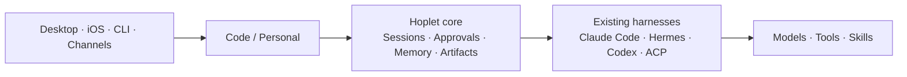

# Hoplet

[简体中文](README.zh-CN.md)

Hoplet is a personal, cross-device shell for AI agents. **Code mode builds products; Personal mode handles chores.** Both modes share one core and can hand work to each other.

> **Status:** the local core and desktop conversation have implementations; M1 closure is in progress. The overview also includes planned capabilities.

## Two modes

| | Code | Personal |
|---|---|---|
| Delivers | Reviewable changes: diffs, checkpoints, PRs | Results: answers, completed work, files |
| Works in | A directory you choose, possibly with several repositories | A companion's workspace and authorized directories |
| Started by | You | You, schedules, messages, events |

Either mode can use a supported harness. Claude Code and Hermes have adapters; Codex and ACP are planned. The design assigns portable growth memory to Hoplet, with reasoning and execution provided by harnesses.

## Architecture overview

- One Go binary currently provides daemon, shim, CLI, and Hermes bridge roles, plus the relay; on Linux, `hoplet daemon install` and `sudo hoplet relay install` set them up as systemd services.
- Shims keep local sessions running across daemon restarts; remote follow-up and approvals are planned.
- Remote access is designed for end-to-end encryption and a byte-forwarding relay.
- The desktop uses MyGo native UI; iOS uses SwiftUI.

## Design map

| Area | Topics |
|---|---|
| [Product and architecture](docs/README.md#总览) | Scope, layers, delivery route |
| [Runtime and communication](docs/README.md#运行与通信) | Processes, data, sync, security, approvals |
| [Agent driving](docs/README.md#agent-驱动) | Shared contracts, native adapters, version management |
| [Workspace and orchestration](docs/README.md#工作区与编排) | Isolation, snapshots, terminals, delegation |
| [Personal and growth](docs/README.md#personal-与成长) | Companions, memory, autonomy, integrations |
| [Clients and delivery](docs/README.md#客户端与交付) | Technology, design system, layouts, quality |

The design documents are in Chinese. Each topic states its current rules independently; the index provides navigation.

## Delivery overview

| Stage | Outcome |
|---|---|
| M1 | Close the local loop: inbox, command palette, file / diff panel, regression gates |
| M2a / M2b | Secure network, then mobile access |
| M3 | Workspace enhancement, independent of the network lane |
| M4a–M4e | Tool bridge and companions; growth, autonomy, channels, cross-host execution by dependency |
| M5a–M5c | New harnesses; writable fan-out needs isolation, mobile preview needs network and ports |

The recommended local path is **M1 → M4a → M4b**. Networking, workspace work, and additional harnesses can progress independently. Stage numbers do not impose one global sequence.

## Contributing

Read [CONTRIBUTING.md](CONTRIBUTING.md) before contributing. Discuss design changes in an issue before writing code. Issues and pull requests may be in English or Chinese.

## License

[Apache License 2.0](LICENSE)
