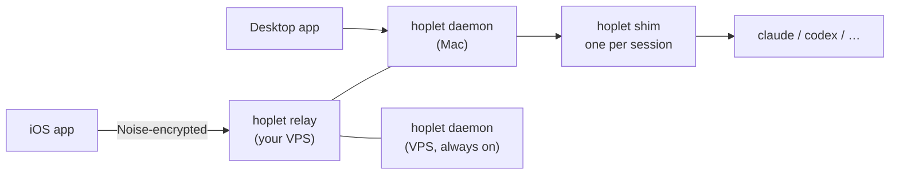

# Hoplet

[简体中文](README.zh-CN.md)

Hoplet is a personal, cross-device shell for AI agents. **Code mode builds products; Personal mode handles chores.** Both modes share one core and can hand work to each other.

> **Status:** design complete, implementation not started. The design docs (in Chinese) live in [`docs/`](docs/README.md).

## Two modes

| | Code mode | Personal mode |
|---|---|---|
| Delivers | A reviewable change: diff, checkpoints, PRs | A result: an answer, a finished task, a file |
| Workspace | A directory you pick, which may hold several git repos | The agent's own workspace plus directories you grant |
| Triggered by | You | You, Telegram, schedules, events (e.g. failing CI) |

Hoplet does not ship its own agent. It drives existing harnesses — Claude Code, Codex, Hermes and others — through their structured protocols, and either mode can use any of them.

## How it fits together

- One Go binary (`hoplet`) runs as daemon, per-session shim, relay and CLI.
- Sessions survive daemon restarts and upgrades; you can follow and approve them from your phone.
- End-to-end encrypted between your devices and your machines; the relay only forwards bytes.
- Desktop app built with [MyGo](https://github.com/egoist/mygo); iOS app in SwiftUI.

## Roadmap

| Milestone | Scope |
|---|---|
| M1 Core loop | Daemon, shim, storage, events; Claude Code and one Personal harness; CLI and minimal desktop |
| M2 Cross-device | Relay, pairing, iOS app, encrypted push, Live Activity |
| M3 Workspace | Checkpoints and rollback, diffs, PRs, isolated mode, ports, terminals |
| M4 Personal | Profile, triggers, Telegram, GitHub chores, budgets |
| M5 Extensions | Codex, generic ACP, fan-out |

## Contributing

Contributions are welcome. Read [CONTRIBUTING.md](CONTRIBUTING.md) first; for anything that changes the design, open an issue to discuss it before writing code. Issues and pull requests may be written in English or Chinese.

## License

[Apache License 2.0](LICENSE)
