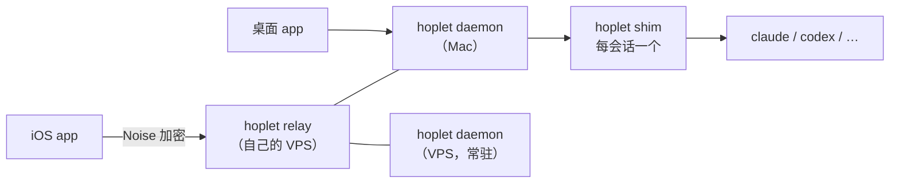

# Hoplet

[English](README.md)

Hoplet 是一个自用的、跨设备的 AI Agent 壳：**Code 模式帮我做产品，Personal 模式帮我处理琐事。** 两种模式共用一个内核，彼此可以转交工作。

> **状态：** 设计已定稿，尚未开始实现。设计文档见 [`docs/`](docs/README.md)。

## 两种模式

| | Code 模式 | Personal 模式 |
|---|---|---|
| 交付物 | 可审阅的变更：diff、检查点、PR | 结果：答案、做完的事、文件 |
| 工作空间 | 我选的目录，里面可以有多个 git 仓库 | 代理人自己的工作区 + 我授权的目录 |
| 触发 | 我 | 我、Telegram、定时、事件（如 CI 失败） |

Hoplet 不自己写 agent，而是通过结构化协议驱动现成的 harness（Claude Code、Codex、Hermes 等），任一模式都可以选用任意 harness。

## 整体结构

- 一个 Go 二进制 `hoplet`，同时承担守护进程、会话 shim、中继和 CLI。
- 守护进程重启、升级不影响会话；手机上可以跟进和审批。
- 设备与机器之间端到端加密，中继只转发字节。
- 桌面端基于 [MyGo](https://github.com/egoist/mygo)，iOS 端使用 SwiftUI。

## 路线图

| 里程碑 | 范围 |
|---|---|
| M1 核心闭环 | 守护进程、shim、存储、事件；Claude Code 与一个 Personal harness；CLI 与最简桌面 |
| M2 跨设备 | 中继、配对、iOS、加密推送、Live Activity |
| M3 工作区 | 检查点与回滚、diff、PR、隔离模式、端口、终端 |
| M4 Personal | 个人档案、触发器、Telegram、GitHub 琐事、预算 |
| M5 扩展 | Codex、通用 ACP、扇出 |

## 参与贡献

欢迎贡献。请先阅读 [CONTRIBUTING.md](CONTRIBUTING.md)；涉及设计变更的改动，请先开 issue 讨论再写代码。issue 和 PR 可以用中文或英文。

## 许可证

[Apache License 2.0](LICENSE)
