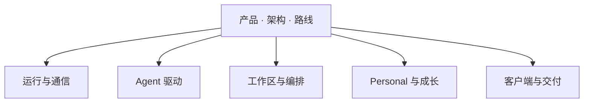

# Hoplet 设计总览与目录

状态：当前设计 · 更新：2026-11-04

Code 交付变更，Personal 交付结果；两种模式共用内核，成长记忆归 Hoplet。目录仅作导航，正文独立维护当前规则，变更直接替换旧表述，待验证项不表示已实现。

## 维护约定

| 项 | 统一规则 |
|---|---|
| 结构 | 范围与现状 → 流程 / 规则 → 验收 → 待验证 |
| 状态 | ✓ 代码已有、◐ 部分实现、○ 目标；不代替实际验收结果 |
| 归属 | 每项详细规则归一个专题，概览仅摘要；重复的存储、验收与入口说明合并到所属能力 |
| 校正 | 已实现行为以代码为准；预留字段、图示与计划不视为已实现 |

## 总览

| 设计 | 范围 |
|---|---|
| [0001 产品边界与模式](design/0001-product-scope.md) | 使用者、模式和交付物 |
| [0015 架构分层](design/0015-architecture.md) | 共享内核、适配、数据和安全边界 |
| [0019 交付路线](design/0019-delivery-roadmap.md) | 阶段、前置能力和验收出口 |

## 运行与通信

| 设计 | 范围 |
|---|---|
| [0002 进程模型与部署](design/0002-process-model.md) | daemon、shim、relay 与重启 |
| [0004 会话数据模型](design/0004-session-data-model.md) | 实体、事件、存储和持久性 |
| [0005 同步协议](design/0005-sync-protocol.md) | 订阅、追赶、快照与背压 |
| [0006 跨设备连接与安全](design/0006-connectivity-security.md) | 配对、加密、路由与本机保护 |
| [0007 命令与审批](design/0007-commands-approvals.md) | 队列、档位、审批与工具授权 |

## Agent 驱动

| 设计 | 范围 |
|---|---|
| [0003 Agent 驱动](design/0003-agent-driving.md) | 统一抽象、事件与启动环境 |
| [0020 Hermes 适配](design/0020-hermes-adapter.md) | gateway、轮次、设置与恢复 |
| [0021 Claude Code 适配](design/0021-claude-adapter.md) | 控制协议、模型探测与事件映射 |
| [0023 Harness 托管与验证](design/0023-harness-lifecycle.md) | 安装、版本门控、自检与录制 |

## 工作区与编排

| 设计 | 范围 |
|---|---|
| [0008 工作区生命周期](design/0008-workspace-lifecycle.md) | 目录、隔离、脚本、检查点与 PR |
| [0022 工作区快照与累计 diff](design/0022-workspace-snapshots.md) | 私有快照、基线、响应与资源上限 |
| [0009 终端](design/0009-terminal.md) | PTY、屏幕与终端输入 |
| [0012 服务入口与编排](design/0012-orchestration-api.md) | 服务入口、等待、扇出与跨机执行 |
| [0025 产物](design/0025-artifacts.md) | 版本、发布、查看、页面能力与授权 |
| [0027 语音通话](design/0027-voice-calls.md) | 语音服务接缝、控制器、生命周期与桌面通话 |

## Personal 与成长

| 设计 | 范围 |
|---|---|
| [0010 Personal 模式](design/0010-personal-mode.md) | 伙伴、交流、事情与转交 |
| [0016 成长记忆](design/0016-growth-memory.md) | 提炼、纠错、版本与跨 harness 使用 |
| [0017 自主运行](design/0017-autonomous-runs.md) | 触发、等待、预算与恢复 |
| [0018 通道与集成](design/0018-channels-integrations.md) | Telegram、GitHub 与 webhook |

## 客户端与交付

| 设计 | 范围 |
|---|---|
| [0011 客户端技术栈](design/0011-client-stack.md) | 桌面、iOS 与协议类型生成 |
| [0014 桌面设计系统](design/0014-desktop-ui.md) | token（生成主题代码）、文字、图标、动效与 MyGO 映射 |
| [0024 桌面布局与交互](design/0024-desktop-layout.md) | 页面、输入、面板与阶段状态 |
| [0026 iOS 界面](design/0026-ios-ui.md) | 页面、手势、颜色、图标与文案 |
| [0013 测试、升级与发布](design/0013-testing-release.md) | 契约、验收、性能与产品发布 |
