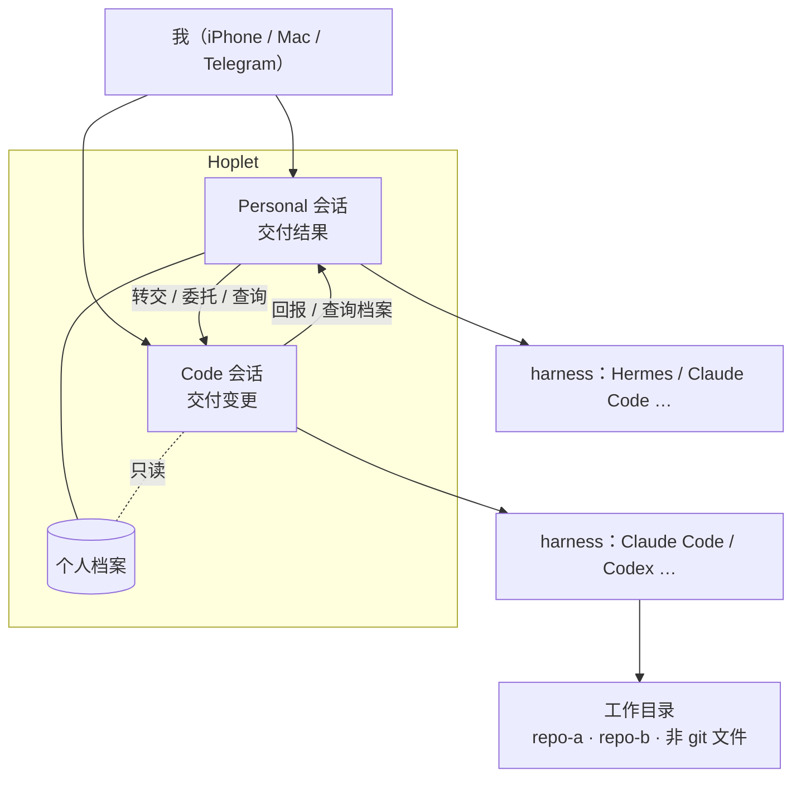
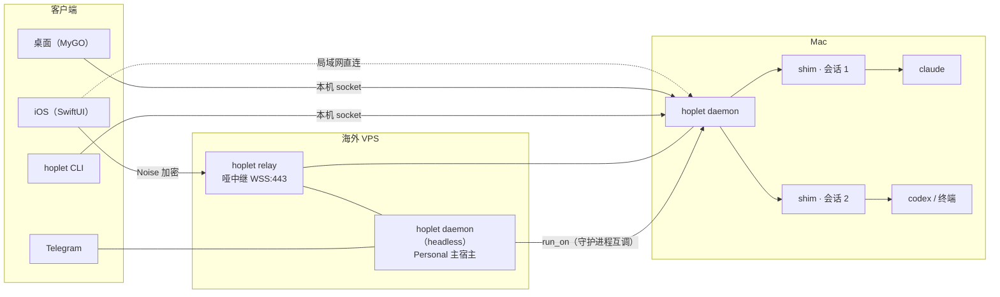

# Hoplet 设计总览

> 一个自用的、跨设备的 Agent 壳：**Code 模式帮我做产品，Personal 模式帮我处理琐事**，两者共用一个内核、彼此互通。

状态：设计已定稿（2026-10-31），尚未开始实现。

## 两种模式

| | Code 模式 | Personal 模式 |
|---|---|---|
| 交付物 | 可审阅的变更：diff、检查点、PR | 结果：答案、做完的事、文件、小脚本 |
| 心态 | 要审、要控、要回溯 | 交代下去，做完告诉我 |
| 工作空间 | 我指定的工作目录（可含多个仓库） | 代理人自己的工作区 + 我授权的目录 |
| 生命周期 | 围绕项目，长期存在 | 围绕一件事；记忆持续积累 |
| 触发 | 主要由我发起 | 我 / Telegram / 定时 / 事件 |

模式不绑定 harness：任何 harness（Claude Code、Codex、Hermes…）都可以跑任一模式。

## 概念模型

## 系统架构

## 设计文档

| 编号 | 主题 | 一句话结论 |
|---|---|---|
| [0001](design/0001-product-scope.md) | 产品边界与模式 | 自用、单人、自有机器；两种模式按交付物区分 |
| [0002](design/0002-process-model.md) | 进程模型与部署 | 单二进制；系统服务托管；每会话一个 shim |
| [0003](design/0003-agent-driving.md) | Agent 驱动 | 全部走结构化协议，各家原生接入 |
| [0004](design/0004-session-data-model.md) | 会话数据模型 | harness 拥有上下文，Hoplet 拥有事件记录 |
| [0005](design/0005-sync-protocol.md) | 同步协议 | 游标追赶 + 快照兜底 + 合批推送 |
| [0006](design/0006-connectivity-security.md) | 跨设备与安全 | 一层 Noise，路由可换；海外中继为主 |
| [0007](design/0007-commands-approvals.md) | 命令与审批 | 权限交给 harness 原生判断，Hoplet 统一模式、转发审批、管自己的工具 |
| [0008](design/0008-workspace-lifecycle.md) | 工作区生命周期 | 以会话为中心、多仓库、默认原地 |
| [0009](design/0009-terminal.md) | 终端 | shim 托管 PTY，Ghostty 模拟器做快照 |
| [0010](design/0010-personal-mode.md) | Personal 模式 | 档案 + 触发器 + Telegram + GitHub 琐事 |
| [0011](design/0011-client-stack.md) | 客户端技术栈 | 桌面 MyGO，iOS SwiftUI，协议类型生成 |
| [0012](design/0012-orchestration-api.md) | 编排与自动化接口 | 一套服务，三个入口，按会话授权 |
| [0013](design/0013-testing-release.md) | 测试、升级与发布 | 契约测试 + 假 harness + 性能预算 |

## 里程碑

每个里程碑合入后都能独立使用。

| 里程碑 | 内容 | 完成后能做什么 |
|---|---|---|
| **M1 核心闭环** | daemon、shim、存储、事件协议；Claude Code 适配 + 一个 Personal harness 适配；会话累计 diff（只读）；会话模式 + 审批转发；CLI + 最简桌面 | 本机跑通两种模式，验证共享内核 |
| **M2 跨设备** | 中继、配对、多路由、iOS、加密推送、Live Activity | 离开电脑用手机驱动 |
| **M3 工作区** | 检查点回滚、三种 diff、PR、隔离模式、端口、终端 | 正式用来做产品 |
| **M4 Personal** | 个人档案、触发器、Telegram、GitHub 琐事、预算护栏、`run_on`、webhook | 代理人主动处理琐事 |
| **M5 扩展** | Codex、通用 ACP、扇出、手机预览端口 | 更多 harness，并行尝试 |

## 术语

| 术语 | 含义 |
|---|---|
| harness | 现成的 agent 程序（Claude Code、Codex、Hermes…），Hoplet 不自己写 |
| 会话 Session | 一段对话 + 选定的 harness + 可选工作目录；一等实体 |
| shim | 每个活跃会话一个的小进程，托管 harness 和终端，守护进程重启不影响它 |
| 主宿主 | 常驻在线、跑 Personal 会话的主机（默认 VPS） |
| 会话模式 | 审批档位（需确认 / 自动编辑 / 智能审批 / 全自动）+ Plan 开关 + Fast 开关 + 思考强度，由适配器映射到各 harness 的原生设置 |
| 底线 | Hoplet 能真正强制执行的少数规则（见 0007） |
