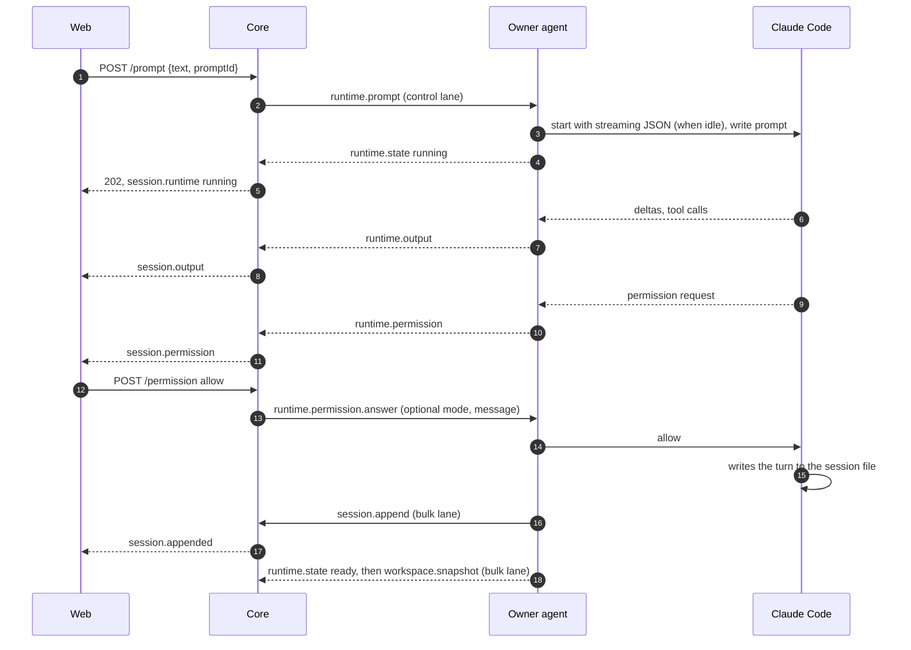
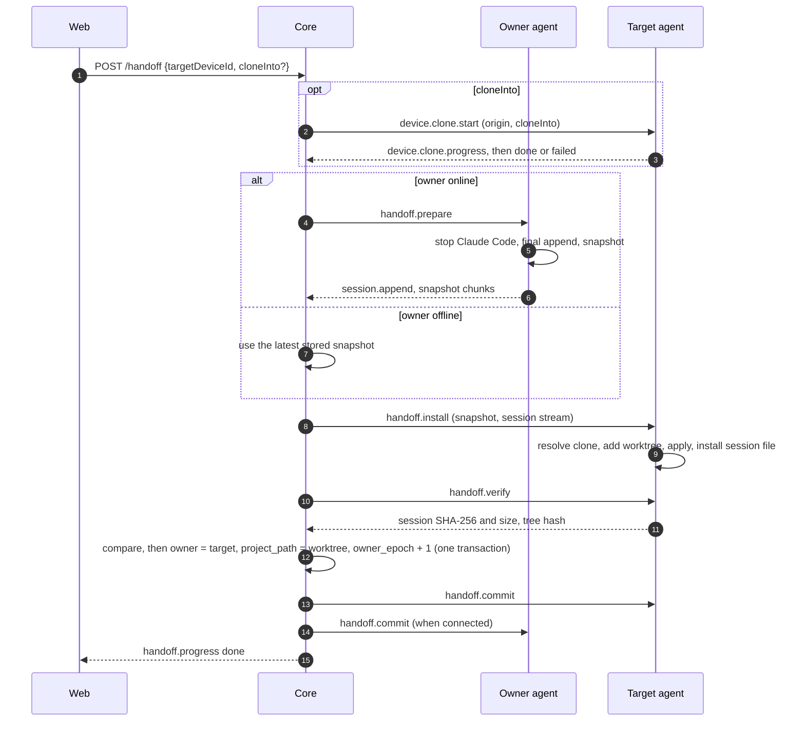

# Hoplet architecture

## Principles

- **Bytes are the record.** The store keeps what Claude Code wrote, verbatim, and its byte count is the
  cursor. Rule: no code in `core/` changes a line before it reaches a chunk file; projection, search and
  rendering read the stored bytes ([ADR 0002](adr/0002-the-byte-offset-is-the-sync-cursor.md)).
- **Clients never hold a whole session.** Every read is a page or a block. Rule: no API returns more than one
  page of lines, and no client code concatenates a session
  ([ADR 0007](adr/0007-reads-elide-large-content-blocks.md)).
- **Control before bulk.** Prompts, permission answers, interrupts, runtime events and handoff steps are never
  queued behind sync batches, search, snapshots or history pages. Rule: every core task and every agent
  message belongs to the control or the bulk class, and each class has its own queue. Control messages stay
  small: a prompt's images are uploaded on the bulk lane first and the prompt names them
  ([ADR 0017](adr/0017-prompt-images-are-uploaded-before-the-prompt.md)).
- **Runtime is transient, the session file is durable.** Rule: runtime events are forwarded and dropped;
  anything that must survive a restart is in the session file, the index or a snapshot
  ([ADR 0008](adr/0008-remote-control-runs-a-hoplet-managed-claude-code-process.md)).
- **One owner, verified moves.** Rule: ownership changes only in the handoff commit, after the target has
  proven its copy ([ADR 0009](adr/0009-handoff-moves-a-workspace-snapshot-into-the-target-clone.md)).
- **The web UI is one client of the API.** A native Mac client follows it on the same API
  ([ADR 0022](adr/0022-the-mac-client-is-native-appkit-with-the-agent-bundled.md)). Rule: anything another
  client must see or the core acts on (queued messages, notification preferences, a session's title or pin)
  lives in the core behind REST or the browser WebSocket; only the view state of one device (scheme, pane
  sizes, folded folders) stays in the client. An API route returns data, not a rendered page, and takes
  the bearer token a native client holds; the contract is `shared/` and the schema generated from it
  (docs/api.md#native-clients).

## Layers

```
browser (web/)            presentation: pages, blocks, live output, control actions
   │  REST + browser WebSocket (host token)
core (core/)              storage, projection, runtime relay, handoff coordination
   │  agent WebSocket (device token): control lane + bulk lane
agent (agent/)            sync, Claude Code processes, workspace, snapshots, installation
   │  files and child processes
Claude Code               the session file (writer) and the running process
```

- The browser layer owns presentation only. It sends intents (prompt, answer, interrupt, hand off) and shows
  state; every rule is enforced in the core.
- The core owns the stored copy of every session, the current runtime state of every session, and the order
  of handoff steps.
- The agent owns everything that touches the development machine: the session files, Claude Code processes,
  the working tree and the clones.

## Components

| Component | Layer | Owns | May call | Code directory |
|---|---|---|---|---|
| config | core | Environment parsing; refuses to start without a host token | log | `core/src/config/` |
| log | core | One JSON object per line on stdout, with redaction | nothing | `core/src/log/` |
| migrations | core | Forward-only schema migrations | nothing | `core/src/migrations/` |
| store | core | SQLite index, chunk files, verbatim append and recovery, paged reads, search scans, devices, snapshots | migrations, log | `core/src/store/` |
| ingest | core | Agent WebSocket: authentication, `device.hello`/`welcome`, append decoding, ack/resync/reject, the two lanes | store, control, log | `core/src/ingest/` |
| notify | core | Notification rules (preset, overrides, quiet hours), redaction, Web Push and webhook delivery, signed action links and their single use, the VAPID and signing secrets | store, control, log | `core/src/notify/` |
| control | core | Runtime state per session, prompt and new-session deduplication, permission routing, handoff state machine, device RPC with timeouts | store, log | `core/src/control/` |
| api | core | REST routes, read projection with one mapping per provider, browser WebSocket and subscriptions, WebSocket tickets, static files | store, control, notify, log, config | `core/src/api/` |
| shared | contract | Schemas, derived types and error codes for REST and both WebSockets | nothing | `shared/src/` |
| web | browser | Token gate, Hoplet screen, API client, live connection, bounded page cache | REST and browser WebSocket only | `web/src/` |
| sync | agent | Agent WebSocket client, the two lanes, cursor reconciliation, append batching | config, provider | `agent/internal/sync/` |
| provider | agent | The `Source`, `Provider` and `Store` interfaces, and one implementation per vendor in `provider/<vendor>/` (`claude`: store discovery, incremental reading, titles, project membership, session-file installation; `codex`: rollout discovery, session ID and directory from the first line, reading a `.jsonl.zst` by decompressing from the start with the cursor counting uncompressed bytes, session-file installation under `sessions/`) | nothing | `agent/internal/provider/` |
| runtime | agent | Process lifecycle, idle stop, `external` detection, and the runtime-driver interface with one driver per vendor in `runtime/<vendor>/` (`claude`: streaming JSON I/O, permissions, interrupt, version check; `codex`: JSON-RPC to `codex app-server`, approvals, steer, interrupt, plan exit, version check) | provider, locate | `agent/internal/runtime/` |
| terminal, ports | agent | The PTY of an opened terminal (process group, limits, credit window, cleanup journal), and the scan for listening TCP ports of processes started from a session's directory | runtime, locate | `agent/internal/terminal/`, `agent/internal/ports/` |
| workspace | agent | Working-tree listing and rooted reads, snapshots, clone resolution, worktree installation, verification | provider, locate | `agent/internal/workspace/` |
| projects, sessions | agent | `projects.json` and its CLI | provider | `agent/internal/projects/`, `agent/internal/sessions/` |
| daemon | agent | Wiring, scan loop, recovery of interrupted installation before connecting | all agent packages | `agent/internal/daemon/` |

## Boundaries

- The web UI never imports `core/`; the core never imports `web/`; `shared/` imports nothing in the
  repository. Enforced by `scripts/boundaries.ts`.
- Core modules import each other only through `index.ts`, in the direction of the Components table. Enforced
  by `scripts/boundaries.ts`.
- A web screen imports from another screen only its `index.tsx` (the cockpit hosts the workspace inspector that
  way), and that holds for stylesheets as for modules; code and styles shared by screens live in `web/src/lib/`
  and `web/src/components/`. The fixtures behind
  `/__states` (`states.tsx`, `fixtures.ts`) are exempt. Enforced by `scripts/boundaries.ts`.
- Only `store` composes paths in the data directory. Enforced by `scripts/boundaries.ts` (no `node:fs` import
  outside `store`, `config` and `api/static`).
- Every `/api/*` request needs the host token, except the two `/api/action/*` routes, which need a signed action token and are rate limited; the browser WebSocket needs a ticket minted with it; the agent
  WebSocket needs a device token, and a host token is refused there. Enforced in `core/src/api/` and
  `core/src/ingest/`, tested in `core/test/auth.test.ts`.
- Every value entering the core or the agent from the network, from disk or from Claude Code is parsed by a
  schema before use. Enforced by the contract test `scripts/test/contract.test.ts` for the wire and by
  review elsewhere.
- Only the vendor parts know a vendor: its paths, file layout, line format, tool names and record kinds
  ([ADR 0015](adr/0015-control-protocol-and-history-source-are-chosen-separately.md)). In the agent that is
  `provider/<vendor>/` and `runtime/<vendor>/`; `daemon` only constructs them. In the core it is
  `api/projection/<vendor>.ts`. Every other package works through the interfaces and the conversation model.
  Enforced by review.
- Only the agent writes on a development machine, and only into: its state root, the Claude Code store during
  handoff installation, and the new worktree. Claude Code processes are started only by `runtime`. Enforced by
  review and the agent tests.

## Extension points

### A REST endpoint

Declare the request and response schemas and error codes in `shared/src/rest/`, add one route entry in
`core/src/api/routes.ts` with its handler, and call it from `web/src/lib/api.ts`. The route table supplies
authentication, body limits, schema validation and error mapping. Name each schema by an export of `shared/`,
list the route in `docs/api.md` and run `pnpm schema`; `pnpm check` fails while the document or
`docs/schema/hoplet-api.schema.json` differs from the route table and `shared/`.

### A wire message

Declare it in `shared/src/wire/` with its lane and mirror it in `agent/internal/sync/protocol.go` in the same
pull request; `scripts/test/contract.test.ts` compares both. Handle it in `core/src/ingest/` (sync) or
`core/src/control/` (everything else). A message the browser sends or receives is also listed in `docs/api.md`,
and `pnpm schema` regenerates its schema.

### A provider

A vendor chooses its control protocol and its history source separately
([ADR 0015](adr/0015-control-protocol-and-history-source-are-chosen-separately.md)).

**Control** is a runtime driver in `agent/internal/runtime/<vendor>/` that declares its capabilities, or the
generic ACP driver configured with the vendor's command.

**History** is one of three levels. At level 0 the vendor is configuration for the generic ACP provider and
mapping: only sessions Hoplet starts exist, and there is no handoff. At level 1 the vendor has an agent
provider in `agent/internal/provider/<vendor>/` that implements `provider.Provider` and a core mapping in
`core/src/api/projection/<vendor>.ts` onto the conversation model, which also classifies the vendor's tools into
tool kinds; sessions started in a terminal appear. At level 2 the provider also implements `provider.Store`,
and handoff installs the session file. The provider declares `discovery` and `handoff`, and the web UI shows
only the controls declared.

A vendor above level 0 is added as in [ADR 0012](adr/0012-vendors-plug-in-behind-provider-interfaces.md): the
`provider` value is added to the schema in `shared/`, and `daemon` constructs the provider and the driver. The
web UI, the store and the wire protocol do not change. A vendor starts with a spike that verifies its session
store and control mode; a level-0 vendor's spike verifies that its command speaks ACP. The generic ACP driver,
provider and mapping are built with the first ACP vendor.

A new session gets its ID in one of two ways, and `runtime.start` answers with it either way. By default the
manager mints a UUID and passes it to the driver as `StartSpec.SessionID` (Claude Code's `--session-id`). A driver
whose vendor assigns the ID itself and cannot be told one implements `runtime.IDAssigner`: the manager calls
`StartNew` without an ID, the driver creates the session and returns the vendor's ID with the process, and the
manager keys the session by it. Such a session does not exist for the manager until `StartNew` returns, and a
failed start leaves nothing behind.

The agent runs one manager per vendor (Claude Code, Codex), each with its own driver, idle cap and locator that
looks only in its vendor's store. A command for an existing session goes to the manager that holds the session,
else to the one whose vendor's store has its file; `runtime.start` goes to the manager of its `provider`.

Provider configurations ([ADR 0028](adr/0028-provider-configurations-live-on-the-machine.md)) refine this: the
agent runs one manager per configuration (`agent/internal/configs` reads `providers.json`, the built-ins first), each
with a driver built from the configuration's command, environment and defaults. `runtime.start` and
`handoff.install` carry an optional `configuration` ID (default: the vendor's built-in); a disabled or unknown one
is refused with `configuration-unavailable`. A command for an existing session goes to the configuration recorded
for it in `sessions-config.json`, else to the vendor's built-in. A configuration that changes keeps its running
sessions on the old process; a disabled one only stops new starts and resumes. `device.hello` carries each
`ProviderInfo.configuration` (id, name, extends, enabled, the names of the variables and whether each is set,
defaults, never a value or the command's content), and the agent sends `device.providers` again when the file
changes. The agent accepts `device.providers.update` (name, enabled, defaults only) and answers a refused one with
`device.providers.rejected`; the core logs the refusal.

The Codex driver (`runtime/codex/`, [ADR 0027](adr/0027-codex-runs-on-its-app-server-and-enters-at-level-2.md))
starts one `codex app-server` per controlled session and speaks newline-delimited JSON-RPC to it over stdio with
the experimental API: `thread/start` (it implements `IDAssigner`) or `thread/resume` with `excludeTurns`,
`turn/start` for a prompt (images as `localImage` files under `<hoplet_home>/codex-images/`), `turn/steer` with
the running turn's ID (a new turn when none runs) and `turn/interrupt`. `item/commandExecution/requestApproval`
and `item/fileChange/requestApproval` become permission requests answered accept or decline; the message of a
refusal is steered into the turn that is still running. The settings are `mode`, `model`, `effort` and
`collaboration`, all applied at the next turn as `turn/start` overrides, and `thread/settings/updated` reports
a change made in Codex. `mode` sets the approval policy, the sandbox and the approvals reviewer together:

| `mode` | approval policy | sandbox | reviewer |
|---|---|---|---|
| `read-only` | on-request | read-only | user |
| `workspace-write` (default) | on-request | workspace-write | user |
| `auto-review` | on-request | workspace-write | auto-review |
| `full-access` | never | none | user |

When a turn in `plan` collaboration completes with a plan item, the driver raises a `planExit` permission
request: approving it starts a turn in `default` collaboration with the chosen mode (never `full-access`), a
refusal with a message starts a turn that stays in plan mode. Only the codex-cli versions in `TestedVersions`
(`runtime/codex/versions.go`) run; any other is refused with an error that names the supported versions, and
`device.hello` announces no version for it. The `effort` options are the union of the efforts of all models, and
the driver leaves out an effort the chosen model does not support.

### A runtime capability

A new control is a `runtime.*` message, a capability name, an implementation in each runtime driver that
supports it, and a control shown with the runtime state when the capability is declared. Drivers and vendor
versions without it do not declare it.

### A session setting

A setting (the model, Thinking, Fast) is a config option in the driver's `Config()`, shaped as ACP's
(`select` or `boolean`, [ADR 0018](adr/0018-session-settings-are-config-options.md)): the driver gives each
option an `id`, a `category`, a default and when a change applies (at once, before the next turn, or by restart).
Nothing else changes: `device.hello` announces it in `capabilities.config`, `runtime.start` carries values in
`config`, `runtime.config` sets one on a session (`POST /api/sessions/:id/config`), the agent reports the
session's values in the `capabilities.config` of `runtime.state`, and the web UI renders the list generically.

### A message while a turn runs

The core holds a session's queue ([ADR 0020](adr/0020-queued-and-steered-messages.md)) and sends its head with
`runtime.prompt` once the session is idle or ready, so the agent and the driver know nothing of the queue. A
driver that can take a message into a running turn declares `steer`; `runtime.steer` carries the message, the agent
answers `runtime.steered` or `runtime.rejected`, and the driver writes it to the process. `session.queue` tells
browsers to read the queue again.

### A plan the vendor asks to leave

A driver whose vendor has a plan step sets `planExit` on the permission request it emits
([ADR 0019](adr/0019-a-plan-exit-is-declared-by-the-driver.md)): the plan as Markdown, the select setting
(`option`) that approval switches, the `modes` it may switch to and the `default`, and `freshContext` when the vendor
can approve the plan into a new session ([ADR 0025](adr/0025-a-plan-can-be-approved-into-a-new-session.md)). It
answers `Verdict.Mode` (an approval) or `Verdict.Message` (a refusal that tells the model what to change). The core, the web UI and the
wire protocol change nothing else: the plan card renders the declaration, and the mode names come from the
setting's config option.

**A plan approved into a new session.** `POST /api/sessions/:id/permission/fresh` is one core call, so every client
reuses it. Control checks that the request is an open plan request of the session from its owner, that
`planExit.freshContext` is set, that the mode is one of `planExit.modes` and that the owner is online. It then starts the
new session through the path of a new session (`runtime.start` to the owner, the project of the session, the same
provider, config `{ [planExit.option]: mode }`, a first prompt of a framing line, the plan and its plan file path). Only
when the start succeeds does it record the continuation in `session_continuations`, answer the plan request in the old
session with a refusal ("This plan is being implemented in a new session.") and interrupt the old session's turn. If the
plan was answered elsewhere during the start, the link is recorded and the refusal skipped. If the start fails nothing
changes and the plan waits. The wire protocol is unchanged apart from the optional `freshContext`.

### A notification channel

A channel is a function in `core/src/notify/` that takes the `NotifyPayload` and returns a delivery result
(`NotifyDeliverySchema`), plus its name in `NOTIFY_CHANNELS` in `shared/src/rest/notify.ts` so the preferences can
choose it. `notify` subscribes to control's event stream (`control.onEvent`: `permission`, `turn-done`,
`failure`), decides the channels from the preferences and sends on each apart from the event, with a timeout and
one retry. The `native` channel is the `notify` browser message to a connected client. A channel never decides
what to send; the rules do. A channel that carries action links tells the user that they decide through the same
path as `POST /api/sessions/:id/permission`.

### An inspector tool on the owner machine

The Terminal and Browser tabs ([ADR 0026](adr/0026-the-inspector-opens-a-restricted-terminal-and-links-dev-servers.md))
are wire messages on the control lane and an agent package each; the web UI renders them as inspector tabs and the
Mac client reuses them.

**A terminal.** `agent/internal/terminal/` owns the PTY and its shell's process group. `control` opens one with
`terminal.open` only when the agent announced `capabilities.terminal` (the agent's `terminal` setting), the session's
runtime state is not `running`, `waiting-permission` or `external`, and no handoff of the session runs; the agent
checks the same against its runtime manager. Input, output, resize, acknowledgments and close are
`terminal.*` messages on the control lane. Output is limited to 4 KiB frames under a 64 KiB credit window that the
core replenishes with `terminal.ack` once the browser connection took the bytes, so the PTY, not the lane, absorbs a
flood and a prompt queued behind terminal output waits for at most 64 KiB. The core relays between the agent and
the browser WebSocket connections attached to the terminal (`core/src/control/terminals.ts`; REST opens it, `terminal.attach` joins it) and keeps no terminal content beyond a 64 KiB replay ring in memory for a connection that attaches again; the core closes a terminal no connection is attached to after 60 seconds. Anything that starts a turn, starts a handoff or
deletes the session first sends `terminal.close`; the agent also closes on its own runtime's first turn and when
its connection to the core ends.

**Ports.** `control` sends `ports.watch` with the sessions that have a subscribed browser; `agent/internal/ports/`
scans the listening TCP sockets of the agent's user every 3 seconds for those sessions, keeps those held by a process
whose directory is inside the session's directory or that descends from the session's process or terminal, and
reports changes, at most once a second per session, as `session.ports` (port, address class, process name). The agent announces its `preview_host` in `device.hello`. The core forwards it to subscribed browsers
and holds it in memory only. No dev server traffic is read, proxied or stored.

**Resources.** `agent/internal/resources/` takes one reading every 15 seconds and sends it as `device.resources` on the
control lane: the whole machine's CPU, memory used and total, free and total bytes of the volume that holds the
browse root, and for each session with a process Hoplet started (its Claude Code or Codex process, its terminal's
shell) the CPU, resident memory and descendant count summed over that process tree, at most 64 sessions, the largest
in memory first. One process listing serves the machine and the sessions: `/proc` on Linux; on macOS one
`ps -A -o pid=,ppid=,rss=,pcpu=`, `sysctl -n hw.memsize` and `vm_stat`, where memory used is the total minus the
free, inactive and speculative pages. CPU figures are percent of the whole machine and, on Linux, differences
between two readings, so the first one carries none (null). Only numbers and session IDs leave the machine: never a
process name, command line or process ID. On any other system no sampler runs. A reading taken while the core is away is dropped, never queued. The core keeps the
last 240 readings of each machine, and the readings of each of its sessions within the same window (at most 64
sessions), in memory (`core/src/control/resources.ts`), outliving the connection and not
the process, and stores nothing.

### A storage migration

Add `core/src/migrations/<NNNN>-<name>.ts` and register it in `core/src/migrations/index.ts`. Migrations run
forward only, at startup (docs/hosting.md#upgrades).

## Contracts

### Wire protocol

Defined in `shared/src/wire/` and mirrored in Go in `agent/internal/sync/protocol.go`; both change in the
same pull request, and `scripts/test/contract.test.ts` compares them. `device.hello` carries
`PROTOCOL_VERSION`; the core refuses an agent with a different version. Every message belongs to the control
or the bulk lane (docs/architecture.md#principles). The sync cursor is the server's per-session byte count
(`byte_size`), equal to the device file offset ([ADR 0002](adr/0002-the-byte-offset-is-the-sync-cursor.md)).

Deleting a session ([ADR 0023](adr/0023-deleting-a-session-and-what-hoplet-made-for-it.md)) uses control-lane
messages that name the session by ID and never a path: `device.session.inspect|inspected|rejected`,
`device.session.delete|deleted` and `device.session.forget|forgotten`. A deleted ID is a tombstone in the core;
`session.append` and a resync of it are answered with `session.rejected` reason `deleted`, and the core sends
`device.session.forget` for the tombstones of a device when it connects. `handoff.install` carries the session's `provider` and an optional `configuration`, and the target installs the session file in that vendor's store and records the vendor with the installation, so verify and rollback use the same store. `handoff.installed` carries `clone`, the
clone the new worktree belongs to, which the core keeps in `session_worktrees`.

A handoff to a machine with no clone of the repository adds a clone step before the owner is touched
([ADR 0024](adr/0024-a-handoff-clones-the-repository-on-a-target-that-has-none.md)). The protocol version is 12.
The control-lane messages are `device.clone.check` (`requestId`, `origin`, optional `cloneInto`) answered by
`device.clone.checked` (`reason`, `detail`, the proposed `cloneInto`), and `device.clone.start` (`requestId`,
`handoffId`, `origin`, `cloneInto`) answered by `device.clone.progress` (`received`, optional `total`, at most four
a second) and then `device.clone.done` (`path`) or `device.clone.failed` (`reason`, `detail`).
`device.clone.cancel` ends a running clone, which answers `device.clone.failed` with reason `cancelled`. The agent
handles each in its own goroutine, so a clone never blocks the control lane. The clone has 600 s in all and 60 s
without progress. The agent journals the clone in `<state>/handoff/<handoffId>.clone.json` and removes a
half-made destination on start-up. Git runs with only the `https` and `ssh` protocols, no prompt, no hooks and
no credentials in the origin it keeps; its output is cut at 2 KiB.

### Session chunk files

`<data>/sessions/<sessionId>/c-<seq>.ndjson` holds at most 500 raw JSONL lines. A full chunk is compressed
after the index commit through `c-<seq>.ndjson.gz.tmp` and an atomic rename to `c-<seq>.ndjson.gz`. Recorded
uncommitted appends are rolled back before cursors are served; reads prefer the plaintext file when both
exist. `byte_size` counts the appended bytes exactly.

### Workspace snapshots

`<data>/snapshots/<sessionId>/<snapshotId>.tar.gz` contains `snapshot.json` (base commit, `origin` URL,
created time, the session's directory relative to the repository root, and the git tree hash of the working
tree), `tracked.diff` (binary git diff against the base commit), `untracked/` (untracked files that are not
ignored, with their modes) and `commits.bundle` when `HEAD` has commits that no remote-tracking branch of
`origin` contains ([ADR
0009](adr/0009-handoff-moves-a-workspace-snapshot-into-the-target-clone.md)). The entries are validated
before anything is written: names are relative and never reach `.git`, links stay inside the worktree, and
the sizes are bounded as the bytes are read.

## Data flow

**A session grows.** Scan → imported session longer than its cursor → read to the last complete line →
`session.append` (it names the source's `provider`) on the bulk lane → ingest checks owner and offset → store appends, syncs, commits →
`session.ack` → `session.appended` to browsers → the open conversation fetches the new lines.

**An agent connects.** `device.hello` → `welcome` with every owned session's cursor and `owner_epoch` → the
agent reports `runtime.state` for every process it runs → control rebuilds runtime state → sync resumes from
the cursors.

**A session starts.** `POST /api/sessions` → control checks the announced capabilities and the device's watched
projects (`device.projects.list`) → `runtime.start` (with the `config` values) on the control lane → the agent starts Claude Code with a new
session ID, writes the prompt, waits for the session file, imports the session into `projects.json` →
`runtime.started` → the response carries the session ID. The core records the started session when the answer
arrives, before the caller continues, and the agent reports its states again right behind the answer, so the first
turn is `running` while the store has no owner for the session yet; what the device said before the answer, when
the session had no name, is dropped. The next scan syncs the file and the session joins the index.

**A browser opens a session.** Token gate → `GET /api/sessions` → select → `GET /api/sessions/:id/lines?start=-80`
→ store reads the touched chunks → api projects large blocks → render → browser WebSocket `subscribe` →
live `session.output` and `session.appended`.

**A prompt runs.**



**A session moves.**



## Data and privacy

Session content lives in the chunk files and snapshots under the server's data directory, in the Claude Code
store and working trees on the development machines, and transiently in the memory of the core and the
browser. The browser stores the host token in `localStorage`. Traffic flows only between the user's machines
and the user's server. The core calls outside services only to deliver notifications the user asked for, to the push services of their subscribed browsers and to their webhook URLs; neither it nor the agent collects telemetry. Export is a
copy of the data directory; erase is deleting it and each agent's state root (docs/hosting.md#uninstall).

## Evolution

What comes next, version by version, is in `docs/roadmap.md`; why the architecture is the way it is, in `docs/adr/`.
