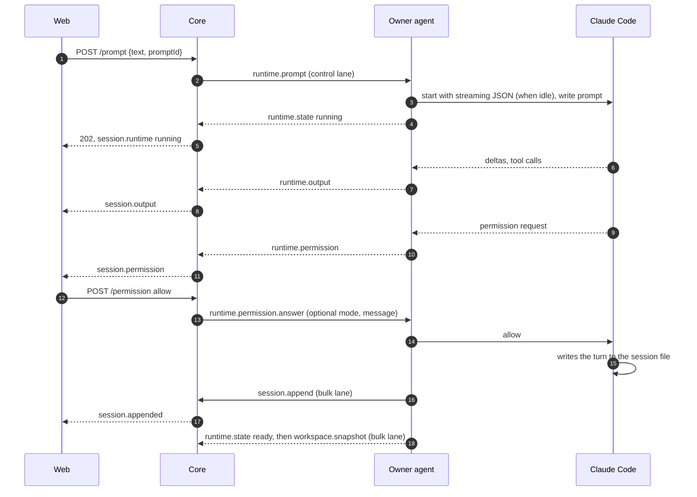
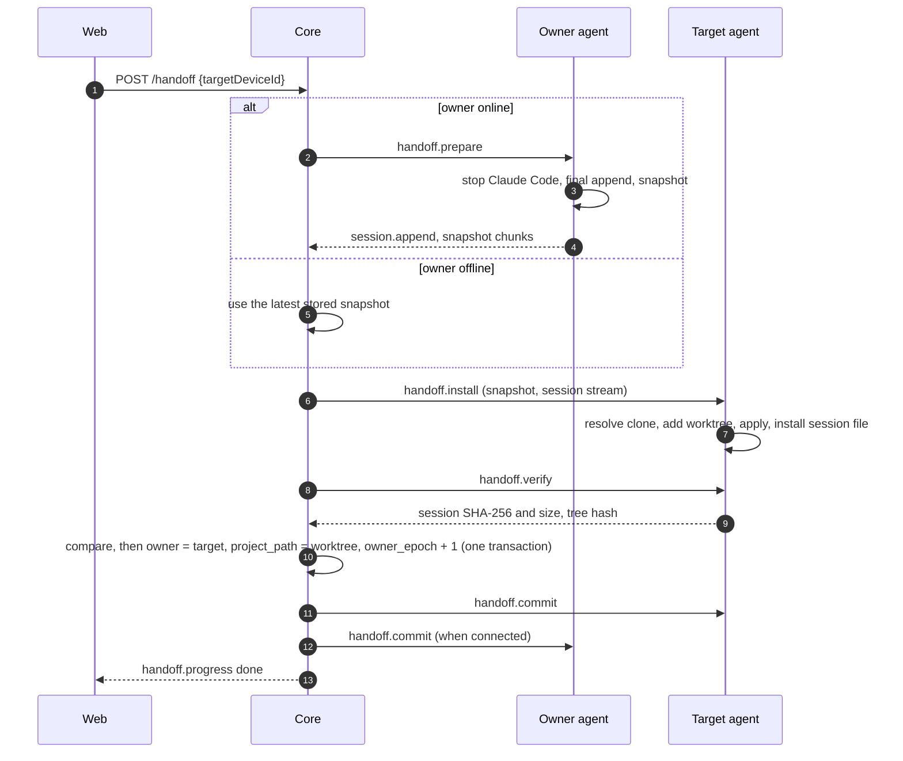

# Hoplet architecture

## Principles

- **Bytes are the record.** The store keeps what Claude Code wrote, verbatim, and its byte count is the
  cursor. Rule: no code in `core/` changes a line before it reaches a chunk file; projection, search and
  rendering read the stored bytes ([ADR 0002](adr/0002-the-byte-offset-is-the-sync-cursor.md)).
- **Clients never hold a whole session.** Every read is a page or a block. Rule: no API returns more than one
  page of lines, and no client code concatenates a session
  ([ADR 0007](adr/0007-reads-elide-large-content-blocks.md)).
- **Control before bulk.** Prompts, permission answers, interrupts, runtime events and handoff steps are never
  queued behind sync batches, search, snapshots or history pages. Rule: every core task and every agent
  message belongs to the control or the bulk class, and each class has its own queue. Control messages stay
  small: a prompt's images are uploaded on the bulk lane first and the prompt names them
  ([ADR 0017](adr/0017-prompt-images-are-uploaded-before-the-prompt.md)).
- **Runtime is transient, the session file is durable.** Rule: runtime events are forwarded and dropped;
  anything that must survive a restart is in the session file, the index or a snapshot
  ([ADR 0008](adr/0008-remote-control-runs-a-hoplet-managed-claude-code-process.md)).
- **One owner, verified moves.** Rule: ownership changes only in the handoff commit, after the target has
  proven its copy ([ADR 0009](adr/0009-handoff-moves-a-workspace-snapshot-into-the-target-clone.md)).
- **The web UI is one client of the API.** A native Mac client follows it on the same API
  ([ADR 0022](adr/0022-the-mac-client-is-native-appkit-with-the-agent-bundled.md)). Rule: anything another
  client must see or the core acts on (queued messages, notification preferences, a session's title or pin)
  lives in the core behind REST or the browser WebSocket; only the view state of one device (scheme, pane
  sizes, folded folders) stays in the client. An API route returns data, not a rendered page, and takes
  the bearer token a native client holds; the contract is `shared/` and the schema generated from it
  (docs/api.md#native-clients).

## Layers

```
browser (web/)            presentation: pages, blocks, live output, control actions
   │  REST + browser WebSocket (host token)
core (core/)              storage, projection, runtime relay, handoff coordination
   │  agent WebSocket (device token): control lane + bulk lane
agent (agent/)            sync, Claude Code processes, workspace, snapshots, installation
   │  files and child processes
Claude Code               the session file (writer) and the running process
```

- The browser layer owns presentation only. It sends intents (prompt, answer, interrupt, hand off) and shows
  state; every rule is enforced in the core.
- The core owns the stored copy of every session, the current runtime state of every session, and the order
  of handoff steps.
- The agent owns everything that touches the development machine: the session files, Claude Code processes,
  the working tree and the clones.

## Components

| Component | Layer | Owns | May call | Code directory |
|---|---|---|---|---|
| config | core | Environment parsing; refuses to start without a host token | log | `core/src/config/` |
| log | core | One JSON object per line on stdout, with redaction | nothing | `core/src/log/` |
| migrations | core | Forward-only schema migrations | nothing | `core/src/migrations/` |
| store | core | SQLite index, chunk files, verbatim append and recovery, paged reads, search scans, devices, snapshots | migrations, log | `core/src/store/` |
| ingest | core | Agent WebSocket: authentication, `device.hello`/`welcome`, append decoding, ack/resync/reject, the two lanes | store, control, log | `core/src/ingest/` |
| notify | core | Notification rules (preset, overrides, quiet hours), redaction, Web Push and webhook delivery, signed action links and their single use, the VAPID and signing secrets | store, control, log | `core/src/notify/` |
| control | core | Runtime state per session, prompt and new-session deduplication, permission routing, handoff state machine, device RPC with timeouts | store, log | `core/src/control/` |
| api | core | REST routes, read projection with one mapping per provider, browser WebSocket and subscriptions, WebSocket tickets, static files | store, control, notify, log, config | `core/src/api/` |
| shared | contract | Schemas, derived types and error codes for REST and both WebSockets | nothing | `shared/src/` |
| web | browser | Token gate, Hoplet screen, API client, live connection, bounded page cache | REST and browser WebSocket only | `web/src/` |
| sync | agent | Agent WebSocket client, the two lanes, cursor reconciliation, append batching | config, provider | `agent/internal/sync/` |
| provider | agent | The `Source`, `Provider` and `Store` interfaces, and one implementation per vendor in `provider/<vendor>/` (`claude`: store discovery, incremental reading, titles, project membership, session-file installation) | nothing | `agent/internal/provider/` |
| runtime | agent | Process lifecycle, idle stop, `external` detection, and the runtime-driver interface with one driver per vendor in `runtime/<vendor>/` (`claude`: streaming JSON I/O, permissions, interrupt, version check) | provider, locate | `agent/internal/runtime/` |
| workspace | agent | Working-tree listing and rooted reads, snapshots, clone resolution, worktree installation, verification | provider, locate | `agent/internal/workspace/` |
| projects, sessions | agent | `projects.json` and its CLI | provider | `agent/internal/projects/`, `agent/internal/sessions/` |
| daemon | agent | Wiring, scan loop, recovery of interrupted installation before connecting | all agent packages | `agent/internal/daemon/` |

## Boundaries

- The web UI never imports `core/`; the core never imports `web/`; `shared/` imports nothing in the
  repository. Enforced by `scripts/boundaries.ts`.
- Core modules import each other only through `index.ts`, in the direction of the Components table. Enforced
  by `scripts/boundaries.ts`.
- Only `store` composes paths in the data directory. Enforced by `scripts/boundaries.ts` (no `node:fs` import
  outside `store`, `config` and `api/static`).
- Every `/api/*` request needs the host token, except the two `/api/action/*` routes, which need a signed action token and are rate limited; the browser WebSocket needs a ticket minted with it; the agent
  WebSocket needs a device token, and a host token is refused there. Enforced in `core/src/api/` and
  `core/src/ingest/`, tested in `core/test/auth.test.ts`.
- Every value entering the core or the agent from the network, from disk or from Claude Code is parsed by a
  schema before use. Enforced by the contract test `scripts/test/contract.test.ts` for the wire and by
  review elsewhere.
- Only the vendor parts know a vendor: its paths, file layout, line format, tool names and record kinds
  ([ADR 0015](adr/0015-control-protocol-and-history-source-are-chosen-separately.md)). In the agent that is
  `provider/<vendor>/` and `runtime/<vendor>/`; `daemon` only constructs them. In the core it is
  `api/projection/<vendor>.ts`. Every other package works through the interfaces and the conversation model.
  Enforced by review.
- Only the agent writes on a development machine, and only into: its state root, the Claude Code store during
  handoff installation, and the new worktree. Claude Code processes are started only by `runtime`. Enforced by
  review and the agent tests.

## Extension points

### A REST endpoint

Declare the request and response schemas and error codes in `shared/src/rest/`, add one route entry in
`core/src/api/routes.ts` with its handler, and call it from `web/src/lib/api.ts`. The route table supplies
authentication, body limits, schema validation and error mapping. Name each schema by an export of `shared/`,
list the route in `docs/api.md` and run `pnpm schema`; `pnpm check` fails while the document or
`docs/schema/hoplet-api.schema.json` differs from the route table and `shared/`.

### A wire message

Declare it in `shared/src/wire/` with its lane and mirror it in `agent/internal/sync/protocol.go` in the same
pull request; `scripts/test/contract.test.ts` compares both. Handle it in `core/src/ingest/` (sync) or
`core/src/control/` (everything else). A message the browser sends or receives is also listed in `docs/api.md`,
and `pnpm schema` regenerates its schema.

### A provider

A vendor chooses its control protocol and its history source separately
([ADR 0015](adr/0015-control-protocol-and-history-source-are-chosen-separately.md)).

**Control** is a runtime driver in `agent/internal/runtime/<vendor>/` that declares its capabilities, or the
generic ACP driver configured with the vendor's command.

**History** is one of three levels. At level 0 the vendor is configuration for the generic ACP provider and
mapping: only sessions Hoplet starts exist, and there is no handoff. At level 1 the vendor has an agent
provider in `agent/internal/provider/<vendor>/` that implements `provider.Provider` and a core mapping in
`core/src/api/projection/<vendor>.ts` onto the conversation model, which also classifies the vendor's tools into
tool kinds; sessions started in a terminal appear. At level 2 the provider also implements `provider.Store`,
and handoff installs the session file. The provider declares `discovery` and `handoff`, and the web UI shows
only the controls declared.

A vendor above level 0 is added as in [ADR 0012](adr/0012-vendors-plug-in-behind-provider-interfaces.md): the
`provider` value is added to the schema in `shared/`, and `daemon` constructs the provider and the driver. The
web UI, the store and the wire protocol do not change. A vendor starts with a spike that verifies its session
store and control mode; a level-0 vendor's spike verifies that its command speaks ACP. The generic ACP driver,
provider and mapping are built with the first ACP vendor.

### A runtime capability

A new control is a `runtime.*` message, a capability name, an implementation in each runtime driver that
supports it, and a control shown with the runtime state when the capability is declared. Drivers and vendor
versions without it do not declare it.

### A session setting

A setting (the model, Thinking, Fast) is a config option in the driver's `Config()`, shaped as ACP's
(`select` or `boolean`, [ADR 0018](adr/0018-session-settings-are-config-options.md)): the driver gives each
option an `id`, a `category`, a default and when a change applies (at once, before the next turn, or by restart).
Nothing else changes: `device.hello` announces it in `capabilities.config`, `runtime.start` carries values in
`config`, `runtime.config` sets one on a session (`POST /api/sessions/:id/config`), the agent reports the
session's values in the `capabilities.config` of `runtime.state`, and the web UI renders the list generically.

### A message while a turn runs

The core holds a session's queue ([ADR 0020](adr/0020-queued-and-steered-messages.md)) and sends its head with
`runtime.prompt` once the session is idle or ready, so the agent and the driver know nothing of the queue. A
driver that can take a message into a running turn declares `steer`; `runtime.steer` carries the message, the agent
answers `runtime.steered` or `runtime.rejected`, and the driver writes it to the process. `session.queue` tells
browsers to read the queue again.

### A plan the vendor asks to leave

A driver whose vendor has a plan step sets `planExit` on the permission request it emits
([ADR 0019](adr/0019-a-plan-exit-is-declared-by-the-driver.md)): the plan as Markdown, the select setting
(`option`) that approval switches, the `modes` it may switch to and the `default`. It answers `Verdict.Mode` (an
approval) or `Verdict.Message` (a refusal that tells the model what to change). The core, the web UI and the
wire protocol change nothing else: the plan card renders the declaration, and the mode names come from the
setting's config option.

### A notification channel

A channel is a function in `core/src/notify/` that takes the `NotifyPayload` and returns a delivery result
(`NotifyDeliverySchema`), plus its name in `NOTIFY_CHANNELS` in `shared/src/rest/notify.ts` so the preferences can
choose it. `notify` subscribes to control's event stream (`control.onEvent`: `permission`, `turn-done`,
`failure`), decides the channels from the preferences and sends on each apart from the event, with a timeout and
one retry. The `native` channel is the `notify` browser message to a connected client. A channel never decides
what to send; the rules do. A channel that carries action links tells the user that they decide through the same
path as `POST /api/sessions/:id/permission`.

### A storage migration

Add `core/src/migrations/<NNNN>-<name>.ts` and register it in `core/src/migrations/index.ts`. Migrations run
forward only, at startup (docs/hosting.md#upgrades).

## Contracts

### Wire protocol

Defined in `shared/src/wire/` and mirrored in Go in `agent/internal/sync/protocol.go`; both change in the
same pull request, and `scripts/test/contract.test.ts` compares them. `device.hello` carries
`PROTOCOL_VERSION`; the core refuses an agent with a different version. Every message belongs to the control
or the bulk lane (docs/architecture.md#principles). The sync cursor is the server's per-session byte count
(`byte_size`), equal to the device file offset ([ADR 0002](adr/0002-the-byte-offset-is-the-sync-cursor.md)).

Deleting a session ([ADR 0023](adr/0023-deleting-a-session-and-what-hoplet-made-for-it.md)) uses control-lane
messages that name the session by ID and never a path: `device.session.inspect|inspected|rejected`,
`device.session.delete|deleted` and `device.session.forget|forgotten`. A deleted ID is a tombstone in the core;
`session.append` and a resync of it are answered with `session.rejected` reason `deleted`, and the core sends
`device.session.forget` for the tombstones of a device when it connects. `handoff.installed` carries `clone`, the
clone the new worktree belongs to, which the core keeps in `session_worktrees`.

### Session chunk files

`<data>/sessions/<sessionId>/c-<seq>.ndjson` holds at most 500 raw JSONL lines. A full chunk is compressed
after the index commit through `c-<seq>.ndjson.gz.tmp` and an atomic rename to `c-<seq>.ndjson.gz`. Recorded
uncommitted appends are rolled back before cursors are served; reads prefer the plaintext file when both
exist. `byte_size` counts the appended bytes exactly.

### Workspace snapshots

`<data>/snapshots/<sessionId>/<snapshotId>.tar.gz` contains `snapshot.json` (base commit, `origin` URL,
created time, the session's directory relative to the repository root, and the git tree hash of the working
tree), `tracked.diff` (binary git diff against the base commit), `untracked/` (untracked files that are not
ignored, with their modes) and `commits.bundle` when `HEAD` has commits that no remote-tracking branch of
`origin` contains ([ADR
0009](adr/0009-handoff-moves-a-workspace-snapshot-into-the-target-clone.md)). The entries are validated
before anything is written: names are relative and never reach `.git`, links stay inside the worktree, and
the sizes are bounded as the bytes are read.

## Data flow

**A session grows.** Scan → imported session longer than its cursor → read to the last complete line →
`session.append` on the bulk lane → ingest checks owner and offset → store appends, syncs, commits →
`session.ack` → `session.appended` to browsers → the open conversation fetches the new lines.

**An agent connects.** `device.hello` → `welcome` with every owned session's cursor and `owner_epoch` → the
agent reports `runtime.state` for every process it runs → control rebuilds runtime state → sync resumes from
the cursors.

**A session starts.** `POST /api/sessions` → control checks the announced capabilities and the device's watched
projects (`device.projects.list`) → `runtime.start` (with the `config` values) on the control lane → the agent starts Claude Code with a new
session ID, writes the prompt, waits for the session file, imports the session into `projects.json` →
`runtime.started` → the response carries the session ID → the agent reports `runtime.state` again, the next
scan syncs the file and the session joins the index.

**A browser opens a session.** Token gate → `GET /api/sessions` → select → `GET /api/sessions/:id/lines?start=-80`
→ store reads the touched chunks → api projects large blocks → render → browser WebSocket `subscribe` →
live `session.output` and `session.appended`.

**A prompt runs.**



**A session moves.**



## Data and privacy

Session content lives in the chunk files and snapshots under the server's data directory, in the Claude Code
store and working trees on the development machines, and transiently in the memory of the core and the
browser. The browser stores the host token in `localStorage`. Traffic flows only between the user's machines
and the user's server. The core calls outside services only to deliver notifications the user asked for, to the push services of their subscribed browsers and to their webhook URLs; neither it nor the agent collects telemetry. Export is a
copy of the data directory; erase is deleting it and each agent's state root (docs/hosting.md#uninstall).

## Evolution

What comes next, version by version, is in `docs/roadmap.md`; why the architecture is the way it is, in `docs/adr/`.
