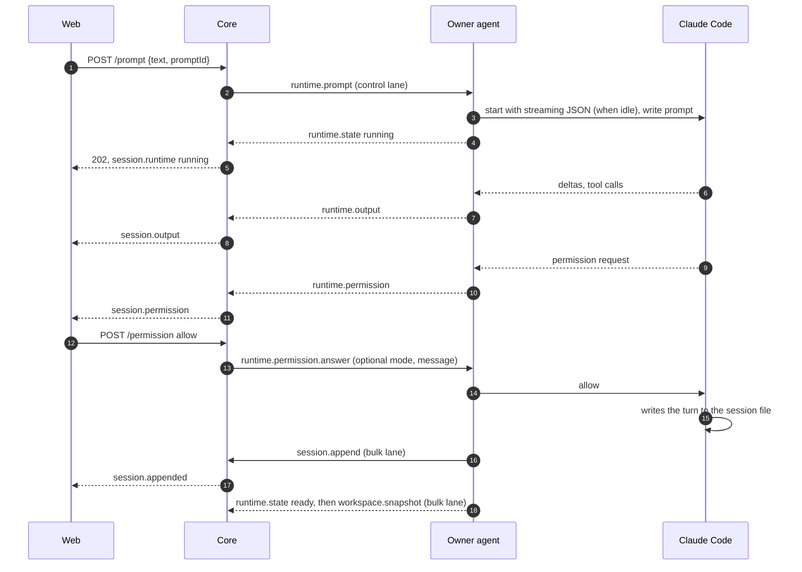
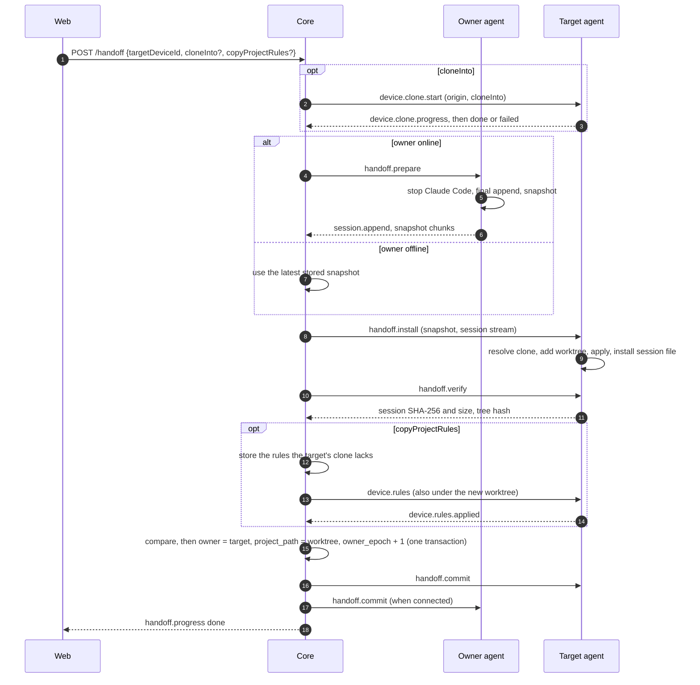

# Hoplet architecture

## Principles

- **Bytes are the record.** The store keeps what Claude Code wrote, verbatim, and its byte count is the
  cursor. Rule: no code in `core/` changes a line before it reaches a chunk file; projection, search and
  rendering read the stored bytes ([ADR 0002](adr/0002-the-byte-offset-is-the-sync-cursor.md)).
- **Clients never hold a whole session.** Every read is a page or a block. Rule: no API returns more than one
  page of lines, and no client code concatenates a session
  ([ADR 0007](adr/0007-reads-elide-large-content-blocks.md)).
- **Control before bulk.** Prompts, permission answers, interrupts, runtime events and handoff steps are never
  queued behind sync batches, search, snapshots or history pages. Rule: every core task and every agent
  message belongs to the control or the bulk class, and each class has its own queue. Control messages stay
  small: a prompt's images are uploaded on the bulk lane first and the prompt names them
  ([ADR 0017](adr/0017-prompt-images-are-uploaded-before-the-prompt.md)).
- **Runtime is transient, the session file is durable.** Rule: runtime events are forwarded and dropped;
  anything that must survive a restart is in the session file, the index or a snapshot
  ([ADR 0008](adr/0008-remote-control-runs-a-hoplet-managed-claude-code-process.md)).
- **One owner, verified moves.** Rule: ownership changes only in the handoff commit, after the target has
  proven its copy ([ADR 0009](adr/0009-handoff-moves-a-workspace-snapshot-into-the-target-clone.md)).
- **The web UI is one client of the API.** A native Mac client follows it on the same API
  ([ADR 0022](adr/0022-the-mac-client-is-native-appkit-with-the-agent-bundled.md)). Rule: anything another
  client must see or the core acts on (queued messages, notification preferences, a session's title or pin)
  lives in the core behind REST or the browser WebSocket; only the view state of one device (scheme, pane
  sizes, folded folders) stays in the client. An API route returns data, not a rendered page, and takes
  the bearer token a native client holds; the contract is `shared/` and the schema generated from it
  (docs/api.md#native-clients).

## Layers

```
browser (web/)            presentation: pages, blocks, live output, control actions
   │  REST + browser WebSocket (host token)
core (core/)              storage, projection, runtime relay, handoff coordination
   │  agent WebSocket (device token): control lane + bulk lane
agent (agent/)            sync, Claude Code processes, workspace, snapshots, installation
   │  files and child processes
Claude Code               the session file (writer) and the running process
```

- The browser layer owns presentation only. It sends intents (prompt, answer, interrupt, hand off) and shows
  state; every rule is enforced in the core.
- The core owns the stored copy of every session, the current runtime state of every session, and the order
  of handoff steps.
- The agent owns everything that touches the development machine: the session files, Claude Code processes,
  the working tree and the clones.

## Components

| Component | Layer | Owns | May call | Code directory |
|---|---|---|---|---|
| config | core | Environment parsing; refuses to start without a host token | log | `core/src/config/` |
| scrub | core | The credential patterns and the functions that mask them, shared by the log, notifications, the audit log and the Markdown export | nothing | `core/src/scrub/` |
| log | core | One JSON object per line on stdout, with redaction | scrub | `core/src/log/` |
| migrations | core | Forward-only schema migrations | nothing | `core/src/migrations/` |
| store | core | SQLite index, chunk files, verbatim append and recovery, paged reads, search scans, devices, snapshots, the audit log | migrations, log, scrub | `core/src/store/` |
| ingest | core | Agent WebSocket: authentication, `device.hello`/`welcome`, append decoding, ack/resync/reject, the two lanes | store, control, log | `core/src/ingest/` |
| notify | core | Notification rules (preset, overrides, quiet hours), redaction, Web Push and webhook delivery, signed action links and their single use, the VAPID and signing secrets | store, control, log, scrub | `core/src/notify/` |
| hooks | core | Lifecycle events from control's event stream (ADR 0031), the webhook hooks, HMAC signing, the address check, the persisted delivery queue with retry and backoff, the delivery history, the hook secrets, the script hooks the agents announced (their switch, the `hook.event` sent to the machine and the `hook.result` recorded) | store, control, notify, log, scrub | `core/src/hooks/` |
| control | core | Runtime state per session, prompt and new-session deduplication, permission routing, handoff state machine, the limits of trees of work and the tree watcher that stops sessions past them ([ADR 0035](adr/0035-child-sessions-work-on-parts-of-a-task-in-parallel.md)), the content check of a session's change requests ([ADR 0036](adr/0036-sessions-change-their-own-configuration-over-mcp.md)), device RPC with timeouts | store, log, scrub | `core/src/control/` |
| api | core | REST routes, read projection with one mapping per provider, browser WebSocket and subscriptions, WebSocket tickets, the Markdown export of a session, static files | store, control, notify, hooks, log, config, scrub | `core/src/api/` |
| shared | contract | Schemas, derived types and error codes for REST and both WebSockets | nothing | `shared/src/` |
| sdk | client | `@hoplet/sdk`: the typed client for scripts and tools: REST calls with errors mapped to the stable codes, paged `readSession`, `waitForTurn`, the event stream with ticket and reconnect, the protocol-version check; `shared/` is bundled into its build ([ADR 0033](adr/0033-a-command-line-tool-an-sdk-and-scoped-tokens.md)) | `shared/`, global `fetch` and `WebSocket` | `sdk/src/` |
| cli | client | `@hoplet/cli`, the `hoplet` command: sessions, `new`, `attach`, `send`, `wait` with exit codes per result, `--json` output, and the host-token commands (interrupt, handoff, devices, audit, tokens); credentials from the environment or a file, nothing stored ([ADR 0033](adr/0033-a-command-line-tool-an-sdk-and-scoped-tokens.md)) | `sdk/`, `node:*` | `cli/src/` |
| web | browser | Token gate, Hoplet screen, API client, live connection, bounded page cache | REST and browser WebSocket only | `web/src/` |
| sync | agent | Agent WebSocket client, the two lanes, cursor reconciliation, append batching | config, provider | `agent/internal/sync/` |
| provider | agent | The `Source`, `Provider` and `Store` interfaces, and one implementation per vendor in `provider/<vendor>/` (`claude`: store discovery, incremental reading, titles, project membership, session-file installation; `codex`: rollout discovery, session ID and directory from the first line, reading a `.jsonl.zst` by decompressing from the start with the cursor counting uncompressed bytes, session-file installation under `sessions/`) | nothing | `agent/internal/provider/` |
| runtime | agent | Process lifecycle, idle stop, `external` detection, and the runtime-driver interface with one driver per vendor in `runtime/<vendor>/` (`claude`: streaming JSON I/O, permissions, the PreToolUse hook callback that checks each tool call against the rules, interrupt, version check; `codex`: JSON-RPC to `codex app-server`, approvals, the PreToolUse command hook (`hoplet-agent hook codex`, which asks the daemon over the local socket `hook.sock`, [ADR 0032](adr/0032-codex-rule-hook-calls-the-agent-over-a-local-socket.md)), steer, interrupt, plan exit, version check) | provider, locate, rules | `agent/internal/runtime/` |
| mcp, localsock | agent | The `hoplet-agent mcp` stdio MCP server (JSON-RPC 2.0) with the read tools, the daemon side that holds the session tokens in memory and calls the core's REST API, and the shared local Unix socket listener (directory 0700, socket 0600, peer user ID, nonce) that `hook.sock` and `mcp.sock` use | config, sync | `agent/internal/mcp/`, `agent/internal/localsock/` |
| terminal, ports | agent | The PTY of an opened terminal (process group, limits, credit window, cleanup journal), and the scan for listening TCP ports of processes started from a session's directory | runtime, locate | `agent/internal/terminal/`, `agent/internal/ports/` |
| workspace | agent | Working-tree listing and rooted reads, snapshots, clone resolution, worktree installation, verification | provider, locate | `agent/internal/workspace/` |
| projects, sessions | agent | `projects.json` and its CLI | provider | `agent/internal/projects/`, `agent/internal/sessions/` |
| rules | agent | the permission decision for a tool call: rule model, shell parsing, path and domain matching, precedence, built-in defaults, the compiled-in floor, mappers from provider hook input ([ADR 0029](adr/0029-permission-rules-match-on-the-agent-and-deny-wins.md)) | none (standard library only) | `agent/internal/rules/` |
| daemon | agent | Wiring, scan loop, recovery of interrupted installation before connecting | all agent packages | `agent/internal/daemon/` |

## Boundaries

- The web UI never imports `core/`; the core never imports `web/`; `shared/` imports nothing in the
  repository. Enforced by `scripts/boundaries.ts`.
- `sdk/` imports only `shared/` and itself (no `node:*`, no `core/`, `web/` or `agent/`), and only the command-line
  tool imports `sdk/`. Enforced by `scripts/boundaries.ts`.
- `cli/` imports only `@hoplet/sdk`, `node:*` and itself; nothing outside `cli/` and `scripts/` imports it (the
  audit test of the core imports its offline verifier as an independent check). Enforced by
  `scripts/boundaries.ts`.
- Core modules import each other only through `index.ts`, in the direction of the Components table. Enforced
  by `scripts/boundaries.ts`.
- A web screen imports from another screen only its `index.tsx` (the cockpit hosts the workspace inspector that
  way), and that holds for stylesheets as for modules; code and styles shared by screens live in `web/src/lib/`
  and `web/src/components/`. The fixtures behind
  `/__states` (`states.tsx`, `fixtures.ts`) are exempt. Enforced by `scripts/boundaries.ts`.
- Only `store` composes paths in the data directory. Enforced by `scripts/boundaries.ts` (no `node:fs` import
  outside `store`, `config` and `api/static`).
- A session token (ADR 0034) is a principal of kind `token` whose grant is read from the session's
  settings on every request, never stored; it reaches only routes marked for sessions, and a prompt or interrupt
  from it passes the guard in `core/src/control/` (itself, mode rank, chain, limits) before it is sent. Tested in
  `core/test/session-mcp.test.ts`.
- Every `/api/*` request needs the host token, except the two `/api/action/*` routes, which need a signed action token and are rate limited; the browser WebSocket needs a ticket minted with it; the agent
  WebSocket needs a device token, and a host token is refused there. Enforced in `core/src/api/` and
  `core/src/ingest/`, tested in `core/test/auth.test.ts`.
- Every value entering the core or the agent from the network, from disk or from Claude Code is parsed by a
  schema before use. Enforced by the contract test `scripts/test/contract.test.ts` for the wire and by
  review elsewhere.
- Only the vendor parts know a vendor: its paths, file layout, line format, tool names and record kinds
  ([ADR 0015](adr/0015-control-protocol-and-history-source-are-chosen-separately.md)). In the agent that is
  `provider/<vendor>/` and `runtime/<vendor>/`; `daemon` only constructs them. In the core it is
  `api/projection/<vendor>.ts`. Every other package works through the interfaces and the conversation model.
  Enforced by review.
- Only the agent writes on a development machine, and only into: its state root, the Claude Code store during
  handoff installation, and the new worktree. Claude Code processes are started only by `runtime`. Enforced by
  review and the agent tests.

## Extension points

### A REST endpoint

Declare the request and response schemas and error codes in `shared/src/rest/`, add one route entry in
`core/src/api/routes.ts` with its handler, and call it from `web/src/lib/api.ts`. The route table supplies
authentication, body limits, schema validation and error mapping. Name each schema by an export of `shared/`,
list the route in `docs/api.md` and run `pnpm schema`; `pnpm check` fails while the document or
`docs/schema/hoplet-api.schema.json` differs from the route table and `shared/`.

### A wire message

Declare it in `shared/src/wire/` with its lane and mirror it in `agent/internal/sync/protocol.go` in the same
pull request; `scripts/test/contract.test.ts` compares both. Handle it in `core/src/ingest/` (sync) or
`core/src/control/` (everything else). A message the browser sends or receives is also listed in `docs/api.md`,
and `pnpm schema` regenerates its schema.

### A provider

A vendor chooses its control protocol and its history source separately
([ADR 0015](adr/0015-control-protocol-and-history-source-are-chosen-separately.md)).

**Control** is a runtime driver in `agent/internal/runtime/<vendor>/` that declares its capabilities, or the
generic ACP driver configured with the vendor's command.

**History** is one of three levels. At level 0 the vendor is configuration for the generic ACP provider and
mapping: only sessions Hoplet starts exist, and there is no handoff. At level 1 the vendor has an agent
provider in `agent/internal/provider/<vendor>/` that implements `provider.Provider` and a core mapping in
`core/src/api/projection/<vendor>.ts` onto the conversation model, which also classifies the vendor's tools into
tool kinds; sessions started in a terminal appear. At level 2 the provider also implements `provider.Store`,
and handoff installs the session file. The provider declares `discovery` and `handoff`, and the web UI shows
only the controls declared.

A vendor above level 0 is added as in [ADR 0012](adr/0012-vendors-plug-in-behind-provider-interfaces.md): the
`provider` value is added to the schema in `shared/`, and `daemon` constructs the provider and the driver. The
web UI, the store and the wire protocol do not change. A vendor starts with a spike that verifies its session
store and control mode; a level-0 vendor's spike verifies that its command speaks ACP. The generic ACP driver,
provider and mapping are built with the first ACP vendor.

A new session gets its ID in one of two ways, and `runtime.start` answers with it either way. By default the
manager mints a UUID and passes it to the driver as `StartSpec.SessionID` (Claude Code's `--session-id`). A driver
whose vendor assigns the ID itself and cannot be told one implements `runtime.IDAssigner`: the manager calls
`StartNew` without an ID, the driver creates the session and returns the vendor's ID with the process, and the
manager keys the session by it. Such a session does not exist for the manager until `StartNew` returns, and a
failed start leaves nothing behind.

The agent runs one manager per vendor (Claude Code, Codex), each with its own driver, idle cap and locator that
looks only in its vendor's store. A command for an existing session goes to the manager that holds the session,
else to the one whose vendor's store has its file; `runtime.start` goes to the manager of its `provider`.

Provider configurations ([ADR 0028](adr/0028-provider-configurations-live-on-the-machine.md)) refine this: the
agent runs one manager per configuration (`agent/internal/configs` reads `providers.json`, the built-ins first), each
with a driver built from the configuration's command, environment and defaults. `runtime.start` and
`handoff.install` carry an optional `configuration` ID (default: the vendor's built-in); a disabled or unknown one
is refused with `configuration-unavailable`. A command for an existing session goes to the configuration recorded
for it in `sessions-config.json`, else to the vendor's built-in. A configuration that changes keeps its running
sessions on the old process; a disabled one only stops new starts and resumes. `device.hello` carries each
`ProviderInfo.configuration` (id, name, extends, enabled, the names of the variables and whether each is set,
defaults, never a value or the command's content), and the agent sends `device.providers` again when the file
changes. The agent accepts `device.providers.update` (name, enabled, defaults only) and answers a refused one with
`device.providers.rejected`. The core relays the update for `POST /api/devices/:deviceId/providers` on the control lane,
checks `defaults` against the options the configuration's driver declares (ADR 0018) before it sends, and answers
with the list of the agent's `device.providers` reply (or the refusal). An agent drops a session's entry from
`sessions-config.json` when the session is removed or deleted. Each `session.append` carries the session's
`configuration` ID (absent for the vendor's built-in); the core keeps the latest one per session, and a handoff sets
it to the configuration the target was asked to install for. The session in the REST API names it from the owner
device's providers, by its ID while that device is offline.

The Codex driver (`runtime/codex/`, [ADR 0027](adr/0027-codex-runs-on-its-app-server-and-enters-at-level-2.md))
starts one `codex app-server` per controlled session and speaks newline-delimited JSON-RPC to it over stdio with
the experimental API: `thread/start` (it implements `IDAssigner`) or `thread/resume` with `excludeTurns`,
`turn/start` for a prompt (images as `localImage` files under `<hoplet_home>/codex-images/`), `turn/steer` with
the running turn's ID (a new turn when none runs) and `turn/interrupt`. `item/commandExecution/requestApproval`
and `item/fileChange/requestApproval` become permission requests answered accept or decline; the message of a
refusal is steered into the turn that is still running. The settings are `mode`, `model`, `effort` and
`collaboration`, all applied at the next turn as `turn/start` overrides, and `thread/settings/updated` reports
a change made in Codex. `mode` sets the approval policy, the sandbox and the approvals reviewer together:

| `mode` | approval policy | sandbox | reviewer |
|---|---|---|---|
| `read-only` | on-request | read-only | user |
| `workspace-write` (default) | on-request | workspace-write | user |
| `auto-review` | on-request | workspace-write | auto-review |
| `full-access` | never | none | user |

When a turn in `plan` collaboration completes with a plan item, the driver raises a `planExit` permission
request: approving it starts a turn in `default` collaboration with the chosen mode (never `full-access`), a
refusal with a message starts a turn that stays in plan mode. Only the codex-cli versions in `TestedVersions`
(`runtime/codex/versions.go`) run; any other is refused with an error that names the supported versions, and
`device.hello` announces no version for it. The `effort` options are the union of the efforts of all models, and
the driver leaves out an effort the chosen model does not support.

The permission rules reach Codex through a `PreToolUse` command hook ([ADR 0032](adr/0032-codex-rule-hook-calls-the-agent-over-a-local-socket.md)).
`thread/start` and `thread/resume` carry it in `config` with the absolute path of the agent binary (`hoplet-agent hook codex`),
the matcher `.*`, a 900 s timeout and `bypass_hook_trust`. The daemon listens on `<hoplet_home>/hook.sock` and gives
each Codex process a random nonce (256 bits) in `HOPLET_HOOK_SOCK` and `HOPLET_HOOK_NONCE`; the hook sends the nonce
with the input (at most 1 MiB), the daemon takes the session from the nonce, evaluates the rules (`rules.FromCodexHook`
maps the tool call) and answers. Codex supports only `deny` from a hook, so the hook prints a deny with a reason and
prints nothing for an `allow` or an approval, which leaves the call to Codex's approval policy; the daemon remembers
the approved tool call for ten minutes and accepts Codex's own approval request for the same item without asking
again. An `ask` is raised as a permission request (`hook:<n>`) and holds the hook open until the user answers; a
rule decision emits `runtime.permission.auto` as in Claude Code. In `plan` collaboration an `allow` is not
remembered and Codex decides. Every error and an unknown nonce deny; an `ask` nobody answers is a deny at 860 s and
the hook prints a deny at 870 s, before Codex's 900 s timeout, after which Codex runs the call. Where
the socket cannot be opened (Windows, a path over 100 bytes) the driver declares `capabilities.rules: "prompts-only"`.

### Trees of work

A child is a session started by another session; the relation is recorded when it starts, in `session_children`, as the
creation chain (the last entry is the parent, the first the root) and lasts as long as the session. Provenance, the
chain behind a session's latest prompt, serves `loop-limit` and the sender label, not the tree. `control/tree.ts` reads it (parent, children, descendants, members of a tree) and
`control/session-mcp.ts` applies the limits of a start with `guardStart` (depth, live children, live sessions per
tree, starts an hour, `pause` budgets, tree tokens). `control/tree-watcher.ts` looks every 30 seconds, with an
injectable timer: a child past its time limit (`session_children`, set when a session starts it) and every live session
of a tree past its tokens are interrupted, stopped and audited as `child.limit`. The API adds `parentId` and
`childCount` to the session metadata, the descendants route and `cascade` on stop; it does not own the relation.

A parent reads its children over four session-callable routes (`api/children.ts` holds the pure parts: the child
state, the last report, the file list, the fit into 8 KiB). The state is derived from the runtime, except what the
core did to a child: `session_children.ended` holds `timed-out` (the tree watcher) or `cancelled` (a cancel) and
wins. Waiting is polling: `wait_children` in the agent asks the status route every 2 seconds for at most 50 seconds,
so nothing is held in the core and no wire message is added. The report preamble and the worktree default
are applied by `control/start.ts` before `runtime.start`, so the agent needs no knowledge of them; the same module
gives the new child its narrow session MCP settings (`inheritSettings`).

### Configuration reads of a session

The core asks the owner of a session for one page of its configuration with `session.config.read` (control lane;
`kind` `list`, `memory`, `skill` or `command`, `scope`, optional `name` and `offset`), which the agent answers with
`session.config` (bulk lane, at most 32 KiB of text) or `session.config.rejected` (control lane, `code`
`unsupported`, `invalid` or `io`). The `control` module waits for the answer like a workspace read. The agent
package `configfiles` opens the scope's directory as a root, maps a kind and name to a path itself, refuses a symbolic
link, a file over 1 MiB, a NUL byte and invalid UTF-8, and cuts a page on a character boundary. One reading logic
serves the MCP tools and the later reads of the web UI. `get_config` needs no agent: it reads the capabilities the
runtime reported.

### Configuration changes of a session

The `control` module `config-changes` keeps a session's requests to change its own configuration in `config_changes`
([ADR 0036](adr/0036-sessions-change-their-own-configuration-over-mcp.md)). The files go through the `ConfigFiles` port
(`preview`, `apply`); `control/config-files.ts` implements it by asking the owner's agent with
`runtime.config.preview` and `runtime.config.apply` ([Configuration writes on the wire](#configuration-writes-on-the-wire)),
and a test may pass its own. The objects are a closed set of kinds and names, so the core never sees a path. Approval
sets the options through `runtime.config`, then writes the files; when the files fail, the options are put back. Undo
is an apply with `restore`, files first and then the options. Expiry and the 30-day pruning of `previous` run on the core's clock.
The browser is told with `session.change` (ids and state). Each stored object carries `takesEffect`, computed when the
request is made by `configTakesEffect` in `shared/`: `next-turn` for an option, `next-start` for the memory file, and
for a skill or command `now` only where the vendor rescans them while it runs. No driver reports a rescan, so the
module passes no reload and every file is `next-start`; the wire has no capability for it.

The session's MCP tools `propose_config_change`, `propose_memory_change` and `propose_skill_change` (package
`agent/internal/mcp`) build the request from their arguments, check the names, hashes, sizes and reason before the core
is asked, and post it with the session's token; `get_change` reads it back. They return the change's ID, its state
and each object's `kind`, `name` and `takesEffect`, never the content or the diff. The propose tools are not read
tools, so the hook does not allow them and the vendor asks the user; `mcp.sock` takes a request of up to 160 KiB, the
route's body limit, so a proposal of 64 KiB fits after JSON escaping.

A request becomes a file in the agent package `configfiles` (the `Writer`), and nowhere else. It maps a kind and a name
to a path below the session's working directory: `memory:project` to the file Claude Code reads (an existing `CLAUDE.md`,
else `.claude/CLAUDE.md`, else an `AGENTS.md` that no `CLAUDE.local.md` here and no memory file above shadows unless one
imports it, else a new `CLAUDE.md`), `skill:<name>` to `.claude/skills/<name>/SKILL.md` and `command:<name>` to
`.claude/commands/<name>.md`. For Codex `memory:project` is `AGENTS.md` (refused `unsupported` beside an
`AGENTS.override.md`, which Codex may read instead), `skill:<name>` is `.agents/skills/<name>/SKILL.md`, and a command
is refused `unsupported`. It opens the working directory with `os.OpenRoot`, refuses a symbolic link or a
non-regular file on the way, runs the content check on the new text (a skill or command may set only `name` and
`description` in its front matter and holds no `` !` `` or ```` ```! ```` shell form; a new `@` import stays inside the
working directory, off the floor's files and off symbolic links), and writes each file to a temporary file in the same
directory that is renamed over it, keeping its mode (0644 for a new file, 0755 for a new directory). An apply checks
every hash before it writes and restores what it wrote when a later object fails, so a change set lands whole or not at
all; applies are serialized in the agent. Skills and commands are written only while the driver reports a vendor
version it was tested with. A Codex skill must set `name` and `description`, and a Codex `AGENTS.md` larger than
32 KiB is `too-large`.

### Session MCP tools

With `session_mcp` on, the agent offers a running session the tools that see other sessions
([ADR 0034](adr/0034-sessions-view-and-direct-other-sessions-over-mcp.md)). A runtime driver that declares the
internal capability `mcp` (not a wire flag; the Claude and Codex drivers) gets `StartSpec.MCP`: the command (`hoplet-agent`),
the arguments (`mcp`), the nonce and the environment `HOPLET_MCP_SOCK` (`<hoplet_home>/mcp.sock`) and
`HOPLET_MCP_NONCE`. The Claude driver writes `<hoplet_home>/mcp/<nonce>.json` (mode 0600 in a directory 0700) and
starts the process with `--mcp-config <path>` and without `--strict-mcp-config`; the file is removed and the nonce
unregistered when the process ends or fails to start. The Codex driver writes no file: it adds
`mcp_servers.hoplet = {command, args, env}` to the `config` of `thread/start` and `thread/resume` (beside the rule
hook), so the nonce travels in that JSON-RPC request and not on a command line. Codex names a new thread itself, so
the manager asks for the spec before the ID exists and the driver calls `MCPSpec.Bind` with the thread ID once it
has one; the nonce is registered then. `hoplet-agent mcp` holds no token: it sends each call to the
daemon over `mcp.sock` with the nonce, and the daemon takes the session from the nonce, ignores any session ID the
caller states, and calls the core's REST API with the session's `hpt_` token. The daemon asks for that token the
first time the session needs it with `runtime.mcp.token.request` and keeps the answer, `runtime.mcp.token`, in
memory until it expires or the core answers 401. The core answers only a device that announced
`capabilities.sessionMcp` in `device.hello` and owns the session. The read tools are `list_machines`, `list_sessions` and
`read_session` (a page of lines by cursor, at most 100 lines and 32 KiB a call, a long entry cut, the result marked
as data and passed through the scrubber), and `get_config`, `list_skills`, `read_skill` and `read_memory`, which read
the session's own options, skills, commands and memory file through the `session.config.read` request, and
`get_change`, the state of the session's own configuration change; a refusal reaches the model as a code, never the request. In Claude Code and Codex
they are `mcp__hoplet__<tool>`, match as `mcp:hoplet/<tool>` in the rules, and the Claude and Codex hooks allow the read
tools when no rule decided. `send_prompt` (queued through `POST /api/sessions/:id/queue`), `interrupt_session` and `start_session`
(`POST /api/sessions`, with the new session's chain recorded in `session_provenance`)
act on another session: the hook does not allow them, so the vendor asks the user, and the core checks the grant,
the target's mode, the chain and the limits again. The hook does not allow `propose_config_change`,
`propose_memory_change` and `propose_skill_change` either (see Configuration changes of a session). The core sets `source` on the `runtime.prompt` it sends for such a
message, and the target's agent puts the fixed line naming the sender before the text; `runtime.start` carries the same `source`, and the new session's first prompt gets the line. A parent also has `wait_children` and `read_child_diff` (read tools: they change nothing and reach only its own children) and `collect_child` and `cancel_child` (the hook does not allow them either); see Trees of work.

### A runtime capability

A new control is a `runtime.*` message, a capability name, an implementation in each runtime driver that
supports it, and a control shown with the runtime state when the capability is declared. Drivers and vendor
versions without it do not declare it.

### A session setting

A setting (the model, Thinking, Fast) is a config option in the driver's `Config()`, shaped as ACP's
(`select` or `boolean`, [ADR 0018](adr/0018-session-settings-are-config-options.md)): the driver gives each
option an `id`, a `category`, a default and when a change applies (at once, before the next turn, or by restart).
Nothing else changes: `device.hello` announces it in `capabilities.config`, `runtime.start` carries values in
`config`, `runtime.config` sets one on a session (`POST /api/sessions/:id/config`), the agent reports the
session's values in the `capabilities.config` of `runtime.state`, and the web UI renders the list generically.

### A message while a turn runs

The core holds a session's queue ([ADR 0020](adr/0020-queued-and-steered-messages.md)) and sends its head with
`runtime.prompt` once the session is idle or ready, so the agent and the driver know nothing of the queue. A
driver that can take a message into a running turn declares `steer`; `runtime.steer` carries the message, the agent
answers `runtime.steered` or `runtime.rejected`, and the driver writes it to the process. `session.queue` tells
browsers to read the queue again.

### A plan the vendor asks to leave

A driver whose vendor has a plan step sets `planExit` on the permission request it emits
([ADR 0019](adr/0019-a-plan-exit-is-declared-by-the-driver.md)): the plan as Markdown, the select setting
(`option`) that approval switches, the `modes` it may switch to and the `default`, and `freshContext` when the vendor
can approve the plan into a new session ([ADR 0025](adr/0025-a-plan-can-be-approved-into-a-new-session.md)). It
answers `Verdict.Mode` (an approval) or `Verdict.Message` (a refusal that tells the model what to change). The core, the web UI and the
wire protocol change nothing else: the plan card renders the declaration, and the mode names come from the
setting's config option.

**A plan approved into a new session.** `POST /api/sessions/:id/permission/fresh` is one core call, so every client
reuses it. Control checks that the request is an open plan request of the session from its owner, that
`planExit.freshContext` is set, that the mode is one of `planExit.modes` and that the owner is online. It then starts the
new session through the path of a new session (`runtime.start` to the owner, the project of the session, the same
provider, config `{ [planExit.option]: mode }`, a first prompt of a framing line, the plan and its plan file path). Only
when the start succeeds does it record the continuation in `session_continuations`, answer the plan request in the old
session with a refusal ("This plan is being implemented in a new session.") and interrupt the old session's turn. If the
plan was answered elsewhere during the start, the link is recorded and the refusal skipped. If the start fails nothing
changes and the plan waits. The wire protocol is unchanged apart from the optional `freshContext`.

### A notification channel

A channel is a function in `core/src/notify/` that takes the `NotifyPayload` and returns a delivery result
(`NotifyDeliverySchema`), plus its name in `NOTIFY_CHANNELS` in `shared/src/rest/notify.ts` so the preferences can
choose it. `notify` subscribes to control's event stream (`control.onEvent`: `permission`, `turn-done`,
`failure`), decides the channels from the preferences and sends on each apart from the event, with a timeout and
one retry. The `native` channel is the `notify` browser message to a connected client. A channel never decides
what to send; the rules do. A channel that carries action links tells the user that they decide through the same
path as `POST /api/sessions/:id/permission`.

### An inspector tool on the owner machine

The Terminal and Browser tabs ([ADR 0026](adr/0026-the-inspector-opens-a-restricted-terminal-and-links-dev-servers.md))
are wire messages on the control lane and an agent package each; the web UI renders them as inspector tabs and the
Mac client reuses them.

**A terminal.** `agent/internal/terminal/` owns the PTY and its shell's process group. `control` opens one with
`terminal.open` only when the agent announced `capabilities.terminal` (the agent's `terminal` setting), the session's
runtime state is not `running`, `waiting-permission` or `external`, and no handoff of the session runs; the agent
checks the same against its runtime manager. Input, output, resize, acknowledgments and close are
`terminal.*` messages on the control lane. Output is limited to 4 KiB frames under a 64 KiB credit window that the
core replenishes with `terminal.ack` once the browser connection took the bytes, so the PTY, not the lane, absorbs a
flood and a prompt queued behind terminal output waits for at most 64 KiB. The core relays between the agent and
the browser WebSocket connections attached to the terminal (`core/src/control/terminals.ts`; REST opens it, `terminal.attach` joins it) and keeps no terminal content beyond a 64 KiB replay ring in memory for a connection that attaches again; the core closes a terminal no connection is attached to after 60 seconds. Anything that starts a turn, starts a handoff or
deletes the session first sends `terminal.close`; the agent also closes on its own runtime's first turn and when
its connection to the core ends.

**Ports.** `control` sends `ports.watch` with the sessions that have a subscribed browser; `agent/internal/ports/`
scans the listening TCP sockets of the agent's user every 3 seconds for those sessions, keeps those held by a process
whose directory is inside the session's directory or that descends from the session's process or terminal, and
reports changes, at most once a second per session, as `session.ports` (port, address class, process name). The agent announces its `preview_host` in `device.hello`. The core forwards it to subscribed browsers
and holds it in memory only. No dev server traffic is read, proxied or stored.

**Resources.** `agent/internal/resources/` takes one reading every 15 seconds and sends it as `device.resources` on the
control lane: the whole machine's CPU, memory used and total, free and total bytes of the volume that holds the
browse root, and for each session with a process Hoplet started (its Claude Code or Codex process, its terminal's
shell) the CPU, resident memory and descendant count summed over that process tree, at most 64 sessions, the largest
in memory first. One process listing serves the machine and the sessions: `/proc` on Linux; on macOS one
`ps -A -o pid=,ppid=,rss=,pcpu=`, `sysctl -n hw.memsize` and `vm_stat`, where memory used is the total minus the
free, inactive and speculative pages. CPU figures are percent of the whole machine and, on Linux, differences
between two readings, so the first one carries none (null). Only numbers and session IDs leave the machine: never a
process name, command line or process ID. On any other system no sampler runs. A reading taken while the core is away is dropped, never queued. The core keeps the
last 240 readings of each machine, and the readings of each of its sessions within the same window (at most 64
sessions), in memory (`core/src/control/resources.ts`), outliving the connection and not
the process, and stores nothing.

**Inventory.** `agent/internal/inventory/` reports what the machine offers as `device.inventory` on the control lane:
the version of each tool of a fixed list (git, node, python, go, rust, java, docker and the like; found on the
`PATH`, asked with a 5 second limit, at most four commands at once), the GPUs (`nvidia-smi` on Linux, `system_profiler`
on macOS) and each watched project with the URL of its `origin` remote, userinfo, query and fragment removed. At most
32 toolchains, 8 GPUs and 200 repositories. It is sent after each connection, hourly, and soon after the watched
projects change, from its own goroutine so detection never delays control work; the tool and GPU results are reused for
five minutes. A report sent while the core is away is dropped, never queued. The core keeps the latest one per device in
the `devices` table (`inventory`), so it outlives the connection and the process. The host's own `labels` of a device
live in the same table and are set over REST (`PUT /api/devices/:deviceId/labels`); an agent never sends or changes them.

### A storage migration

Add `core/src/migrations/<NNNN>-<name>.ts` and register it in `core/src/migrations/index.ts`. Migrations run
forward only, at startup (docs/hosting.md#upgrades).

## Contracts

### Wire protocol

Defined in `shared/src/wire/` and mirrored in Go in `agent/internal/sync/protocol.go`; both change in the
same pull request, and `scripts/test/contract.test.ts` compares them. `device.hello` carries
`PROTOCOL_VERSION`; the core refuses an agent with a different version. Every message belongs to the control
or the bulk lane (docs/architecture.md#principles). The sync cursor is the server's per-session byte count
(`byte_size`), equal to the device file offset ([ADR 0002](adr/0002-the-byte-offset-is-the-sync-cursor.md)).

Deleting a session ([ADR 0023](adr/0023-deleting-a-session-and-what-hoplet-made-for-it.md)) uses control-lane
messages that name the session by ID and never a path: `device.session.inspect|inspected|rejected`,
`device.session.delete|deleted` and `device.session.forget|forgotten`. A deleted ID is a tombstone in the core;
`session.append` and a resync of it are answered with `session.rejected` reason `deleted`, and the core sends
`device.session.forget` for the tombstones of a device when it connects. `handoff.install` carries the session's `provider` and an optional `configuration`, and the target installs the session file in the store of that configuration (its own session directory when its environment sets `CLAUDE_CONFIG_DIR` or `CODEX_HOME`, else the vendor's) and records the vendor and the configuration with the installation, so verify and rollback use the same store. A configuration that is unknown, disabled or of another vendor is refused with `configuration-unavailable`, which the core reports as `rejected`. When the handoff commits with this device as the owner, the agent records the configuration in `sessions-config.json` (the vendor's built-in has no entry); an abort records nothing. `handoff.installed` carries `clone`, the
clone the new worktree belongs to, which the core keeps in `session_worktrees`.

A handoff to a machine with no clone of the repository adds a clone step before the owner is touched
([ADR 0024](adr/0024-a-handoff-clones-the-repository-on-a-target-that-has-none.md)). The protocol version is 23.
The control-lane messages are `device.clone.check` (`requestId`, `origin`, optional `cloneInto`) answered by
`device.clone.checked` (`reason`, `detail`, the proposed `cloneInto`), and `device.clone.start` (`requestId`,
`handoffId`, `origin`, `cloneInto`) answered by `device.clone.progress` (`received`, optional `total`, at most four
a second) and then `device.clone.done` (`path`) or `device.clone.failed` (`reason`, `detail`).
`device.clone.cancel` ends a running clone, which answers `device.clone.failed` with reason `cancelled`. The agent
handles each in its own goroutine, so a clone never blocks the control lane. The clone has 600 s in all and 60 s
without progress. The agent journals the clone in `<state>/handoff/<handoffId>.clone.json` and removes a
half-made destination on start-up. Git runs with only the `https` and `ssh` protocols, no prompt, no hooks and
no credentials in the origin it keeps; its output is cut at 2 KiB.

### Workspace changes on the wire

`session.workspace.changes.read` (`sessionId`, `requestId`) asks the agent for what a session changed in its
workspace ([ADR 0035](adr/0035-child-sessions-work-on-parts-of-a-task-in-parallel.md)). The agent answers
`session.workspace.changes` (`branch`, `base`, `shared`, `total`, `files`: per file the `path`, `status`, `added` and
`removed`, or `binary`; at most 200 files, no content) or `session.workspace.rejected`. Both travel on the control lane: they
carry a list, never file content. A session in a worktree Hoplet made is compared with the commit the worktree was
made from; any other session is compared with `HEAD` and a shared directory is marked `shared`. Uncommitted and
untracked files count.

The diff of one file is paged: `session.workspace.diff.read` takes `base` (compare with the recorded base instead of
`HEAD`), `cursor` (a byte offset into the diff text, 0 or the `next` of the previous page) and `limit` (at most
256 KiB). The `session.workspace.diff` answer carries `next` while text is left. It stays on the bulk lane. A cursor
that is not 0, a line start or the end is refused with `invalid-cursor`; a tree that changes between two pages can
shift the text, so a reader that needs a stable diff reads it again from 0.

### Configuration writes on the wire

`runtime.config.preview` (`sessionId`, `requestId`, `provider`, 1 to 5 `objects` of `kind`, `name` and `content`, null
to delete) asks the owner's agent what a change would do. It answers `runtime.config.previewed` with one object per
object asked, in order: `currentHash` (SHA-256 of the file now, empty when it does not exist), `previous` (its text or
null), `diff` (a unified diff the agent made itself) and `newDirectories` (the directories writing it would create,
when there are any). `runtime.config.apply` (`changeId`, `provider`, `restore`, objects with `baseHash` and `newHash`)
writes an approved change; each file must still have `baseHash` and `newHash` must be the hash of `content`. `restore`
marks an undo: the content is what the agent read at preview time, so the content check and the version gate are
skipped while the hash, path and symbolic-link rules are not. The agent answers `runtime.config.applied` (the hash of
each object afterwards) or, for either request, `runtime.config.failed` (`code` `unsupported`, `unsafe-content`,
`stale`, `not-found`, `invalid`, `too-large` or `io`, and a `reason`). All of them travel on the control lane: an
object is at most 64 KiB and a change at most five. The core waits as long as for a workspace read; an answer from
another connection is dropped.

### Script hooks on the wire

An agent announces its script hooks ([ADR 0031](adr/0031-the-session-lifecycle-events-and-the-two-hook-kinds.md)) in
`device.hello` as `hooks`: per hook the `id` (the slug in its `config.json`), `command`, `events`, `projects`,
`timeoutMs`, the names in `env`, and the counts `runs`, `failed` and `dropped` since it started. The core replaces
what it kept for the device, keeps the `enabled` switch of a hook it knew, and forgets the rest. For an event an
enabled hook takes, the core sends `hook.event` (`hookId`, `event`: the envelope with the project's `path`) on the bulk
lane to the machine that owns the session (the source for `handoff.started`, the target for `handoff.completed`). The
agent checks the hook ID, the event type and the project again, runs the script and answers `hook.result` (`hookId`,
`eventId`, `ok`, `exitCode`, `error` of `timeout`, `spawn-failed` or `dropped`, `durationMs`, `stderr` cut to 1 KiB) on
the bulk lane. No message carries a command, an argument, an environment variable or a path to run.

### Permission rules on the wire

The core sends each agent its permission rules ([ADR 0029](adr/0029-permission-rules-match-on-the-agent-and-deny-wins.md))
as `device.rules` on the control lane: a `revision` (the machine's revision, which only grows), `global` (the
rules of every machine, the built-ins with their switches included), `projects` (`{projectPath, rule}` for the
project rules of this machine) and `sessions` (`{sessionId, rule}` for the sessions this machine owns). Each rule is
the agent's `rules.Rule` and carries no target and no timestamp. `projects` lists a rule again under each worktree
Hoplet made from the rule's project on this machine (the `session_worktrees` rows of the machine whose `clone` is
the project path, and the worktree a running handoff installed there), unless the worktree lies under the project
path already, so a session in a worktree obeys its clone's rules
([ADR 0037](adr/0037-worktrees-share-their-clones-project-rules-and-a-handoff-can-copy-them.md)). The core sends
the set after `device.hello`, after every change to a rule, when a session changes owner or is deleted, when a
handoff installed a worktree on the machine, and when a new session is started in a worktree, to the machines
whose set changed. The agent refuses a push with an unknown field, an invalid rule, an ID that repeats (except a
project rule repeated with the same body under another path), or a rule outside its own scope's list, applies
a valid one whole, writes it to `<hoplet_home>/permission-rules.json` and answers `device.rules.applied` with the
`revision` (and an `error` for a refusal, in which case it keeps the previous set). The core keeps the last applied
revision of each connected machine in memory. A handoff that copies project rules waits for the target's
`device.rules.applied` of the revision that holds them before it commits.

A child session obeys the `deny` and `ask` rules of the sessions that started it. `device.rules` carries them as
`inherited` (`{sessionId, rule}`, the child's ID and the ancestor's rule with its own ID), only for children this
machine owns and never an allow rule; the agent refuses an inherited rule that is an `allow` or not of the session
scope. A session's ID is known only after its process started, so `runtime.start` also carries the same rules as
`inheritedRules`: the agent holds them for the new session until a pushed set carries its `inherited` rules. A
child's start and the first sync of a child session raise the machine's revision and send the set, and so does a
change to an ancestor's rule.

`device.hello` also carries the agent's own deny rules, `permissionDeny`: the `permission_deny` of its configuration
as the engine holds them (`scope: "agent"`, `action: "deny"`, `enabled: true`, `builtin: false`; at most 100, so the
agent refuses to start with more), absent when there are none. They are not secret. A hello with a longer list or a
rule of another shape is an `invalid-message` and registers nothing. The core keeps the latest list of each machine
in the `devices` table, replaced by every hello (a hello without one clears it), and shows it read-only; no push
reaches it.

Each call a rule decided (`allow`, `deny` or `ask`; not a call no rule matched) is reported by the agent as
`runtime.permission.auto` on the control lane: `sessionId`, `toolUseId` (absent when the vendor sent none),
`decision`, `ruleId`, `scope` (`global`, `project`, `session`, or `agent` for the compiled-in floor and the local
deny list) and the `revision` in force. The core records it as a `permission.auto` audit event keyed by the session
and the tool use ID, with the device as actor and the channel `agent`; the message holds no command, path or
pattern. A decision made while the core is unreachable stays in a queue in the agent's memory (500 entries, the
oldest dropped past that, lost when the agent exits) and is sent after the reconnect. A change to a rule through
`/api/permission-rules` is a `config.changed` audit event with `area: "permission-rules"`; the match patterns and
the note are named in `fields` and never recorded.

The core also keeps the latest 200 decisions of a session that carry a `toolUseId`, in memory, and sends each as
`session.rule` (`sessionId`, `toolUseId`, `decision`, `ruleId`, `scope`) to the browsers subscribed to the session; a
browser that subscribes gets the kept ones again. The message holds ids only: the web names the rule from the rules
it lists (`GET /api/permission-rules`; the built-in table is in `shared/`). The lines are gone when the core restarts;
the audit event is the record.

`device.rules.applied` also gives the core the revision and the time each machine last confirmed, in memory;
`GET /api/permission-rules/machines` lists them against the latest revision, and a push to one machine can be
repeated (`POST /api/permission-rules/machines/:deviceId/push`). When the Codex hook did not run for a call, the agent
sends `runtime.rules.unenforced` (`sessionId`, `toolUseId`) once per process and the core relays it as
`session.rules.unenforced` to the subscribed browsers, again on subscribe, in memory only.

### Session chunk files

`<data>/sessions/<sessionId>/c-<seq>.ndjson` holds at most 500 raw JSONL lines. A full chunk is compressed
after the index commit through `c-<seq>.ndjson.gz.tmp` and an atomic rename to `c-<seq>.ndjson.gz`. Recorded
uncommitted appends are rolled back before cursors are served; reads prefer the plaintext file when both
exist. `byte_size` counts the appended bytes exactly.

### Workspace snapshots

`<data>/snapshots/<sessionId>/<snapshotId>.tar.gz` contains `snapshot.json` (base commit, `origin` URL,
created time, the session's directory relative to the repository root, and the git tree hash of the working
tree), `tracked.diff` (binary git diff against the base commit), `untracked/` (untracked files that are not
ignored, with their modes) and `commits.bundle` when `HEAD` has commits that no remote-tracking branch of
`origin` contains ([ADR
0009](adr/0009-handoff-moves-a-workspace-snapshot-into-the-target-clone.md)). The entries are validated
before anything is written: names are relative and never reach `.git`, links stay inside the worktree, and
the sizes are bounded as the bytes are read.

## Data flow

**A session grows.** Scan → imported session longer than its cursor → read to the last complete line →
`session.append` (it names the source's `provider`) on the bulk lane → ingest checks owner and offset → store appends, syncs, commits →
`session.ack` → `session.appended` to browsers → the open conversation fetches the new lines.

**An agent connects.** `device.hello` → `welcome` with every owned session's cursor and `owner_epoch` → the
agent reports `runtime.state` for every process it runs → control rebuilds runtime state → sync resumes from
the cursors.

**A session starts.** `POST /api/sessions` → control checks the announced capabilities and the device's watched
projects (`device.projects.list`) → `runtime.start` (with the `config` values) on the control lane → the agent starts Claude Code with a new
session ID, writes the prompt, waits for the session file, imports the session into `projects.json` →
`runtime.started` → the response carries the session ID. The core records the started session when the answer
arrives, before the caller continues, and the agent reports its states again right behind the answer, so the first
turn is `running` while the store has no owner for the session yet; what the device said before the answer, when
the session had no name, is dropped. The next scan syncs the file and the session joins the index.

**A browser opens a session.** Token gate → `GET /api/sessions` → select → `GET /api/sessions/:id/lines?start=-80`
→ store reads the touched chunks → api projects large blocks → render → browser WebSocket `subscribe` →
live `session.output` and `session.appended`.

**A prompt runs.**



**A session moves.**



## Data and privacy

Session content lives in the chunk files and snapshots under the server's data directory, in the Claude Code
store and working trees on the development machines, and transiently in the memory of the core and the
browser. The browser stores the host token in `localStorage`. Traffic flows only between the user's machines
and the user's server. The core calls outside services only to deliver notifications the user asked for, to the push services of their subscribed browsers and to their webhook URLs; neither it nor the agent collects telemetry. Export is a
copy of the data directory; erase is deleting it and each agent's state root (docs/hosting.md#uninstall).

## Evolution

What comes next, version by version, is in `docs/roadmap.md`; why the architecture is the way it is, in `docs/adr/`.
