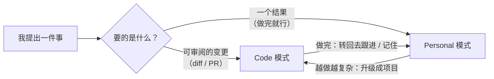
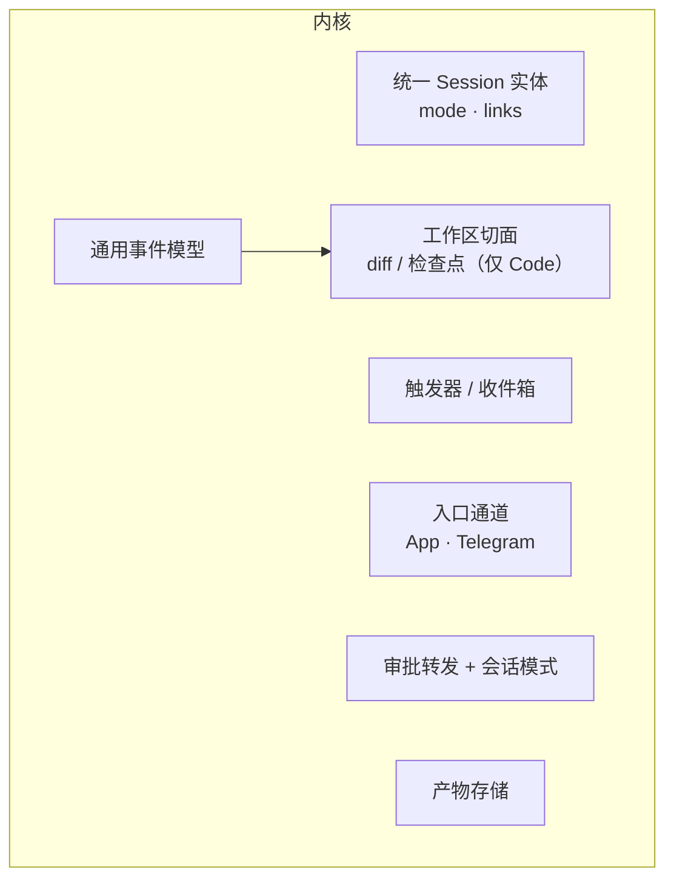

# 0001 产品边界与模式

状态：已采纳 · 2026-10-31

## 决策

| 维度 | 结论 |
|---|---|
| 使用者 | 只有我自己；不做团队、账号、多租户、商业化 |
| 核心场景 | **离开电脑**：手机远程驱动 agent，Personal 主动代办；坐在电脑前并行开发是底座能力 |
| 运行位置 | 只在我自己的机器上（Mac + 海外 VPS）；不做托管云沙箱 |
| 产品形态 | 一个产品，两种模式：Code 和 Personal，从第一天起都按一等公民设计（后补的模式会被塞进不合适的抽象） |
| harness | 只接入市面上现成的 harness，不自己写 agent loop |

## 两种模式按交付物区分

- 模式由我选择（界面顶部切换），不靠 LLM 猜意图（猜错就会两边都干不好）。
- 模式 ≠ harness：两种模式都可以选任意 harness。
- Personal 也能写代码；复杂项目我更想要带 diff 和 PR 的 Code 模式。

## 两种模式共享的内核（v1 就为两者设计）

## 模式之间的三种互通

| 动作 | 方向 | 例子 |
|---|---|---|
| 转交 | 双向 | Personal 里聊出方案 → 一键开 Code 会话；Code 做完 → 转回 Personal 跟进 |
| 委托 | Code → Personal | 让 Personal 盯着某个 Code 会话的进度和卡点 |
| 查询 | 双向（MCP） | Code 问档案里我的偏好；Personal 查各 Code 会话进展 |

## 风险与兜底

“交付物”这条线足够清楚，我能凭直觉选对模式。如果不清楚，靠“升级成项目 / 转回”两个动作低成本纠正。
