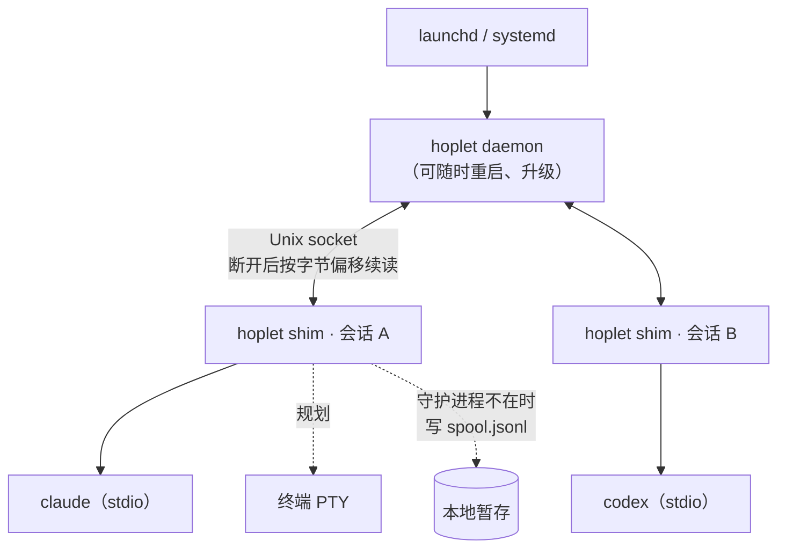
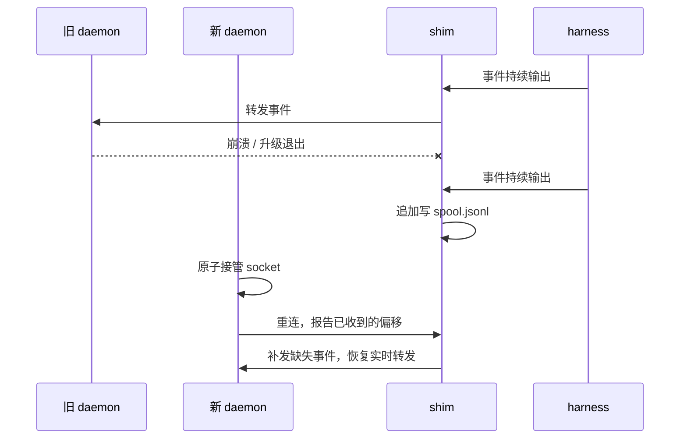

# 0002 进程模型与部署

状态：当前设计 · 更新：2026-11-07

## 范围与现状

范围：单二进制角色、进程托管、部署与重启恢复。

| 状态 | 边界 |
|---|---|
| ✓ 代码已有 | 本机 daemon、stdio shim、macOS LaunchAgent、Linux systemd 用户服务、中继与系统服务、偏移续接 |
| ○ 目标 | PTY、电源断言、iOS 配对 |

## 决策

| 项 | 结论 |
|---|---|
| 二进制 | `daemon`、`shim`、`relay`、CLI 与 `hermes-bridge` |
| 托管 | `daemon install`：macOS 装 LaunchAgent；Linux 装 systemd 用户服务 `hoplet.service`（`~/.config/systemd/user`，`Restart=on-failure`、`RestartSec=30`、不限重启次数，`KillMode=process` 让 shim 与 harness 在停服务时存活，`WantedBy=default.target`），未开启 linger 时提示 `sudo loginctl enable-linger <用户>`，否则登出即停；两者锁占用时都按 30s 节奏重试；其他平台报不支持 |
| 会话进程 | 每个活跃会话一个 shim，当前托管 harness / bridge stdio；PTY 托管未实现 |
| 单例 | flock；socket 用“新进程监听临时路径 → 原子 rename”接管，清理逻辑永不删 socket（误删会让新守护进程“能连不能用”） |
| 版本 | 一次握手：主版本不一致即拒绝并提示升级；shim ↔ daemon 协议带版本 |
| 休眠 | `IOPMAssertion` 与“接电源时常亮”均为规划，当前没有电源断言实现 |
| 多机 | 目标为逐台对等配对；当前 daemon 仅有本机服务入口 |
| 平台 | macOS（Apple Silicon）、Linux（amd64 / arm64）；不做 Windows |

## 进程关系

## 守护进程重启时会发生什么

shim 和原生进程保持运行时，daemon 重启不终止正在进行的轮次；补发按已提交偏移续读。

## shim 协议（已实现）

| 项 | 当前行为 |
|---|---|
| 帧 | 4 字节大端长度 + JSON，payload 最大 16 MiB，协议版本 1 |
| spool | JSONL 记录 start / stdout / stderr / stdin / stdin_error / exit，按字节偏移续读 |
| 分片 | 每记录 1 MiB，`More` 拼接；非 UTF-8 使用 base64 字节 |
| 写入 | stdin 接受不等于 harness 已收到；失败写入记录为 stdin_error |
| 排队与路径 | stdin 待写队列 64 条；Unix socket 路径按 103 字节上限检查，daemon 包含临时后缀 |
| 时限 | hello 5s、发送 30s、停止宽限 5s、退出输出排空 2s；退出后默认保留 shim 24h 等待补读 |

## 部署形态

| 主机 | 运行 | 作用 |
|---|---|---|
| Mac | `hoplet daemon` + 桌面 app | Code 会话主力；合盖即离线 |
| 海外 VPS | `hoplet-relay.service`（系统服务）+ headless daemon（systemd 用户服务，开启 linger） | 常驻主宿主 |

## 恢复边界

| 情况 | 行为 |
|---|---|
| daemon 重启 | shim 继续托管，按偏移补发 |
| spool 损坏 | 当前记录接入错误；原生历史只读降级尚未实现 |
| 无历史协议 | 保留 Hoplet 已存记录，不解析 harness 私有文件补造内容 |
| harness / gateway 重启 | 按该适配器的续接能力核对，不套用 daemon 重启保证 |

当前超长原生行跨 spool 记录时，提交偏移停在完整行边界；中途重启可重复归一化片段，交错轮次重复会结清为失败。shim 已不在时，下次发送起新 shim，daemon 仍从已提交偏移续读：先入库旧进程未读的尾部，追平前发送等待；尾部里的 exit 记录只结清旧进程的轮次，随后从它之后重新接入新进程。shim 崩溃未写 exit 记录时，旧尾部直接接上新进程输出，适配器不知旧进程已退出；不能对这些边界承诺“所有事件恰好一次”。

待验证：损坏降级、原生历史入口与服务接管；目标回放不得解析 harness 私有文件。

## 验收

| 范围 | 条件 |
|---|---|
| 重启 | 正常完整行按偏移接续，超长 / 交错重放边界可解释 |
| 服务 | macOS / Linux 安装、卸载与锁接管符合代码；Linux 未开启 linger 时安装与 doctor 都提示 |

## 待验证

尚未落地的目标按原生协议、故障恢复与平台约束分别验证。
