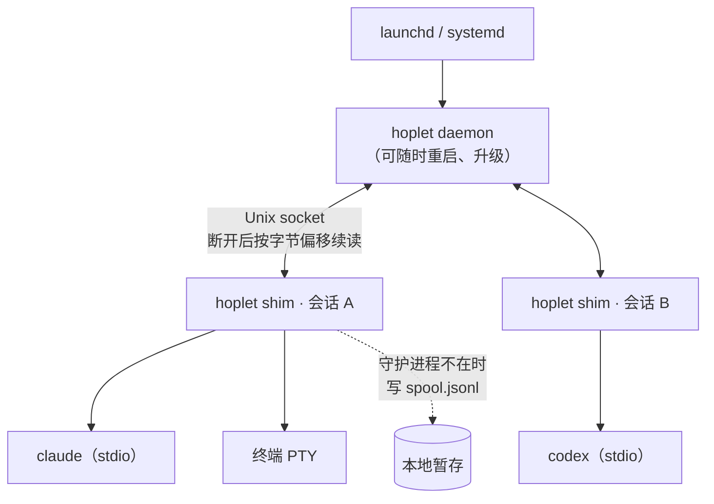
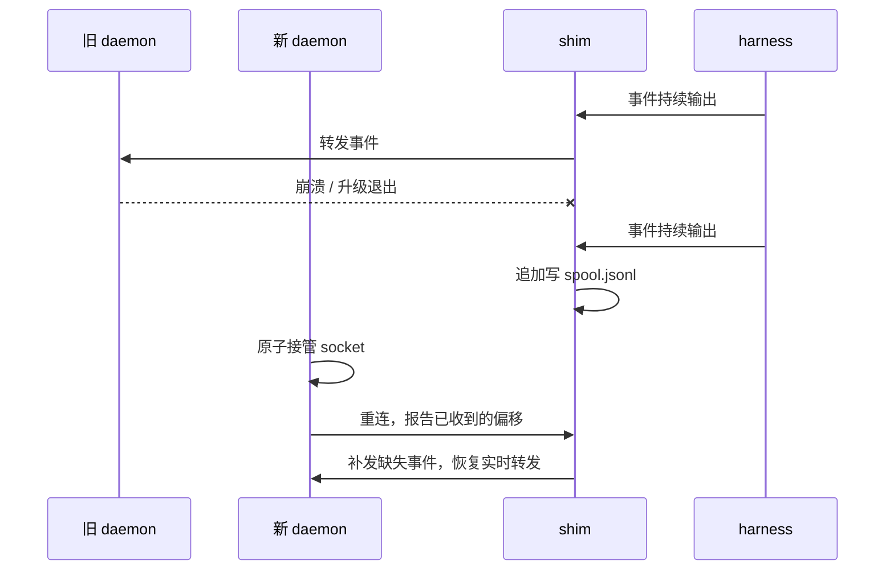

# 0002 进程模型与部署

状态：已采纳 · 2026-10-31

## 决策

| 项 | 结论 |
|---|---|
| 二进制 | 一个 Go 二进制 `hoplet`，子命令区分角色：`daemon` `shim` `relay` 及各 CLI 命令 |
| 托管 | macOS：LaunchAgent；Linux：`systemd --user` + `loginctl enable-linger`；`hoplet daemon install` 安装；另一个守护进程持锁时，LaunchAgent 每 30 秒重试一次，对方退出后接管。不内嵌在桌面 app（关 app 不能停 agent） |
| 会话进程 | 每个活跃会话一个 `hoplet shim`，托管 harness 的 stdio 和该会话所有 PTY（守护进程重启、升级不丢正在进行的轮次） |
| 单例 | flock；socket 用“新进程监听临时路径 → 原子 rename”接管，清理逻辑永不删 socket（误删会让新守护进程“能连不能用”） |
| 版本 | 一次握手：主版本不一致即拒绝并提示升级；shim ↔ daemon 协议带版本 |
| 休眠 | 有 agent 在跑时持有 `IOPMAssertion` 阻止空闲休眠；可选“接电源时常亮” |
| 多机 | 每台机器一个守护进程，对等无主；守护进程互调时以客户端身份配对 |
| 平台 | macOS（Apple Silicon）、Linux（amd64 / arm64）；不做 Windows |

## 进程关系

## 守护进程重启时会发生什么

harness 感知不到守护进程重启，正在进行的轮次不会丢。

## 部署形态

| 主机 | 运行 | 作用 |
|---|---|---|
| Mac | `hoplet daemon` + 桌面 app | Code 会话主力；合盖即离线 |
| 海外 VPS | `hoplet relay` + `hoplet daemon`（headless） | 中继；7×24 在线；Personal 主宿主 |

## 风险与兜底

shim ↔ daemon 之间的断线续读可靠。若 spool 损坏，该会话降级为“从 harness 原生历史只读回放”，并标记缺口。
