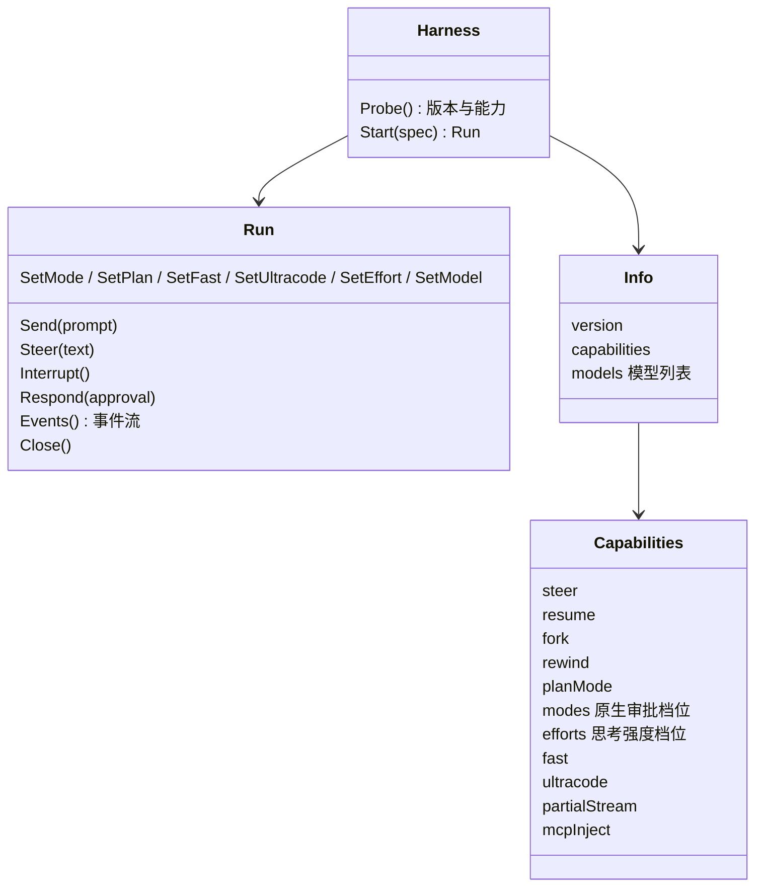

# 0003 Agent 驱动

状态：已采纳 · 2026-10-31（版本托管部分由 [0013](0013-testing-release.md) 修订；Hermes 接入 2026-11-01 修订）

## 决策

- 所有 harness 会话**只走结构化协议**（PTY 只给字符屏，手机上做不了语义审批）；PTY 只用于我自己的终端（[0009](0009-terminal.md)）。
- 每家用**原生协议**接入，不用 ACP 去包装原生协议更强的 harness（包装层会丢信息、误报完成）。

| harness | 接入方式 | 备注 |
|---|---|---|
| Claude Code | 启动 CLI：`-p --input-format stream-json --output-format stream-json --permission-prompt-tool stdio`，stdio 控制协议做审批 / 中断 / 切模式 / 切模型 / 改思考强度、Fast 与 Ultracode（`apply_flag_settings`，强度与 Fast 给 `null` 回到默认；启动时 Fast 与 Ultracode 放进 `--settings` 的 JSON：`fastMode`、`ultracode`）；`--resume` 续接；带 `--thinking-display summarized`，否则思考块只有空文本 | 与官方 Agent SDK 同一线协议，不引入 Node 运行时；Hoplet 托管副本：仓库契约测试（2.1.312 已录制验证）+ 新版本先过本机自检再跟进（[0013](0013-testing-release.md)）；启动环境不得带 `CLAUDECODE` / `CLAUDE_CODE_*`（会被当成子会话而无法登录） |
| Codex | `codex app-server`（stdio JSON-RPC） | 用其 JSON Schema 生成 Go 类型 |
| Hermes | 连其 gateway 的原生协议 `hermes-gateway-v1`（JSON-RPC over WebSocket）；小桥接进程 `hoplet hermes-bridge` 放在 shim 后面：每个 gateway 帧是一行 stdout，每个请求是一行 stdin，断线自行重连（不跨连接携带行，需要的请求由适配器重发） | 共用默认 `~/.hermes`（登录、人格、记忆、技能与我自己的 Hermes 一致；Hoplet 不改其全局设置、不碰凭证）；会话由 gateway 持有，守护进程重启不丢事件；版本门控同 Claude（录制 0.22.5 + 本机自检）；不用 ACP（续接要全量回放、没有 steer） |
| 其他 | Go 自写 ACP 客户端 | 新增一家 ≈ 一份配置 |

## Hermes 细节

| 项 | 做法 |
|---|---|
| 会话 | `session.create` 用 Hoplet 会话 ID 作 `request_id`（重复创建拿回同一会话），来源 `acp`，不带标题（带标题会接上同名旧会话）；会话在 Hermes 桌面端也可见 |
| 档位 | 需确认 = 编辑逐个确认（编辑策略 `ask`）；自动编辑 = 工作目录内的编辑放行（`workspace_session`）；全自动 = 本会话 yolo + 编辑全部放行（yolo 管不住编辑审批）。命令是否询问始终由 Hermes 自己的危险识别与全局审批模式（manual / smart / off）决定，Hoplet 不改；智能审批与 Plan 不声明（前者是 Hermes 的全局设置，后者只是提示词），选了按最近的更严档位回退 |
| 设置 | 编辑策略、思考强度（low…ultra）、模型用 `session.mutate`：一次只发一个，轮次中等轮次结束再发；设置未生效前发的消息排在设置之后。yolo、Fast（`service_tier`）用 `config.set`，即时生效 |
| 轮次 | 按 admission 跟踪，组成一个有序队列，每次快照对账：Hermes 排队的下一轮、断线期间开始或结束的轮次，都保证每轮恰好一次 TurnStarted / TurnEnded、按 admission 顺序；排在后面的轮次的事件先缓冲，轮到它时再放出。`message.start` 开始；`message.complete` 后取 `prompt.receipt`：带本轮用量（gateway 的计数是会话累计）与结束原因，再结束轮次。非终态的 receipt 最多再问 3 次（间隔 1 秒）；`unknown` 或被拒时，见过 `message.complete` 就按它结束（无用量），否则记 aborted。下一轮先开始时，上一轮按 `message.complete` 结束，用量随迟到的 receipt 补报 |
| 桥接进程 | 重连时在写 `connected` 行之前丢弃此前收到的行，写失败的行直接丢弃，不跨连接携带。连续 3 个心跳间隔收不到任何帧就断开重连（relay 正阻塞在写 stdout 时不算失联）；连接持续不足 30 秒就断开时不重置退避。不跟随 HTTP 重定向；`hermes gateway ensure` 非零退出视为失败 |
| 审批 | 快照里已不存在、且 Hoplet 未回答的审批记为 expired（decided_by `hermes`）；不认识的审批被结清也记 expired；快照里有、本次运行不认识的待审批重新发出 ApprovalRequested；回答被 Hermes 拒绝时报错 |
| 断线 | 守护进程重启：桥接进程与 shim 照常运行，事件留在 spool；重新接上后总会发一次 `session.resume`（不带历史）；store 里未结束的轮次以占位记录接手，在本次运行自己的快照到达时统一结清（旧守护进程请求的 receipt 先扣住；最终回复要么已发，要么随回放的 `message.complete` 到来，不补发）。gateway 重启或桥接进程重启：用 `session.resume` 重新接上，清掉在途设置并重新排队；在途的消息（按 `submission_id` 幂等）、审批回答、`config.set` 在重新拿到快照后重发，interrupt、steer、receipt 不重发，对旧连接请求的应答一律忽略；本轮已结束就用 receipt 补齐最终回复。Hermes 拒绝创建或续接会话时报错，丢弃等待中的请求（报出条数），此后的命令直接返回该错误，直到新连接重新接上。来自旧守护进程请求的错误应答直接丢弃。始终不加载全量历史（gateway 的事件补发缓冲只有 512 帧，流式输出几秒就溢出） |
| 停止 | 桥接进程收到 SIGTERM 时先中断它看到的进行中轮次，写请求用不受停止影响的超时上下文 |
| 中断 / 插话 | 中断遇 stale_generation 不重试（那一轮已结束）；steer 遇 stale_generation 报错 |
| 消息顺序 | 用户消息保持用户给出的顺序（含断线重发与排在设置之后的情形） |
| 模型 | 当前模型取自每轮的 `session.usage`（`model`、`provider`），变化时报告 `model.changed`；模型列表在会话之外单独连一次 gateway 调 `model.options`，取已登录服务商的模型（当前服务商在前），缓存 10 分钟；换模型用 `session.mutate` 的 `model`，带服务商代号。`session.usage` 报的服务商名（如 `custom`）与 `model.options` 里的服务商代号可能不同，所以判断“当前是哪个模型”只比模型名 |
| 不支持 | 提问（`acp` 来源的会话没有 clarify 工具）、Plan |

## 模型与工具输出

| 项 | 做法 |
|---|---|
| 当前模型 | harness 报告它在跑的模型时（Claude Code：每轮 `init` 行的 `model`；Hermes：`session.usage`），适配器发 `model.changed`，守护进程记进会话（0004）。我换模型时会话先记下所选，harness 报告后以报告为准 |
| 模型列表 | `harnesses.list` 返回各 harness 的版本、能力与模型（`ModelInfo`：选项值、服务商代号与服务商名、实际模型名、显示名、说明、是否默认、支持的强度档位、是否支持 Fast；有服务商名时桌面端按服务商分组）。Claude Code：`initialize` 的回答里就有模型列表（含 `default` 一项；每项带 `supportedEffortLevels`、`supportsFastMode`），会话接上时发一次并更新列表；还没有会话时，守护进程单独起一个 claude（`-p --no-session-persistence`、空 MCP、禁用 hooks），只发 `initialize` 不发消息，读完即停，不耗额度；列表按 claude 二进制缓存，换版本才重新问。守护进程一启动就在后台先问一遍；`harnesses.list` 同时问各 harness，等最慢的那个。装不了 / 探测失败的 harness 也列出，`Missing` 写原因（桌面端在新建页的 harness 列里置灰并写安装方法） |
| 换模型 | `sessions.set_model`（模型、服务商），下一条消息起生效；harness 不能换时返回不支持 |
| 工具输出 | 适配器把工具结果的正文随该 `ToolCall` 事件交给守护进程，守护进程存成 blob，记在 `ToolCall.Output`；客户端用 `sessions.output` 按会话与工具调用读取，最多 64KB，截在行尾并标出截断。Claude Code 取 `tool_result` 的文本；Hermes 暂不提供（Personal 的工作痕迹不展开） |

## 统一抽象

归一化事件：`TurnStarted` `MessageDelta` `Thinking` `ToolCall(read/edit/exec/web/other)` `FileChange` `ApprovalRequested` `Question` `Usage` `ContextUsage{used, window}` `ModeChanged` `ModelChanged` `TurnEnded{reason}` `Error`。上下文用量：已用 = 最近一次请求的输入 + 缓存写入 + 缓存读取 + 输出，窗口大小 harness 说了才有（Claude Code：每条回复的 `message.usage`、轮次结束 `result` 的 `usage.iterations` 末项与 `modelUsage.*.contextWindow`、压缩后 `compact_boundary` 的 `post_tokens`）。**每个归一化事件都附带原始事件。**

## 硬规则

| # | 规则 |
|---|---|
| 1 | 轮次结束只认协议信号，不靠“安静多久”推断；进程崩溃 → 标记 `aborted` |
| 2 | 身份以 Hoplet 会话 ID 为准；harness 的 session id 只是记录在案的指针 |
| 3 | 凭证留在 harness 自己的存储（订阅登录或 API key 配置）；Hoplet 不保管，只用 `hoplet doctor` 检查 |
| 4 | harness 环境 = 用户登录 shell（按用户数据库取，不是守护进程的 `$SHELL`）读出的环境：启动时带上图形会话的 `LANG` `LC_*` `TMPDIR` `SSH_AUTH_SOCK` `XDG_*`，结果去掉 `TERM`、`HOPLET_*` 与名字像凭证的变量（如 `*TOKEN*` `*SECRET*` `*PASSWORD*` `*API_KEY*` `*_KEY`；`config.toml` 的 `[env] allow` 可逐个放行）+ 代理变量 + Hoplet MCP token；放行的凭证、带密码的代理和值为带密码 URL 的变量（如 `DATABASE_URL`）只留在内存，不写入缓存；按名字判断，值里带密码但名字不像凭证的变量会传给 harness，只是不写入缓存；launchd 下的守护进程没有 `LANG`，语言环境取自启动文件 |
| 5 | 每个会话注入 Hoplet MCP（本机回环 HTTP，每会话一个 token） |
| 6 | 版本区间外：已有会话只读回放，禁止开新轮次 |
| 7 | 生成标题、转交摘要等小任务：一次性隔离运行，关工具、不持久化 |

## 风险与兜底

Claude Code 的 stdio 控制协议在托管版本下稳定。若新版本改变协议：本机自检不通过，Hoplet 停在旧副本并在 doctor 中告警；修好适配器、录制新版本后再发布 Hoplet。
