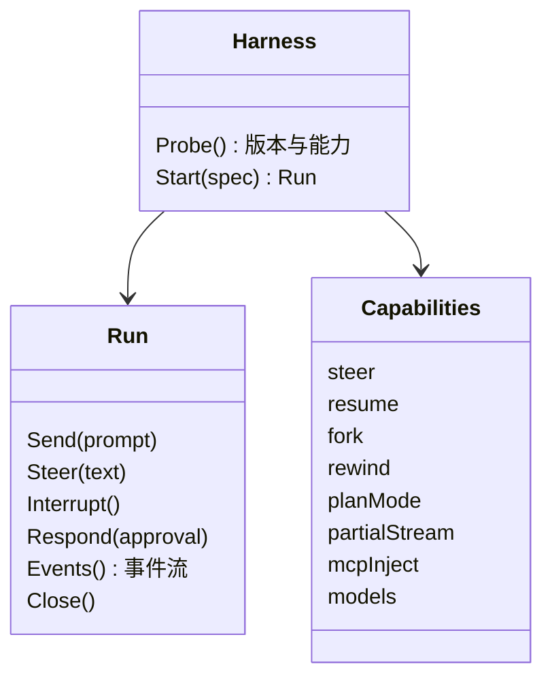

# 0003 Agent 驱动

状态：已采纳 · 2026-10-31（版本托管部分由 [0013](0013-testing-release.md) 修订）

## 决策

- 所有 harness 会话**只走结构化协议**（PTY 只给字符屏，手机上做不了语义审批）；PTY 只用于我自己的终端（[0009](0009-terminal.md)）。
- 每家用**原生协议**接入，不用 ACP 去包装原生协议更强的 harness（包装层会丢信息、误报完成）。

| harness | 接入方式 | 备注 |
|---|---|---|
| Claude Code | 启动 CLI：`--input-format stream-json --output-format stream-json`，stdio 控制协议做审批 / 中断 / 切模式 | 与官方 Agent SDK 同一线协议，不引入 Node 运行时；锁版本 + 契约测试；备选 `--permission-prompt-tool <MCP 工具>` |
| Codex | `codex app-server`（stdio JSON-RPC） | 用其 JSON Schema 生成 Go 类型 |
| Hermes | 连其 gateway：TUI-gateway JSON-RPC（WebSocket），ACP 备选 | 会话状态由 Hermes gateway 持有，无需 shim |
| 其他 | Go 自写 ACP 客户端 | 新增一家 ≈ 一份配置 |

## 统一抽象

归一化事件：`TurnStarted` `MessageDelta` `Thinking` `ToolCall(read/edit/exec/web/other)` `FileChange` `ApprovalRequested` `Question` `Usage` `TurnEnded{reason}` `Error`。**每个归一化事件都附带原始事件。**

## 硬规则

| # | 规则 |
|---|---|
| 1 | 轮次结束只认协议信号，不靠“安静多久”推断；进程崩溃 → 标记 `aborted` |
| 2 | 身份以 Hoplet 会话 ID 为准；harness 的 session id 只是记录在案的指针 |
| 3 | 凭证留在 harness 自己的存储（订阅登录或 API key 配置）；Hoplet 不保管，只用 `hoplet doctor` 检查 |
| 4 | harness 环境 = 用户登录 shell（按用户数据库取，不是守护进程的 `$SHELL`）读出的环境：启动时带上图形会话的 `LANG` `LC_*` `TMPDIR` `SSH_AUTH_SOCK` `XDG_*`，结果去掉 `TERM`、`HOPLET_*` 与名字像凭证的变量（如 `*TOKEN*` `*SECRET*` `*PASSWORD*` `*API_KEY*` `*_KEY`；`config.toml` 的 `[env] allow` 可逐个放行）+ 代理变量 + Hoplet MCP token；放行的凭证、带密码的代理和值为带密码 URL 的变量（如 `DATABASE_URL`）只留在内存，不写入缓存；按名字判断，值里带密码但名字不像凭证的变量会传给 harness，只是不写入缓存；launchd 下的守护进程没有 `LANG`，语言环境取自启动文件 |
| 5 | 每个会话注入 Hoplet MCP（本机回环 HTTP，每会话一个 token） |
| 6 | 版本区间外：已有会话只读回放，禁止开新轮次 |
| 7 | 生成标题、转交摘要等小任务：一次性隔离运行，关工具、不持久化 |

## 风险与兜底

Claude Code 的 stdio 控制协议在锁定版本下稳定。若变化：该 harness 的会话降级只读，契约测试在升级前拦截。
