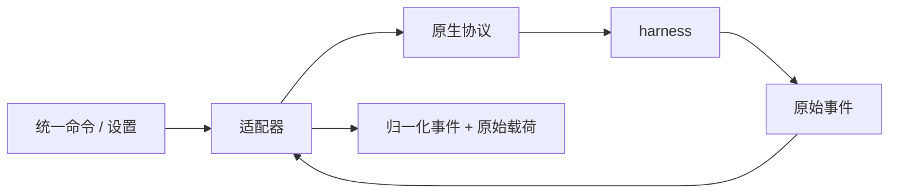
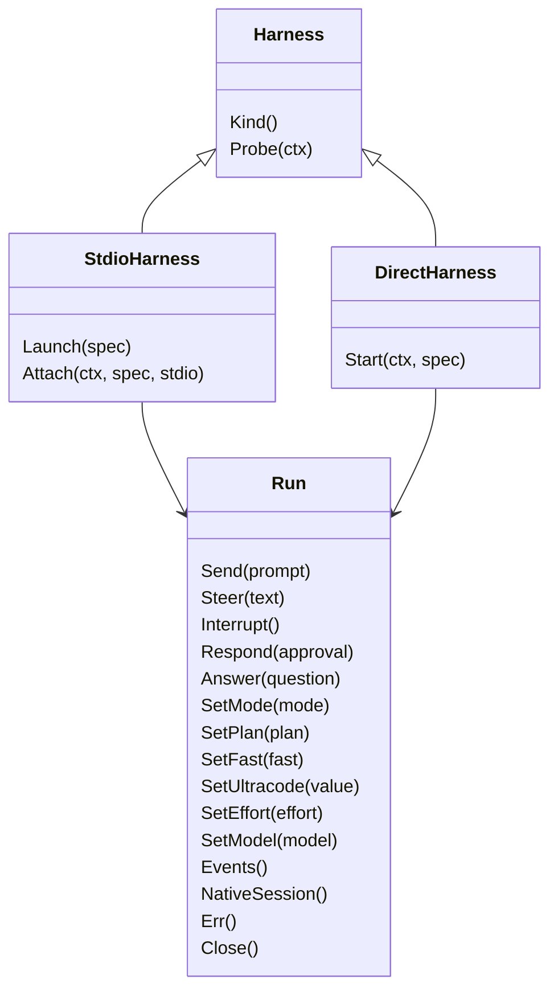

# 0003 Agent 驱动

状态：当前设计 · 更新：2026-11-04

## 范围与现状

范围：统一原生协议、事件、启动环境与能力边界；具体 harness 的字段映射独立维护。

| 状态 | 边界 |
|---|---|
| ✓ 代码已有 | Claude Code / Hermes 的统一接口、事件、模型和环境 |
| ○ 目标 | MCP、禁工具提炼、fork / rewind 和新能力验证 |

## 执行路径

| harness | 原生入口 |
|---|---|
| Claude Code | CLI stdio stream-json 与控制协议 |
| Hermes | gateway JSON-RPC / WebSocket，经 shim 后的 bridge 搬运 |
| Codex（目标） | `codex app-server` stdio JSON-RPC，按 JSON Schema 生成 Go 类型 |
| ACP（目标） | Go ACP 客户端 |

会话只走结构化协议；PTY 留给用户终端。优先原生能力，不用更弱的包装协议替换已有接入。

## 统一抽象（已实现）

当前 Claude Code 和 Hermes 都走 `StdioHarness`；Hermes 的 WebSocket 由桥接进程放到 shim 后。`DirectHarness` 是通用分支，不是当前 Hermes 的接入路径。

| 生命周期 | 代码契约 |
|---|---|
| `Stdio.WriteLine` | nil 只代表传输接受，后续可收到写入失败记录 |
| `Run.Events` | 持续消费；读慢会形成背压，不丢事件 |
| `ErrDetached` | 传输断开，不等于原生进程退出，可重新接上 |
| `Run.Close` | shim 路径释放连接、原生进程可继续；直接进程不能保证脱离所有者运行 |
| 预留 | `Fork` / `Rewind` 没有 Run 方法；`Spec.MCP` 当前两个适配器忽略 |

## 事件契约

| 类别 | 事件 |
|---|---|
| 轮次 | `TurnStarted`、`TurnEnded{reason}` |
| 内容 | `MessageDelta`、`Thinking`、`ToolCall(read/edit/exec/web/other)`、`FileChange`、`TodoList`、`Subagent` |
| 交互 | `ApprovalRequested`、`Question` |
| 运行信息 | `Usage`、`ContextUsage{used, window}`、`ModeChanged`、`ModelChanged`、`Error` |

适配器 `Event.Raw` 携带原始行，当前 daemon 仍以 spool 保存原始协议，未逐事件写入 raw blob；上下文已用量包含最近请求的输入、缓存写入、缓存读取和输出，窗口大小只有 harness 报告后才有。

## 任务清单

harness 自己维护的任务清单（agent 给自己列的待办）归一成一个事件。

| 项 | 规则 |
|---|---|
| 事件 | `todo.list`，载荷 `TodoList{Items}`，`TodoItem{ID, Text, Active, Status}`；`Active` 是进行中的说法（如“正在运行测试”），harness 不给时为空 |
| 状态 | `pending` / `in_progress` / `completed` / `cancelled` |
| 快照 | 每次都发整张表，不发增量；回放、断线追赶和各端只看最新一条 |
| 来源 | 适配器在会话内维护这张表，harness 的任务工具每次调用后发一次；这些调用不再作为 `ToolCall` 发出 |
| 不支持 | 子任务嵌套拍平成按顺序的列表；任务之间的依赖不传 |

## 子代理

harness 在一轮里派出的子代理（agent 交给另一个 agent 去做的一段工作）归一成一个事件，它自己的过程另存一份记录。

| 项 | 规则 |
|---|---|
| 事件 | `subagent`，载荷 `Subagent{ID, CallID, Type, Title, Status, Background, Tokens, ToolUses, Duration, Summary}`；`CallID` 是派出它的那次工具调用，`Type` 是 harness 给的子代理类型（不给时为空），`Summary` 是交回给主代理的结果 |
| 状态 | `running` / `done` / `failed` / `stopped`；`Background` 为真表示主代理不等它、它可以跨过本轮结束继续跑 |
| 快照 | 按 `ID` 每次发整条，不发增量；各端对同一 `ID` 只看最新一条 |
| 派出 | 派出子代理的那次工具调用不再作为 `ToolCall` 发出，由 `subagent` 代替 |
| 记录 | 子代理自己的事件（思考、工具调用、正文）带 `Event.Agent`（子代理 `ID`），主对话的事件不带；daemon 照常存进会话的事件日志。`sessions.events` 不带 `agent` 时不返回这些事件，带 `agent` 时只返回那个子代理的记录；实时推送照发，客户端主对话跳过带 `Agent` 的事件 |
| 不支持 | 子代理再派出的子代理拍平到最外层那个的记录里；不单独停止或插话某个子代理，停止整轮会停掉它们；子代理记录不是新会话 |

## 模型与工具输出

| 服务 | 契约 |
|---|---|
| 当前模型 | 记录用户所选；适配器的 `model.changed` 报告到来后以报告值为准 |
| `harnesses.list` | 返回版本、能力、模型选项；各 harness 同时探测，等最慢者；安装或探测失败也列出，`Missing` 说明原因 |
| `ModelInfo` | 选项值、服务商代号 / 名称、实际模型名、显示名、说明、默认项、强度档位、`NoEffort` 与 Fast 支持；有服务商时按组显示 |
| `sessions.set_model` | 接收模型和服务商，下一条消息起生效；不支持则返回不支持 |
| 工具输出 | 适配器提供正文，daemon 存 blob，`ToolCall.Output` 引用；按会话和调用读取，最多 64KB、行尾截断并标记 |

## 启动环境

| 环节 | 规则 |
|---|---|
| 基础 | 从用户数据库取得登录 shell，读取其启动环境，不用 daemon 的 `$SHELL` 代替 |
| 启动输入 | 带图形会话的 `LANG`、`LC_*`、`TMPDIR`、`SSH_AUTH_SOCK`、`XDG_*` |
| 默认过滤 | 去掉 `TERM`、`HOPLET_*`，以及 `*TOKEN*`、`*SECRET*`、`*PASSWORD*`、`*API_KEY*`、`*_KEY` 等凭证名 |
| 显式放行 | `config.toml` 的 `[env] allow` 逐项、区分大小写精确匹配 |
| 追加变量 | 当前加入代理变量；Hoplet MCP token 注入尚未实现 |
| 敏感缓存 | 放行凭证、带密码的代理、值为带密码 URL 的变量（如 `DATABASE_URL`）仅留内存，不写缓存 |
| 识别边界 | 传递过滤按名字判断；名字不像凭证但值含密码的变量仍会传入，但不写缓存 |
| locale | launchd 环境可能没有 `LANG`，语言环境从启动文件取得 |
| 刷新 | `env.refresh` 更新后续启动环境，不修改已运行进程；刷新失败保留旧快照，首次解析失败使用最小环境并报告诊断 |

## 控制与持久性

| # | 规则 |
|---|---|
| 1 | 轮次结束只认协议信号，不靠“安静多久”推断；进程崩溃 → 标记 `aborted` |
| 2 | 身份以 Hoplet 会话 ID 为准；harness 的 session id 只是记录在案的指针 |
| 3 | 凭证留在 harness 自己的存储（订阅登录或 API key 配置）；Hoplet 不保管，只用 `hoplet doctor` 检查 |
| 4 | MCP 注入为规划；目标是工作会话独立 token，提炼任务禁工具。当前并未注入 |
| 5 | 未经验证的版本：已有会话只读回放，禁止开新轮次 |
| 6 | 小任务隔离、禁工具与成长提炼都是目标能力；当前 `Ephemeral` 仅在 Claude 启动时加 `--no-session-persistence`，不等于禁工具或禁原生记忆副作用 |

## 成长记忆驱动契约（M4b）

适配器将 Hoplet 选定的记忆提供给工作会话，并提供独立的一次性提炼入口。提炼执行器不必与工作会话使用同一家 harness；只使用选定材料，不加载业务会话的完整原生上下文，不读取私有记忆目录或凭证。

下表是适配器需要验证的目标，**不表示当前 `Spec`、`Run` 或 `Capabilities` 已有这些接口**；只有相应 harness 和版本的契约验证通过后才能声明支持，具体协议字段尚未定稿。

| 能力 | 契约 |
|---|---|
| 隔离提炼 | 工具关闭，不产生业务上下文和原生记忆写入副作用；输出候选操作及其来源，必要审计由 Hoplet 保存。不支持时换用其他已验证执行器 |
| 启动注入 | 经受支持的原生上下文入口提供 Hoplet 选定的摘要与索引；记下提供的记忆版本，不靠修改用户全局规则文件加载 |
| 按需读取 | 提供会话获准查询的主题与技能；MCP 可注入不代表启动注入、续接刷新或原生记忆控制已经可用 |
| 续接刷新 | 在支持的入口投递记忆新增、纠正和撤回；记录送达状态，不把内部修订伪装成用户消息，不把已送达当作模型已遵守 |
| 原生记忆控制 | 受控接入需要验证会话范围内的控制能力；保持用户全局配置与凭证不变。无法控制时只声明兼容接入，不保证原生记忆不影响结果 |
| 技能投影 | 验证加载、同名优先级、可写性与变更回收；原生技能修改不直接覆盖 Hoplet 权威版本 |

无法从已有上下文清除旧内容时，标记限制；新上下文的接续规则尚未定稿。关闭工具和不持久化必须经验证，不能只凭提示词宣称隔离。

## 验收

| 范围 | 要求 |
|---|---|
| 基本控制 | 录制验证审批、中断、设置、模型与续接，不靠安静多久判定完成 |
| 事件 | 原生与归一化事件可对照，原生会话 ID 只作指针 |
| 版本变化 | 不支持的版本拒绝新轮次，保留只读记录与明确诊断 |
| 规划能力 | 记忆、原生委派与新上下文接续按版本分别验证，不从基础控制测试推断支持 |

## 待验证

尚未落地的目标按原生协议、故障恢复与平台约束分别验证。
