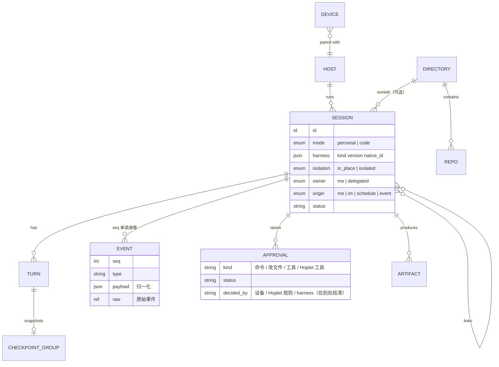
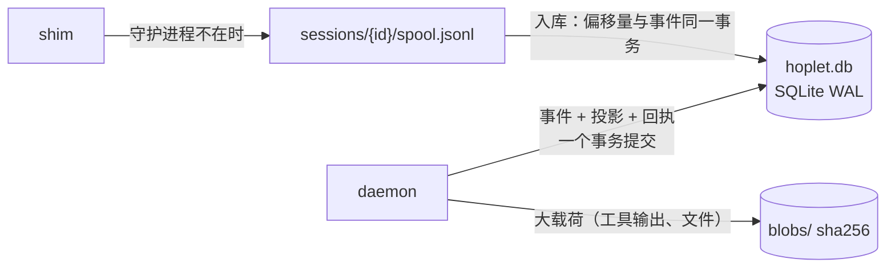

# 0004 会话数据模型

状态：已采纳 · 2026-10-31

## 核心原则

| 数据 | 事实来源 | 用途 |
|---|---|---|
| 模型上下文 | harness 自己的存储 | resume、压缩、harness 自带记忆 |
| 事件记录 | Hoplet 的事件日志 | 界面、同步、审计、跨设备追赶 |

界面**从不**通过解析 harness 的私有文件重建（对方格式一变就坏）。触发器和入口归 Hoplet，所以 Hoplet 发起的运行都有完整记录。

## 实体关系



另有 `Receipt`（命令幂等回执）。

### 列表属性

会话记录上另有四项只服务于列表的属性，存在守护进程里，所有客户端看到的一致：

| 字段 | 含义 | 谁改 |
|---|---|---|
| `title` | 标题 | 创建时给定，或我改名；仍为空时，守护进程取我的第一条消息的首行（最多 60 字）。harness 生成标题（0003）落地时再记录标题来源，让它能替换自动标题而不替换我改的名 |
| `pinned` | 置顶 | 只有我 |
| `unread` | 有我没看过的新结果 | 轮次结束时守护进程置为真；任一客户端打开该会话时置为假 |
| `preview` | 最近一条完整消息（任一方）的首行，空白折叠，最多 120 字 | 守护进程在消息入库时写入；伙伴行的第二行 |

- `title`、`pinned`、`unread` 通过 `sessions.update` 修改，CLI 对应 `hoplet session set ID --title T --pinned on|off --unread on|off`。
- 修改这几项不改 `updated_at`，列表顺序不会因为置顶或已读而跳动；置顶的会话单独排在最前。

## 存储



- 纯 Go SQLite 驱动；流式增量每 100ms 合批入库，消息完成后压缩成完整消息。
- 事件里只放摘要 + blob 引用，大内容不进事件表。

## 丢失契约

| 数据 | 持久性 |
|---|---|
| 流式增量 | `synchronous=NORMAL`，掉电最多丢最后一批 |
| 审批决定、命令回执、轮次结束、会话创建 | 落盘后才 ack |
| 写入失败 | 记住并在下一个需确认的点报出，绝不假装成功 |

## 目录布局

```
~/.hoplet/               0700
  config.toml            配置（network.proxy、[env] allow、[harness.claude] / [harness.hermes] follow 等）
  daemon.sock            本机 API（0600）；daemon.lock 单例锁；token 本机 token（0600）
  env.json               登录 shell 环境缓存（不含凭证）
  hoplet.db              结构化数据
  blobs/                 大载荷（内容寻址）
  sessions/<id>/         spool.jsonl、shim socket
  artifacts/<session>/   产物
  harness/<kind>/        各适配器私有数据与托管的 CLI 副本
  profile/               个人档案（见 0010）
  logs/                  daemon.log（按大小轮转）、launchd.log
```

## 演进规则

- schema 迁移只向前、按编号。
- **已持久化的事件必须永远能解码**：事件类型带版本，旧解码器保留。

## 风险与兜底

Hoplet 看得到 harness 的全部活动。若我在 Hoplet 之外 resume 了同一会话，接管时对比轮次数，插入“外部活动”标记，不伪造内容。
