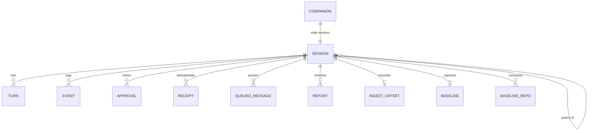
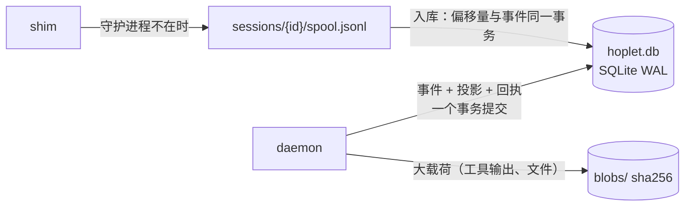

# 0004 会话数据模型

状态：当前设计 · 更新：2026-11-08

## 范围与现状

范围：会话实体、事件、存储、持久性与数据演进。

| 状态 | 边界 |
|---|---|
| ✓ 代码已有 | 会话、轮次、事件、审批、回执、队列、偏移、基线与 blob、伙伴、父会话与回报 |
| ○ 目标 | 事情、成长条目、设备、检查点组、会话 links 与产物服务 |

## 核心原则

| 数据 | 事实来源 | 用途 |
|---|---|---|
| 模型上下文与原生记忆 | harness 自己的存储 | resume、压缩与原生学习；不作为 Hoplet 可迁移成长记忆的权威版本 |
| 事件记录 | Hoplet 的事件日志 | 界面、同步、审计、跨设备追赶 |
| 成长记忆 | 主宿主上的 Hoplet 档案与版本记录 | 跨 harness 使用的事实、偏好、协作约定、经验与技能 |

界面**从不**通过解析 harness 的私有文件重建（对方格式一变就坏）。触发器和入口归 Hoplet，所以 Hoplet 发起的运行都留有事件记录；记录范围以协议实际可见的活动为准。

## 实体关系（已实现）



| 会话属性 | 当前行为 |
|---|---|
| `mode` | `personal` / `code` |
| harness | kind、version、native_id；原生 ID 是续接指针 |
| 状态 | idle / running / waiting / errored；归档另记 `archived_at` |
| owner / origin | 公开创建入口写入 `me`；`session_create` 建的子会话 owner 为 `delegated`，`handoff` 建的 Code 会话 owner 为 `me`；IM 与定时入口未实现 |
| `parent` | 建这个会话的会话，建时写入、之后不改，不能是自己；为空表示不是委派或转交来的 |
| isolation | 已有字段；当前目录选择没有 worktree 实现，不能据此视为隔离 |
| 目录 | Code 必填；Personal 未指定目录时，伙伴主会话用伙伴目录 `companions/<id>/`（迁移时已有原生会话的留在 `sessions/<id>/`），有父会话的 Personal 会话与其他 Personal 会话用 `sessions/<id>/` |

| 规划实体 | 状态 |
|---|---|
| 配对设备、主机目录 | 未实现 |
| 检查点组、会话 links | 未实现独立实体与完整服务 |
| 产物、产物数据 | 未实现；产物属于会话，按版本存放，数据跨版本保留，随会话删除 |
| 事情、成长条目 | 未冻结 SQL schema 或协议 |

### 伙伴

`companions` 表一行一个伙伴：

| 列 | 含义 |
|---|---|
| `id` | 8 字节随机十六进制，与会话 ID 同样生成；支持至少 4 个字符的唯一前缀 |
| `main_session` | 主会话，唯一，引用 `sessions(id)` |
| `in_session_dir` | 为 1 时主会话在会话目录里工作；只由迁移写入，给迁移时已有原生会话的主会话 |
| `created_at` | 创建时间；迁移来的取会话的创建时间 |

- 名字、harness、归档时间不另存，读时取自主会话。
- 新建没有父会话的 Personal 会话时，会话与伙伴行在同一事务里写入，任一失败都不留下另一个。
- 迁移只加表、加行：每个 Personal 会话（含已归档的）插一行，`sessions` 与 `events` 不变。
- 人格不进数据库，在伙伴目录的 `persona.md`。

### 父会话与回报

- `sessions.parent` 引用父会话；有父会话的 Personal 会话不是伙伴，不建伙伴行。
- 回报是父会话队列里的一条消息：`queue.from_session` 记它来自哪个会话，我的消息为空；编辑保留来源。投递后父会话日志里的 `Message` 记原文，`from` 为来源会话。
- `reports` 表一行一个入过队的回报键：

| 列 | 含义 |
|---|---|
| `parent` | 收回报的会话，引用 `sessions(id)` |
| `key` | 回报的键，与队列的键相同 |
| `created_at` | 入队时间 |

- 主键 `(parent, key)`。`Store.Report` 在一个事务里插 `reports` 行并入队；键已在就什么都不做，所以一个键只入队一次，我删掉的回报也不会再出现。父会话不存在、已归档、队列已满时整体回滚，键不被占用。
- 迁移只加列、加表：已有会话的 `parent`、已有队列消息的 `from_session` 为空。

### 列表属性

会话记录上另有四项只服务于列表的属性，存在守护进程里，所有客户端看到的一致：

| 字段 | 含义 | 谁改 |
|---|---|---|
| `title` | 标题 | 创建时给定，或我改名；仍为空时，守护进程取我的第一条消息的首行（最多 60 字）。harness 生成标题落地时再记录标题来源，让它能替换自动标题而不替换我改的名 |
| `pinned` | 置顶 | 只有我 |
| `unread` | 有我没看过的新结果 | 轮次结束时守护进程置为真；任一客户端打开该会话时置为假 |
| `preview` | 最近一条完整消息（任一方）的首行，空白折叠，最多 120 字 | 守护进程在消息入库时写入；伙伴行的第二行 |

- `title`、`pinned`、`unread` 通过 `sessions.update` 修改，CLI 对应 `hoplet session set ID --title T --pinned on|off --unread on|off`。
- 修改这几项不改 `updated_at`，列表顺序不会因为置顶或已读而跳动；置顶的会话单独排在最前。

### 模型、插话与工具输出

- 会话另记 `model` 与 `model_provider`：建会话时可选，`sessions.set_model` 时记下所选，harness 报告 `model.changed` 时以报告为准；为空表示 harness 的默认模型、尚未报告。harness 下次启动时用这里记的模型。
- 插话送达 harness 后，守护进程把它作为本轮里一条我的消息记进日志（`Message`，角色 user），所以重新打开会话时插话仍在原处。
- 工具调用的输出存成 blob，`ToolCall.Output` 指向它；客户端按需用 `sessions.output` 读取。

## 存储



- 纯 Go SQLite，WAL，单写连接与 4 个只读连接；写操作串行，读取使用只读池。
- ingest 按 50ms 或 256 个事件合批；轮次切换先提交，审批 / 提问请求与轮次结束触发及时提交。
- 完整 `Message` 与 delta 均可入库。`Store.Compact` 可删除已被同 ID 完整消息替代的 delta，但当前 daemon 没有自动调用。
- 工具结果正文存 blob，`ToolCall.Output` 指向它。
- 原始协议行由 shim 写入 spool；适配器的 `Event.Raw` 当前未被 ingest 转成 raw blob，不填事件表的 `raw_sha256`。不能宣称已建立每个归一化事件到原始 blob 的映射。
- 错误追加会从已提交 spool 偏移重接；消息不是仅凭客户端在线状态投递。

## 丢失契约

| 数据 | 持久性 |
|---|---|
| 普通追加与 ingest 偏移 | `synchronous=NORMAL`；掉电可能丢尚未同步的普通批次，不承诺最多一批 |
| 审批决定、命令回执、轮次结束、会话创建 | `synchronous=FULL`；提交后返回 |
| 写入失败 | 记住并在下一个需确认的点报出，绝不假装成功 |

## 目录布局

```
~/.hoplet/               0700；HOPLET_HOME 可覆盖
  config.toml            配置（network.proxy、[env] allow、[harness.claude] / [harness.hermes] follow 等）
  daemon.sock            本机 API（0600）；daemon.lock 单例锁；token 本机 token（0600）
  env.json               登录 shell 环境缓存（不含凭证）
  hoplet.db              结构化数据
  blobs/                 大载荷（内容寻址）
  sessions/<id>/         spool.jsonl、shim socket
  artifacts/<session>/   产物各版本内容（目标）
  harness/<kind>/        各适配器私有数据与托管的 CLI 副本
  profile/               成长记忆（规划）
  logs/                  daemon.log（按大小轮转）、launchd.log
```

## 队列与归档

| 项 | 当前行为 |
|---|---|
| 队列 | 每会话最多 100 条；key 最多 256 字节且不能含 `#` |
| 编辑 | 修改后使用新 attempt key，作为新消息发送；旧请求重试不覆盖编辑 |
| 失败队首 | 持久化错误并阻塞后续，编辑 / 移动 / 删除后可继续 |
| 归档 | 停止 harness 并持久化归档时间；当前不自动删除会话目录或 spool |

## 演进规则

- schema 迁移只向前、按编号。
- **已持久化的事件必须永远能解码**：事件类型带版本，旧解码器保留。

## 验收

| 范围 | 条件 |
|---|---|
| 持久性 | 回执、轮次结束、审批及创建以 FULL 提交 |
| 恢复 | 偏移与事件同事务，写失败不跳过记录 |
| 演进 | 旧版本事件仍可解码，索引重建不改变事实来源 |

## 待验证

Hoplet 只以实际收到的协议事件与 blob 为依据。对外部 resume 的活动对账和专门标记尚未实现；目标是通过受支持的协议标记缺口，不解析私有历史或补造证据。
