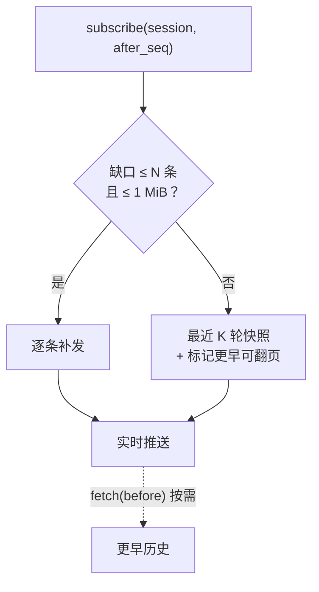
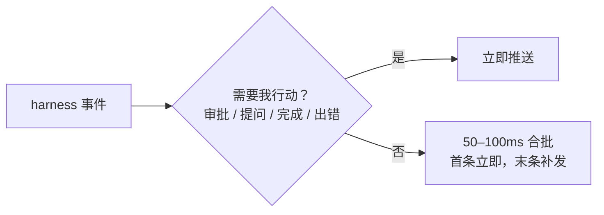
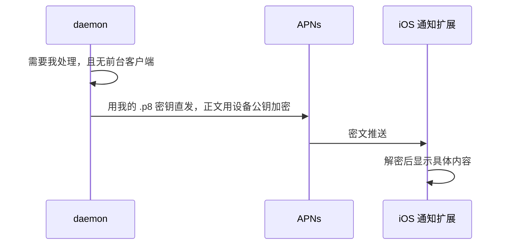

# 0005 同步协议

状态：已采纳 · 2026-10-31

## 传输与信封

| 项 | 结论 |
|---|---|
| 连接 | 每客户端每主机一条 WebSocket；JSON 文本帧 + 二进制帧（终端、大块数据） |
| 本地 / 远程 | 同一协议：本机走 Unix socket / 回环；远程走加密隧道（[0006](0006-connectivity-security.md)） |
| 请求 | `{id, method, params}` → `{id, result \| error}` |
| 流 | `{sub, item}`；取消 `{sub, cancel}` |
| 握手 | `hello{protocol_major, device_id}` → `{host, features}`；主版本不符即拒绝 |

## 三类订阅

| 订阅 | 内容 | 断线追赶 |
|---|---|---|
| 目录 | 会话列表、状态、待审批、主机状态 | 实体版本号 + 墓碑；游标过旧 → 全量快照 |
| 会话 | 单个会话的事件流 | `after_seq`；缺口小则补发，大则发快照 + 向前翻页 |
| 输出 | 工具完整输出、终端 | 展开 / 打开时才订阅 |

## 会话订阅的追赶逻辑

## 推送节奏

单条事件有大小上限（工具调用摘要 ≤ 64KB），完整内容走 blob 拉取。

## 可靠性

| 问题 | 机制 |
|---|---|
| 连接悄悄死掉 | 应用层心跳 10–15s，超时判死 |
| 重连风暴 | 指数退避 + 抖动，上限 5 分钟；iOS 回前台立即探测 |
| 慢客户端 | 每连接出站高水位（约 8 MiB），超出只断这一条，靠游标补回 |
| 重复命令 | 幂等键 + 回执去重；响应返回产生的事件 seq |

## 推送通知

在线状态只用于决定是否推送，不参与数据投递（在线判断有延迟，用它投递会丢数据）。

## 多主机与缓存

- 客户端对每台主机各连一条，本地汇总。
- iOS 本地 SQLite 缓存，主键 `(host, session, seq)`；先显示缓存，后台补齐。

## 风险与兜底

阈值 N / 1 MiB / K 在手机网络下合适。做成守护进程配置，由 [0013](0013-testing-release.md) 的字节预算测试校准。
