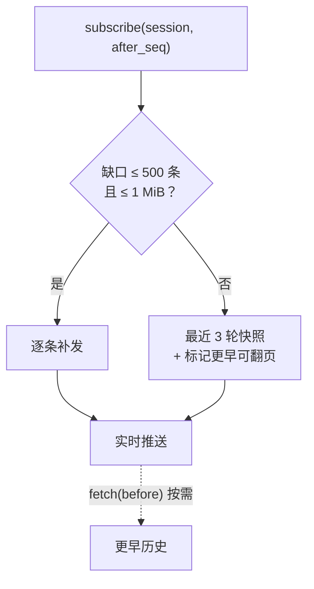
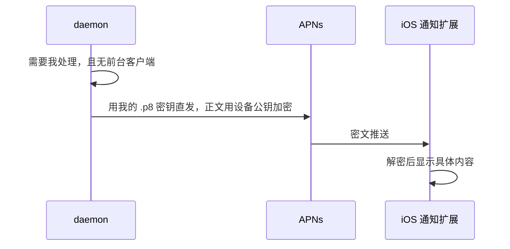

# 0005 同步协议

状态：当前设计 · 更新：2026-11-04

## 范围与现状

范围：客户端信封、订阅追赶、推送与背压。

| 状态 | 边界 |
|---|---|
| ✓ 代码已有 | 本机 WebSocket、目录 / 会话订阅、分页、快照、队列与背压 |
| ○ 目标 | 远程加密传输、终端帧、APNs 与 iOS 缓存 |

## 传输与信封

| 项 | 结论 |
|---|---|
| 连接 | 当前 HTTP/WebSocket 运行在 Unix socket 上，路径 `/v1`；服务端发送 JSON 文本帧 |
| 远程 / 二进制 | Noise 隧道、终端与大块数据帧属于规划 |
| 请求 | `{id, method, params}` → `{id, result \| error}` |
| 流 | `{sub, item}`；取消 `{sub, cancel}` |
| 握手 | 首帧 `hello{protocol_major, device_id, token}` → `{host, version, protocol_major}`；主版本为 1，错误 token / 空设备 ID 被拒绝 |

## 三类订阅

| 订阅 | 内容 | 断线追赶 |
|---|---|---|
| 目录 | 当前会话记录及状态 | `after_version` 为 0 或超过当前版本时全量快照，否则增量；没有实体删除墓碑 |
| 会话 | 事件流，首项与队列变化附完整队列 | `after_seq`；小缺口补发，大缺口或游标越界发快照 |
| 输出 | 工具结果按 `sessions.output` 请求 | 不是独立输出订阅；终端流未实现 |

## 会话订阅的追赶逻辑

## 提交与推送

订阅由入库提交信号驱动。当前没有独立的“首条立即、末条补发”推送合批层，入库批次的时限与持久性由存储流程控制。

## 可靠性

| 问题 | 机制 |
|---|---|
| 心跳 | 每 15s 发 WebSocket Ping，10s 未响应则断开；hello 等待上限 10s |
| 桌面重连 | `desktop/internal/link` 按 1s 起倍增至 30s，支持手动立即重试；当前无抖动和 5 分钟上限 |
| 慢客户端 | 待写队列 8 MiB 高水位，超出断开自身；单独的大响应可发出，不能把高水位当单帧硬上限 |
| 幂等 | `sessions.send` / `sessions.respond` 使用持久化 key / 回执；不能泛称所有请求均有回执 |
| 分页与帧 | 事件页 500 条，客户端读入帧上限 1 MiB；旧消息按 `before_seq` 向前翻页 |

## 推送通知（规划）

在线状态只用于决定是否推送，不参与数据投递（在线判断有延迟，用它投递会丢数据）。

## 多主机与缓存（规划）

- 客户端对每台主机各连一条，本地汇总。
- iOS 本地 SQLite 缓存，主键 `(host, session, seq)`；先显示缓存，后台补齐。

## 验收

| 范围 | 要求 |
|---|---|
| 追赶 | 补发与快照得到同一会话状态，目录游标过旧可重建 |
| 背压 | 慢客户端只断开自身，不阻塞其他会话 |
| 幂等 | 丢失响应后重试不重复执行 |
| 预算 | 当前阈值在服务内确定，未暴露用户配置；远程字节预算需另行校准 |

## 待验证

尚未落地的目标按原生协议、故障恢复与平台约束分别验证。
