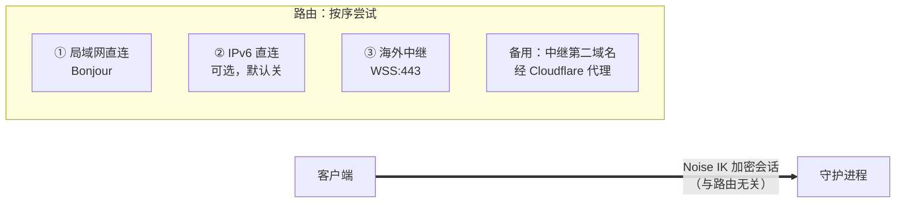
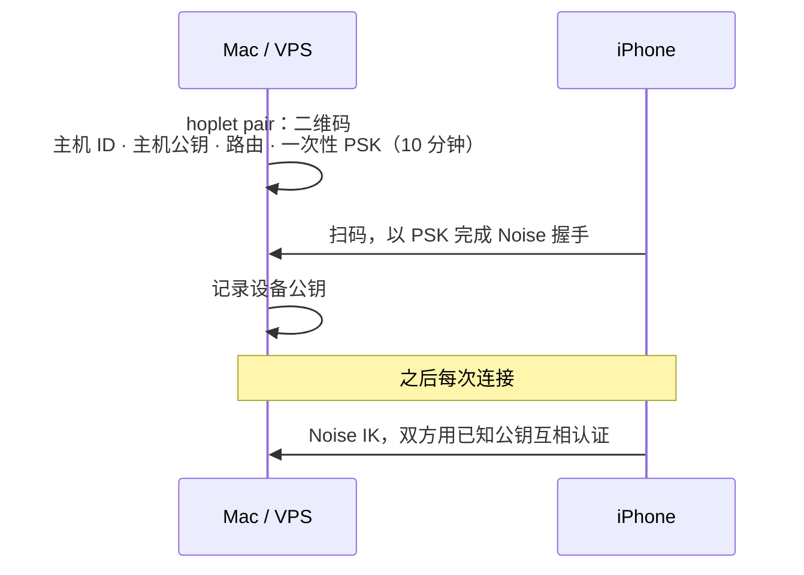
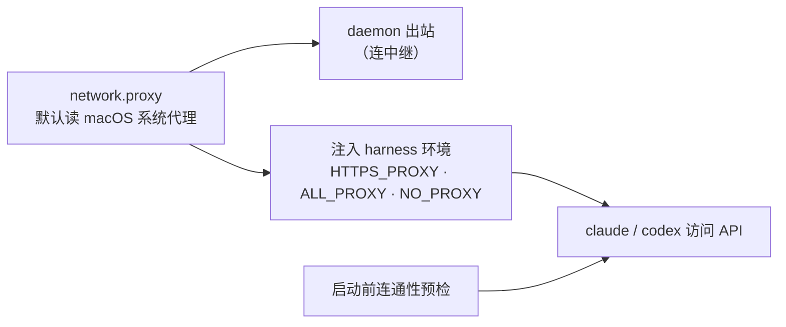

# 0006 跨设备连接与安全

状态：已采纳 · 2026-10-31

前提：iPhone 常开代理 VPN（占用唯一的 VPN 位，所以 Tailscale 不做主路由）；VPS 在海外。

## 一层安全，多条路由

- 连在后面的路由时，后台持续探测前面的路由，能通就切回（回家自动走局域网）。
- 加密与认证全在应用层；中继、Cloudflare、Tailscale 都只搬运字节。

## 配对与日常连接

| 项 | 结论 |
|---|---|
| 密钥 | 每个守护进程、每台设备一对长期 X25519 密钥 |
| 吊销 | 任一已配对设备上操作，或 `hoplet device revoke` |
| 多主机 | 每台主机各配对一次，不做信任传递；守护进程互调也走配对 |
| 防重放 / 降级 | Noise 计数器；只有一个协议版本 |

## 中继

| 项 | 结论 |
|---|---|
| 形态 | `hoplet relay`，部署在海外 VPS，哑转发，不缓存 |
| 协议 | 只用 TCP 443 上的 WSS；域名 + Let's Encrypt，流量像普通网站（国内到海外的 UDP 常被限速、干扰） |
| 认证 | 守护进程用主机密钥签名注册；客户端按主机 ID 连接 |
| 可见性 | 只见密文与元数据 |
| 保活 | 每段心跳 + 端到端回声探测 |
| 不做 | UDP / WebRTC 打洞、Cloudflare Workers 中继 |

## 代理（守护进程拿不到 shell 的代理变量）

## 本机与终端设备

| 场景 | 措施 |
|---|---|
| 本机访问 | Unix socket 0600 + 本机 token；回环 WebSocket 拒绝带 `Origin` 的握手 |
| 推送 | 正文用设备公钥加密，iOS 通知扩展解密 |
| iOS 缓存 | 系统 Data Protection |
| 手机丢失 | 修改 Hoplet 规则与授权必须 Face ID；可选 app 启动锁；任意设备可吊销 |

## 风险与兜底

海外中继在国内的线路稳定。不稳时切 Cloudflare 备用域名；以实测延迟和丢包决定主备。
