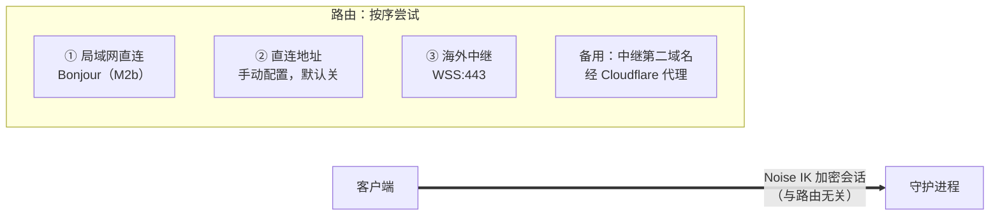
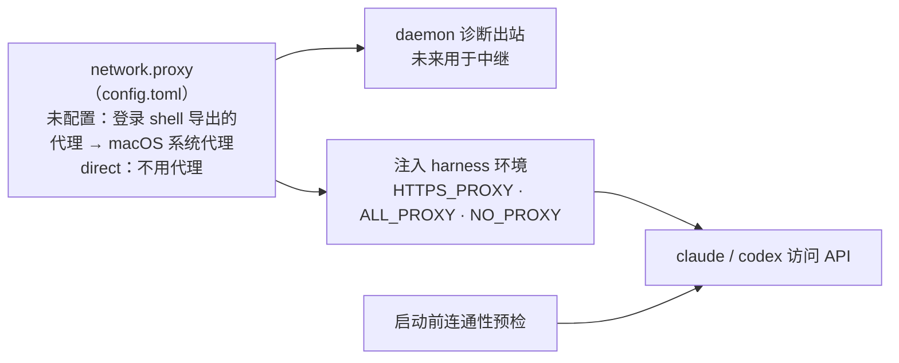

# 0006 跨设备连接与安全

状态：当前设计 · 更新：2026-11-07

## 范围与现状

范围：跨设备身份、路由、中继、代理与终端保护。

前提：iPhone 常开代理 VPN（占用唯一的 VPN 位，所以 Tailscale 不做主路由）；VPS 在海外。

| 状态 | 边界 |
|---|---|
| ✓ 代码已有 | 本机 socket / token / Origin 检查与代理解析 |
| ○ 目标 | 配对、Noise、路由、中继、设备吊销与生物识别 |

## 当前本机保护

| 项 | 已实现边界 |
|---|---|
| 数据根目录 | `~/.hoplet` 或 `HOPLET_HOME`，权限 0700 |
| socket / token | socket 0600；本机随机 token 文件拒绝组 / 其他用户权限 |
| 连接 | Unix socket 上的 `/v1` WebSocket；升级前拒绝非空 `Origin` |
| hello | 校验协议主版本、本机 token 与非空设备 ID；设备 ID 不是配对身份 |
| 远程 | 当前没有默认 TCP / 回环监听、Noise、配对或 relay |

## 一层安全，多条路由（M2a 目标）

- 按序尝试；连在后面的路由时，后台定时探测前面的路由，能通就新建连接、按游标重新订阅、再关旧连接（回家自动走局域网）。
- 加密与认证全在应用层；中继、Cloudflare、Tailscale 都只搬运字节。
- M2a 只有直连地址与中继两条；Bonjour 随 iOS（M2b），iOS 用系统 Network.framework 发现，守护进程只做广播。

| 项 | 结论 |
|---|---|
| Noise 模式 | 套件 `25519_ChaChaPoly_SHA256`（iOS CryptoKit 原生支持）；日常 IK，配对 IKpsk2，中继注册 XN；发起方首条消息前带 1 字节握手类型，prologue 为 `hoplet/1` 加该类型字节 |
| 通道帧 | 一条 WebSocket 二进制消息 = 一条 Noise 传输消息（≤ 65535 字节）；上层帧带 1 字节标志分片，另有端到端 ping / pong |
| 通道里的协议 | 仍是本机同一套客户端协议；hello 不带 token，设备身份取握手认证的公钥 |
| 直连监听 | `network.listen` 配置后才监听，明文 WebSocket，拒绝非空 `Origin` |

## 配对与日常连接（目标）

| 项 | 结论 |
|---|---|
| 密钥 | 每个守护进程、每台设备一对长期 X25519 密钥；主机 ID 由公钥哈希得出 |
| PSK | 守护进程只在内存保存，10 分钟过期，用一次即作废 |
| 吊销 | 任一已配对设备上操作，或 `hoplet device revoke` |
| 多主机 | 每台主机各配对一次，不做信任传递；守护进程互调也走配对 |
| 防重放 / 降级 | Noise 计数器；只有一个协议版本 |

## 中继（目标）

| 项 | 结论 |
|---|---|
| 形态 | `hoplet relay`，部署在海外 VPS，哑转发，不缓存 |
| 协议 | 只用 TCP 443 上的 WSS；域名 + Let's Encrypt，流量像普通网站（国内到海外的 UDP 常被限速、干扰） |
| 证书 | 内置 ACME（Let's Encrypt），只为配置的域名签发 |
| 注册 | 守护进程以 Noise XN 握手证明持有主机密钥（X25519 不能签名，不另加签名密钥）；只接受白名单里的主机 ID |
| 连接 | 客户端按主机 ID 连接；中继通知守护进程，守护进程为每个客户端回拨一条 WSS，中继两头逐条转发，不做多路复用 |
| 可见性 | 只见密文与元数据 |
| 保活 | 每段心跳 + 端到端回声探测 |
| 不做 | UDP / WebRTC 打洞、Cloudflare Workers 中继 |

## 代理（已实现）

## 设备保护与推送（M2b 目标）

| 场景 | 措施 |
|---|---|
| 推送 | 正文用设备公钥加密，iOS 通知扩展解密 |
| iOS 缓存 | 系统 Data Protection |
| 手机丢失 | 修改 Hoplet 规则与授权必须 Face ID；可选 app 启动锁；任意设备可吊销 |

## 验收

| 范围 | 要求 |
|---|---|
| 身份 | 拒绝重放、已吊销设备和未配对主机 |
| 路由 | 加密身份与路由分离，切换不新增信任 |
| 主备线路 | M2a 按配置顺序，失败切备用域名；按实测延迟与丢包定主备待有实际数据后再定 |
| 本机入口 | 验证 socket 权限、token 与 `Origin` 拒绝规则 |

## 待验证

尚未落地的目标按原生协议、故障恢复与平台约束分别验证。
