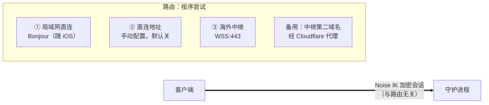
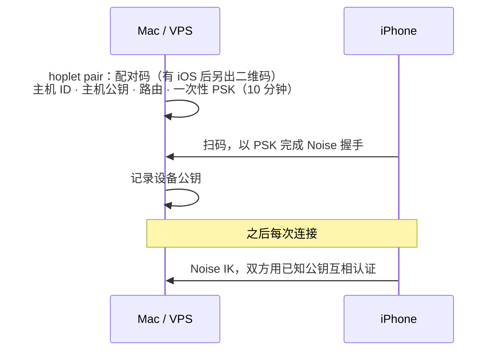
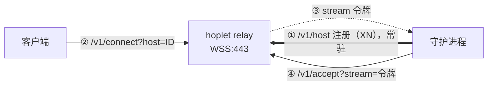
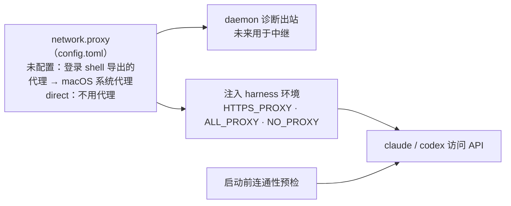

# 0006 跨设备连接与安全

状态：当前设计 · 更新：2026-11-08

## 范围与现状

范围：跨设备身份、路由、中继、代理与终端保护。

前提：iPhone 常开代理 VPN（占用唯一的 VPN 位，所以 Tailscale 不做主路由）；VPS 在海外。

| 状态 | 边界 |
|---|---|
| ✓ 代码已有 | 本机 socket / token / Origin 检查、代理解析；配对、Noise、直连地址路由、设备吊销（CLI）；中继（`hoplet relay`、注册与回拨、CLI 经中继拨号与切回直连、Linux 系统服务安装、doctor 监听与注册检查） |
| ○ 目标 | 局域网发现、iOS 配对与生物识别 |

## 当前本机保护

| 项 | 已实现边界 |
|---|---|
| 数据根目录 | `~/.hoplet` 或 `HOPLET_HOME`，权限 0700 |
| socket / token | socket 0600；本机随机 token 文件拒绝组 / 其他用户权限 |
| 连接 | Unix socket 上的 `/v1` WebSocket；升级前拒绝非空 `Origin` |
| hello | 校验协议主版本、本机 token 与非空设备 ID；设备 ID 不是配对身份 |
| 远程 | 默认不监听 TCP；配置 `network.listen` 后才有直连监听，只接受 Noise 通道；配置 `network.relays` 后向中继注册，经回拨连接服务客户端 |

## 一层安全，多条路由

- 按序尝试；连在后面的路由时，后台定时探测前面的路由，能通就新建连接、按游标重新订阅、再关旧连接（回家自动走局域网）。
- 加密与认证全在应用层；中继、Cloudflare、Tailscale 都只搬运字节。
- 当前只有直连地址与中继两条；Bonjour 随 iOS 提供，iOS 用系统 Network.framework 发现，守护进程只做广播。

| 项 | 结论 |
|---|---|
| Noise 模式 | 套件 `25519_ChaChaPoly_SHA256`（iOS CryptoKit 原生支持）；日常 IK，配对 IKpsk1，中继注册 XN；发起方首条消息前带 1 字节握手类型，prologue 为 `hoplet/1` 加该类型字节 |
| 通道帧 | 一条 WebSocket 二进制消息 = 一条 Noise 传输消息（≤ 65535 字节）；上层帧带 1 字节标志分片，另有端到端 ping / pong |
| 通道里的协议 | 仍是本机同一套客户端协议；hello 不带 token，设备身份取握手认证的公钥 |
| 直连监听 | `network.listen`（`host:port`）配置后才监听，明文 WebSocket 只服务 `/v1/noise`，其他路径 404，非空 `Origin` 403；读上限 65536 字节；只接受日常与配对握手，握手限时 10s |
| 路由地址 | `network.routes`：`ws://` 或 `wss://` + 主机[:端口]，不带路径、查询与用户信息；`network.relays`：`wss://` + 主机[:端口]，同样不带路径；配对码的路由 = `network.routes` 后接每个中继的 `<中继>/v1/connect`，两者都空时不发码 |
| 客户端拨号 | 按序尝试，每条限时 15s：路由路径为 `/v1/connect` → 中继，拨 `<路由>?host=<主机 ID>`；否则拨 `<路由>/v1/noise`；之后同样 IK 握手、hello、核对主机 ID |
| 切回 | CLI 里只有 `session watch` 切回：连在第 i 条路由（i > 0）时每 60s 用前 i 条再拨一次（完整握手 + hello），成功 → 在新连接上以已打印的最后一个 seq 订阅，再关旧连接，stderr 打印 “switched to <路由>”；失败不打印、不影响当前连接；其他命令每次按序拨号 |

## 配对与日常连接

| 项 | 结论 |
|---|---|
| 密钥 | 每个守护进程、每台设备一对长期 X25519 密钥；主机 ID 由公钥哈希得出 |
| PSK | 守护进程只在内存保存，10 分钟过期，用一次即作废；再发一个配对码即作废上一个 |
| 配对码 | `hoplet1:` + base64url（无填充）的紧凑 JSON `{"id","key","name","routes","psk","exp"}`：主机 ID、主机公钥、显示名（默认系统主机名，截到 64 字节的 UTF-8 边界）、路由、PSK、过期时间（Unix 秒）；`key`、`psk` 为 base64url；`id` 必须等于公钥算出的主机 ID，否则视为损坏；路由取自 `network.routes`（对外可达的地址，与监听地址分开配置）与 `network.relays`，都空时不发码 |
| 放行 | 配对握手的首条载荷是加入方的显示名（非空 UTF-8，≤ 64 字节）；PSK 验证通过、且仍是当前配对码时才放行并立即作废；错误 PSK 不消耗配对码；同一公钥再次配对更新名字并清除吊销 |
| 加入 | 加入方的 CLI 先在本地查过期与名字冲突（不拨号、不用掉配对码），再读本机身份密钥直接握手；对方主机的公钥、名字与路由记在加入方守护进程（同名不同 ID 冲突），之后 `--host <名字或 ID>` 按它连接，只用于 `session`、`companion`、`artifact` 与 `device` 命令 |
| 权限 | `pairing.start` 与 `hosts.add / list / remove` 只限本机连接，远程调用返回 `unauthorized`；`devices.list / revoke` 本机与已配对设备都可；会话操作两者相同，审批的 `decided_by` 为远程设备的主机 ID |
| 吊销 | 任一已配对设备上操作，或 `hoplet device revoke`（完整 ID 或 ≥ 4 字符的唯一前缀）；写入吊销时间后立即断开该设备所有在线连接，之后的握手被拒 |
| 多主机 | 每台主机各配对一次，不做信任传递；守护进程互调也走配对 |
| 防重放 / 降级 | Noise 计数器；只有一个协议版本 |

## 中继（已实现）

| 项 | 结论 |
|---|---|
| 形态 | `hoplet relay --domain <域名> [--domain <备用>] [--listen :443] [--dir <目录>]`，部署在海外 VPS，前台运行到 SIGTERM / SIGINT；哑转发，不缓存、不解密，日志不记载荷 |
| 系统服务 | Linux 上 `sudo hoplet relay install --domain <域名>… [--listen :443]` 写 `/etc/systemd/system/hoplet-relay.service` 并启用、（重）启动；`DynamicUser`、`StateDirectory=hoplet-relay`（`/var/lib/hoplet-relay`，0700）、只给 `CAP_NET_BIND_SERVICE`、`NoNewPrivileges`，`Restart=on-failure`、`RestartSec=5`；需 root，二进制须在固定位置且其他用户可执行；`sudo hoplet relay uninstall` 停用并删除单元，保留证书与白名单；装了服务时 `relay allow / deny / list` 默认用服务目录，root 写白名单后把属主改回目录属主 |
| 协议 | 只用 TCP 443 上的 WSS；域名 + Let's Encrypt，流量像普通网站（国内到海外的 UDP 常被限速、干扰） |
| 证书 | 内置 ACME（TLS-ALPN-01，同一监听端口），只为 `--domain` 列出的域名签发，缓存在 `<目录>/certs`；SNI 不在列表里（含空 SNI，如经 Cloudflare 代理的备用域名）时回第一个域名的证书，Cloudflare 用 Full（非 strict）模式 |
| 白名单 | `<目录>/allow`：每行一个主机 ID，0600，组 / 其他用户可访问或有非 ID 行则拒绝使用；`hoplet relay allow / deny / list [--json]` 直接改文件；中继在每次注册与每个客户端连接时重读，不需重启 |
| 端点 | `/v1/host`：守护进程注册；`/v1/connect?host=<ID>`：客户端连接，主机未注册或不在白名单 → 404，超限 → 503；`/v1/accept?stream=<令牌>`：守护进程回拨，令牌未知或过期 → 404；其他路径 404；非空 `Origin` → 403 |
| 注册 | 守护进程以 Noise XN 握手证明持有主机密钥（X25519 不能签名，不另加签名密钥；中继无静态密钥）；白名单外关闭连接；同一主机新注册顶替旧控制连接；握手限时 10s |
| 控制消息 | 控制连接的 Noise 通道里的 JSON 帧，只由中继发：`{"type":"registered"}`（第一条，守护进程 10s 内收到才算注册成功）、`{"type":"stream","stream":"<令牌>"}`；令牌为 128 位随机数，一次性，只经加密的控制连接下发 |
| 连接 | 客户端按主机 ID 连接；中继发令牌，守护进程为每个客户端回拨一条 WSS，最多等 10s；对上后两头逐条转发二进制消息（≤ 65536 字节，文本消息关闭该流），不排队、不合并、不做多路复用；任一头断开两头都关 |
| 回拨之后 | 守护进程与直连监听同一条路径：日常 / 配对握手 → 放行检查 → 登记设备连接 → 服务；吊销同样断开；守护进程关闭时断开控制连接与所有回拨连接 |
| 限制 | 每主机并发流 64、每客户端 IP 等待回拨的连接 8，超出 503 |
| 保活 | 控制连接：通道 ping / pong，15s 一次，10s 无回应断开（双方）；转发的每一段：中继发 WebSocket Ping，15s 一次，10s 无回应关闭该流；端到端仍是 Noise 通道的 ping / pong |
| 重连 | 守护进程对每个中继各保持一条控制连接，断开或被拒后按 1s 起倍增至 30s 重拨，注册成功后复位；中继重启后自动恢复 |
| 诊断 | `hoplet doctor` 检查：`listener`（直连监听地址与 `network.routes`，未配置监听为 ok，有监听无路由为 warn）；每个中继一项 `relay <地址>`：已注册 → ok（注册时间），最近一次失败 → fail（附白名单提示），尚未尝试 → warn |
| 可见性 | 只见密文、主机 ID、客户端 IP 与字节数；日志记主机注册与离开、流的结束与上下行字节数 |
| 不做 | UDP / WebRTC 打洞、Cloudflare Workers 中继 |

## 代理（已实现）

## 语音通话（目标）

语音的信令与控制走 Noise 通道的 `voice.*`，不写事件、不写日志；音频由客户端直连语音服务，不经守护进程和中继，因此依赖客户端到语音服务的 UDP 可达。

## 设备保护与推送（目标）

| 场景 | 措施 |
|---|---|
| 推送 | 正文用设备公钥加密，iOS 通知扩展解密 |
| iOS 缓存 | 系统 Data Protection |
| 手机丢失 | 修改 Hoplet 规则与授权必须 Face ID；可选 app 启动锁；任意设备可吊销 |

## 验收

| 范围 | 要求 |
|---|---|
| 身份 | 拒绝重放、已吊销设备和未配对主机 |
| 路由 | 加密身份与路由分离，切换不新增信任 |
| 主备线路 | 按配置顺序，失败切备用域名；按实测延迟与丢包定主备待有实际数据后再定 |
| 本机入口 | 验证 socket 权限、token 与 `Origin` 拒绝规则 |

## 待验证

尚未落地的目标按原生协议、故障恢复与平台约束分别验证。
