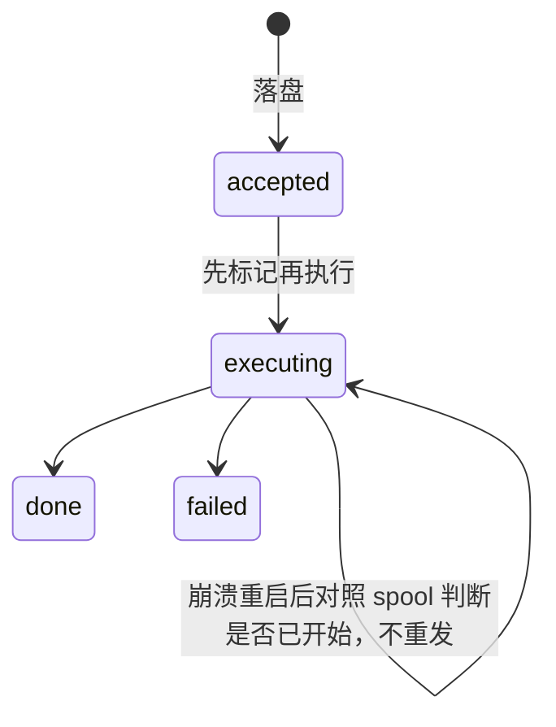
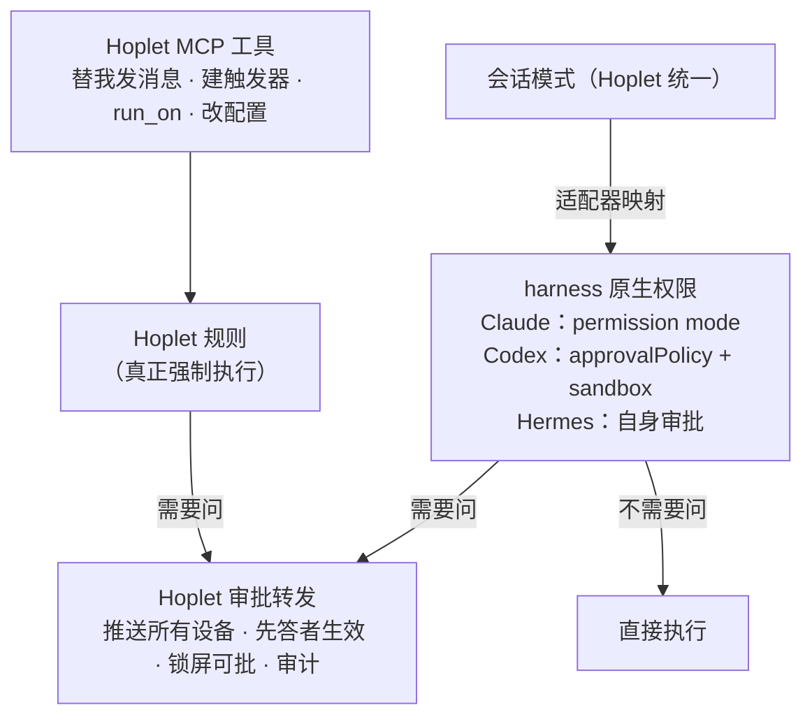
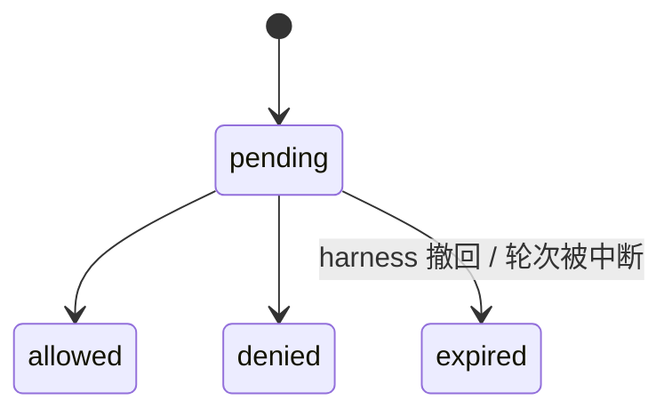

# 0007 命令与审批

状态：已采纳 · 2026-10-31

## 命令集

发送、steer、中断、回答提问、回应审批、切换模式 / 模型、回滚、fork、归档、转交、委托。harness 不支持的命令按能力位隐藏。

| 情况 | 行为 |
|---|---|
| 轮次进行中又发消息 | 默认进入**持久化队列**（可编辑、删除、调序）；支持 steer 时另有“插话” |
| 停止本轮 | 只结束当前轮，会话和进程保留；队列继续按顺序发送 |
| 停止会话 | 进程组 SIGHUP / SIGTERM → 5s → SIGKILL；队列暂停：队首标记为失败，编辑、移动或删除后恢复 |

## 命令的可靠执行

## 权限分工

Hoplet 不自建通用权限引擎：harness 自带工具（读写文件、执行命令）由 **harness 原生权限**判断；Hoplet 只强制执行它真正控制得了的部分（命令字符串审查有补不上的洞，如被污染的 PATH、恶意 `.git/config`）。

## 会话模式

审批档位、Plan 开关、Fast 开关、思考强度是四个独立的设置，都可以在会话中途切换。

| 审批档位 | 改文件 | 执行命令 | Claude Code | Codex | 默认用于 |
|---|---|---|---|---|---|
| 需确认 | 问 | 问 | `default` | 请求批准 | Personal |
| 自动编辑 | 工作目录内不问 | 问 | `acceptEdits` | 工作区可写 + 命令要问 | — |
| 智能审批 | harness 判断风险，只问有风险的 | 同左 | `auto` | 帮我批准 | Code |
| 全自动 | 不问 | 不问（harness 自身的强制检查仍会弹出） | `bypassPermissions` | 完全访问 | — |

| 设置 | 说明 |
|---|---|
| Plan 开关 | 开启时 harness 只探索、出方案，不改任何东西；批准方案后由 harness 自己退出 Plan，并上报 `mode.changed`，会话记录随之更新（Claude Code：`plan` 模式与 `ExitPlanMode`）。Plan 开着时切换审批档位只记下退出 Plan 后要恢复的档位，不会让 harness 离开 Plan |
| Fast 开关 | 同一模型更快输出、消耗更高，与思考强度无关；harness 用能力位声明是否支持 |
| 思考强度 | 统一刻度 low / medium / high / xhigh / max / ultra，空表示 harness 默认；各 harness 用能力位声明支持的档位，不支持的隐藏 |
| 上下文窗口 | 不单设开关：作为模型变体出现在模型列表里（如 Opus · 1M） |

- 某个 harness 缺少某一档时，取更严的最近一档，并在界面标注。
- harness 支持 OS 沙箱时默认开启（如 Codex 用 `workspace-write`）。
- 我全局配置里的 allow 规则（如 `~/.claude/settings.json`）照常生效，这是预期行为。

## 审批对象

| 规则 | 说明 |
|---|---|
| 选项 | 透传 harness 原生选项（仅此一次 / 本会话 / 总是 / 拒绝），界面写明各自作用范围 |
| 先答者生效 | 数据库比较并交换；广播 `resolved`，其他设备弹窗消失 |
| 不超时自动批 | 无人响应就一直等，并推送 |
| harness 自带超时 | 设为永不，或映射为 `expired` 并同步，绝不静默拒绝 |
| 审计 | 每次决定写入会话日志：哪台设备、何时、选了什么 |

## Hoplet 规则（只管 Hoplet 自己的 MCP 工具）

| 工具 | 默认 |
|---|---|
| `notify_me`、读会话、读档案 | 直接放行 |
| 替我发消息给别人 | **必须我本人确认** |
| `trigger_create` / 修改触发器 | 问我 |
| `run_on` 到其他主机 | 按目标会话的模式执行 |
| `session_send` 到我开的会话 | 只在该会话托管给 Personal 时允许 |

规则存放在 `~/.hoplet/rules.toml`。

## 底线（能兑现的几条）

| 底线 | 怎么保证 |
|---|---|
| 凭证类环境变量不传给 harness | 启动环境白名单 |
| 修改 Hoplet 规则与授权必须 Face ID | 只能从客户端改，且需生物识别 |
| 替我给别人发消息必须我本人确认 | 只能经 Hoplet MCP 发出 |

## 提问

harness 的提问（AskUserQuestion、clarify 等）统一为 `Question` 对象，生命周期同审批，答案按各家原生方式回传。

## 以后再加

- Personal 代批：托管给 Personal 的会话，由它回答 harness 审批（数据模型已预留）。
- AI 自动审查：在“需确认”和“全自动”之间加一档。

## 风险与兜底

各家模式映射不完全对等。映射表随契约测试一起验证；拿不准的一档一律映射到更严的那一档。
