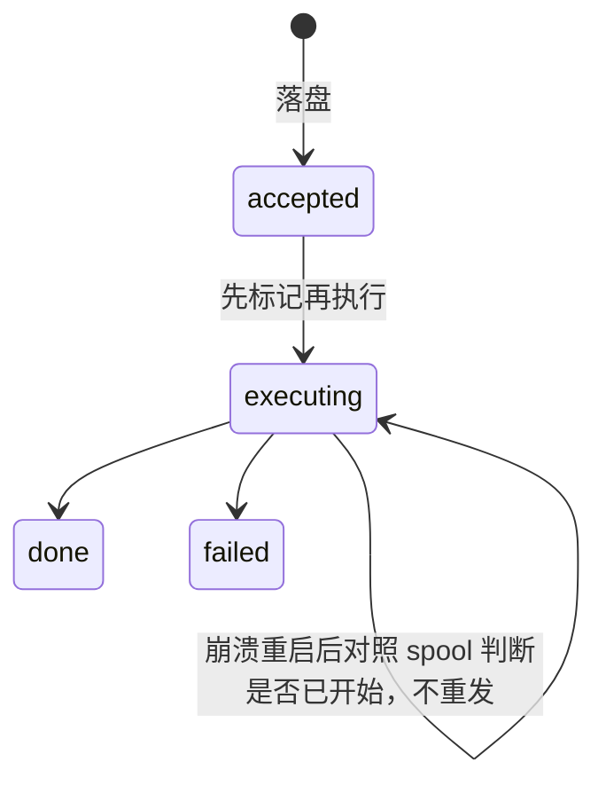
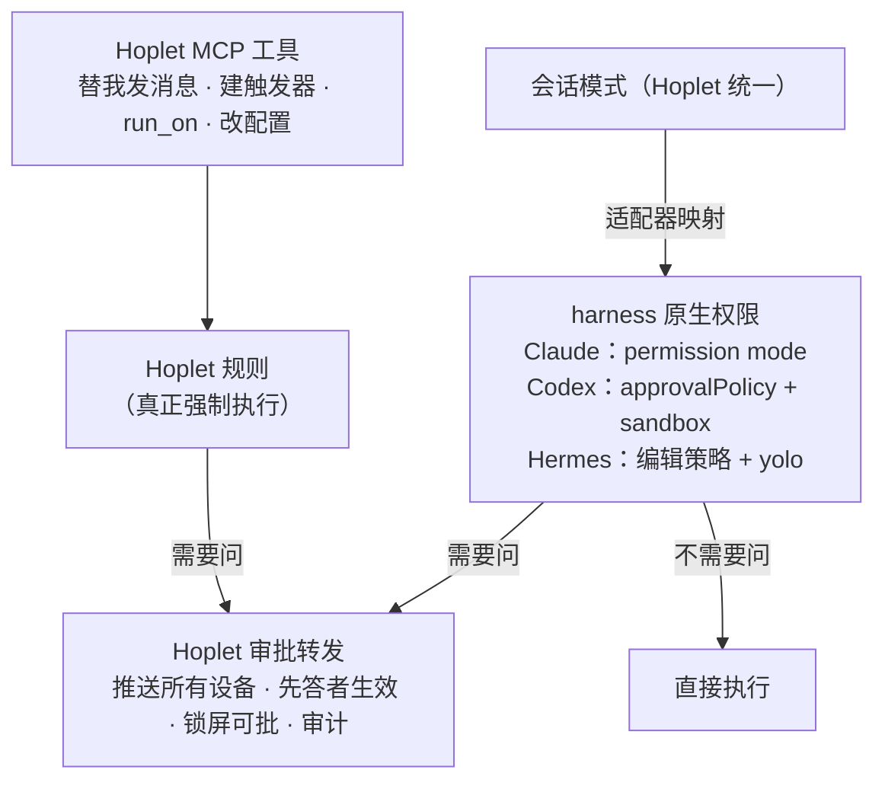
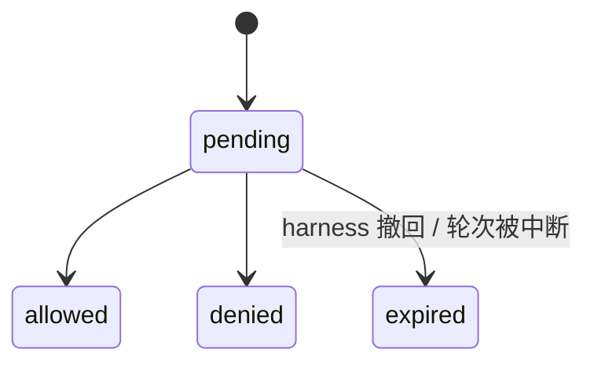

# 0007 命令与审批

状态：当前设计 · 更新：2026-11-07

## 范围与现状

范围：命令队列、会话模式、审批与 Hoplet 工具授权。

| 状态 | 边界 |
|---|---|
| ✓ 代码已有 | 消息队列（含子会话的回报）、原生审批、运行设置、停止与归档；委派、转交与回报工具的默认规则 |
| ○ 目标 | MCP 工具规则、规则编辑、生物识别与高级会话操作 |

## 命令集

| 状态 | 命令 |
|---|---|
| ✓ 当前 | 发送、原生能力允许的 steer / 中断 / 审批、运行设置、停止、归档、队列管理 |
| ◐ 有入口但不支持 | `sessions.answer`；当前 Claude Code / Hermes 均不提供提问回答能力 |
| ○ 规划 | 回滚、fork、转交与委派的公开命令、可配置的 Hoplet MCP 工具授权 |

harness 不支持的命令按能力位隐藏；预留字段不代表实现。

| 情况 | 行为 |
|---|---|
| 轮次进行中又发消息 | 默认进入**持久化队列**（可编辑、删除、调序）；支持 steer 时另有“插话” |
| 停止本轮 | 只结束当前轮，会话和进程保留；队列继续按顺序发送 |
| 停止会话 | 当前 stdio 路径发 TERM，等待 5s 后仍未结束再发 KILL；队列暂停：队首标记为失败，编辑、移动或删除后恢复 |

## 命令的可靠执行

## 权限分工

Hoplet 不自建通用权限引擎：harness 自带工具（读写文件、执行命令）由 **harness 原生权限**判断；Hoplet 只强制执行它真正控制得了的部分（命令字符串审查有补不上的洞，如被污染的 PATH、恶意 `.git/config`）。

## 会话模式

审批档位、Plan 开关、Fast 开关、Ultracode 开关、思考强度是五个独立的设置，都可以在会话中途切换。

| 审批档位 | 协议值 | 改文件 | 执行命令 | 默认用于 |
|---|---|---|---|---|
| 需确认 | `confirm` | 原生规则询问 | 原生规则询问 | Personal |
| 自动编辑 | `auto_edit` | 工作目录内放行 | 询问 | — |
| 智能审批 | `auto_review` | 原生判断风险 | 同左 | Code |
| 全自动 | `full_auto` | 放行 | 放行，原生强制检查仍可能询问 | — |

| 设置 | 统一语义 |
|---|---|
| Plan | 原生只探索、出方案；批准后原生退出并报告 `mode.changed`。期间切审批档只记录退出后要恢复的值，不退出 Plan |
| Fast | 更快输出与更高消耗，独立于思考强度；同时检查 harness 和模型支持 |
| Ultracode | 原生多 agent workflow，独立于强度和审批档；需原生能力与模型 xhigh，拒绝时显示错误；消息中的 ultrathink 原样传递，不作为设置 |
| 思考强度 | low / medium / high / xhigh / max / ultra；空为原生默认，新会话从空开始；模型档位优先，缺省用 harness 能力；模型不接受强度时隐藏并拒绝设置 |
| 上下文 | 不造独立窗口开关，使用原生模型变体；`ContextUsage` 报已用和窗口后显示 |

缺失审批档取更严的最近档，并在界面标注；Plan / 强度 / 模型设置按实际能力校验。原生支持 OS 沙箱时目标为默认开启；尚未接入的 harness 映射必须先验证。用户原生 allow 规则继续生效，Hoplet 不改其全局设置。

## 审批对象

| 规则 | 说明 |
|---|---|
| 选项 | 透传 harness 原生选项（仅此一次 / 本会话 / 总是 / 拒绝），界面写明各自作用范围 |
| 先答者生效 | 数据库比较并交换；广播 `resolved`，其他设备弹窗消失 |
| 不超时自动批 | 无人响应就一直等，并推送 |
| harness 自带超时 | 设为永不，或映射为 `expired` 并同步，绝不静默拒绝 |
| 在别处结清 | Hermes：审批在其桌面端被回答、超时或随快照消失，而 Hoplet 未回答，记为 `expired`，decided_by `hermes`；重连后快照里仍待处理的审批会重新发出；Hermes 拒绝 Hoplet 的回答时报错 |
| 审计 | 每次决定写入会话日志：哪台设备、何时、选了什么 |

## Hoplet 工具规则（规划）

| 工具 | 默认 |
|---|---|
| `notify_me`、读会话、读档案 | 直接放行 |
| Personal 的 `profile_write` | 走同一记忆服务；核对来源、范围、版本和提交条件，推测保留候选；Code 会话仍只读 |
| 替我发消息给别人 | **必须我本人确认** |
| `trigger_create` / 修改触发器 | 问我 |
| `run_on` 到其他主机 | 按目标会话的模式执行 |
| `session_send` | 只到调用方自己用 `session_create` 建的托管子会话；我开的会话、别人的子会话、转交的 Code 会话都拒绝 |
| `session_create` / `handoff` | 只给 Personal；转交的 Code 会话权限为 confirm，审批到我这里 |
| `report` | 只给有父会话的会话，只交给直接的父会话 |

规则目标存放于 `~/.hoplet/rules.toml`，当前尚无该配置加载与执行服务。工具桥先不加载它：上表中读会话、`session_send`、`session_create`、`handoff`、`report` 的默认写在代码里；`notify_me` 推迟。

### 成长记忆与授权

- 成长记忆提供背景和默认做法，不授予权限、不修改 Hoplet 规则，也不能替代本应由我作出的审批。模型写下“用户通常允许”或反复观察到同一做法，都不是新增授权。
- 我的明确记住、修改、撤回进入同一记忆服务；伙伴引用实际用户消息，不得自行声称用户已要求。客户端编辑和后台候选也受同一版本与来源校验约束。
- 提炼任务没有业务工具或 MCP 写权限，只返回候选；由 daemon 检查并提交，不能借内部任务获取 Personal 全套工具权限。内部提炼调度不等于 `trigger_create` 授权。
- 原生工具的权限仍归 harness，Hoplet 的记忆规则只在其控制的服务入口执行。提示词不能成为文件隔离、原生记忆控制或强制权限的保证；不通过修改用户全局设置、规则文件或凭证来接管原生记忆。

## 强制边界与目标

| 底线 | 怎么保证 |
|---|---|
| 凭证类环境变量默认过滤，仅逐项显式放行 | 启动环境过滤与 `config.toml` 的 `[env] allow`；敏感值不写缓存 |
| 修改 Hoplet 规则与授权需生物识别（目标） | 当前没有规则编辑服务或 Face ID 路径，不能宣称已强制执行 |
| 替我给别人发消息必须我本人确认 | Hoplet MCP 强制检查；原生工具或外部 MCP 的审批覆盖需验证 |

## 提问

`Question` 载荷与 `sessions.answer` 已预留，当前两家适配器都返回不支持；统一持久化提问、生命周期与原生回传仍为目标。

## 范围边界

Personal 代答 harness 审批不在 v1 范围内；数据模型保留托管关系，但托管本身不授予代批权限。

## 验收

| 范围 | 要求 |
|---|---|
| 档位映射 | 契约测试验证；拿不准时取更严档位 |
| 多设备审批 | 只有一个决定生效，其他设备收到结清 |
| 外部写入路径 | 核对原生工具 / 外部 MCP 是否覆盖本人确认，不把 Hoplet 服务保证扩展为所有路径的保证 |
| 环境 | 显式放行与默认过滤一致，缓存不落敏感值 |

## 待验证

尚未落地的目标按原生协议、故障恢复与平台约束分别验证。
