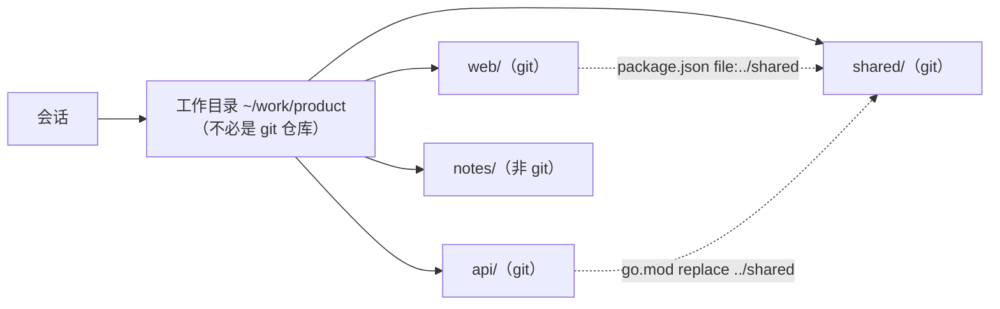
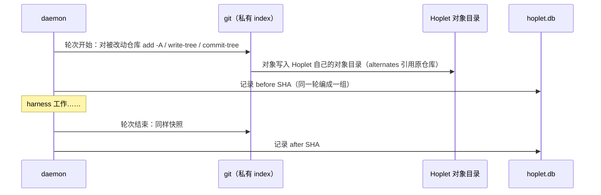
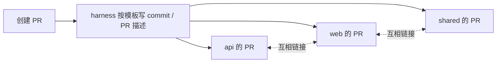

# 0008 工作区生命周期

状态：已采纳 · 2026-10-31

## 以会话为中心



- 不是“先选一个仓库再开会话”，而是**会话选目录，仓库是目录里被发现的资源**。
- 扫描深度 ≤ 3，跳过 `node_modules` `vendor`；子模块挂在父仓库下；文件变化时重扫。
- 推断仓库关系（`go.work`、`go.mod replace`、`package.json` workspaces / `file:`、Cargo path 依赖），只用于展示和隔离镜像。

## 原地 vs 隔离

| | 原地（默认） | 隔离（开会话时勾选） |
|---|---|---|
| 位置 | 真实目录 | `~/.hoplet/mirrors/<session>/`，结构与原目录一致 |
| 仓库 | 不切分支 | 每个仓库 `git worktree add --no-track -b hoplet/<slug>` |
| 非 git 文件 | — | COW 复制（APFS `clonefile`），默认不用软链（防止经软链改到原文件） |
| gitignore 文件 | — | 只复制 `[isolate].include` 列出的 |
| 冲突 | 两会话改同一仓库 → 横幅提醒，建议转隔离 | 天然隔离 |
| 归档 | — | 跑 archive 脚本 → 未提交改动做备份 commit → 移除 worktree，保留未合并分支 |

原地模式只在“创建 PR 且仓库停在默认分支”时新建 `hoplet/<slug>` 分支。

## 配置 `hoplet.toml`

```toml
[setup]                       # 隔离镜像创建后执行（原地可选：首次开会话时）
[archive]                     # 归档前执行
[run.web]                     # 具名运行命令
ports = ["web"]
[env]                         # 注入环境变量
[isolate]
include = [".env", "config/*.local"]
```

- 个人覆盖写在 `hoplet.local.toml`（不提交）。
- 脚本按内容 hash 记录信任：首次或内容变化时需我确认。

## 端口与环境变量

| 变量 | 含义 |
|---|---|
| `HOPLET_SESSION_ID` | 会话 ID |
| `HOPLET_WORKDIR` | 实际工作目录 |
| `HOPLET_ROOT` | 原始目录（隔离时与上者不同） |
| `HOPLET_PORT` … `+9` | 每会话分配的 10 个端口（端口池 40000–49999） |
| `HOPLET_PORT_<NAME>` | `[run.x]` 声明的具名端口 |

另按进程树把监听端口归属到会话；以后可经加密通道代理到手机预览。

## 检查点：完全不碰我的仓库



| 规则 | 说明 |
|---|---|
| 不写用户仓库 | 无 ref、无对象落进 `.git`（快照大文件会在用户仓库里堆积大量对象） |
| 范围 | 遵守 `.gitignore`；单文件 > 50MB 跳过并标注；非 git 目录只快照被改文件到 blobs |
| 发现改动 | FileChange 事件 + FSEvents + 轮末对所有仓库 `git status` 兜底 |
| 回滚 | 同组仓库一起回退；文件被会话外修改过 → 拒绝还原并列出 |

## diff 与 PR

| diff 视图 | 范围 |
|---|---|
| 本轮改动 | 本轮 before → after |
| 会话累计 | 会话首轮 before → 现在 |
| 分支改动 | 每个仓库 merge-base → HEAD |

刷新：FSEvents 防抖 + 每 2 分钟补漏；单个 diff ≤ 3MB，带 sha，无变化不推送。



- 用我已登录的 `gh`；Hoplet 不存 token。
- 状态轮询：活跃会话 20s，其余 5 分钟；可选合并后自动归档。

## Personal 的工作区

`~/Hoplet/Personal/<事情>/`；“升级成项目”时复制到选定工作目录并转交 Code 模式。

## 风险与兜底

能捕捉到一轮改了哪些仓库。轮末全量 `git status` 兜底；仓库多时后台进行，界面显示“正在核对”。
