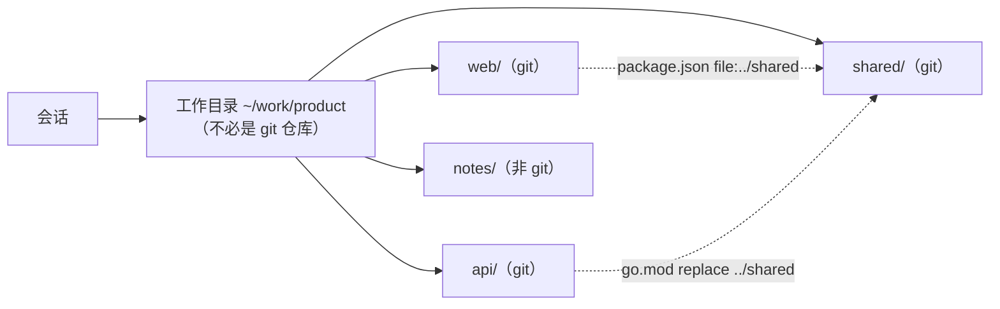
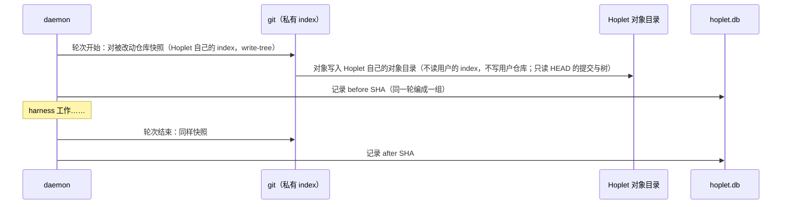
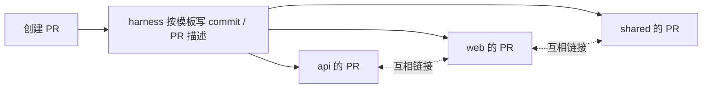

# 0008 工作区生命周期

状态：当前设计 · 更新：2026-11-07

## 范围与现状

范围：目录发现、隔离、脚本、端口、检查点与 PR。

| 状态 | 边界 |
|---|---|
| ✓ 代码已有 | 仓库发现、原地目录、基线与累计 diff |
| ○ 目标 | 真正 worktree 隔离、PR、脚本、检查点、端口；只读文件接口（M1 PR9c） |

## 以会话为中心



- 不是“先选一个仓库再开会话”，而是**会话选目录，仓库是目录里被发现的资源**。
- 当前扫描深度 ≤ 3，跳过 `node_modules`、`vendor`、`.git` 和符号链接目录；子模块挂在父仓库下。创建基线 / 请求 diff 时发现仓库，没有文件监听重扫。
- `go.work`、`go.mod replace`、workspaces / `file:`、Cargo path 关系推断尚未实现。

## 当前目录与隔离边界

| 项 | 代码行为 |
|---|---|
| Code | 使用传入的真实目录，累计 diff 已实现 |
| Personal | 未指定目录时在 `~/.hoplet/sessions/<id>/` 工作 |
| `Isolation` | 接受并存储枚举，但 `workDir` 未创建 worktree 或镜像；不能当作现有隔离保证 |
| 文件 / diff | 有 `sessions.diff`（会话累计、未提交、分支、单个提交）与 `sessions.commits`；只读的 `files.list` / `files.read` 见下节（M1 PR9c） |

## 只读文件接口

桌面右栏的文件树、文件查看与 ⌘P 用两个只读方法；都不写会话目录、不写用户仓库，不新增事件，客户端在 `TurnEnded` / `FileChange` 后对展开着的目录、打开着的文件重新请求。

| 方法 | 参数 | 结果 |
|---|---|---|
| `files.list` | 会话、目录（相对会话目录，空为根）、`all`、`ignored` | 条目：路径、种类（文件 / 目录 / 符号链接）、大小、是否被忽略；超出上限标 `truncated` |
| `files.read` | 会话、路径、`baseline`、diff 范围（`range` / `commit`） | 文本、大小，或 `binary` / `too_large` / `missing` |

| 规则 | 说明 |
|---|---|
| 路径 | 相对会话目录、清理后不得为绝对路径或以 `..` 开头；任一级父目录是符号链接时视为不存在；符号链接本身列为符号链接，不跟随、不读取 |
| 列一层 | 按名字排序、目录在前；默认不列被忽略的路径和 `.git`，`ignored` 时列出并标记 |
| 忽略 | 按所在仓库的 `git check-ignore --no-index`（去掉全部 `GIT_*` 环境变量，关闭 hooks、filter 与 fsmonitor，不写用户仓库）；不在仓库里的路径不算忽略。已跟踪但匹配忽略规则的文件也会标成忽略，M1 接受 |
| 列全部 | `all` 只列文件，深度不限，跳过被忽略的目录、`.git` 与符号链接目录；最多 20000 项 |
| 读当前 | 只打开普通文件（`O_NOFOLLOW\|O_NONBLOCK` + fstat）；大于 2 MiB 为 `too_large`；前 8000 字节含 NUL 或不是 UTF-8 为 `binary` |
| 读基线 | 累计范围：从 Hoplet 私有对象库里该仓库基线的树取 blob，不读用户对象；不在仓库里或没有基线时报错，基线里没有该文件为 `missing`。其他范围读该范围旧的一侧（`HEAD`、分叉点或父提交的树），只读用户对象 |

## 原地 vs 隔离（规划）

| | 原地（默认） | 隔离（开会话时勾选） |
|---|---|---|
| 位置 | 真实目录 | `~/.hoplet/mirrors/<session>/`，结构与原目录一致 |
| 仓库 | 不切分支 | 每个仓库 `git worktree add --no-track -b hoplet/<slug>` |
| 非 git 文件 | — | COW 复制（APFS `clonefile`），默认不用软链（防止经软链改到原文件） |
| gitignore 文件 | — | 只复制 `[isolate].include` 列出的 |
| 冲突 | 两会话改同一仓库 → 横幅提醒，建议转隔离 | 天然隔离 |
| 归档 | — | 跑 archive 脚本 → 未提交改动做备份 commit → 移除 worktree，保留未合并分支 |

原地模式只在“创建 PR 且仓库停在默认分支”时新建 `hoplet/<slug>` 分支。

界面上这个选项是新建页的“Worktree”勾选框（Git 的术语，不译）：不勾 = 原地，勾上 = 隔离。

## 配置 `hoplet.toml`（规划）

```toml
[setup]                       # 隔离镜像创建后执行（原地可选：首次开会话时）
[archive]                     # 归档前执行
[run.web]                     # 具名运行命令
ports = ["web"]
[env]                         # 注入环境变量
[isolate]
include = [".env", "config/*.local"]
```

- 个人覆盖写在 `hoplet.local.toml`（不提交）。
- 脚本按内容 hash 记录信任：首次或内容变化时需我确认。

## 端口与环境变量（规划）

| 变量 | 含义 |
|---|---|
| `HOPLET_SESSION_ID` | 会话 ID |
| `HOPLET_WORKDIR` | 实际工作目录 |
| `HOPLET_ROOT` | 原始目录（隔离时与上者不同） |
| `HOPLET_PORT` … `+9` | 每会话分配的 10 个端口（端口池 40000–49999） |
| `HOPLET_PORT_<NAME>` | `[run.x]` 声明的具名端口 |

另按进程树把监听端口归属到会话；以后可经加密通道代理到手机预览。

## 检查点与回滚（M3）



| 规则 | 说明 |
|---|---|
| 不写用户仓库 | 无 ref、无对象落进 `.git`（快照大文件会在用户仓库里堆积大量对象） |
| 范围 | 遵守 `.gitignore`；单文件 > 50MiB 跳过并标注；非 git 目录只快照被改文件到 blobs |
| 发现改动 | FileChange 事件 + FSEvents + 轮末对所有仓库 `git status` 兜底 |
| 回滚 | 同组仓库一起回退；文件被会话外修改过 → 拒绝还原并列出 |

## diff 与 PR

| diff 视图 | 范围 | 阶段 |
|---|---|---|
| 本轮改动 | 本轮 before → after | M3 |
| 会话累计 | 建会话时的基线 → 现在 | M1 |
| 未提交的改动 | 每个仓库 HEAD → 现在 | M1 |
| 分支改动 | 每个仓库与默认分支的分叉点 → 现在（含未提交的） | M1 |
| 一个提交 | 父提交 → 该提交（一次只看一个仓库） | M1 |

刷新：M1 由客户端按需请求；以后再加 FSEvents 防抖 + 每 2 分钟补漏的推送。单个仓库的 patch ≤ 3MiB，带 sha，无变化不重绘。



- 用我已登录的 `gh`；Hoplet 不存 token。
- 状态轮询：活跃会话 20s，其余 5 分钟；可选合并后自动归档。

## Personal 的工作区

当前默认目录是 `sessions/<id>/`。按事情组织到 `~/Hoplet/Personal/<事情>/`、复制目录并转交 Code 的行为均未实现，工作区迁移规则待定。

## 验收

| 范围 | 条件 |
|---|---|
| 当前 | 累计 diff 不修改用户 `.git`、index、ref 或对象库 |
| 隔离目标 | worktree / COW 真正生效后才能声明隔离 |
| 回滚目标 | 检查外部修改，拒绝覆盖冲突内容 |

## 待验证

能捕捉到一轮改了哪些仓库。轮末全量 `git status` 兜底；仓库多时后台进行，界面显示“正在核对”。
