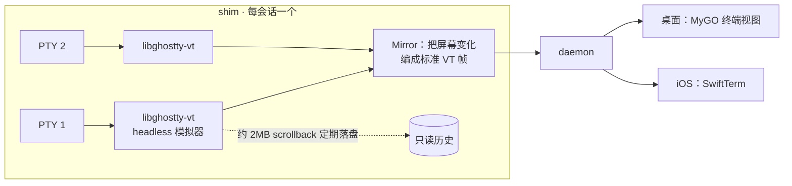

# 0009 终端

状态：已采纳 · 2026-10-31（模拟器选型由 [0011](0011-client-stack.md) 修订）

## 范围

终端只用于：我在会话里开的终端标签（cwd = 工作目录）、`[run.x]` 运行命令、setup / archive 脚本输出。harness 会话不走终端。

## 结构

客户端接入时先收快照（屏幕 + scrollback + 光标 + 键盘 / 鼠标 / 粘贴模式），再收实时帧。

## 线协议

| 项 | 结论 |
|---|---|
| 帧 | `[opcode][终端 id][数据]`，opcode：output / input / resize / snapshot |
| 输入 | 带序号、逐条确认；切换路由时按键不丢不重 |
| 背压 | 只在 shim → daemon 积压时暂停读 PTY；远程客户端跟不上 → 丢中间输出，用快照重同步（不让手机网络卡住构建） |

## 进程与环境

| 项 | 结论 |
|---|---|
| 关闭 | 进程组 SIGHUP → 超时 SIGKILL（`zsh -l` 会吞 SIGTERM） |
| 上限 | 每主机 PTY 数量上限；归档时关闭该会话全部终端 |
| 登录环境 | 守护进程启动时执行一次 `$SHELL -lic env` 并缓存，作为 harness 与终端的基础环境；`hoplet env refresh` 重新解析 |
| 终端启动 | `$SHELL -l` |

## agent 读写终端

MCP 工具 `terminal_read` / `terminal_send` / `terminal_wait(exit | idle)`，两种模式都能用。`terminal_read` 返回模拟器渲染后的文本，不是剥掉转义的原始流。

## 风险与兜底

MyGO 终端插件的 `Mirror` 能脱离 UI 在 shim 里运行，且 libghostty-vt 能随 Linux 版一起分发。实现前先验证；不行则在快照里附带最近 N KB 原始输出由客户端重放兜底。
