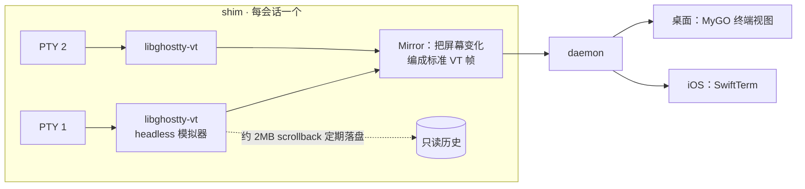

# 0009 终端

状态：当前设计 · 更新：2026-11-04

## 范围与现状

范围：用户终端的 PTY、屏幕快照、线协议与输入。

| 状态 | 边界 |
|---|---|
| ○ 目标 | PTY、headless 屏幕、终端协议与 terminal_* 工具均未实现 |
| ✓ 已有基础 | stdio shim 只托管原生协议，不等于用户终端 |

## 使用场景

终端只用于：我在会话里开的终端标签（cwd = 工作目录）、`[run.x]` 运行命令、setup / archive 脚本输出。harness 会话不走终端。

## 结构

客户端接入时先收快照（屏幕 + scrollback + 光标 + 键盘 / 鼠标 / 粘贴模式），再收实时帧。

shim 使用 MyGO 终端插件的 libghostty-vt + `Mirror` 做服务端模拟，输出标准 VT 序列供客户端显示；所需原生库按平台分发，包含 Linux VPS。

## 线协议

| 项 | 结论 |
|---|---|
| 帧 | `[opcode][终端 id][数据]`，opcode：output / input / resize / snapshot |
| 输入 | 带序号、逐条确认；切换路由时按键不丢不重 |
| 背压 | 只在 shim → daemon 积压时暂停读 PTY；远程客户端跟不上 → 丢中间输出，用快照重同步（不让手机网络卡住构建） |

## 进程与环境

| 项 | 结论 |
|---|---|
| 关闭 | 进程组 SIGHUP → 超时 SIGKILL（`zsh -l` 会吞 SIGTERM） |
| 上限 | 每主机 PTY 数量上限；归档时关闭该会话全部终端 |
| 登录环境 | 使用守护进程提供的已过滤登录环境；`hoplet env refresh` 重新读取 |
| 终端启动 | 使用用户登录 shell 的 `-l` 模式 |

## agent 读写终端

MCP 工具 `terminal_read` / `terminal_send` / `terminal_wait(exit | idle)`，两种模式都能用。`terminal_read` 返回模拟器渲染后的文本，不是剥掉转义的原始流。

## 验收

| 范围 | 条件 |
|---|---|
| 屏幕 | 快照、实时帧和模式重建一致 |
| 输入 | 序号确认保证切路由不丢不重 |
| 背压 | 慢客户端不阻塞原生构建进程 |

## 待验证

| 项 | 需确认 / 兜底 |
|---|---|
| headless 模拟 | 验证 MyGO `Mirror` 脱离 UI 在 shim 运行 |
| 原生库 | 验证 libghostty-vt 按平台分发，覆盖 Linux VPS |
| 快照与模式 | 屏幕、scrollback、光标及输入模式重建一致 |
| 失败兜底 | 快照附最近 N KB 原始输出供客户端重放；预算与重放效果先验证 |
