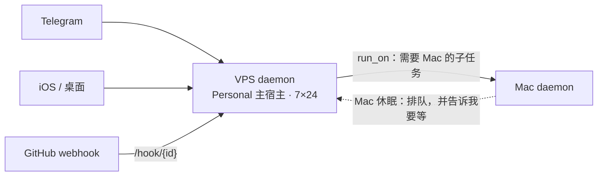
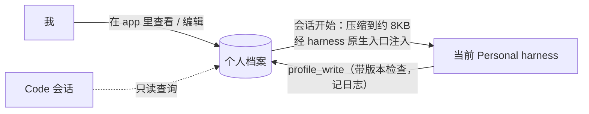
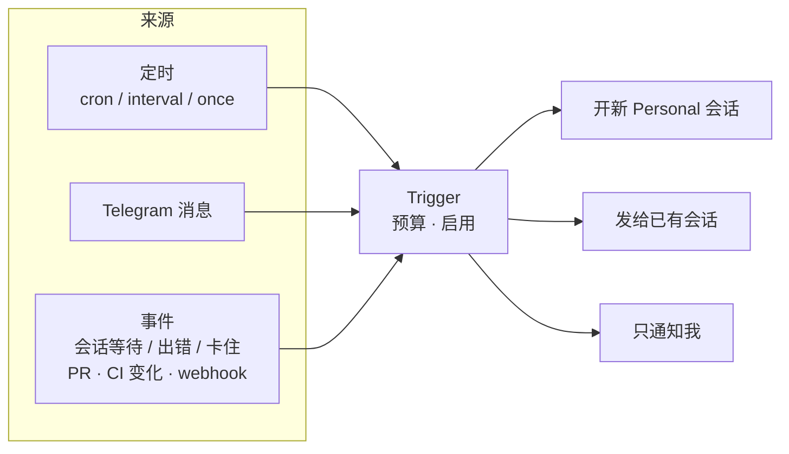
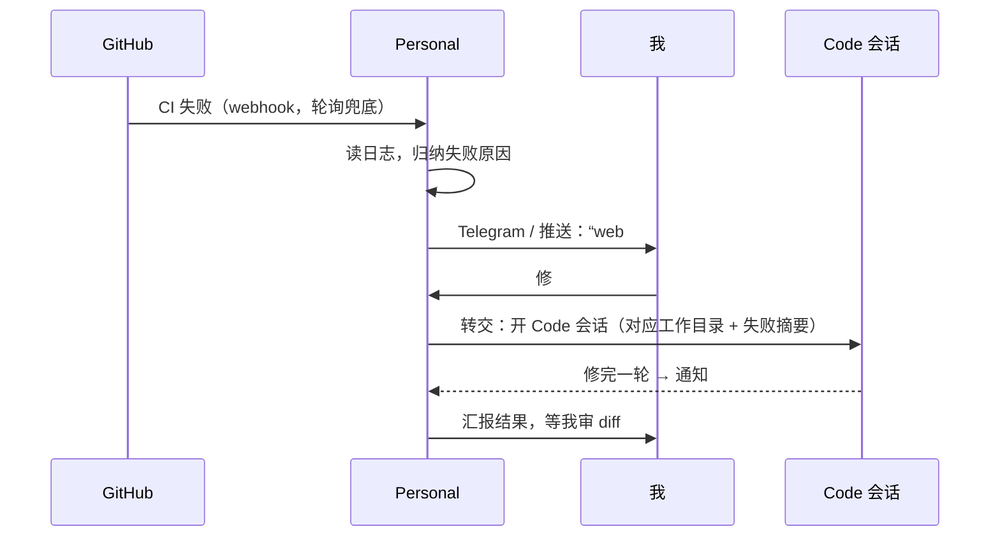

# 0010 Personal 模式

状态：已采纳 · 2026-10-31

## 定位

Personal 是一种**模式**，不是某个 harness。默认 harness 是一个设置项，随时可换；模型支持**订阅登录和 API key** 两种方式（凭证都留在 harness 自己的配置里）。

## 运行位置



## 个人档案（可移植记忆）

```
~/.hoplet/profile/          （位于主宿主）
  PROFILE.md                 索引
  persona.md                 人格（只注入 Personal）
  about-me.md · preferences.md · facts/*.md · people.md …（带 frontmatter）
```



- Hoplet 只负责**存放与注入**；“学什么、怎么整理”交给 harness。
- harness 自带的记忆照常运行；“关于我的事实”约定写进档案，换 harness 不丢。

## 触发器



| 规则 | 说明 |
|---|---|
| 主机离线错过 | 默认跳过并通知；可设为恢复后补跑一次 |
| 并发 | 同一触发器同时只跑一个 |
| 创建 / 修改 | 默认问我（Hoplet 规则） |

## Telegram

| 项 | 结论 |
|---|---|
| 运行 | VPS 上 bot 长轮询，无需公网入口 |
| 授权 | app 里生成一次性配对码，Telegram 用户 ID 进白名单，其他人消息一律忽略 |
| 线程 | 每个（通道，聊天）一条线程；空闲 N 小时或 `/new` 切新会话，带摘要 + 档案 |
| 发消息 | 发给我自己：直接发；替我发给别人：必须我本人确认 |

## 首批琐事：GitHub



- 能力来源：GitHub MCP / `gh`，登记在 `mcp.toml`（按模式启用）。
- 其他琐事（邮件、日历、浏览器……）以后通过接入现成 MCP 扩展，Hoplet 不自己造工具。

## Personal 可用的 Hoplet 工具

`sessions_list/read/status` · `session_create` · `session_send` · `handoff` · `delegate` · `profile_*` · `artifact_save` · `notify_me` · `trigger_create` · `terminal_*` · `run_on`

## 护栏

| 护栏 | 说明 |
|---|---|
| 预算 | 每个触发器、每次自主运行有轮次上限和 token 预算；另有每日总预算；超出即停并通知 |
| 循环检测 | 重复同一调用或无进展 → 自动暂停 |
| 代批 | Personal 代答 harness 审批：v1 不做，数据模型已预留 |

## 风险与兜底

harness 能遵守“事实写进档案”的约定。若不遵守，档案会变薄；可加一个低频后台任务，从会话摘要里提炼候选事实，交给我确认后写入。
