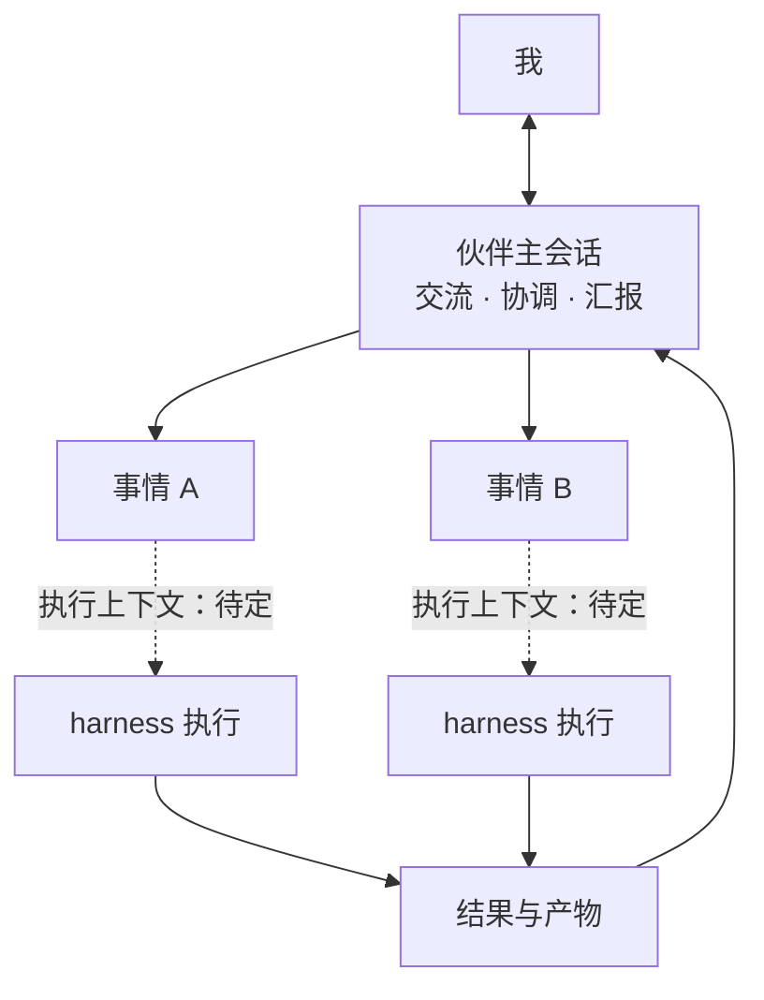
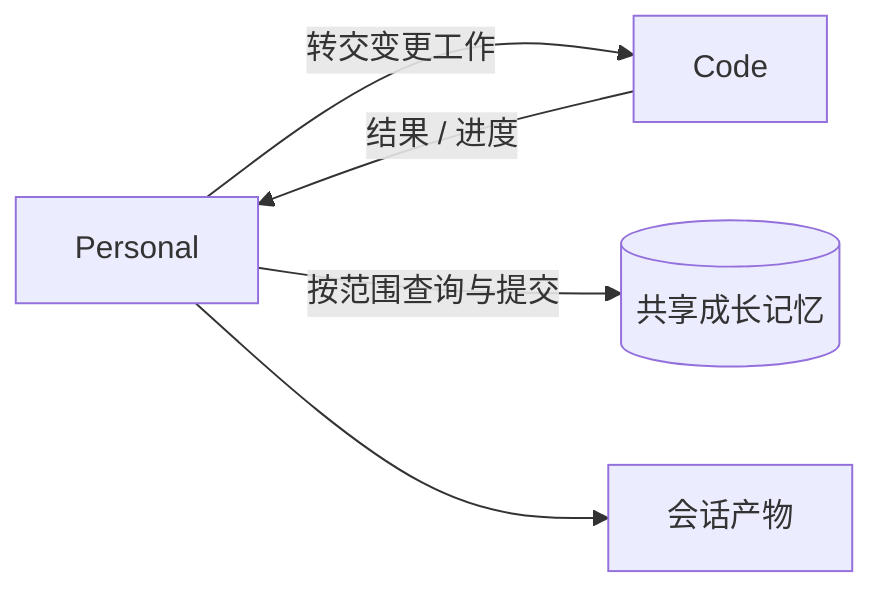

# 0010 Personal 模式

状态：当前设计 · 更新：2026-11-04

## 范围与现状

交付阶段：M4a 伙伴与工具底座。Personal 围绕长期伙伴交代事情，交付答案、办完的事和产物。

当前 Personal 使用普通 `Session{mode: personal}`：名字是会话标题，头像取首字。独立伙伴实体、人格入口、产物与转交服务尚未实现。

| 状态 | 边界 |
|---|---|
| ◐ 代码现状 | Personal 是普通 Session，标题和首字头像表示伙伴 |
| ○ 目标 | 独立伙伴身份、人格、事情关联、产物和转交 |

## 伙伴与事情

| 概念 | 当前规则 |
|---|---|
| 伙伴 | 人格 + 所选 harness + 连续主会话；各伙伴可选不同 harness |
| 事情 | 围绕目标、要求和结果跟进；具体实体与执行绑定待定 |
| 会话 | 保持当前统一 Session 内核；不将原生子执行自动视为新 Session |
| 参与者 | 消息记录发言伙伴，v1 只有一个参与者 |
| 生命周期 | 伙伴长期存在；轮次结束不证明事情完成 |

## 选择与位置

| 项 | 规则 |
|---|---|
| 模式 | 我明确选择 Personal，不由模型猜测 |
| harness | Personal 默认 harness 是设置项；新建伙伴时默认使用，可选择其他已支持项 |
| 模型登录 | 订阅或 API key 由 harness 自己管理，Hoplet 不保管凭证 |
| 人格 | 各伙伴独立；不擅自改写用户全局人格配置 |
| 位置 | 可建在任一自有主机，默认常驻主宿主；列表按机器筛选 |
| 跨机 | 需要另一台机器的操作交给明确授权的远端执行 |

## 能力边界

| 能力 | 规则 |
|---|---|
| 交流 | 短回答、澄清、优先级调整与结果汇报由主会话承接 |
| 执行 | 复用 harness 的工具、技能与原生委派；异步能力按版本验证 |
| 成长 | 使用内核的可迁移记忆；不以原生 Memory 自动代替权威档案 |
| Code 互通 | 提供目录、摘要与关联；给我已有会话发消息须先托管 |
| 产物 | 与事情和会话关联，可回到来源查看 |
| 权限 | 延续原生审批与 Hoplet 工具规则；记忆不授予授权 |
| 范围外 | 群聊与 Personal 代批不在 v1 范围内 |

## 验收

| 场景 | 结果 |
|---|---|
| 离开后回来 | 继续同一伙伴的交流，知道未完成事项 |
| 交代多件事 | 能区分目标、修订和结果，执行状态可追踪 |
| 转交 Code | 带目录与摘要，结果回到伙伴并等待我审阅变更 |

主会话与事情的图示是组织目标，不冻结新实体、接口或界面。未验证的能力不作为当前已实现功能呈现。

## 待验证

| 项 | 需确认 |
|---|---|
| 主会话 | 多件事情的跟进目录、话题指向、中途修订和结果版本 |
| 执行绑定 | 原生委派与独立 Session 的取舍；并行时如何保持交流响应 |
| 上下文接续 | 长会话压缩、换 harness、轮换和入口线程切换 |
| 产物与工作区 | 事情、执行上下文、目录和产物的关联与升级转交 |
