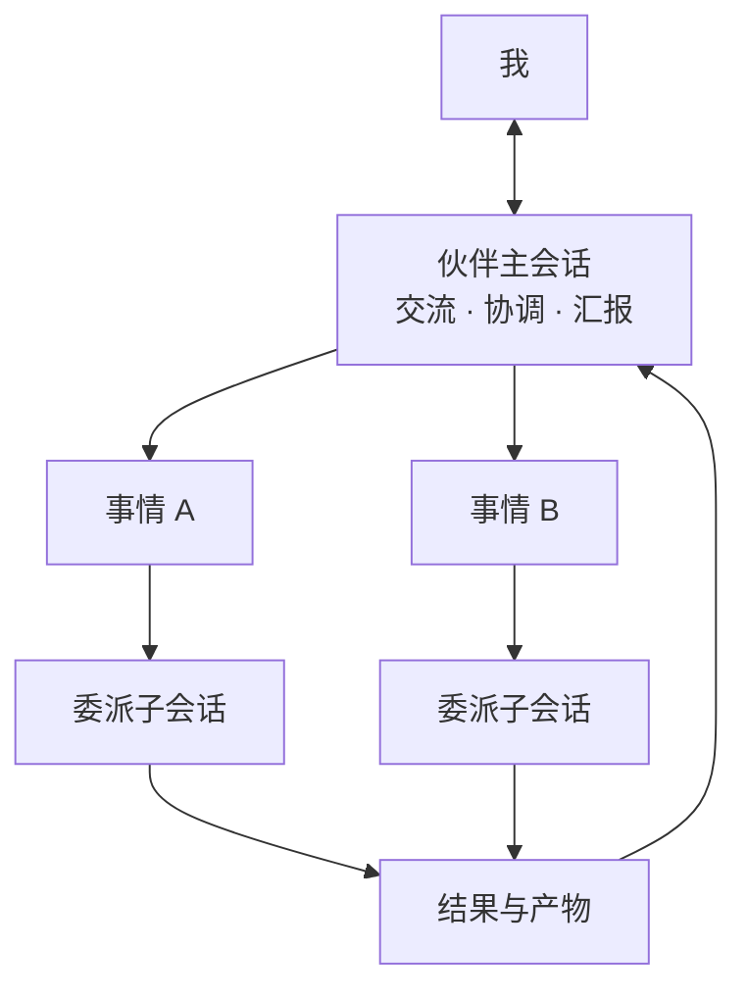
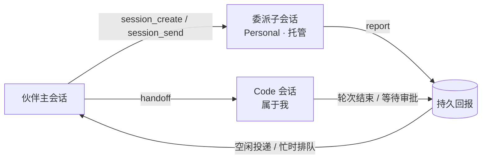
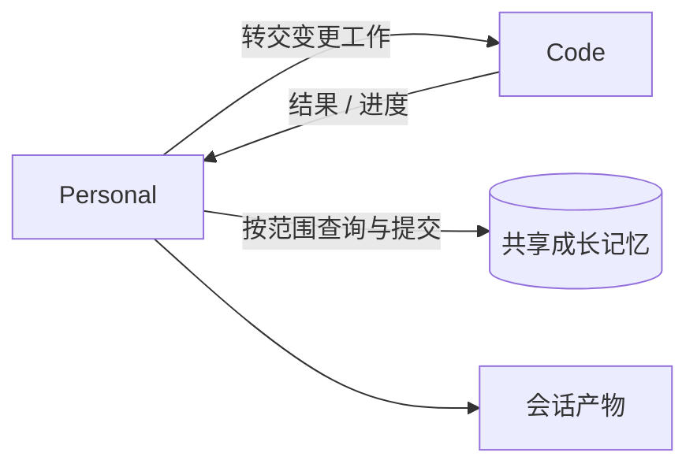

# 0010 Personal 模式

状态：当前设计 · 更新：2026-11-08

## 范围与现状

Personal 围绕长期伙伴交代事情，交付答案、办完的事和产物。

每个没有父会话的 Personal 会话是一个伙伴的主会话：伙伴有自己的目录和人格，名字取主会话标题，头像取首字。Personal 会话能委派子会话、收回回报，并把改代码的工作转交给 Code 会话；产物尚未实现。

| 状态 | 边界 |
|---|---|
| ◐ 代码现状 | 伙伴实体、伙伴目录与人格；主会话按人格启动；委派子会话与回报；转交 Code 与自动回报 |
| ○ 目标 | 产物、换主会话 |

## 伙伴与事情

| 概念 | 当前规则 |
|---|---|
| 伙伴 | 人格 + 所选 harness + 连续主会话；各伙伴可选不同 harness |
| 事情 | 围绕目标、要求和结果跟进；不设单独实体，一件事由一个委派子会话承担 |
| 会话 | 保持当前统一 Session 内核；不将原生子执行自动视为新 Session |
| 参与者 | 消息记录发言伙伴，v1 只有一个参与者 |
| 生命周期 | 伙伴长期存在；轮次结束不证明事情完成 |

## 伙伴实体

| 项 | 规则 |
|---|---|
| 字段 | 只存 ID、主会话、创建时间和是否留在会话目录；名字（主会话标题）、harness、归档时间读时取自主会话，主机由 daemon 填自己的主机 ID |
| 新建 | 新建没有父会话的 Personal 会话即建伙伴，同一事务写入，该会话作主会话；`companions.create` 与 CLI `companion new` 走同一路径 |
| 改名 | 改主会话标题 |
| 归档 | 主会话归档后，伙伴默认不再列出 |
| 迁移 | 每个已有的 Personal 会话（含已归档的）迁成一个伙伴，该会话作主会话；会话与事件不变 |
| 目录 | `~/.hoplet/companions/<id>/`，0700，放人格文件；新建伙伴时建好，迁移来的在第一次用到时再建 |
| 主会话的工作目录 | 会话设了 `Directory` 就用它；否则用伙伴目录。迁移时已有原生会话的主会话留在原来的会话目录，以便继续原生会话；`Directory` 不因迁移改动 |

## 委派与回报

| 项 | 规则 |
|---|---|
| 谁能委派 | 任何 Personal 会话；子会话也能再建子会话、继续交代、转交，回报交给直接的父会话 |
| 委派 | 用 `session_create` 建 Personal 子会话：归属为托管，父会话为调用方，建时写入、之后不改；任务作第一条消息立即发出；用 `session_send` 继续交代，只能发给自己建的托管子会话 |
| 子会话的设置 | 权限沿用调用方；harness 默认与调用方相同，相同时沿用模型与 effort；目录可选，须是已存在的绝对路径，不给就在会话目录工作；有父会话的 Personal 会话不是伙伴 |
| 回报 | 子会话用 `report` 交回结果。回报是发给父会话的一条消息，记下来自哪个会话，走父会话的消息队列：父会话空闲就发，忙就排队，持久、按键幂等，我可以编辑或删除；同一个键只入队一次，删掉的不会再出现 |
| 交给模型的回报 | 父会话日志记回报原文与来源；交给 harness 的文本前加一行 `[Report from Hoplet session <id> "<标题>"]`，空一行接原文，模型据此知道这不是我说的 |
| 父会话已归档 | `report` 把失败返回给模型；转交的自动回报跳过 |
| 原生委派 | harness 自己的子代理照常可用，Hoplet 不把它当作事情跟踪 |
| 转交 Code | `handoff` 建归属于我的 Code 会话：目录必填，父会话为调用方，权限 confirm，harness 默认与调用方相同；摘要作为第一条消息立即发出，审批都到我这里 |
| 转交的自动回报 | daemon 在每次存储变化后检查归属于我、有父会话、未归档的会话：最近结束的轮次回报该轮最后一条助手消息（没有时写 `The turn ended without a reply.`），每项等待中的审批回报一次它的标题与说明；键由会话、轮次或审批 ID 决定，daemon 重启后也不重复；daemon 停着时结束的几轮只回报最近的一轮 |

## 选择与位置

| 项 | 规则 |
|---|---|
| 模式 | 我明确选择 Personal，不由模型猜测 |
| harness | Personal 默认 harness 是设置项；新建伙伴时默认使用，可选择其他已支持项 |
| 模型登录 | 订阅或 API key 由 harness 自己管理，Hoplet 不保管凭证 |
| 人格 | 各伙伴独立；不擅自改写用户全局人格配置；见下节 |
| 位置 | 可建在任一自有主机，默认常驻主宿主；列表按机器筛选 |
| 跨机 | 需要另一台机器的操作交给明确授权的远端执行 |

## 人格

| 项 | 规则 |
|---|---|
| 来源 | 每个伙伴一份 `~/.hoplet/companions/<id>/persona.md`，是唯一来源；文件不存在当作空 |
| 限制 | 不超过 64 KiB、必须是 UTF-8；写入时拒绝，直接改坏的文件让主会话启动失败并说明原因 |
| 写入 | `companions.set_persona` 与 `companion persona --set` 先写临时文件再改名，0600；直接改文件也算数 |
| 读取 | 每次启动主会话前读一次；不是主会话的 Personal 会话不读 |
| 工作目录 | 项目里的工作交给子会话在各自目录进行 |
| Claude Code | 人格非空时经 `--append-system-prompt` 传入；为空时参数不变 |
| Hermes | 每次启动主会话时覆盖生成工作目录里的 `HERMES.md`（0600）：第一行注明由 Hoplet 生成、直接修改会被覆盖、改人格请用 `hoplet companion persona`，空一行后接人格；人格为空时只有这一行。Hermes 从工作目录读取 |
| 叠加 | 人格叠加在 harness 自身的全局身份之上，不替换也不修改它 |
| 生效 | 主会话还没有原生会话时，改动在它启动时生效（`next_launch`）；Claude Code 与 Hermes 续接原生会话时都沿用会话开始时的系统提示，主会话运行过之后改动只对新主会话生效（`new_main_session`），`set_persona` 返回其一，CLI 照此说明 |
| 限制 | Hermes 对 `HERMES.md` 做注入扫描，命中的内容被丢弃且不报错；Hoplet 不另做检测 |

## 能力边界

| 能力 | 规则 |
|---|---|
| 交流 | 短回答、澄清、优先级调整与结果汇报由主会话承接 |
| 执行 | 复用 harness 的工具、技能与原生委派；异步能力按版本验证 |
| 成长 | 使用内核的可迁移记忆；不以原生 Memory 自动代替权威档案 |
| Code 互通 | 提供目录、摘要与关联；给我已有会话发消息须先托管 |
| 产物 | 与事情和会话关联，可回到来源查看 |
| 权限 | 延续原生审批与 Hoplet 工具规则；记忆不授予授权 |
| 范围外 | 群聊与 Personal 代批不在 v1 范围内 |

## 验收

| 场景 | 结果 |
|---|---|
| 离开后回来 | 继续同一伙伴的交流，知道未完成事项 |
| 交代多件事 | 能区分目标、修订和结果，执行状态可追踪 |
| 转交 Code | 带目录与摘要，结果回到伙伴并等待我审阅变更 |

主会话与事情的图示是组织目标，不冻结新实体、接口或界面。未验证的能力不作为当前已实现功能呈现。

## 待验证

| 项 | 需确认 |
|---|---|
| 主会话 | 多件事情的跟进目录、话题指向、中途修订和结果版本 |
| 上下文接续 | 长会话压缩、换 harness、轮换和入口线程切换 |
| 产物与工作区 | 事情、执行上下文、目录和产物的关联与升级转交 |
