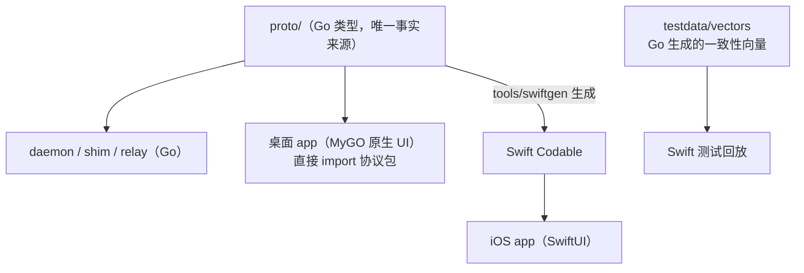

# 0011 客户端技术栈

状态：已采纳 · 2026-10-31

## 总览

## 桌面：MyGO 原生 UI

| 需要 | MyGO 提供 |
|---|---|
| 侧边栏、会话列表 | sidebar、虚拟化列表 |
| 流式回复 | 流式 Markdown |
| 审阅变更 | diff 查看器、代码编辑器 |
| 终端 | 终端插件（libghostty-vt） |
| 系统集成 | 通知、托盘、单实例、全局快捷键、自动更新、签名公证、Liquid Glass |

- 不用 webview 模式；纯 Go、无 cgo。
- 桌面 app 只是客户端：内置 `hoplet`，负责安装 LaunchAgent，守护进程独立运行。
- 先 macOS，Linux 以后（代码基本现成）。

## 终端模拟器（修订 0009）

shim 里用 MyGO 终端插件的 libghostty-vt + `Mirror` 做服务端模拟；`Mirror` 输出标准 VT 序列，iOS 的 SwiftTerm 可直接显示。代价：shim 依赖按平台分发的原生库（含 Linux VPS）。

## iOS：SwiftUI + Swift 协议客户端

| 项 | 结论 |
|---|---|
| 语言 / 系统 | Swift 6，iOS 26+ |
| 协议客户端 | Swift 实现。不用 gomobile：Go 运行时在 iOS 后台挂起时行为不可控，通知扩展的 24MB 内存也装不下 |
| 类型同步 | Go 写的生成器把 `proto/` 生成 Swift Codable（手写会让两边类型漂移） |
| 一致性 | Go 生成 Noise 握手、帧、续传场景向量，Swift 测试逐条回放 |
| 依赖 | CryptoKit（Noise）、GRDB（缓存）、SwiftTerm（终端） |

离开电脑场景专属：

| 能力 | 用途 |
|---|---|
| Live Activity / 灵动岛 | 运行中会话、待审批，锁屏批准 |
| Share Extension | 任意 app 里分享给 Personal |
| App Intents / Siri | “让 Personal 帮我……” |
| 通知扩展 | 解密推送正文 |

## 不做

Web 客户端、桌面 webview 模式、Android。

## 前置条件

Apple 开发者账号（真机、APNs、签名公证）、Go 1.27+、Xcode。

## 风险与兜底

MyGO 0.x 的 API 足够稳定。锁版本、用 `mygo migrate-ui` 升级；视图层保持很薄，状态都在协议客户端里。
