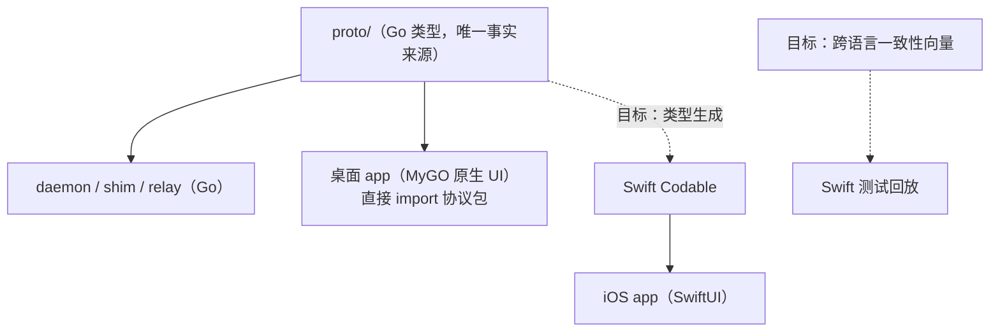

# 0011 客户端技术栈

状态：当前设计 · 更新：2026-11-08

## 范围与现状

范围：桌面与 iOS 技术栈、协议类型生成与系统集成。

| 状态 | 边界 |
|---|---|
| ✓ 代码已有 | Go / MyGO 桌面与协议客户端 |
| ○ 目标 | Swift / iOS、Swift 类型生成器与跨语言向量 |

## 总览

## 桌面：MyGO 原生 UI

| 需要 | MyGO 提供 |
|---|---|
| 侧边栏、会话列表 | sidebar、虚拟化列表 |
| 流式回复 | 流式 Markdown |
| 审阅变更 | diff 查看器、代码编辑器 |
| 终端 | 终端插件（libghostty-vt） |
| 系统集成 | 通知、托盘、单实例、全局快捷键、自动更新、签名公证、Liquid Glass |
| HTML 产物 | `ui.WebView`，不可信页面加自定义协议 |

- 应用界面全部是原生 UI，不做 web 前端；只有 HTML 产物用 `ui.WebView` 嵌在原生界面里，一律按不可信页面加载。纯 Go、无 cgo。
- 桌面 app 只是客户端：内置 `hoplet`，负责安装 LaunchAgent，守护进程独立运行。
- 先 macOS，Linux 以后（代码基本现成）。
- macOS 上计划引入的唯一 Swift 组件是 iOS 模拟器辅助进程（规划中，尚未实现）：Go 无法直接调用模拟器的私有框架，它将作为独立进程运行，桌面仍是纯 Go、无 cgo。

## iOS：SwiftUI + Swift 协议客户端（规划）

| 项 | 结论 |
|---|---|
| 语言 / 系统 | Swift 6，iOS 26+ |
| 协议客户端 | Swift 实现。不用 gomobile：Go 运行时在 iOS 后台挂起时行为不可控，通知扩展的 24MB 内存也装不下 |
| 类型同步 | Go 写的生成器把 `proto/` 生成 Swift Codable（手写会让两边类型漂移） |
| 一致性 | Go 生成 Noise 握手、帧、续传场景向量，Swift 测试逐条回放 |
| 依赖 | CryptoKit（Noise）、GRDB（缓存）、SwiftTerm（终端） |

离开电脑场景专属：

| 能力 | 用途 |
|---|---|
| Live Activity / 灵动岛 | 运行中会话、待审批，锁屏批准 |
| Share Extension | 任意 app 里分享给 Personal |
| App Intents / Siri | “让 Personal 帮我……” |
| 通知扩展 | 解密推送正文 |
| 产物查看 | SwiftUI `WebView` / `WebPage` 加自定义协议处理器，与桌面同一桥接契约 |

当前没有 `apple/`、Swift 类型生成器或跨语言向量产物，不能把图中的生成链路视为已实现。

## 不做

Web 客户端、web 前端的应用界面、Android。

## 前置条件

Apple 开发者账号（真机、APNs、签名公证）、Go 1.27+、Xcode。

## 验收

| 项 | 要求 |
|---|---|
| 协议一致性 | Go 向量由 Swift 逐条回放，类型通过生成同步 |
| MyGO 升级 | 锁定版本，使用 `mygo migrate-ui` 并验证组件 |
| 状态归属 | 视图保持薄，业务状态在协议客户端与 daemon |
| 平台能力 | iOS 后台、通知扩展与系统入口按真机验证 |

## 待验证

尚未落地的目标按原生协议、故障恢复与平台约束分别验证。
