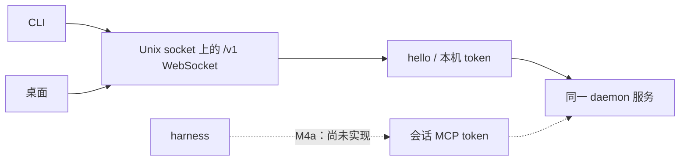
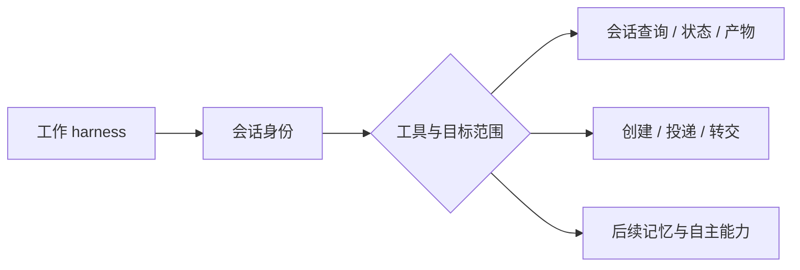
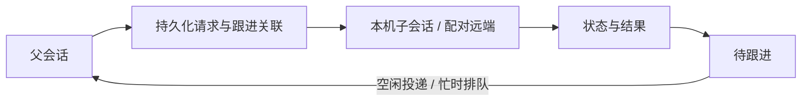

# 0012 服务入口与编排

状态：当前设计 · 更新：2026-11-04

## 范围与现状

范围：本机 API、CLI、目标 MCP 工具桥与跨会话 / 跨机服务。

| 状态 | 边界 |
|---|---|
| ✓ 代码已有 | 本机 API、CLI、订阅和客户端 wait |
| ○ 目标 | 会话 MCP、伙伴 / 产物工具、持久跟进、扇出与跨机 |

## 当前入口

本机 token 是当前认证机制；`device_id` 是客户端提供的审计标识，不是已实现的配对公钥身份。当前没有 MCP 服务、会话工具 token 或按 Code / Personal 区分的 MCP 鉴权。

## 已实现 API

| 类别 | 方法 |
|---|---|
| 连接 | `hello` |
| 会话目录 | `sessions.list`、`sessions.create`、`sessions.get`、`sessions.update`、`sessions.archive` |
| 输入与控制 | `sessions.send`、`sessions.respond`、`sessions.interrupt`、`sessions.steer`、`sessions.stop`、`sessions.answer` |
| 运行设置 | `sessions.set_permission`、`sessions.set_plan`、`sessions.set_fast`、`sessions.set_ultracode`、`sessions.set_effort`、`sessions.set_model` |
| 记录与输出 | `sessions.events`、`sessions.output`、`sessions.diff` |
| 队列 | `queue.list`、`queue.edit`、`queue.delete`、`queue.move` |
| 订阅 | `subscribe.catalog`、`subscribe.session` |
| 诊断 | `harnesses.list`、`env.refresh`、`system.doctor` |

`answer` 有服务入口，但当前两家适配器均返回不支持；其他动作也以适配器能力为准。`sessions.get` 的会话、待审批、队列分开读取，允许瞬间混合视图；写入决定以事务校验为准。

## CLI 与等待

| 项 | 当前行为 |
|---|---|
| 主命令 | session、daemon、harness、env、doctor、version、shim、hermes-bridge；开发入口有 record / sanitize |
| session | new / list / send / watch / wait / approve / set / interrupt / steer / stop / archive / diff，支持 `--json` |
| `session set` | 顺序为 permission → plan → fast → Ultracode → effort → model → title / pinned / unread；首个失败即停止，之前已生效的项不回滚 |
| ID | session 命令可用至少 4 字符的唯一前缀 |
| watch | 文本或 JSONL 事件，不提供完整 TUI |
| wait | 客户端使用订阅并每 2s 重查状态，不是 daemon 的持久化后台任务 |
| 未实现命令 | pair / device / relay / trigger / api schema，以及终端、fork、回滚、转交 / 委派的公开命令 |

`config.toml` 当前只加载 `network.proxy`、`network.no_proxy`、`env.allow`、`harness.claude.follow`、`harness.hermes.follow`；未知键报错。`rules.toml`、`hoplet.toml` 和 `mcp.toml` 尚未接入配置加载。

| `wait --for` | 满足条件 |
|---|---|
| idle | 会话 idle、队列空、相关消息轮次已结束 |
| blocked | waiting 审批态或队首失败 |
| done | idle / blocked / errored / archived；表示等待可结束，不证明事情交付完成 |

## 工具桥与伙伴服务（M4a 目标）

| 调用方 | 目标权限 |
|---|---|
| Code | 获准范围只读记忆、本会话终端和产物、转交与 notify |
| Personal | 按工具授权；给我已有会话发消息必须先托管 |
| 提炼任务 | 不注入可调用业务工具；只返回候选，由 daemon 提交 |

工具桥先复用现有服务，再增加稳定伙伴身份、会话关联、产物入口与回报订阅。MCP 注入、权限映射和原生协议能力先验证；不以提示词代替服务校验。

## 记忆服务入口（M4b 目标）

| 操作 | 输入与回执边界 |
|---|---|
| 查询 | 范围与条件 → 有效条目、版本、来源 |
| 写入 | 内容、来源、范围、目标版本、操作标识 → 已提交 / 候选 / 冲突 |
| 纠正 / 撤回 | 目标与版本 → 权威更新；修订投递另记状态 |
| 后台候选 | daemon 携带材料范围与进度提交，模型无服务写权限 |

具体字段和重试协议未冻结，当前没有这些 `proto/` 方法。

## 跨会话回报与跨机执行（目标）

| 能力 | 目标边界 |
|---|---|
| 持久化跟进 | 结果与通知分别记录；失败不丢结果，不等于当前 CLI wait |
| 原生委派 | 不自动映射成 Hoplet Session，不默认具有完整事件或重启恢复 |
| `run_on` | 依赖配对网络和工具桥，按目标授权与环境执行，不复制凭证 |
| 离线 | 明确排队；重连先核对，未知副作用不重放 |
| 扇出 | 可写并行要求隔离工作区，选中合回、其余归档；不以原生只读并行等同完整扇出 |

## 验收

| 当前 | 目标 |
|---|---|
| API 与 CLI 一致 | 相同命令得到相同结果与错误，send / respond 重试可查回执 |
| 等待可解释 | idle、blocked、done 与代码条件一致 |
| 工具桥 | 会话 token 与范围正确，底层服务只实现一次 |
| 远端 | 可区分排队、接单、执行与回报，断线后可核对 |

## 待验证

MCP 传输与注入、工具范围、伙伴关联和产物字段、持久订阅与回执、跨机输入 / 产物传输及取消语义均需定稿。对外 SDK 不在范围内。
