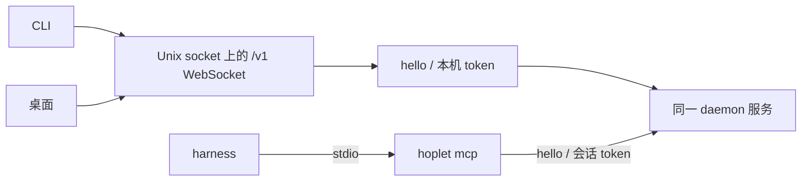
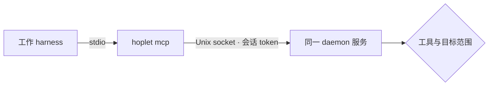
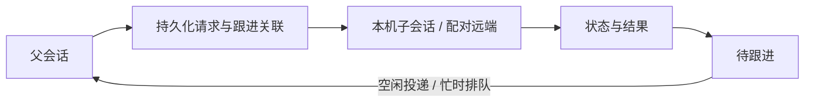

# 0012 服务入口与编排

状态：当前设计 · 更新：2026-11-08

## 范围与现状

范围：本机 API、CLI、MCP 工具桥与跨会话 / 跨机服务。

| 状态 | 边界 |
|---|---|
| ✓ 代码已有 | 本机 API、CLI、订阅和客户端 wait；伙伴与人格；会话工具桥与 `sessions_list`、`session_get`、`session_create`、`session_send`、`handoff`、`report`、`artifact_publish`；`hoplet artifact` |
| ○ 目标 | 持久跟进、扇出与跨机 |

## 当前入口

本机 token 是客户端的认证机制；`device_id` 是客户端提供的审计标识，不是已实现的配对公钥身份。harness 经 `hoplet mcp` 以会话 token 连接，只能调工具方法；工具按调用方的模式与父会话决定是否可见。

## 已实现 API

| 类别 | 方法 |
|---|---|
| 连接 | `hello` |
| 会话目录 | `sessions.list`、`sessions.create`、`sessions.get`、`sessions.update`、`sessions.archive` |
| 输入与控制 | `sessions.send`、`sessions.respond`、`sessions.interrupt`、`sessions.steer`、`sessions.stop`、`sessions.answer` |
| 运行设置 | `sessions.set_permission`、`sessions.set_plan`、`sessions.set_fast`、`sessions.set_ultracode`、`sessions.set_effort`、`sessions.set_model` |
| 记录与输出 | `sessions.events`、`sessions.output`、`sessions.diff`、`sessions.commits` |
| 伙伴 | `companions.list`、`companions.get`、`companions.create`、`companions.persona`、`companions.set_persona` |
| 队列 | `queue.list`、`queue.edit`、`queue.delete`、`queue.move` |
| 订阅 | `subscribe.catalog`、`subscribe.session` |
| 诊断 | `harnesses.list`、`env.refresh`、`system.doctor` |

伙伴方法的规则：

- `companions.list` 默认不含主会话已归档的，`all` 为真时全部列出；`list`、`get`、`create` 返回的伙伴带本机主机 ID。
- `companions.create` 的参数与 `sessions.create` 相同，只是没有 `mode`、`directory`、`isolation`；返回伙伴和主会话。用 `sessions.create` 建没有父会话的 Personal 会话也建伙伴。
- `companions.set_persona` 收 `{id, text}`，返回 `applies`：`next_launch`（主会话启动时生效）或 `new_main_session`（主会话已续接原生会话，只对新主会话生效）。
- 已配对的远程设备与 `sessions.*` 一样可调；会话 token 的连接不能调。

`answer` 有服务入口，但当前两家适配器均返回不支持；其他动作也以适配器能力为准。`sessions.get` 的会话、待审批、队列分开读取，允许瞬间混合视图；写入决定以事务校验为准。

## CLI 与等待

| 项 | 当前行为 |
|---|---|
| 主命令 | session、companion、artifact、daemon、harness、env、doctor、version、shim、hermes-bridge；开发入口有 record / sanitize |
| session | new / list / send / watch / wait / approve / set / interrupt / steer / stop / archive / diff，支持 `--json` |
| `session set` | 顺序为 permission → plan → fast → Ultracode → effort → model → title / pinned / unread；首个失败即停止，之前已生效的项不回滚 |
| companion | list [--all] / show / new / persona [--set FILE\|-]，支持 `--json` 与 `--host`；`persona --set` 按 `applies` 说明何时生效 |
| artifact | publish SESSION PATH [--name NAME] / list SESSION，支持 `--json`；`list` 支持 `--host`，`publish` 只在本机 |
| ID | session、companion 与 artifact 命令可用至少 4 字符的唯一前缀 |
| watch | 文本或 JSONL 事件，不提供完整 TUI；产物发布显示为 `published <name> v<n> (<kind>)` |
| wait | 客户端使用订阅并每 2s 重查状态，不是 daemon 的持久化后台任务 |
| 未实现命令 | pair / device / relay / trigger / api schema，以及终端、fork、回滚、转交 / 委派的公开命令 |

`config.toml` 当前只加载 `network.proxy`、`network.no_proxy`、`env.allow`、`harness.claude.follow`、`harness.hermes.follow`；未知键报错。`rules.toml`、`hoplet.toml` 和 `mcp.toml` 尚未接入配置加载。

| `wait --for` | 满足条件 |
|---|---|
| idle | 会话 idle、队列空、相关消息轮次已结束 |
| blocked | waiting 审批态或队首失败 |
| done | idle / blocked / errored / archived；表示等待可结束，不证明事情交付完成 |

## 工具桥与伙伴服务

| 项 | 规则 |
|---|---|
| 传输 | stdio：harness 的 MCP 配置运行 `hoplet mcp`，它连本机 daemon socket 转发；不开 TCP 端口 |
| 实现 | 官方 MCP Go SDK `github.com/modelcontextprotocol/go-sdk`，固定版本 |
| token | 存储只留 SHA-256，只对本会话有效，daemon 重启后仍有效，会话归档后作废；Claude Code 每次启动新生成；Hermes 把 MCP 配置存在自己的会话里，token 随会话不变 |
| 传递 | token 只放在这一项 MCP 配置的 `env` 里，不进 harness 的 shell 环境，也不进命令行 |
| 连接 | `hoplet mcp` 以会话 token 发 hello；这样的连接绑定到该会话，只能调 `tools.list`、`tools.call`；工具定义、参数校验与范围检查都在 daemon，`hoplet mcp` 只转发 |
| 规则 | 先不加载 `rules.toml`，默认规则写在代码里 |

| 工具 | 作用 | 调用方与范围 |
|---|---|---|
| `sessions_list`、`session_get` | 读会话目录与单个会话状态 | 所有会话；只读 |
| `session_create` | 建委派子会话 | 仅 Personal；参数 `prompt`（必填）、`title`、`harness`、`directory`；新会话为 Personal、归属托管、父会话为调用方；`prompt` 以键 `create:<子会话 ID>` 立即发出；返回子会话 |
| `session_send` | 给子会话发消息 | 仅 Personal；参数 `id`、`text`；目标须是调用方的直接子会话且归属托管；经消息队列发送或排队，返回 `{seq, turn}` 或 `{queued}` |
| `handoff` | 转交 Code | 仅 Personal；参数 `directory`（必填）、`summary`（必填）、`title`、`harness`；建归属于我的 Code 会话，父会话为调用方，权限 confirm；`summary` 立即发出；返回 Code 会话 |
| `report` | 交回结果 | 有父会话的会话；参数 `text`；以随机键交给父会话的消息队列，返回 `{queued}`，投递由队列完成 |
| `artifact_publish` | 发布产物 | 所有会话；参数 `name`（必填）、`entry`（必填）、`files`，路径相对会话工作目录，解析符号链接后不能越出；以来源 `harness` 只发布到本会话；返回 `{id, name, kind, version}` |
| `simulator_*` | 操作本机 iOS 模拟器：`list`、`boot`、`launch`、`screenshot`、`open_url`；目标：`tap`、`swipe`、`text`、`button` | 仅 Code 会话且主机为 macOS；`launch` 与输入类操作须持有设备占用；`screenshot` 的结果带图片内容 |

回报带状态：子会话调用 `report` 为 `done`；转交的 Code 会话由 daemon 代为回报，等待审批为 `approval`，一轮正常结束为 `done`，以失败或中止结束为 `error`（没有回复时正文为失败原因）。委派与转交成功后父会话日志里有一条 `session.delegated`。

当前已有读会话、委派、转交、回报与发布产物的工具。看不见的工具硬调用得到“没有这个工具”；ID 参数支持至少 4 个字符的唯一前缀；参数错误、范围不符、父会话已归档、队列已满都以工具失败返回给模型。`notify_me` 推迟到推送或交互通道就绪。提炼任务不注入可调用业务工具，只返回候选，由 daemon 提交。工具桥复用现有服务，不以提示词代替服务校验。

## 记忆服务入口（目标）

| 操作 | 输入与回执边界 |
|---|---|
| 查询 | 范围与条件 → 有效条目、版本、来源 |
| 写入 | 内容、来源、范围、目标版本、操作标识 → 已提交 / 候选 / 冲突 |
| 纠正 / 撤回 | 目标与版本 → 权威更新；修订投递另记状态 |
| 后台候选 | daemon 携带材料范围与进度提交，模型无服务写权限 |

具体字段和重试协议未冻结，当前没有这些 `proto/` 方法。

## 跨会话回报与跨机执行（目标）

| 能力 | 目标边界 |
|---|---|
| 持久化跟进 | 结果与通知分别记录；失败不丢结果，不等于当前 CLI wait |
| 原生委派 | 不自动映射成 Hoplet Session，不默认具有完整事件或重启恢复 |
| `run_on` | 依赖配对网络和工具桥，按目标授权与环境执行，不复制凭证 |
| 离线 | 明确排队；重连先核对，未知副作用不重放 |
| 扇出 | 可写并行要求隔离工作区，选中合回、其余归档；不以原生只读并行等同完整扇出 |

## 验收

| 当前 | 目标 |
|---|---|
| API 与 CLI 一致 | 相同命令得到相同结果与错误，send / respond 重试可查回执 |
| 等待可解释 | idle、blocked、done 与代码条件一致 |
| 工具桥 | 会话 token 与范围正确，底层服务只实现一次 |
| 远端 | 可区分排队、接单、执行与回报，断线后可核对 |

## 待验证

持久订阅与回执、跨机输入 / 产物传输及取消语义均需定稿。对外 SDK 不在范围内。
