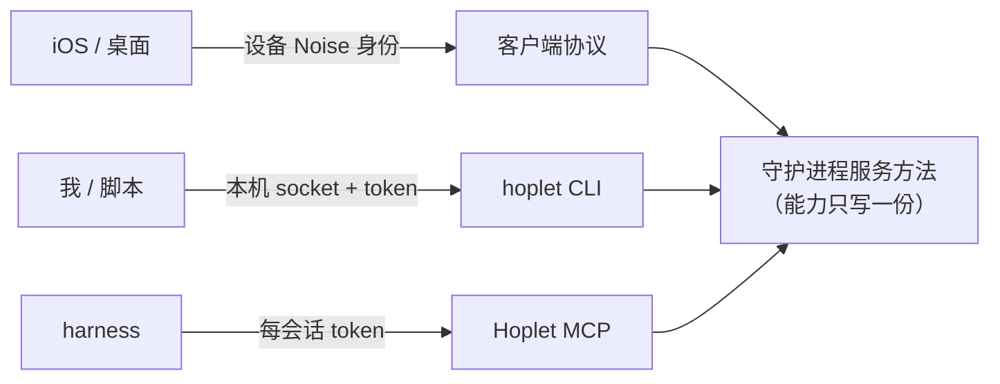
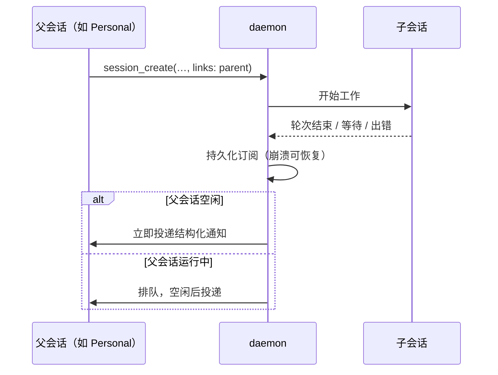

# 0012 编排与自动化接口

状态：已采纳 · 2026-10-31

## 一套服务，三个入口



## MCP 权限范围

| 调用方 | 可用 |
|---|---|
| Code 会话 | 只读档案、本会话终端与产物、发起转交、`notify_me` |
| Personal 会话 | 全套工具；但给**我开的会话**发消息，须先托管给它 |

Hoplet MCP 调用由 [0007](0007-commands-approvals.md) 的 Hoplet 规则把关。

## 等待与回报



- 等待原语：`session_wait(idle | blocked | done)`、`terminal_wait(exit | idle)`。
- 兜底：未处理的子会话结果出现在 `sessions_status` 的“待跟进”列表。

## 扇出（v1 只给原语）

`session_create` 带 `group` → 组内会话自动隔离、同一工作目录、可选不同 harness → 选中一个合回，其余归档。比较界面以后再做。

## CLI

```
hoplet session new --mode code --dir . --harness claude "prompt"
hoplet session list | send | watch | wait | approve | archive
hoplet pair · hoplet device list | revoke · hoplet daemon install | uninstall | status · hoplet doctor
hoplet relay · hoplet env refresh · hoplet trigger list | add
hoplet api schema        # 全部方法的 JSON Schema，给 agent 自己读
```

全部支持 `--json`；`watch` 输出文本事件流，不做完整 TUI。

## webhook

中继额外暴露 `/hook/<id>`，每个 hook 独立 HMAC 密钥，验签后转给 VPS 守护进程生成触发事件；不额外开公网端口。

## 不做

对外 SDK。

## 风险与兜底

父会话能正确理解注入的完成通知。通知用固定结构化格式并写进 Personal 提示词；“待跟进”列表兜底。
