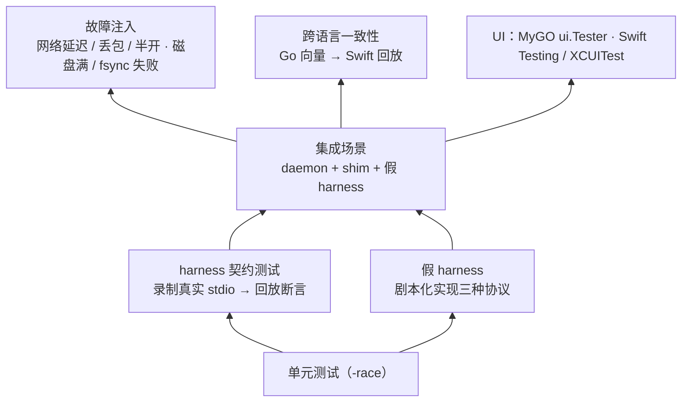

# 0013 测试、升级与发布

状态：当前设计 · 更新：2026-11-07

## 范围与现状

范围：测试、质量预算、产品升级与发布。

| 状态 | 边界 |
|---|---|
| ✓ 代码已有 | CI、格式 / lint / race / vet、假 harness 与录制回放 |
| ○ 目标 | 完整性能门禁、跨语言验证、构建分发、签名和备份恢复 |

## 仓库结构

```
cmd/hoplet/          唯一二进制（daemon / shim / relay / CLI）
internal/            daemon · shim · store · sync · noise · relay · harness/<kind> · workspace · trigger …
proto/               协议类型（唯一事实来源）
tools/swiftgen/      Go 类型 → Swift Codable
desktop/             MyGO 桌面 app
apple/               iOS app + 通知扩展 + Share Extension + Live Activity
testdata/vectors/    跨语言一致性向量
docs/                设计文档
```

## 测试分层



必须覆盖的集成场景：轮次中途 `kill -9` 守护进程后续接 · 两客户端抢答审批 · 续传阈值（补发 / 快照）· 背压断连 · Noise 反例（重放、已吊销设备、带 `Origin` 的连接）。

## 性能预算（目标）

| 指标 | 初始目标 |
|---|---|
| 冷打开会话、断线续传的传输字节数 | 设上限，回归监控 |
| 守护进程空闲 RSS | < 50MB |
| 单个 shim RSS | < 10MB |
| 30 个并发会话 | CPU / 内存不随时间增长 |
| 经海外中继的流式端到端延迟 | p95 < 400ms |

当前有存储基准与工作区性能场景，尚未实现表中所有 RSS、长时间并发与远程延迟门禁；不能由一次 `make check` 推断这些预算均已验证。

## 可观测性

| 工具 | 内容 |
|---|---|
| 日志 | slog JSON、自动轮转、带会话 ID；默认不打逐 token 日志 |
| `hoplet doctor` | 已有：home 权限、token、主机身份密钥、config、服务（LaunchAgent / systemd，含 linger）、daemon 版本、登录 shell 环境、git、直连监听、中继注册、代理连通、harness 适配；目标：APNs 密钥、libghostty |
| `hoplet status --json` | 基础运行指标 |

## 当前检查链路

| 项 | 代码配置 |
|---|---|
| `make check` | fmt-check → lint → `go tool mygo vet desktop` → `go test -race ./...` → gen-check，前一步失败则后续不执行 |
| CI | Go 1.27，安装 golangci-lint 2.15.0，执行同一 `make check` |
| 生成 | `go generate ./...` 后比较 Git 状态，覆盖 `proto/` 生成的 Swift 类型与 `testdata/vectors/`；向量另由 `go test` 与实现逐字节比对 |
| Swift | 有 Xcode 的机器上 `make check` 含 `swift format` 与 `swift test`；CI 在相关路径变动时用 macOS 任务运行 |
| 现有测试 | 假 harness、原生录制回放、daemon / shim / store / workspace / 桌面组件测试 |
| 后续测试 | Noise、iOS、跨语言向量、MCP、记忆、自主与跨机随能力落地 |

## 升级（目标）

| 组件 | 方式 |
|---|---|
| 守护进程 | 放新二进制 → launchd / systemd 重启 → 原子接管 socket；shim 不动、自动重连 |
| shim | 会话空闲或下次启动时才换新版本 |
| 数据库 | 迁移前自动备份 `hoplet.db`（保留最近 3 份） |
| 各主机 | `hoplet self-update`，从 GitHub Releases 下载并校验签名 |
| 桌面 app | MyGO 更新器，连同内置 `hoplet` 一起更新 |
| 版本不一致 | 客户端提示升级（主版本） |

## 发布（目标）

| 产物 | 方式 |
|---|---|
| `hoplet` | GitHub Actions：darwin-arm64、linux-amd64、linux-arm64 |
| 桌面 app | `mygo build`，签名 + 公证 |
| iOS | 本地 archive → TestFlight |
| 版本号 | 全部组件共用一个 semver 0.x |
| 备份 | `hoplet backup / restore`：数据库、档案、规则、密钥，口令加密 |

当前发布工作流只运行 release-please；没有二进制构建上传、签名校验、自更新、备份恢复、桌面公证或 iOS 发布流水线，不能把目标表当作已实现命令。

## 验收

| 范围 | 条件 |
|---|---|
| 本机 | 实际运行 Makefile 中的检查，逐项报告真实结果 |
| 新能力 | 对应的协议、恢复和平台用例通过后才算交付 |
| 发布 | 构建、签名、升级与恢复逐步验证，release-please 不代替它们 |

## 待验证

录制只覆盖走过的路径，本机自检只覆盖核心控制；Plan 批准等能力分别验证。未通过验证的版本禁止新轮次；有可用托管副本时保留旧副本，不能据此承诺所有原生安装均可回退。
