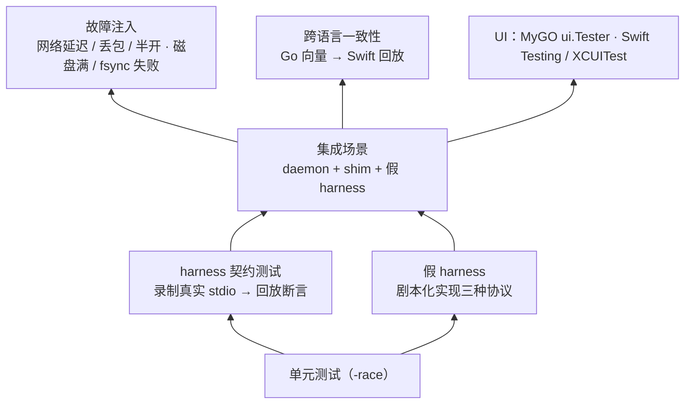
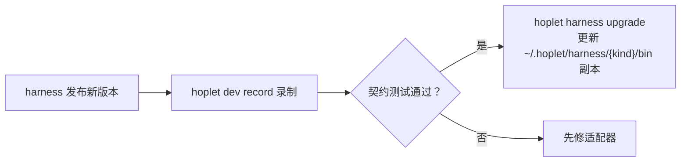

# 0013 测试、升级与发布

状态：已采纳 · 2026-10-31

## 仓库结构

```
cmd/hoplet/          唯一二进制（daemon / shim / relay / CLI）
internal/            daemon · shim · store · sync · noise · relay · harness/<kind> · workspace · trigger …
proto/               协议类型（唯一事实来源）
tools/swiftgen/      Go 类型 → Swift Codable
desktop/             MyGO 桌面 app
apple/               iOS app + 通知扩展 + Share Extension + Live Activity
testdata/vectors/    跨语言一致性向量
docs/                设计文档
```

## 测试分层



必须覆盖的集成场景：轮次中途 `kill -9` 守护进程后续接 · 两客户端抢答审批 · 续传阈值（补发 / 快照）· 背压断连 · Noise 反例（重放、已吊销设备、带 `Origin` 的连接）。

## 性能预算（写进测试，超出即失败）

| 指标 | 初始目标 |
|---|---|
| 冷打开会话、断线续传的传输字节数 | 设上限，回归监控 |
| 守护进程空闲 RSS | < 50MB |
| 单个 shim RSS | < 10MB |
| 30 个并发会话 | CPU / 内存不随时间增长 |
| 经海外中继的流式端到端延迟 | p95 < 400ms |

首次实测后校准。

## 可观测性

| 工具 | 内容 |
|---|---|
| 日志 | slog JSON、自动轮转、带会话 ID；默认不打逐 token 日志 |
| `hoplet doctor` | harness 版本、代理连通、登录 shell 环境、权限、中继、APNs 密钥、libghostty |
| `hoplet status --json` | 基础运行指标 |

## harness 版本托管（修订 0003）



- Hoplet 使用**自己锁定版本的 CLI 副本**，关闭其自动更新；登录与配置沿用我全局的 `~/.claude`、`CODEX_HOME`。
- 我在终端里用的 CLI 不受影响。

## 升级

| 组件 | 方式 |
|---|---|
| 守护进程 | 放新二进制 → launchd / systemd 重启 → 原子接管 socket；shim 不动、自动重连 |
| shim | 会话空闲或下次启动时才换新版本 |
| 数据库 | 迁移前自动备份 `hoplet.db`（保留最近 3 份） |
| 各主机 | `hoplet self-update`，从 GitHub Releases 下载并校验签名 |
| 桌面 app | MyGO 更新器，连同内置 `hoplet` 一起更新 |
| 版本不一致 | 客户端提示升级（主版本） |

## 发布

| 产物 | 方式 |
|---|---|
| `hoplet` | GitHub Actions：darwin-arm64、linux-amd64、linux-arm64 |
| 桌面 app | `mygo build`，签名 + 公证 |
| iOS | 本地 archive → TestFlight |
| 版本号 | 全部组件共用一个 semver 0.x |
| 备份 | `hoplet backup / restore`：数据库、档案、规则、密钥，口令加密 |

## 风险与兜底

录制回放能覆盖 harness 的真实行为。录制只覆盖走过的路径；每次升级额外跑一次手动冒烟测试（需真实订阅）。
