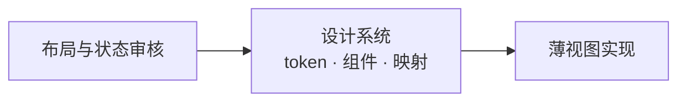

# 0014 桌面设计系统

状态：当前设计 · 更新：2026-11-04

## 范围与现状

范围：视觉 token、文字、图标和 MyGO 组件映射。

布局审核通过后先同步设计系统，再实现；代码从当前系统取值，缺失状态先设计，不以实现绕过原生组件。

| 状态 | 边界 |
|---|---|
| ✓ 代码已有 | 主题、字号、资源与基础组件；颜色以 theme.For 为准 |
| ○ 待验证 | 所有材质上的可读性与后续组件状态 |

## 材质

- 整个窗口是玻璃，桌面壁纸透过侧栏（`side`）、正文区（`pane`）和右栏
- 各区靠明暗区分。底色跟着标志走：深色取深色标志（石墨），浅色取浅色标志的底（白 → #E7EAEE），正文区取白端，侧栏和你的气泡取 #E7EAEE
- 输入框在浅色下加一条 `glass-line` 细边（黑 .08）。输入框只铺 `glass` 底与 `glass-line` 细边
- 窗口里自己画的弹层、菜单、提示条、回到底部按钮用接近不透明的 `popover` + 1px `line2` + `shadow-popover`，不加背后模糊。正文区上的卡片（伙伴气泡等）用 `bg`，工具输出框和排队托盘用 `bg2`。正文区不用玻璃材质，只用半透明底，保证长文与代码清晰。

## 颜色

| token | 深色 | 浅色 | 用途 |
|---|---|---|---|
| `fg` / `fg2` / `fg3` | #F4F4F5 / #D3D6DB / #B0B4BB | #23272D / #383B40 / #53575D | 正文 / 次要 / 图标与控件 |
| `muted` / `faint` | #8E939B / #666B73 | #5E6268 / #A0A4AA | 辅助信息 / 占位与禁用 |
| `accent` + `on-accent` | #3CC4C9 + #0C1A1C | #066A70 + #FFFFFF | 按钮、开关、发送的底与其上的字 |
| `accent-fg` | #3CC4C9 | #066A70 | 需要突出显示的一律用它：链接、行内代码（8% 淡底）、文件名（工具行读取 / 编辑的路径、改动卡片）；焦点环、运行中、未读 |
| `attn` + `on-attn` | #F0A35B + #1E1408 | #A85C14 + #FFFFFF | 需要你 |
| `attn-line` / `attn-glow` | #F0A35B .40 / .10 | #D9822B .40 / .10 | 审批输入框的描边 / 描边外 3px 光晕（深浅都有） |
| `add` / `del` | #7BC86C / #F0758A | #2E7031 / #B02A55 | diff 新增 / 删除 |
| `pane` / `side` / `glass` | #0E1014 .42、#0E1014 .38、白 .05 | 白 .62、#E7EAEE .82、白 .88 | 正文区 / 侧栏与右列 / 输入框 |
| `raised` / `sel` / `sel-row` | 白 .16 / .10 / .09 | 白 .88 / 黑 .055 / .06 | 分段与标签选中项 / 当前菜单项 / 选中行 |
| `bg` / `bg2` | 白 .06 / .03 | 白 .75 / .70 | 正文区上的卡片、伙伴气泡 / 工具输出框、排队托盘 |
| `side-line` | 白 .07 | 黑 .06 | 侧栏右边的细边 |
| `fill` / `fill2` | 白 .06 / .10 | 黑 .04 / .06 | 控件底 / 悬停 |
| `line` / `line2` | 白 .08 / .14 | 黑 .06 / .10 | 分隔线 / 控件边 |
| `glass-line` | 白 .12 | 黑 .08 | 输入框细边 |
| `attn-fg` | #F5BB82 | #8A4B0F | 需要你的文字 |
| `add-bg` / `del-bg` | #7BC86C .12 / #F0758A .11 | #2E7031 .10 / #B02A55 .08 | diff 淡底 |
| `bubble` | 白 .10 | #E7EAEE .95 | 我的消息气泡 |
| `shadow` | 黑 .45 | 黑 .12 | 弹层阴影 |
| `popover` | #262A30 .97 | 白 .97 | 窗口里自己画的弹层（输入框的弹层、新建页的目录与模型、提示条、回到底部）：接近不透明，配 1px `line2` 边框与弹层阴影，不加背后模糊 |

规则：

- 一种彩色：青色只给可操作的元素和需要注意的状态，不用在背景、壁纸、中性灰和选中底上。
- 四种有含义的颜色在色相上拉开：青 182°、绿 110–123°、琥珀 29°、玫红 341–350°。新增 / 删除只出现在 diff 和行数里；琥珀只表示需要你；文件状态 M、R 用中性灰。
- 状态先靠形状，其次颜色。
- 文字在玻璃上的目标对比度 ≥4.5:1，需按实际材质实测；`faint` 不承载必须读到的信息。焦点环 2px 实线 `accent-fg`。

## 字体

界面使用系统 SF Pro / 苹方，不打包；代码打包 JetBrains Mono Regular / SemiBold，关闭连字。

| 语义槽位 | 字号 |
|---|---|
| 新建页标题 | 22 / 行高 28，600 |
| 分区标题、卡片数字 | 15 / 行高 20，600 |
| 对话正文、输入框 | 13.5 / 行高 22，400 |
| 侧栏、菜单、按钮、工具行 | 13 / 行高 18，400；标题栏与未读行 600 |
| 路径、预览 | 12 / 行高 16，400 |
| 时间、计数、分组、快捷键 | 11 / 行高 14；分组 600，其余 400 |
| 代码 | 12 / 行高 19，400；行内 12.5 |

字重只用 400 / 500 / 600；会变的数字用等宽数字。

## 尺寸

 4 的倍数。圆角：行 6 · 控件 7 · 卡片与弹层 10 · 大卡片 14 · 输入框与气泡 18 · 胶囊 999。高度：行 28、密集行 24、标题栏 44。

## 图标

 界面用 Lucide（16 网格、1.4 描边、跟随文字色；尺寸 12 / 14 / 16 / 20；图标按钮 28，密集处 24；必须有悬停提示"名称 快捷键"）。审批档位用 Lucide 盾牌：shield-question-mark、shield-half、shield-check、shield-off。文件类型用 Material Icon Theme 彩色图标（官方 SVG 原样放在 `desktop/internal/icons/material/`，MIT），保留原色：工具行里读取 / 编辑的文件、改动卡片的每个文件前 14；会话详情的目录行用它的文件夹图标；正文里的文件链接不加（Markdown 行内插图标要绕开 MyGO 的渲染）。harness：Claude 用 Simple Icons 单色标志，Codex、Hermes 用首字母占位；名字写正式名 Claude Code、Codex、Hermes，不写内部代号。

## 标志

 小写 h（竖笔胶囊 + 肩与右腿连成的倒 L），右上一块圆角方块跳出、转 14°，方块是品牌青。深色图标：石墨渐变底 #3A3F47→#15181C、主体 #F4F4F5、方块 #3CC4C9；浅色图标：#FFFFFF→#E7EAEE、主体 #23272D、方块 #066A70。菜单栏、标签页、通知用单色剪影（方块 42% 不透明）。

## 文字

界面用中文，所有界面文字（包括工具行、工作组摘要、耗时）跟随界面语言；命令、路径、文件名、模型名、原始输出保持原文。只陈述事实，称"你"，不加"请"，不用感叹号与 emoji；出错一句话说原因并给一个能解决的操作。按钮以动词开头、2–4 个字。能用图标的不用文字。中英文之间加空格。品牌名在界面文字里写作 Hoplet（首字母大写；命令名、路径里仍是 `hoplet`）。词表：会话、伙伴、工作目录、变更、本次 / 累计 / 分支、产物、触发器、审批、插话、排队、分叉、个人档案、需要你、断线（不说对话、Bot、项目、轮）。

## 资源版本

| 资源 | 固定版本 | 规则 |
|---|---|---|
| MyGO | 0.7.4 | 原生 UI，升级验证组件契约 |
| Lucide / lucide-static | 1.66.0 | 官方 SVG 原样复制，不画图标或改路径 |
| Material Icon Theme | 5.40.0 | 文件类型图标，保留原色与 MIT 许可 |
| Simple Icons | 16.36.0 | harness 标志，保留 CC0 许可 |
| JetBrains Mono | 2.304 | Regular / SemiBold，保留 SIL OFL 1.1 许可 |

## MyGO 对应

| 对象 | 原生 API / 映射 |
|---|---|
| 主题 | `ui.Theme`；Surface / SurfaceHover = `fill` / `fill2`，Border = `line2`，Text / TextMuted = `fg` / `muted` |
| 主题状态 | Accent / AccentText = `accent` / `on-accent`，Warning = `attn`，Success / Danger = `add` / `del`，Focus = `accent-fg` |
| 基础尺寸 | Radius 7、Spacing 4、FontSize 13；其余语义色按 `Theme.Dark` 放在应用主题包 |
| 窗口材质 | `Vibrancy: VibrancyUnderWindow` + `TitleBarHiddenInset`；根节点不铺底，区域铺半透明 token |
| 输入框与弹层 | 输入框 `glass` + `glass-line`，弹层 `popover`；`glass.Glass{}` 只模糊窗口内内容且压暗浅色，不用于此材质方案 |
| 侧栏与键盘 | `ui.Row` + 悬停 / 点击 / 右键；可聚焦元素以 `Shortcut` 接键。`ui.SidebarItem` / `ui.List.Selected` 的强调色选中底不符合中性灰选中规范 |
| 分段 / 标签 | `ui.Segmented` / `ui.Tabs` |
| 拖动宽度 | `ui.Split`；原生分隔线，悬停 / 拖动时强调色 |
| Markdown / diff / 文件树 | `markdown.Stream` / `editor.DiffView` / `ui.Tree` |
| 弹层 | `ui.PopoverBase` + `AttachTo`；`popover`、圆角 10、内边距 6、阴影，菜单项高 28 / 圆角 6 |
| 模型与强度菜单 | 嵌套 `ui.PopoverBase` 承载搜索、右侧值和开关；`PopoverMenu` 文字项不足以表达这些控件 |
| 队列拖动 | `ListState.Reorder` |
| Worktree / 开关 / 角标 | `ui.Checkbox` / `ui.Switch` / `ui.Badge` |
| 提示条 | `c.AddToast` + `ui.ToastViewportBase` / `ui.ToastBase` |
| 动效 | `Element.Jump` / `AnimateTo` / `AnimateColor` / `Transition`，不自建计时器 |
| 悬停提示 | `Element.Tooltip` |
| 头像 | 首字 + 中性灰底；`ui.Avatar` 按名字配色不符合单一彩色规范 |
| 图标 | `ui.Icon`（Lucide）/ `ui.Image`（Material） |
| 菜单与托盘 | `mygo.NewMenu` / `mygo.NewTray`，托盘 `IconIsTemplate: true` |

MyGO 升级通过 `mygo migrate-ui` 迁移并验证；视图保持薄，禁止用计时器、覆盖层或自行绘图绕过现成组件。缺失能力先调整并审核设计。

## 验收

| 范围 | 条件 |
|---|---|
| token | 颜色与尺寸对应现有主题代码 |
| 资源 | 版本固定，官方 SVG 原样保留 |
| 可用性 | 材质、文字、焦点和减少动态效果按真实界面核对 |

## 待验证

实际玻璃材质对比度、跨系统外观、后续组件和资源升级仍需验证。
