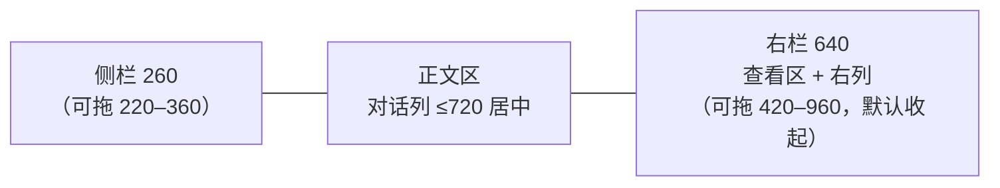

# 0014 桌面界面与设计系统

状态：已采纳 · 2026-11-01

桌面端的布局、交互与视觉规范。实现用 MyGO 原生 UI（[0011](0011-client-stack.md)）；这里的每个值都能直接对应到 `ui.Theme`、MyGO 组件和玻璃材质，对应关系见文末。

设计稿分两份：桌面布局稿画界面和状态，供审核；Hoplet 设计系统存 token、组件规格和 MyGO 对应，是代码取值的来源。审过的布局先同步进设计系统和本文，再写代码；本文与设计系统保持一致。

## 窗口

- 隐藏系统标题栏，自己画 44 高的标题行；侧栏顶行 52 高，左侧让出红绿灯。红绿灯固定在距窗口左上 (20, 19)，正好在 52 高顶行的中线上，顶行的按钮与它同一中线；侧栏收起时正文标题行也变成 52 高。
- ⌃⌘S 收起侧栏：侧栏整个隐藏，红绿灯、显示侧栏、后退、前进移到正文标题栏最左侧。
- 正文区窄于 560 时右栏自动收起。Personal 默认没有右栏。

## 侧栏

| 区 | 内容 |
|---|---|
| 顶行 | 红绿灯 · 收起侧栏 ⌃⌘S · 后退 ⌘[ · 前进 ⌘] · 右侧模式切换（只用图标：左 Personal 对话气泡 ⌘1，右 Code `</>` ⌘2） |
| 入口 | 新建 · 搜索（⌘K）· 收件箱（角标 = 需要你的数量）。图标 + 文字，不写快捷键 |
| Code 列表 | 标题行"全部机器 ▾"（范围）+ 排列菜单（排序：最近更新 / 创建时间 / 名称；显示：全部 / 需要我处理的 / 运行中）；置顶分区；按**工作目录**分组（文件夹图标 · 目录名 · 右侧 ＋ 在此目录新建会话） |
| Personal 列表 | 标题行"全部机器 ▾" + ＋ 新建伙伴；伙伴两行：头像（首字、中性灰底，右下 harness 角标）· 名字 · 最近一条消息预览 |
| 底部 44 | 本机身份按钮（电脑图标 · 本机名 · 连接图标，断开时换成带斜线的）· 归档（Code）/ 个人档案（Personal）· 设置 |

**会话行：** 一行 28 高；行首 harness 品牌图标；行尾只放一样东西：运行中转圈、需要你实心点、未读小点 + 标题加粗、出错方块、断线断链图标；只有空闲显示相对时间；悬停换成置顶、归档。会话行不显示机器（机器只在标题栏悬停提示、范围筛选和底部身份里出现）。

**右键菜单：** 置顶 P · 标为未读 U · 重命名 R · 在 Finder 中显示目录 O（仅本机）· 停止 S（仅运行中）· 归档 A。

## 正文区

**标题栏：** harness 品牌图标 · 标题（13 / 600，双击改名）· ⌄ 会话菜单；右侧 会话详情（⌘I，浮层：机器 · 目录与分支 · harness / 模型 / 强度 · 计划 · 分叉 · 复制会话 ID）· 右栏开关（右栏收起时才在这里，打开时在右栏自己的顶栏）。不放状态胶囊，不写机器和目录（悬停标题显示）。

**Code 对话：**

- 分隔线：时间 · 用时 · +/−（不写"第 N 轮"）。
- 你的消息：右对齐灰气泡；悬停显示时间、编辑并重发（最后一条）、复制、分叉。
- 工作组：两段回复正文之间的思考和工具调用合成一组。完成后折叠成一行摘要（"思考 · 读取 4 个文件 · 搜索 1 次" · 总耗时）；展开是带左侧细线的树。运行中只显示最近 3 条；有失败时保持展开，摘要标"✕ N 个失败"（等宽 600，`fg`）。
- 工具行 24 高：动作图标（读取 / 搜索 / 编辑 / 写入 / 运行 / 抓取网页 / MCP / 子任务）· 动词 · 对象（等宽）。耗时悬停才显示；运行中显示"12 秒…"。失败时保留动作图标，在耗时前加"✕ 退出码 N"（等宽 11、600、`fg`，不用玫红；harness 没给退出码时只写"✕"），输出自动展开（先显示 12 行，"还有 N 行"）。
- 代码块：头部语言 + 展开 / 复制图标。改动卡：回复末尾"改了 N 个文件"，点文件在右栏打开 diff。
- 审批记录：盾牌✓ 已允许 / 盾牌✕ 已拒绝 · 对象 · 理由；谁、哪台设备、何时悬停才显示。
- 插话：虚线气泡，上方插入箭头 + 送达时间。出错：警告图标 · 一句话 · 一个图标按钮（重试 / 压缩并重试 / 重新连接）。

**Personal 对话：** 聊天形态，按天分隔；伙伴消息在左（白色玻璃气泡 + 头像），你的消息在右（灰气泡 + 你的默认头像）；工作痕迹永远折叠成一行；结果卡片 + 建议回复胶囊；"记住了：…"、主动消息来源、替你发送的确认卡、转交 Code 会话（M4 起）。

## 输入框

- 第一行（仅 Code）：文件夹 · 目录、分支、仓库数，全用图标。
- 控件行：左 ＋ 添加、审批档位（盾牌图标随档位变）；右 上下文圈（悬停显示上下文与本周用量，>80% 点击压缩）· 强度胶囊（强度柱 · harness 图标 · 模型名 ⌄）· 发送。运行中发送变停止，旁边多一个插话图标；↩ 排队、⌘↩ 插话、⎋ 停止都只写在悬停提示里。
- 强度弹层：Fast 开关（不支持时置灰）· 当前强度与模型（点模型名换模型）· 恢复默认 · 按 harness 档位分段的滑杆。审批档位弹层：需确认 / 自动编辑 / 智能审批 / 全自动，Plan 单独一行。
- 排队托盘贴在输入框上方：每条可拖动、插话、编辑、删除；标题行 全部插话、清空。
- **审批和提问在输入框里**：外框加琥珀描边，上半部换成审批内容（类型图标 · 标题 · 计数；命令 / diff / 问题；数字键选项），底部输入行一直在（打字 = 拒绝理由 / 自由回答）。⎋ 收起后审批仍挂在会话上。
- Personal 去掉第一行和审批档位；伙伴给的建议回复以胶囊贴在输入框上方。

## 右栏

- 查看区：标签（文件、变更、终端），＋ 菜单（文件 ⌘P、终端），⤢ 放大到占满正文区。
- 右列（有自己的顶栏，与标签栏同高）：切换 文件树 / 变更（带改动数），最右收起右侧栏。
- 文件树：筛选（⌘P）+ 显示被忽略的文件；根是会话目录；有改动的文件加粗、行尾 M / A / D。
- 变更：范围 本次 / 累计 / 分支；按目录成树；点文件打开唯一的"变更"标签并滚到该文件。变更标签连续排开所有改动文件的 diff：文件标题行（⌄ · 状态 · 文件图标 · 文件名 · 目录 · +/− · 打开文件）、折叠条（"N 行未改动"）。
- Personal 右栏：产物与触发器（M4）。

## 顶部菜单栏、菜单栏图标、Dock

全部用原生菜单，不自绘。

- 应用菜单：Hoplet · 文件 · 编辑 · 会话 · 视图 · 窗口 · 帮助；界面里每个有快捷键的操作都在菜单里；不可用的项置灰，harness 不支持的项对当前会话置灰。
- 菜单栏图标：单色模板图标（标志剪影），右侧数字 = 需要你的数量（为 0 不显示）；方块浓淡表示状态（运行中实心、空闲 42%、本机守护进程断开几乎透明）。菜单：需要你 · 运行中 · 机器 · 新建会话 · 打开 Hoplet · 暂停通知 · 设置 · 退出。窗口全关时继续运行。
- Dock 角标 = 需要你的数量；右键菜单：新建会话、收件箱、打开的会话窗口。

**快捷键：** ⌘N 新建会话 · ⇧⌘N 新建伙伴 · ⌥⌘N 新窗口 · ⌘K 搜索 · ⌘1 / ⌘2 模式 · ⇧⌘I 收件箱 · ⌃⌘S 侧栏 · ⌥⌘I 右栏 · ⌥⌘E 文件树 · ⌥⌘D 变更 · ⌘P 打开文件 · ⌘I 会话详情 · ⌘[ / ⌘] 后退前进 · ⇧⇥ Plan · ⇧⌘1–4 审批档位 · ⌘↩ 插话 · ⎋ 停止 · ⇧⌘P 置顶 · ⇧⌘U 标为未读 · ⌘⌫ 归档 · ⌘/ 快捷键一览。

## 视觉规范

**全玻璃：** 整个窗口是玻璃，桌面壁纸透过侧栏（`side`）、正文区（`pane`）和右栏；各区靠明暗区分。浮在内容上的分两层：输入框只铺 `glass` 底与 `glass-line` 细边（不加材质）；窗口里自己画的弹层、菜单、详情和提示条用接近不透明的 `popover` + 1px `line2` + `shadow-popover`。正文区上的卡片（伙伴气泡等）用 `bg`，工具输出框和排队托盘用 `bg2`。正文区不用玻璃材质，只用半透明底，保证长文与代码清晰。

**深浅两套主题，各对应一版标志：**

| token | 深色 | 浅色 | 用途 |
|---|---|---|---|
| `fg` / `fg2` / `fg3` | #F4F4F5 / #D3D6DB / #B0B4BB | #23272D / #383B40 / #53575D | 正文 / 次要 / 图标与控件 |
| `muted` / `faint` | #8E939B / #666B73 | #5E6268 / #A0A4AA | 辅助信息 / 占位与禁用 |
| `accent` + `on-accent` | #3CC4C9 + #0C1A1C | #066A70 + #FFFFFF | 按钮、开关、发送的底与其上的字 |
| `accent-fg` | #3CC4C9 | #066A70 | 链接、焦点环、运行中、未读 |
| `attn` + `on-attn` | #F0A35B + #1E1408 | #A85C14 + #FFFFFF | 需要你 |
| `attn-line` / `attn-glow` | #F0A35B .40 / .10 | #D9822B .40 / .10 | 审批输入框的描边 / 描边外 3px 光晕（深浅都有） |
| `add` / `del` | #7BC86C / #F0758A | #2E7031 / #B02A55 | diff 新增 / 删除 |
| `pane` / `side` / `glass` | 白 .06 叠暗、白 .05、白 .05 | 白 .10、浅灰 .45、灰 .10 | 正文区 / 侧栏与右列 / 输入框 |
| `raised` / `sel` / `sel-row` | 白 .16 / .10 / .09 | 白 .88 / 黑 .055 / .06 | 分段与标签选中项 / 当前菜单项 / 选中行 |
| `bg` / `bg2` | 白 .06 / .03 | 白 .40 / .20 | 正文区上的卡片、伙伴气泡 / 工具输出框、排队托盘 |
| `side-line` | 白 .07 | 黑 .06 | 侧栏右边的细边 |
| `popover` | #262A30 .97 | 白 .97 | 窗口里自己画的弹层（输入框的弹层、新建页的目录与模型）：接近不透明，配 1px `line2` 边框与弹层阴影 |

规则：

- 一种彩色：青色只给可操作的元素和需要注意的状态，不用在背景、壁纸、中性灰和选中底上。
- 四种有含义的颜色在色相上拉开：青 182°、绿 110–123°、琥珀 29°、玫红 341–350°。新增 / 删除只出现在 diff 和行数里；琥珀只表示需要你；文件状态 M、R 用中性灰。
- 状态先靠形状，其次颜色。
- 文字在玻璃上 ≥4.5:1（两个主题都核过）；`faint` 不承载必须读到的信息。焦点环 2px 实线 `accent-fg`。

**字体：** 界面用系统字体（SF Pro + 苹方，不打包）；代码用打包的 JetBrains Mono（Regular、SemiBold，关闭连字）。只用 7 档：22 新建页标题 · 15 分区标题与卡片数字 · 13.5 对话正文与输入框 · 13 界面（侧栏、菜单、按钮、工具行；标题栏标题 600）· 12 路径与预览 · 11 时间、计数、分组标题、快捷键 · 12 代码（行内 12.5）。字重只用 400 / 500 / 600；会变的数字用等宽数字。

**间距与圆角：** 4 的倍数。圆角：行 6 · 控件 7 · 卡片与弹层 10 · 大卡片 14 · 输入框与气泡 18 · 胶囊 999。高度：行 28、密集行 24、标题栏 44。

**图标：** 界面用 Lucide（16 网格、1.4 描边、跟随文字色；尺寸 12 / 14 / 16 / 20；图标按钮 28，密集处 24；必须有悬停提示"名称 快捷键"）。审批档位用 Lucide 盾牌：shield-question-mark、shield-half、shield-check、shield-off。文件类型用 Material Icon Theme 彩色图标。harness：Claude 用 Simple Icons 单色标志，Codex、Hermes 用首字母占位；名字写正式名 Claude Code、Codex、Hermes，不写内部代号。

**标志：** 小写 h（竖笔胶囊 + 肩与右腿连成的倒 L），右上一块圆角方块跳出、转 14°，方块是品牌青。深色图标：石墨渐变底 #3A3F47→#15181C、主体 #F4F4F5、方块 #3CC4C9；浅色图标：#FFFFFF→#E7EAEE、主体 #23272D、方块 #066A70。菜单栏、标签页、通知用单色剪影（方块 42% 不透明）。

## 文字

界面用中文，所有界面文字（包括工具行、工作组摘要、耗时）跟随界面语言；命令、路径、文件名、模型名、原始输出保持原文。只陈述事实，称"你"，不加"请"，不用感叹号与 emoji；出错一句话说原因并给一个能解决的操作。按钮以动词开头、2–4 个字。能用图标的不用文字。中英文之间加空格。品牌名在界面文字里写作 Hoplet（首字母大写；命令名、路径里仍是 `hoplet`）。词表：会话、伙伴、工作目录、变更、本次 / 累计 / 分支、产物、触发器、审批、插话、排队、分叉、个人档案、需要你、断线（不说对话、Bot、项目、轮）。

## MyGO 对应

| 规范 | MyGO |
|---|---|
| 主题 | `ui.Theme`：Surface / SurfaceHover = `fill` / `fill2`，Border = `line2`，Text / TextMuted = `fg` / `muted`，Accent / AccentText = `accent` / `on-accent`，Warning = `attn`，Success / Danger = `add` / `del`，Focus = `accent-fg`，Radius 7，Spacing 4，FontSize 13；其余语义色放在应用自己的主题包里，按 `Theme.Dark` 取值 |
| 玻璃 | 透出桌面靠窗口材质：`Vibrancy: VibrancyUnderWindow` + `TitleBarHiddenInset`，根节点不铺底；侧栏、正文区、右列只铺各自的半透明 token（`side` / `pane`）。`glass.Glass{}` 只模糊窗口自己画在下面的内容，而且在浅色下会把底色压暗；输入框在对话下方、不叠在内容上，只铺 `glass` token |
| 组件 | 侧栏的行自己画（`ui.Row` + 悬停 / 点击 / 右键菜单）：`ui.SidebarItem` 获得焦点时用强调色填满选中行，违反“选中用中性灰”；分段 `ui.Segmented`；标签 `ui.Tabs`；拖动宽度 `ui.Split`；对话正文 `markdown.Stream`；diff `editor.DiffView`；文件树 `ui.Tree`；弹层 `ui.PopoverBase` 加自己的外框（`popover` 底、圆角 10、内边距 6、弹层阴影），用 `AttachTo` 贴着控件向上弹出，菜单项高 28、圆角 6；右键菜单、菜单栏仍用原生菜单；会话列表的 ↑↓ 选择自己做（可聚焦的列 + 元素上的 `Shortcut`，MyGO 自己的控件写法）：`ui.List` 的 `Selected` 同样用强调色填满选中行；排队托盘拖动排序用 `ListState.Reorder`；推理强度 `ui.StepSlider`；新建页"Worktree"勾选 `ui.Checkbox`；提示条用 `c.AddToast` 加 `ui.ToastViewportBase` / `ui.ToastBase` 画外观；动效用 `Element.Jump` / `AnimateTo` / `AnimateColor` / `Transition`，不自己写计时器；悬停提示 `Element.Tooltip`；开关 `ui.Switch`；角标 `ui.Badge`；头像自己画（首字 + 中性灰底；`ui.Avatar` 按名字配彩色，违反“只有一种彩色”）；图标 `ui.Icon`（Lucide）/ `ui.Image`（Material） |
| 菜单 | `mygo.NewMenu`（应用菜单、右键、Dock）、`mygo.NewTray`（`IconIsTemplate: true`） |

## M1 范围

依赖后续里程碑的界面在 M1 不显示，功能落地时再接上：多机器与机器范围（M2）；撤销、提交与 PR、终端（M3）；伙伴的人格、产物、触发器、个人档案、替你发送、转交（M4）；分叉、语音输入（未排期）。M1 的 Personal 侧栏把每个 Personal 会话当作一个伙伴显示（名字 = 会话标题，头像 = 首字）。M1 只有本机，列表标题写“全部机器”，不带 ▾ 范围菜单。

PR9b 交付正文区、输入框、审批与提问、新建页（第一行是工作目录，Personal 是伙伴名字；左下审批档位；右下强度胶囊里按 harness 分组选模型，选哪个模型就用哪个 harness），以及侧栏“新建”、目录 ＋ 与 Personal 的 ＋ 新建伙伴；搜索（⌘K 命令面板）与收件箱随 PR9b2。PR9b 里暂不出现的部分（缺后端或属于后面的阶段）：轮次分隔的 +/− 与点击切到“本次”、上下文占用圈、退出码、改动卡的“全部撤销”与点文件打开 diff（右栏随 9c）、出错条上的解决按钮、你的消息的编辑并重发与分叉、＋ 添加附件、/ 命令与 @ 引用文件、语音输入、新建页的机器选择、置顶的拖动排序、Plan 结束时的专用审批（开始执行 / 继续完善计划，暂按普通审批显示）；Personal 的结果卡片、建议回复、记住了、触发器消息、来自别处、替你发送、转交。输入框断线时暂存的消息只在内存里，退出应用即丢失。伙伴在 M1 不置顶、不归档：右键菜单与标题栏 ⌄ 只有“重命名”，行上悬停不出置顶 / 归档；伙伴详情显示头像、名字、建立日期、harness、模型、强度与机器。Code 会话详情：harness 图标、名字、状态与建立日期，下面是机器、目录（在 Finder 中显示）、分支、harness 与版本、模型与强度、审批（Plan 开着时加“· Plan”），分隔线下是会话 ID 与复制。提示条在正文区顶部、标题栏下方 12 点，在正文区内水平居中（MyGO 的 toast 视口只能整体靠上或靠下，靠下会被高度会变的输入框挡住），用 `popover` 层：失败带“重试”（能重来时）和关闭，一直显示；一次性提示 4 秒后淡出，悬停不消失；同时只有一条。侧栏空列表一行说明加最多一个动作。新建页分三种状态：①未选目录，第一行是加深边框的“选择工作目录”，占位“先选工作目录”，框下方列最多 3 个最近用过的目录，点一下即选中；②已选目录，第一行是目录，点它弹出“最近用过 + 选择其他目录…”；③断线，同输入框的断线写法（虚线外框、断线行），已选目录先收起、重连后回来，草稿保留，审批档位仍可改，强度与模型和发送置灰。发送要连上、选了目录且写了内容。M1 第一行不显示机器、仓库与分支、Worktree，框下方不显示未提交改动提示（要守护进程能在建会话前查目录）。工具输出先显示 12 行，底栏写“还有 N 行”或“输出超过 64 KB，只显示开头”，短输出没有底栏。别处新建的会话出现时整行 `fill2` 在 1.5 秒内淡出（`AnimateColor`；颜色渐变不移动东西，减少动态效果时照样淡出），本窗口新建的直接选中、不闪。
