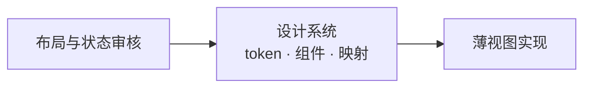

# 0014 桌面设计系统

状态：当前设计 · 更新：2026-11-05

## 范围与现状

范围：视觉 token、文字、图标、动效和 MyGO 组件映射。布局与交互见 [0024](0024-desktop-layout.md)。

布局审核通过后先同步设计系统，再实现；代码从当前系统取值，缺失状态先设计，不以实现绕过原生组件。

设计系统的 `tokens.json` 与 `layout.json` 原样复制到 `desktop/internal/theme/`，`go generate` 生成颜色、阴影、间距、圆角、尺寸、文字样式、动效与布局常量；改值先改设计系统，再复制、重新生成，不手改生成文件。视图里的尺寸、颜色、时长只能取 token：`shell` 包的守卫测试遇到样式方法里的数字、`ui.Hex` / `ui.RGBA` 或写死的时长即失败（命名常量的行为规则、token 的比例 / 倍数 / 一半除外）。

| 状态 | 边界 |
|---|---|
| ✓ 代码已有 | 由设计系统 token 生成的主题、文字样式、动效与布局；资源与基础组件 |
| ○ 待验证 | 所有材质上的可读性与后续组件状态 |

## 材质

- 整个窗口是玻璃，桌面壁纸透过侧栏（`side`）、正文区（`pane`）和右栏
- 各区靠明暗区分。底色跟着标志走：深色取深色标志（石墨），浅色取浅色标志的底：正文区取白端，侧栏只比正文区暗一点（不发灰），你的气泡取 #E7EAEE
- 边界只有三条 1px `line`，且只在侧边栏展开时出现：侧栏右边、右栏左边、右栏里右列的左边。区内不画分隔线：标题栏下、侧栏底栏上、会话详情列左边、右栏的标签栏和路径栏下都没有线
- 设计稿的桌面画板铺样例壁纸（`wallpaper`），窗口用 `material-window` 近似系统材质；代码里这层由 `VibrancyUnderWindow` 提供，不用这两个值
- 输入框在浅色下加一条 `glass-line` 细边（黑 .08）。输入框只铺 `glass` 底与 `glass-line` 细边
- 窗口里自己画的弹层、菜单、提示条、回到底部按钮用接近不透明的 `popover` + 1px `line2` + `shadow-popover`，不加背后模糊。正文区上的卡片（伙伴气泡等）用 `bg`，工具输出框和排队托盘用 `bg2`。正文区不用玻璃材质，只用半透明底，保证长文与代码清晰。

## 颜色

| token | 深色 | 浅色 | 用途 |
|---|---|---|---|
| `fg` / `fg2` / `fg3` | #F4F4F5 / #D3D6DB / #B0B4BB | #23272D / #383B40 / #53575D | 正文 / 次要 / 图标与控件 |
| `muted` / `faint` | #8E939B / #666B73 | #5E6268 / #A0A4AA | 辅助信息 / 占位与禁用 |
| `accent` + `on-accent` | #3CC4C9 + #0C1A1C | #066A70 + #FFFFFF | 按钮、开关、发送的底与其上的字 |
| `accent-fg` | #3CC4C9 | #066A70 | 需要突出显示的一律用它：链接、行内代码（8% 淡底）、文件名（工具行读取 / 编辑的路径、改动卡片）；焦点环、运行中、未读 |
| `attn` + `on-attn` | #F0A35B + #1E1408 | #A85C14 + #FFFFFF | 需要你 |
| `attn-line` / `attn-glow` | #F0A35B .40 / .10 | #D9822B .40 / .10 | 审批输入框的描边 / 描边外 3px 光晕（深浅都有） |
| `add` / `del` | #7BC86C / #F0758A | #2E7031 / #B02A55 | diff 新增 / 删除 |
| `pane` / `side` / `glass` | 白 .06 叠暗、#0E1014 .38、白 .05 | 白 .62、#F4F5F7 .80、白 .88 | 正文区与右栏查看区 / 侧栏与右列 / 输入框 |
| `raised` / `sel` / `sel-row` | 白 .16 / .10 / .09 | 白 .88 / 黑 .055 / .06 | 分段与标签选中项 / 当前菜单项 / 选中行 |
| `bg` / `bg2` | 白 .06 / .03 | 白 .75 / .70 | 正文区上的卡片、伙伴气泡 / 工具输出框、排队托盘 |
| `fill` / `fill2` | 白 .06 / .10 | 黑 .04 / .06 | 控件底 / 悬停 |
| `line` / `line2` | 白 .08 / .14 | 黑 .06 / .10 | 三条边界与卡片、输出框自己的边 / 控件边 |
| `glass-line` | 白 .12 | 黑 .08 | 输入框细边 |
| `attn-fg` | #F5BB82 | #8A4B0F | 需要你的文字 |
| `add-bg` / `del-bg` | #7BC86C .12 / #F0758A .11 | #2E7031 .10 / #B02A55 .08 | diff 淡底 |
| `bubble` | 白 .10 | #E7EAEE .95 | 我的消息气泡 |
| `shadow` | 黑 .45 | 黑 .12 | 弹层阴影 |
| `popover` | #262A30 .97 | 白 .97 | 窗口里自己画的弹层（输入框的弹层、新建页的目录与模型、提示条、回到底部）：接近不透明，配 1px `line2` 边框与弹层阴影，不加背后模糊 |

规则：

- 一种彩色：青色只给可操作的元素和需要注意的状态，不用在背景、壁纸、中性灰和选中底上。
- 四种有含义的颜色在色相上拉开：青 182°、绿 110–123°、琥珀 29°、玫红 341–350°。新增 / 删除只出现在 diff 和行数里；琥珀只表示需要你；文件状态 M、R 用中性灰。
- 状态先靠形状，其次颜色。
- 文字在玻璃上 ≥4.5:1（两个主题在设计稿上都核过，真实材质待实测）；`faint` 不承载必须读到的信息。焦点环 2px 实线 `accent-fg`。

## 字体

界面使用系统 SF Pro / 苹方，不打包；代码打包 JetBrains Mono Regular / SemiBold，关闭连字。

只用设计系统的 13 个文字样式（生成为 `theme.Style`）：

| 样式 | 字号 / 行高、字重 | 用于 |
|---|---|---|
| `display` | 22 / 28，600 | 新建页标题 |
| `title` | 15 / 20，600 | 分区标题、卡片数字、命令面板搜索框 |
| `reading` | 13.5 / 22，400 | 对话正文、输入框 |
| `ui` / `ui-medium` / `ui-strong` | 13 / 18，400 / 500 / 600 | 侧栏、菜单、按钮、工具行；当前标签；标题栏与未读行 |
| `secondary` / `secondary-block` | 12 / 16、12 / 18，400 | 路径、预览（一行 / 多行） |
| `caption` / `label` | 11 / 14，400 / 600 | 时间、计数、快捷键 / 分组标题 |
| `code` / `code-inline` / `code-caption` | 12 / 19、12.5（只在正文里）、11，400 | 代码、行内代码、等宽小字 |

字重只用 400 / 500 / 600；会变的数字用等宽数字。

## 尺寸

全部取设计系统的 token。间距 2 · 4 · 6 · 8 · 12 · 16 · 24 · 32；圆角 4（小件）· 6（行）· 8（控件）· 10（卡片与弹层）· 14（大卡片）· 18（输入框与气泡）· 胶囊；高度：行 28、密集行 24、工作组的一步 32、标题栏 44；弹层宽 232 / 128 / 280（模型列 +40）；右列 220（文件树）/ 260（变更）；diff 竖条 3。窗口几何（侧栏、正文列、右栏的宽度与收起阈值）在 `layout.json`。

## 图标

 界面用 Lucide（16 网格、1.4 描边、跟随文字色；尺寸 12 / 14 / 16，空状态 32；图标按钮 28，密集处 24，行尾小按钮 22；必须有悬停提示"名称 快捷键"）。审批档位用 Lucide 盾牌：shield-question-mark、shield-half、shield-check、shield-off。文件类型用 Material Icon Theme 彩色图标（官方 SVG 原样放在 `desktop/internal/icons/material/`，MIT），保留原色：工具行里读取 / 编辑的文件、改动卡片的每个文件前 14；会话详情的目录行用它的文件夹图标；正文里的文件链接不加（Markdown 行内插图标要绕开 MyGO 的渲染）。harness 标志单色、跟随文字色（`desktop/internal/icons/harness/`，原样使用，许可证在同目录）：Claude Code 用 Claude 星芒，Codex 用 OpenAI 花形标志，Hermes 用 Nous 女孩头像；没有标志的 harness 用首字母占位；名字写正式名 Claude Code、Codex、Hermes，不写内部代号。

## 标志

 小写 h（竖笔胶囊 + 肩与右腿连成的倒 L），右上一块圆角方块跳出、转 14°，方块是品牌青。深色图标：石墨渐变底 #3A3F47→#15181C、主体 #F4F4F5、方块 #3CC4C9；浅色图标：#FFFFFF→#E7EAEE、主体 #23272D、方块 #066A70。主体 = `fg`、方块 = `accent`，与界面同色（仓库里的 App 图标核对一致）。菜单栏、标签页、通知用单色剪影（方块 42% 不透明）。

## 动效

只为三件事动：从哪来、发生了什么、看这里（需要你）；不做页面过场，键盘操作（↑↓ 选择、⌘K 结果、标签与页面切换）一律即时。只用 MyGO 自带的动画，时长与曲线取设计系统的 `motion` token（规格与演示在画板“规范：动效”）。

| 类别 | 规则 |
|---|---|
| 空间（弹簧） | 小件 `ui.Snappy`：弹层与菜单从 0.95 放大、分段与标签的选中块用 `Match` 滑到新位置、状态圆点从 0.6 出现、chevron 转向。大块 `ui.Smooth`：侧栏、右栏、会话详情开合用 `Size` 过渡加裁切；工作组、折叠条、排队托盘展开，列表行插入、移除、重排用 `Collapse`；输入框长高 |
| 颜色与透明度 | 悬停、按下、退出、交叉淡化 120 ms EaseOut；进入 200 ms EaseOut，从下方 6 上移（消息、工作组的一步、改动卡、出错条）；退出向上 4（收件箱卡片、提示条）；提示条从标题栏下方向下 8 进入，停 4 秒，悬停不计时 |
| 错开 | 同一刻进来的几步每项错开 30 ms，最多 5 项 |
| 数字 | 用时、角标、计数逐位滚动 350 ms `CubicBezier(0.22, 1, 0.36, 1)` |
| 进行中 | 工作中方块 `Loop` 1200 ms、`ui.Spinner` |
| 需要你 | 审批到来时输入框内容交叉淡化、长高、描边变色，光晕从 0 扩到 6 再收到 3 一次（600 ms），这是唯一主动抓眼的动效 |
| 提示 | 新会话插入侧栏时整行 `fill2` 在 1.5 秒内淡出一次；收件箱卡片处理后先收成一行确认、停 1.5 秒再上移淡出，下面的卡片平滑补位 |
| 减少动态效果 | 位移、缩放、尺寸即时，只留不超过 120 ms 的淡入淡出，循环停住 |

## 文字

界面用中文，所有界面文字（包括工具行、工作组摘要、耗时）跟随界面语言；命令、路径、文件名、模型名、原始输出保持原文。只陈述事实，称"你"，不加"请"，不用感叹号与 emoji；出错一句话说原因并给一个能解决的操作。按钮以动词开头、2–4 个字。能用图标的不用文字。中英文之间加空格。品牌名在界面文字里写作 Hoplet（首字母大写；命令名、路径里仍是 `hoplet`）。词表：会话、伙伴、工作目录、变更、本次 / 累计 / 分支、产物、触发器、审批、插话、排队、分叉、个人档案、需要你、断线（不说对话、Bot、项目、轮）。

## 资源版本

| 资源 | 固定版本 | 规则 |
|---|---|---|
| MyGO | 0.7.4 | 原生 UI，升级验证组件契约 |
| Lucide / lucide-static | 1.66.0 | 官方 SVG 原样复制，不画图标或改路径 |
| Material Icon Theme | 5.40.0 | 文件类型图标，保留原色与 MIT 许可 |
| harness 标志 | 各家官方标志 | 原样放在 `desktop/internal/icons/harness/`，许可证在同目录 |
| JetBrains Mono | 2.304 | Regular / SemiBold，保留 SIL OFL 1.1 许可 |

## MyGO 对应

| 对象 | 原生 API / 映射 |
|---|---|
| 主题 | `ui.Theme`；Surface / SurfaceHover = `fill` / `fill2`，Border = `line2`，Text / TextMuted = `fg` / `muted` |
| 主题状态 | Accent / AccentText = `accent` / `on-accent`，Warning = `attn`，Success / Danger = `add` / `del`，Focus = `accent-fg` |
| 基础尺寸 | Radius 8（`radius-control`）、Spacing 4、FontSize 13（`ui`）；其余语义色按 `Theme.Dark` 放在应用主题包 |
| 窗口材质 | `Vibrancy: VibrancyUnderWindow` + `TitleBarHiddenInset`；根节点不铺底，区域铺半透明 token |
| 输入框与弹层 | 输入框 `glass` + `glass-line`，弹层 `popover`；`glass.Glass{}` 只模糊窗口内内容且压暗浅色，不用于此材质方案 |
| 侧栏与键盘 | `ui.Row` + 悬停 / 点击 / 右键；可聚焦元素以 `Shortcut` 接键。`ui.SidebarItem` / `ui.List.Selected` 的强调色选中底不符合中性灰选中规范 |
| 分段 / 标签 | `ui.Segmented` / `ui.Tabs` |
| 拖动宽度 | `ui.Split`；原生分隔线，悬停 / 拖动时强调色 |
| Markdown / diff / 文件树 | `markdown.Stream` / `editor.DiffView` / `ui.Tree` |
| 弹层 | `ui.PopoverBase` + `AttachTo`；`popover`、圆角 10、内边距 6、阴影，菜单项高 28 / 圆角 6 |
| 模型与强度菜单 | 嵌套 `ui.PopoverBase` 承载搜索、右侧值和开关；`PopoverMenu` 文字项不足以表达这些控件 |
| 队列拖动 | `ListState.Reorder` |
| Worktree / 开关 / 角标 | `ui.Checkbox` / `ui.Switch` / `ui.Badge` |
| 提示条 | `c.AddToast` + `ui.ToastViewportBase` / `ui.ToastBase` |
| 动效 | `Element.Jump` / `AnimateTo` / `AnimateColor` / `Transition` / `Match` / `Collapse`，弹簧 `ui.Snappy` / `ui.Smooth`，不自建计时器 |
| 悬停提示 | `Element.Tooltip` |
| 头像 | 首字 + 中性灰底；`ui.Avatar` 按名字配色不符合单一彩色规范 |
| 图标 | `ui.Icon`（Lucide）/ `ui.Image`（Material） |
| 菜单与托盘 | `mygo.NewMenu` / `mygo.NewTray`，托盘 `IconIsTemplate: true` |

MyGO 升级通过 `mygo migrate-ui` 迁移并验证；视图保持薄，禁止用计时器、覆盖层或自行绘图绕过现成组件。缺失能力先调整并审核设计。

## 验收

| 范围 | 条件 |
|---|---|
| token | 主题代码由设计系统 token 生成；视图不写数字、颜色与时长（守卫测试） |
| 资源 | 版本固定，官方 SVG 原样保留 |
| 可用性 | 材质、文字、焦点和减少动态效果按真实界面核对 |

## 待验证

实际玻璃材质对比度、跨系统外观、后续组件和资源升级仍需验证。
