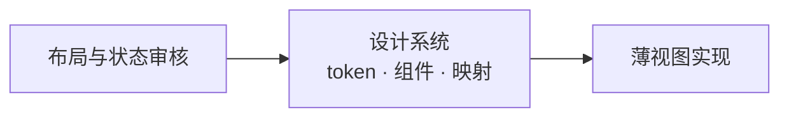

# 0014 桌面设计系统

状态：当前设计 · 更新：2026-11-08

## 范围与现状

范围：视觉 token、文字、图标、动效和 MyGO 组件映射；页面布局与交互不在本文。

布局审核通过后先同步设计系统，再实现；代码从当前系统取值，缺失状态先设计，不以实现绕过原生组件。

设计系统的 `tokens.json` 与 `layout.json` 原样复制到 `desktop/internal/theme/`，`go generate` 生成颜色、阴影、间距、圆角、尺寸、文字样式、动效与布局常量；改值先改设计系统，再复制、重新生成，不手改生成文件。视图里的尺寸、颜色、时长只能取 token：`shell` 包的守卫测试遇到样式方法里的数字、`ui.Hex` / `ui.RGBA` 或写死的时长即失败（命名常量的行为规则、token 的比例 / 倍数 / 一半除外）。

| 状态 | 边界 |
|---|---|
| ✓ 代码已有 | 由设计系统 token 生成的主题、文字样式、动效与布局；资源与基础组件 |
| ○ 待验证 | 所有材质上的可读性与后续组件状态 |

## 材质

- 整个窗口是玻璃，桌面壁纸透过侧栏（`side`）、正文区（`pane`）和右栏
- 各区靠明暗区分。底色跟着标志走：深色取深色标志（石墨），浅色取浅色标志的底：正文区取白端，侧栏只比正文区暗一点（不发灰），你的气泡取 #E7EAEE
- 边界只有三条 1px `line`，且只在侧边栏展开时出现：侧栏右边、右栏左边、右栏里右列的左边。区内不画分隔线：标题栏下、侧栏底栏上、会话详情列左边、右栏的标签栏和路径栏下都没有线
- 设计稿的桌面画板铺样例壁纸（`wallpaper`），窗口用 `material-window` 近似系统材质；代码里这层由 `VibrancyUnderWindow` 提供，不用这两个值
- 输入框和其他表面一样铺 `surface`，配 1px `line2` 与 `shadow-composer`
- 相对取色：区域和表面都是叠在下面一层上的中性白 / 黑（不带色调），不写死颜色，所以不管桌面偏冷偏暖整窗都是一个色调；只有浮层、文字和彩色是固定值。表面 `surface` 用于输入框、代码块、改动文件卡、工具输出、会话详情、收件箱卡片、伙伴气泡、回报卡、任务与排队托盘：对话流里配 1px `line`、无阴影，输入框配 `line2` + `shadow-composer`。浮层 `surface-float`（菜单、命令面板、模型与 harness 选择、推理强度、打开方式、产物版本菜单、编辑人格、提示条、回到底部）不透明，配 1px `line2` + `shadow-popover`：窗口本身半透明，浮层哪怕 .97 也会透出字影；glass 插件实测着色 .92 会压暗、.85 会透字，所以不用。正文区不用玻璃材质，只用半透明底，保证长文与代码清晰。配色总览画板把整窗放在偏冷、中性、偏暖三种桌面上，三种都协调才算通过。

## 颜色

按层组织：每个颜色只回答它在哪一层、起什么作用；同一层的东西同一个颜色，层与层之间靠明暗、细边和阴影区分。tokens.json 里每个颜色都标了层。

| 层 | token | 深色 | 浅色 | 用途 |
|---|---|---|---|---|
| 0 设计稿底 | `wall` / `wallpaper` | — | — | 只在设计稿里近似桌面；代码由窗口材质提供 |
| 1 区域 | `pane` / `side` | #121214 .62 / .50 | 白 .62 / .38 | 正文区与查看区 / 侧栏与右列；系统材质上一层中性白或黑，透出桌面，不带色调 |
| 2 表面 | `surface` / `surface-float` | 白 .06 / #323234 | 白 .70 / #FBFBFB | `surface`：叠在区域上的中性层，用于输入框与区域上放的一切东西，随区域变色、永远再亮一级；`surface-float`：浮层，不透明，明度对准 surface 的实际样子 |
| 3 状态叠加 | `fill` / `hover` / `selected` / `pressed` | 白 .04 / .06 / .09 / .13 | 黑 .035 / .05 / .08 / .11 | 叠加阶梯四档，一档比一档深：控件平时的底 / 悬停 / 选中（比悬停深一档）/ 按下 |
| 3 状态叠加 | `raised` | 白 .16 | 白 .88 | 分段与标签的选中块，配 `shadow-raised` |
| 4 角色例外 | `bubble` | 白 .09 | 黑 .05 | 你的消息：叠在正文区上的中性层，唯一与 `surface` 方向相反的底 |
| 5 文字 | `fg` / `fg2` / `fg3` | #FDFDFD / #E2E2E2 / #C3C3C3 | #2A2A2A / #3D3D3D / #515151 | 正文 / 次要 / 图标与控件；零色相，≥9.5 / 7.5 / 5.5:1 |
| 5 文字 | `muted` / `faint` / `on-inverse` | #B1B1B1 / #858585 / #252526 | #5E5E5E / #848484 / #FFFFFF | 辅助信息 ≥4.5:1 / 占位与禁用 ≥2.6:1 / 翻过来的小块上的字 |
| 6 语义 | `accent` + `on-accent` / `accent-fg` | #3CC4C9 + #0C1A1C / #3CC4C9 | #066A70 + #FFFFFF / #06696F | 按钮、开关、发送的底与字 / 链接、行内代码、文件名、焦点环、运行中、未读 |
| 6 语义 | `attn` + `on-attn` / `attn-fg` / `attn-line` / `attn-glow` | #F0A35B + #1E1408 / #F5BB82 / .40 / .10 | #A85C14 + #FFFFFF / #8A4B0F / #D9822B .40 / .10 | 需要你：圆点与角标 / 文字 / 审批输入框描边 / 光晕 |
| 6 语义 | `add` / `del` / `add-bg` / `del-bg` | #7BC86C / #F496A6 / .12 / .11 | #2C6B2F / #AE2A54 / .10 / .08 | diff 新增 / 删除 / 淡底 |
| 7 边与阴影 | `line` / `line2` / `shadow` | 白 .08 / .14 / 黑 .45 | 黑 .06 / .10 / .12 | 对话流里的块与三条边界 / 浮层与控件的边 / 阴影色 |
| 7 标志 | `logo-*` | — | — | 标志与 App 图标，`logo-body` = `fg`、`logo-piece` = `accent` |

规则：

- 一种彩色：青色只给可操作的元素和需要注意的状态，不用在背景、壁纸、中性灰和选中底上。
- 四种有含义的颜色在色相上拉开：青 182°、绿 110–123°、琥珀 29°、玫红 341–350°。新增 / 删除只出现在 diff 和行数里；琥珀只表示需要你；文件状态 M、R 用中性灰。
- 状态先靠形状，其次颜色。
- 对比度审计：tokens.json 的 `audit` 一节写明窗口材质参考色、承载文字的底（区域、表面、浮层、选中行、你的消息，按 token 层层叠出）和每档目标：`fg` ≥9.5、`fg2` ≥7.5、`fg3` ≥5.5、`muted` / `accent-fg` / `attn-fg` / `add` / `del` ≥4.5、`faint` ≥2.6（只用于占位与禁用），`on-accent` / `on-attn` 在各自底上 ≥4.5。`desktop/internal/theme` 的测试按它计算深浅两套，画板“配色：token”有同一张表；不过审计的颜色改动不能合入。两套参考色都由真实窗口实测的正文区反推（浅色 #F2F3F3、深色 #252527 时的材质）。焦点环 2px 实线 `accent-fg`。
- 文字五档是零色相中性灰，由对比度目标生成，不手挑；标志主体保留品牌石墨色，与 `fg` 相差不到一级。
- 透明度只取 `opacity-disabled` 0.45（不能用）与 `opacity-faded` 0.6（还能用但退到后面：行尾平时的 ＋、没送出的消息、没装的 harness）。

## 组件规则

设计系统 README 的“组件规则”是唯一来源，这里只列要点：

- **圆角按角色**：小件 `radius-xs` · 行 `radius-row`（侧栏行、菜单项、文件树、命令面板的行、审批选项）· 控件 `radius-control` · 表面 `radius-card`（对话流里的块与小浮层）· 大浮层 `radius-panel`（命令面板）· 输入框与气泡 `radius-composer` · 圆 `radius-pill`。
- **交互状态**：悬停 `hover`、按下 `pressed`、选中 `selected`、分段选中 `raised`、禁用 `opacity-disabled`；叠加层半透明，叠在区域或表面上。
- **空、加载、出错**：空写一行事实（筛选造成的加“显示全部”）；加载在那一行行尾转圈，不用骨架屏；出错一行原因加一个能解决的操作，不用红色。
- **键帽**：`caption` 字、`fill` 底、`radius-xs`、高 `icon`。
- **命名**：组件按层命名（`A` 小组件、`C` 控件、`M` 大组件、`P` 页面、`D` 桌面），布局画板上的组件板是唯一来源，设计系统的组件页由它们生成。

## 字体

界面使用系统 SF Pro / 苹方，不打包；代码打包 JetBrains Mono Regular / SemiBold，关闭连字。

只用设计系统的 13 个文字样式（生成为 `theme.Style`）：

| 样式 | 字号 / 行高、字重 | 用于 |
|---|---|---|
| `display` | 22 / 28，600 | 新建页标题 |
| `title` | 15 / 20，600 | 分区标题、卡片数字、命令面板搜索框 |
| `reading` | 13.5 / 22，400 | 对话正文、输入框 |
| `ui` / `ui-medium` / `ui-strong` | 13 / 18，400 / 500 / 600 | 侧栏、菜单、按钮、工具行；当前标签；标题栏与未读行 |
| `secondary` / `secondary-block` | 12 / 16、12 / 18，400 | 路径、预览（一行 / 多行） |
| `caption` / `label` | 11 / 14，400 / 600 | 时间、计数、快捷键 / 分组标题 |
| `code` / `code-inline` / `code-caption` | 12 / 19、12.5（只在正文里）、11，400 | 代码、行内代码、等宽小字 |

字重只用 400 / 500 / 600；会变的数字用等宽数字。

## 尺寸

全部取设计系统的 token。间距 2 · 4 · 6 · 8 · 12 · 16 · 24 · 32；圆角 4（小件）· 6（行）· 8（控件）· 10（卡片与弹层）· 14（大卡片）· 18（输入框与气泡）· 胶囊；高度：行 28、密集行 24、工作组的一步 32、标题栏 52（`titlebar`：整排顶栏同高，与红绿灯同一中线）、矮一档的横栏 44（`bar-compact`：命令面板的搜索行、侧栏底栏）；弹层宽 232 / 128 / 280（模型列 +40；打开方式弹层同 232）；右列 260（`panel-rail`：文件树与变更同宽）；diff 竖条 3。窗口几何（侧栏、正文列、右栏的宽度与收起阈值）在 `layout.json`。

通话：通话条高 56（`call-bar`），点阵 168（`call-dots`），收起后 14（`call-dots-small`，退成 3×3）。

## 图标

 iOS 用 SF Symbols，以下只管桌面。界面用 Lucide（16 网格、1.4 描边、跟随文字色；尺寸 12 / 14 / 16，通话条按钮 20（`icon-call`，挂断的 `phone` 由外层容器转 135°，SVG 不改），空状态 32；图标按钮 28，密集处 24，行尾小按钮 22；分段切换（Personal / Code、文件树 / 变更 / 产物）与图标按钮同高 28：每段 24 见方、外围 2；必须有悬停提示"名称 快捷键"）。审批档位用 Lucide 盾牌：shield-question-mark、shield-half、shield-check、shield-off。文件类型用 Material Icon Theme 彩色图标（官方 SVG 原样放在 `desktop/internal/icons/material/`，MIT），保留原色：工具行里读取 / 编辑的文件、改动卡片的每个文件前 14；会话详情的目录行用它的文件夹图标；正文里的文件链接不加（Markdown 行内插图标要绕开 MyGO 的渲染）。harness 标志单色、跟随文字色（`desktop/internal/icons/harness/`，原样使用，许可证在同目录）：Claude Code 用 Claude 星芒，Codex 用 OpenAI 花形标志，Hermes 用 Nous 女孩头像；没有标志的 harness 用首字母占位；名字写正式名 Claude Code、Codex、Hermes，不写内部代号。

## 标志

 小写 h（竖笔胶囊 + 肩与右腿连成的倒 L），右上一块圆角方块跳出、转 14°，方块是品牌青。深色图标：石墨渐变底 #3A3F47→#15181C、主体 #F4F4F5、方块 #3CC4C9；浅色图标：#FFFFFF→#E7EAEE、主体 #23272D、方块 #066A70。主体 = `fg`、方块 = `accent`，与界面同色（仓库里的 App 图标核对一致）。菜单栏、标签页、通知用单色剪影（方块 42% 不透明）。

## 动效

只为三件事动：从哪来、发生了什么、看这里（需要你）；不做页面过场，键盘操作（↑↓ 选择、⌘K 结果、标签与页面切换）一律即时。只用 MyGO 自带的动画，时长与曲线取设计系统的 `motion` token（规格与演示在画板“规范：动效”）。

| 类别 | 规则 |
|---|---|
| 空间（曲线，不用弹簧） | 一律固定时长、不回弹。小件 `motion-fast`（120 ms EaseOut）：弹层与菜单从 0.95 放大、状态圆点从 0.6 出现、chevron 转向。大块 `motion-base`（200 ms EaseOut）：侧栏、右栏、会话详情开合改宽度并裁切，右栏一次移动超过侧栏宽度时时长按距离的平方根加长，最多 4/3；分段与标签的选中块用 `Match` 滑到新位置；工作组、折叠条、任务与排队托盘展开，列表行插入、移除、重排用 `Collapse`；输入框长高。宽度变化时内容只跟随一次：正文区、对话列不再挂自己的过渡去追赶；面板内容按最终宽度排好再裁切，不逐帧重排；动画中的宽度取整到整点 |
| 颜色与透明度 | 悬停、按下、退出、交叉淡化 120 ms EaseOut；进入 200 ms EaseOut，从下方 6 上移（消息、工作组的一步、改动卡、出错条）；退出向上 4（收件箱卡片、提示条）；提示条从标题栏下方向下 8 进入，停 4 秒，悬停不计时 |
| 错开 | 同一刻进来的几步每项错开 30 ms，最多 5 项 |
| 数字 | 用时、角标、计数逐位滚动 350 ms `CubicBezier(0.22, 1, 0.36, 1)` |
| 进行中 | 工作中方块 `Loop` 1200 ms、`ui.Spinner` |
| 通话点阵 | 37 个点共用一个 `Loop`，按距离或角度算缩放和透明度：连接中 2400 ms 一起呼吸（`motion-call-breathe`）、聆听 2200 ms 弱波（`motion-call-listen`）、说话 1200 ms 强波（`motion-call-speak`）、处理中 1600 ms 绕圈（`motion-call-sweep`）、静音不动；减少动态效果时不动 |
| 需要你 | 审批到来时输入框内容交叉淡化、长高、描边变色，光晕从 0 扩到 6 再收到 3 一次（600 ms），这是唯一主动抓眼的动效 |
| 提示 | 新会话插入侧栏时整行 `hover` 在 1.5 秒内淡出一次；收件箱卡片处理后先收成一行确认、停 1.5 秒再上移淡出，下面的卡片平滑补位 |
| 减少动态效果 | 位移、缩放、尺寸即时，只留不超过 120 ms 的淡入淡出，循环停住 |

## 文字

界面用中文，所有界面文字（包括工具行、工作组摘要、耗时）跟随界面语言；命令、路径、文件名、模型名、原始输出保持原文。只陈述事实，称"你"，不加"请"，不用感叹号与 emoji；出错一句话说原因并给一个能解决的操作。按钮以动词开头、2–4 个字。能用图标的不用文字。中英文之间加空格。品牌名在界面文字里写作 Hoplet（首字母大写；命令名、路径里仍是 `hoplet`）。词表：会话、伙伴、工作目录、变更、本次 / 累计 / 分支、产物、触发器、审批、插话、排队、分叉、个人档案、需要你、断线（不说对话、Bot、项目、轮）。

## 资源版本

| 资源 | 固定版本 | 规则 |
|---|---|---|
| MyGO | 0.7.4 | 原生 UI，升级验证组件契约 |
| Lucide / lucide-static | 1.66.0 | 官方 SVG 原样复制，不画图标或改路径 |
| Material Icon Theme | 5.40.0 | 文件类型图标，保留原色与 MIT 许可 |
| harness 标志 | 各家官方标志 | 原样放在 `desktop/internal/icons/harness/`，许可证在同目录 |
| JetBrains Mono | 2.304 | Regular / SemiBold，保留 SIL OFL 1.1 许可 |

## MyGO 对应

| 对象 | 原生 API / 映射 |
|---|---|
| 主题 | `ui.Theme`；Surface / SurfaceHover / SurfacePressed = `fill` / `hover` / `pressed`，Border = `line2`，Text / TextMuted = `fg` / `muted` |
| 主题状态 | Accent / AccentText = `accent` / `on-accent`，Warning = `attn`，Success / Danger = `add` / `del`，Focus = `accent-fg` |
| 基础尺寸 | Radius 8（`radius-control`）、Spacing 4、FontSize 13（`ui`）；其余语义色按 `Theme.Dark` 放在应用主题包 |
| 窗口材质 | `Vibrancy: VibrancyUnderWindow` + `TitleBarHiddenInset`；根节点不铺底，区域铺半透明 token |
| 输入框与弹层 | 输入框 `surface` + `line2` + `shadow-composer`；弹层 `surface-float`（不透明）+ `line2` + `shadow-popover`；不用 `glass.Glass{}` |
| 侧栏与键盘 | `ui.Row` + 悬停 / 点击 / 右键；可聚焦元素以 `Shortcut` 接键。`ui.SidebarItem` / `ui.List.Selected` 的强调色选中底不符合中性灰选中规范 |
| 分段 / 标签 | `ui.Segmented` / `ui.Tabs` |
| 拖动宽度 | `ui.Split`；原生分隔线，悬停 / 拖动时强调色 |
| Markdown / diff | `markdown.Stream` / `editor.DiffView`（变更标签每个文件一个 `SetPatch` + `FitContent`；点折叠条时换成该文件新旧全文（`Old` / `New`），由 `DiffSeparator.ExpandAll` 在原处展开；折叠条用 `RenderSeparator`；行的底色由 DiffView 按 `add` / `del` 与 `pane` 混出，与 `add-bg` / `del-bg` 相近而不逐值相同） |
| 文件树 / 变更树 | `ui.Row` 自己画行（Lucide chevron、文件图标、行尾 M / A / D 与计数）+ `Shortcut` 接 ↑↓←→↩：`ui.Tree` 的项只有文字，`ui.Outline` 的选中是强调色填满 |
| 弹层 | `ui.PopoverBase` + `AttachTo`；`surface-float`、`radius-card`、内边距 `space-1_5`、`line2` + `shadow-popover`，菜单项高 `row` / `radius-row` |
| 模型与强度菜单 | 嵌套 `ui.PopoverBase` 承载搜索、右侧值和开关；`PopoverMenu` 文字项不足以表达这些控件 |
| 队列拖动 | `ListState.Reorder` |
| Worktree / 开关 / 角标 | `ui.Checkbox` / `ui.Switch` / `ui.Badge` |
| 提示条 | `c.AddToast` + `ui.ToastViewportBase` / `ui.ToastBase` |
| 产物 | 网页 `ui.WebView`（`PageOptions.Untrusted`，`hoplet-artifact://` 经 `mygo.Protocol.HandleFunc`）；Markdown `markdown.Stream`；版本菜单 `ui.PopoverBase` |
| 编辑人格 | `ui.DialogBase` 自己画外框（`surface-float`、`radius-panel`）+ `ui.TextArea` |
| 事件行与回报卡 | 可点的 `ui.Row` 自己画外框；回报正文用文字的最大行数截到 3 行 |
| 动效 | `Element.Jump` / `AnimateTo` / `AnimateColor` / `Transition` / `Match` / `Collapse`，曲线取 `motion` token，不用弹簧，不自建计时器 |
| 悬停提示 | `Element.Tooltip` |
| 头像 | 首字 + 中性灰底；`ui.Avatar` 按名字配色不符合单一彩色规范 |
| 查找栏 | `editor.State` / `editor.DiffState` 的 `RenderFindBar` 自己画外观：`ui.TextInputBase` 交给 `FindBar.QueryInput`，开关 `ui.ToggleBase`，按钮 `ui.ButtonBase(c).KeepFocus()`；默认查找栏是英文、带选区内查找与替换，外观不合 |
| 搜索框 | `ui.Row` + Lucide `search` + `ui.TextInput` + 有字时 `x` 清除按钮：`ui.SearchField` 的清除按钮用主题 Background 画 ×，Hoplet 的 Background 透明，× 看不见；菜单外 ⎋ 清空、提示“清除 esc”，菜单里 ⎋ 照旧关菜单、提示只写“清除” |
| 自动换行 | `editor.State.SoftWrap` / `editor.DiffState.Wrap` |
| 语音通话 | 点阵用一个 `Loop` 相位算每个点的 `Scale` 与 `Opacity`，不用计时器；通话条自己画（`ui.Row`）；确认 `ui.DialogBase`，选机器 `ui.PopoverBase` |
| 图标 | `ui.Icon`（Lucide）/ `ui.Image`（Material；不认识的文件用 Material 的 `file`，`document` 只给文本文件） |
| 菜单与托盘 | `mygo.NewMenu` / `mygo.NewTray`，托盘 `IconIsTemplate: true` |

MyGO 升级通过 `mygo migrate-ui` 迁移并验证；视图保持薄，禁止用计时器、覆盖层或自行绘图绕过现成组件。缺失能力先调整并审核设计。

## 验收

| 范围 | 条件 |
|---|---|
| token | 主题代码由设计系统 token 生成；视图不写数字、颜色与时长（守卫测试） |
| 资源 | 版本固定，官方 SVG 原样保留 |
| 可用性 | 材质、文字、焦点和减少动态效果按真实界面核对 |

## 待验证

实际玻璃材质对比度、跨系统外观、后续组件和资源升级仍需验证。
