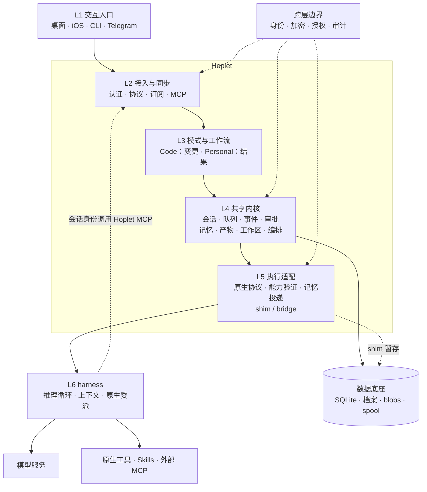
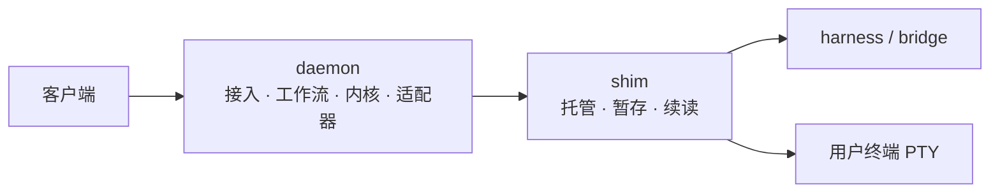
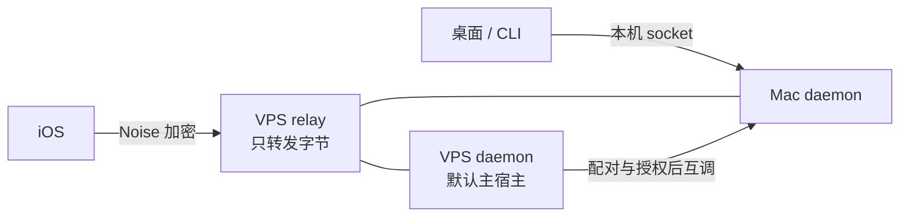

# 0015 架构分层

状态：当前设计 · 更新：2026-11-07

## 范围与现状

两种模式共用一个内核；成长记忆属于 Hoplet，推理与执行复用现成 harness。图中包含规划能力。

| 状态 | 边界 |
|---|---|
| ◐ 代码现状 | 本机共享内核、客户端与两家原生适配 |
| ○ 目标 | 图中的远端、MCP、独立伙伴、记忆与自动化 |

## 逻辑分层

| 层 | 职责 | 边界 |
|---|---|---|
| L1 | 交流、状态、产物、审批 | 薄视图，状态来自 daemon |
| L2 | 认证、命令回执、订阅追赶、通道接入 | 入口不授予额外权限 |
| L3 | 两种交付方式、转交与跟进 | 模式由我选择，不绑定 harness |
| L4 | 可靠服务、成长管理、确定性校验 | 语义归纳调用模型，不自写 agent loop |
| L5 | 命令与事件映射、版本验证、记忆投递 | 送达不等于模型遵守 |
| L6 | 推理、工具使用、上下文与原生并行 | 原生记忆不自动成为 Hoplet 权威记忆 |

## 逻辑层与进程

| 调用 | 到哪里结束 |
|---|---|
| 列会话、读产物、编辑记忆 | 内核服务，不调用模型 |
| 用户终端输入 | shim / PTY，不调用模型 |
| 任务执行、语义提炼 | 适配器 → harness |
| harness 调用 Hoplet 工具 | MCP 接入 → 授权 → 同一服务 |
| 产物页面调用能力 | 客户端协议处理 → 同步协议 → 同一服务；`ask` 经所属会话队列到 harness |

六层是职责划分，不是六个独立服务。`proto/` 是跨层协议类型的事实来源。

## 数据归属

| 数据 | 权威来源 |
|---|---|
| 会话、事件、队列、审批、回执 | Hoplet SQLite |
| 可迁移人格、事实、偏好、经验、技能 | 主宿主成长档案与版本记录 |
| 工具输出、产物 | Hoplet blobs / artifacts |
| 断线暂存 | shim spool，按偏移入库 |
| 模型上下文、原生记忆 | harness 自己的存储 |

成长记忆按场景供 Code / Personal 使用；Code agent 只读。用户编辑、Personal 写入和后台候选经同一服务提交。记忆归属是软件架构概念，不表示 Hoplet 自建基础模型。

## 主机与安全

- 每台主机一个 daemon，对等配对；主宿主统一提交成长记忆，不建立传递信任。
- Hoplet 管自己的服务权限，harness 管原生工具权限和模型凭证；不宣称拦截所有工具路径。
- 桌面关闭不停止 daemon；daemon 事件恢复、harness 子执行恢复和跨机任务恢复是不同契约。

## 验收

| 范围 | 条件 |
|---|---|
| 分层 | 客户端不重建 agent loop，内核与原生执行归属清楚 |
| 数据 | 当前与目标数据来源清楚，未实现路径明确标记 |

## 待验证

MCP、记忆、原生委派观测、配对和跨机恢复分别验证，不从分层图推断接口存在。
