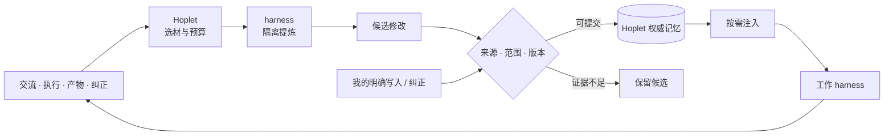
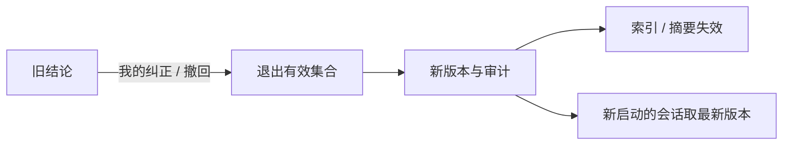
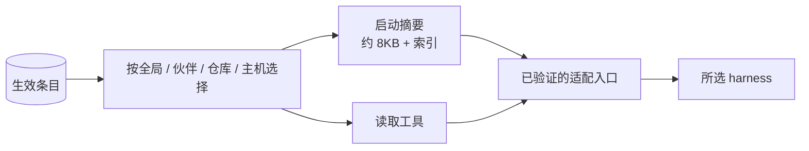

# 0016 成长记忆

状态：当前设计 · 更新：2026-11-08

## 范围与现状

Hoplet 持有流程与数据，harness 提供可替换的归纳能力。

| 状态 | 边界 |
|---|---|
| ○ 第一期 | 条目存储、写入与纠错、后台提炼、候选、启动注入、按需读取、Mac 与 CLI 管理 |
| ○ 后续 | 技能复用、原生记忆控制、回合级刷新、iOS 管理、空闲维护、向量检索、多机同步、场景范围 |
| ✓ 已有基础 | 可引用的会话事件、工具输出 blob、原生适配、伙伴人格注入 |

人格不属于记忆系统：每个伙伴的人格只存在 `companions/<id>/persona.md`，自动提炼不读写它。

## 成长闭环



| 动作 | Hoplet | harness / 模型 |
|---|:---:|:---:|
| 触发、选材、预算、排队与恢复 | ✓ | — |
| 归纳事实、经验、技能 | — | ✓ |
| 判断语义重复、冲突，提出合并 | — | ✓ |
| 校验来源、范围、版本并提交 | ✓ | — |
| 保存、纠错、撤回、选择与注入 | ✓ | — |
| 在工作中理解和运用记忆 | — | ✓ |

提炼由来源会话所用的 harness 和模型执行，材料不跨 harness 流动；不依赖某一家原生 Memory 功能作为事实来源，也不自写 agent loop。

## 使用范围

| 调用方 | 读取 | 更新 |
|---|---|---|
| Personal | 对应伙伴与事情的相关记忆 | 经记忆服务校验 |
| Code agent | 仓库、任务、主机相关偏好与经验 | 只读 |
| 我本人 | 查看有效内容与来源 | 客户端 / CLI 编辑、纠正、撤回 |
| 提炼任务 | Hoplet 选定的已持久化材料 | 只返回候选，由 daemon 提交 |

获准的 Code 记录可供提炼，不因此给 Code agent 写权限，也不默认采集所有开发记录。原生学习成果经受支持的输出入口进入候选；不解析 harness 私有历史、记忆文件或凭证。

## 保存什么

| 类别 | 范围 | 条件 |
|---|---|---|
| 事实与偏好 | 共享个人档案 | 保留来源和有效时间 |
| 协作约定 | 伙伴 / 仓库 / 主机 | 局部要求不扩大成全局规则 |
| 经验 | 已观察和验证的条件 | 一次失败不形成普遍结论 |
| 技能（后续） | 可复用流程 | 标明步骤、依赖、适用条件和验证依据 |

“这次优先直达”留在事情记录，“以后优先直达”才是长期偏好。事情的目标、进度和临时决定不直接变成长期记忆。网页、工具输出和模型复述不能自行变成我的偏好或授权；凭证不入库，记忆不覆盖当前指令、项目规范和权限规则。

| 条目属性 | 保存内容 |
|---|---|
| 身份 | 稳定 ID、版本、类别、正文 |
| 范围 | 全局、伙伴、仓库或主机；跨机用稳定资源身份，路径注明主机 |
| 证据 | 实际消息 / 事件 / 产物引用，区分用户明确说明、验证、观察与推测 |
| 生命周期 | 候选、生效、待核实、被替代、已撤回；有效时间和替代关系 |

一条目一文件，类别目录为 `fact`、`preference`、`convention`、`experience`：

```text
主宿主 ~/.hoplet/profile/
├── PROFILE.md                     生成的索引，不手工编辑
└── entries/<category>/<id>.md     条目
```

```markdown
---
id: mem_01J...
version: 3
category: preference
status: active            # candidate | active | stale | superseded | withdrawn
scope: { kind: repo, value: github.com/x/y }   # global | companion | repo | host
evidence:
  - { kind: user_stated, ref: event:ses_123/456 }  # user_stated | verified | observed | inferred
valid_until: null
replaced_by: null
updated_at: 2026-11-08T10:00:00Z
---
正文
```

主宿主统一提交。远端旧快照不得覆盖权威版本，离线不得宣称已核对；不做向量检索或知识图谱。

## 存储与恢复

| 数据 | 性质 | 位置 |
|---|---|---|
| 条目当前版本 | 权威 | Markdown |
| 版本与审计（含旧版本正文、操作者、原因、目标版本、提交状态） | 持久，不可重建 | SQLite |
| 提炼运行（材料范围、进度、目标版本、候选操作、去重依据） | 持久，不可重建 | SQLite |
| 注入记录（会话、条目 ID / 版本、送达状态） | 持久，不可重建 | SQLite |
| 检索索引（子串匹配，FTS5 查不到两字中文词）、`PROFILE.md` | 派生，可从 Markdown 重建 | SQLite、文件 |

重建索引时不动持久表。

提交顺序：

1. 在审计表写入意图：操作 ID、目标条目、期望版本。
2. 比对版本，用临时文件加 rename 原子写入 Markdown。
3. 标记已提交，更新索引，重新生成 `PROFILE.md`，之后才回复“已保存”。

崩溃恢复：意图已写而文件未变的按失败处理；文件已变而未标记的补完提交。操作 ID 相同的重试不重复写入；恢复期间不暴露已撤回的条目。

条目的编辑入口是客户端和 CLI。扫描发现 Markdown 哈希不一致时：frontmatter 合法的视为一次用户编辑，版本加一并入审计；不合法的不进索引并在状态中报错，文件不动。

- 来源引用限于实际持久化的消息、事件和产物；源材料有缺口、已不可用或只是模型自述时保留相应标记，不伪造验证证据。提炼输出和注入文本不能成为同一结论的新独立证据。
- 一次性提炼不写业务会话上下文，但不省略 Hoplet 的来源与审计。

## 何时提炼

| 时机 | 处理 |
|---|---|
| 明确记住、修改或忘记 | 不走后台提炼，经工具或客户端及时提交；落盘后才说已保存 |
| 会话归档、交接给 Code、换 harness | 有新证据时排入一批 |
| 委派的子会话完成并回报 | 有新证据时排入一批 |
| 会话闲置 30 分钟 | 有新证据时排入一批；轮次结束不触发 |

| 默认值 | 取值 |
|---|---|
| 单批材料 | 约 32KB，超出的留到下一批 |
| 每日次数 | 按 harness 分别计，各 20 次；超出的留在队列，次日继续 |
| 失败重试 | 最多 2 次，之后标记失败并在状态中显示 |
| 后台提炼开关 | 默认开启，可在设置中关闭 |

第一期：会话创建后不能换 harness，“换 harness”的触发等这项功能落地时接上。闲置由每分钟的扫描判断：会话空闲或已归档、最后一条事件距今满 30 分钟、有新证据。来源会话还没有报告模型时不建运行，等报告后的下次扫描。开关存在单行表里，CLI 是 `hoplet profile extraction on/off/status`，Mac 设置项随管理界面提供。这项功能上线前已有的会话记录不算新证据，“记住了”事件也不算。

流程：

1. 阶段结束时，daemon 为有新证据的会话创建提炼运行，记录事件序号范围和目标条目版本。
2. 选材：用户消息、助手最终回复、工具结果摘要和产物引用；注入内容和提炼自身的事件不进材料。
3. 以来源会话的 harness 和模型做一次隔离运行，显式传入模型，并提供相关现有条目用于去重。
4. 输出是 JSON 操作列表；格式不对算失败。材料每行标事件序号，模型只写序号，会话和引用前缀由 daemon 补全；第一期模型不引用产物，产物只作背景。
5. 逐条校验后提交，操作 ID 由运行 ID 与序号组成。

提炼关闭工具、原生记忆写入副作用与业务上下文持久化，只返回候选。隔离未经验证的 harness 或版本不承担提炼，其会话的证据不进队列，状态中说明原因；明确写入、纠正、注入和读取不受影响。Hermes 当前不承担提炼。处理范围与进度持久化，失败重试不重跑业务操作，不阻塞前台交流。

## 更新与纠错



| 情况 | 规则 |
|---|---|
| 用户写入 | 客户端 / CLI 带期望版本，立即生效 |
| 伙伴直接写入 | `profile_write` 仅 Personal 可用，引用实际用户消息，不得自行声称“用户要求”；与后台候选走同一服务 |
| 校验 | 证据必须存在且属于本批材料或该会话；`user_stated` 必须指向用户消息；疑似凭据的正文拒绝；拒绝原因入审计 |
| 自动生效 | 证据为 `user_stated` 且范围不扩大的新增或修改；证据为 `verified` 且不超出验证范围的 `experience` |
| 保留候选 | 证据为 `observed` / `inferred`、范围扩大、提炼提出的撤回 |
| 并发更新 | 核对期望版本；用户与伙伴写入返回冲突，提炼操作转为候选 |
| 崩溃重试 | 同一操作去重，进度不越过未完成范围；权威提交与审计可恢复后才 ack |
| 旧材料回放 | 比较证据时间与条目变更：证据早于用户的纠正或撤回时不生效，只记录；已撤回内容重现时同样拦截，除非有晚于撤回的 `user_stated` 证据 |
| 自我强化 | 注入、提炼输出和模型复述不作为新独立证据；不递归提炼自身事件 |
| 撤回 | 停止检索与注入，保留防止重建的必要标记；不等于物理删除历史、版本、备份与原生副本 |

源材料缺失时标记缺口，不用模型总结补造证据。语义冲突由模型提出判断，不能仅靠字面去重或模型自报置信度判定。

## 注入与迁移



启动摘要的选择顺序：`convention`、`preference` 优先，然后 `fact`、`experience`；同类中范围越具体、更新越近越靠前；放不下的只进索引（ID、类别、一行标题）。摘要开头写明这是背景信息，不覆盖当前指令、项目规则和权限，也不代表授权。

| 模式 | Claude Code | Hermes |
|---|---|---|
| Personal 主会话 | `--append-system-prompt`，与人格同传 | 生成的 `HERMES.md`，与人格同放 |
| Code | 同一入口，只放摘要 | 不注入，记录为 `unsupported`；`HERMES.md` 是项目约定文件，读取工具照常可用 |

委派的 Personal 子会话不注入摘要，按需用读取工具；转交出去的 Code 会话按 Code 注入。

适用范围由会话决定：全局、当前主机，Personal 再加所属伙伴，有工作目录的会话再加所在仓库。仓库范围的值是规范化后的 `origin`（`host/path`，不含协议、凭据和 `.git`）；没有可用 `origin` 时为 `主机名:仓库根目录`。`profile_write` 只收范围种类，值取自调用会话；`profile_list`、`profile_read` 只看调用方适用的范围，范围外按不存在处理。

| 工具（`hoplet mcp`，范围由会话 token 决定） | 可用于 | 说明 |
|---|---|---|
| `profile_list` | Personal、Code | 按类别、范围、关键词列出 |
| `profile_read` | Personal、Code | 按 ID 返回最新生效版本 |
| `profile_write` | Personal | 新增、修改、撤回；Code 调用返回明确的不支持错误 |

| 边界 | 契约 |
|---|---|
| 选择 | 不加载全部历史；`candidate`、`stale`、`superseded`、`withdrawn` 不被检索或注入 |
| 记录 | 保存提供过的条目 ID / 版本和送达状态；送达不证明遵守 |
| 刷新 | 新启动的会话取最新摘要；续接的会话沿用启动时的上下文，用读取工具查最新版本；运行中不投递修订，文件改动不代表运行上下文已刷新 |
| 迁移 | 换 harness 走同一启动摘要，靠同一份权威条目保留约定，不做 harness 间直接同步；不承诺搬迁原生上下文或 session ID |
| 能力不足 | 摘要生成或投递失败时会话照常启动，注入记录标为失败；不伪装成功 |

## 界面

Mac 与 CLI 提供管理；iOS 不提供管理界面。Mac 的具体样式先在布局画布审核。

| 位置 | 内容 |
|---|---|
| 成长记忆页 | 按类别列出生效条目，状态点与范围图标 |
| 条目详情 | 正文、范围、来源（可跳回原消息）、版本历史；编辑、纠正、撤回 |
| 候选 | 确认或拒绝，确认时可调整范围 |
| 聊天内 | 自动保存后显示“记住了：…”，点开可查看并撤回 |
| 设置 | 后台提炼开关、当日用量、失败状态、harness 不支持提炼的标记 |

“记住了”来自来源会话日志里的 `memory.saved` 事件：伙伴或提炼的创建、更新实际生效后写入一条。事件只含条目 ID、版本、动作和来源，不含正文，撤回后日志里不留内容；显示时按 ID 取条目，已撤回的如实显示。这条事件不标未读，不改预览和会话排序。

成长记忆的读写方法只对本机客户端开放，配对设备不能调用；连到远程机器的 Mac 看不到那台机器的成长记忆。iOS 能解码这条事件，但不显示。

CLI：`hoplet profile list | show | edit | withdraw | candidates | accept | reject`，与客户端调用同一服务。

## 原生记忆边界

| 方式 | 处理 |
|---|---|
| 兼容接入（第一期） | 原生记忆继续存在；Hoplet 提供带来源与版本的有效记忆，摘要写明两者冲突时以注入内容为准；提示词不保证消除影响 |
| 受控接入（后续） | 经已验证接口控制会话内重叠的原生记忆来源；不改变用户全局配置与凭证 |
| 技能投影（后续） | 提供版本化副本或读取入口；原生修改回到候选流程，不直接覆盖权威版本 |
| 彻底遗忘 | 撤回不证明活跃上下文和原生副本已清除；如实呈现残留范围，必要时重建上下文 |

## 验收

验收本机单主宿主。

| 场景 | 结果 |
|---|---|
| 明确记住后换 harness | 注入同一有效约定，能回到用户来源 |
| 用户纠正后回放旧记录 | 新版本生效，旧结论不复活 |
| 非法 / 并发候选 | 拒绝不存在来源、超范围和过期目标；重试不重复提交 |
| 提炼与注入 | 提炼无工具调用、无残留会话、无原生记忆写入；每个会话拿到的条目与版本可核对，不以模型自报通过 |
| 崩溃恢复 | 提炼或提交中途崩溃，重启后恢复且不重复写入 |
| 写入或预算失败 | 不报告已保存，不越过未完成进度，不重跑业务副作用 |
| 撤回 | 不再检索或注入；原生副本与活跃上下文残留明确说明 |

## 待验证

| 项 | 需确认 |
|---|---|
| 预算默认值 | 批次大小、每日次数、闲置时长在真实使用后调整 |
| Hermes 提炼 | 出现能在运行期间关闭工具、记忆和会话持久化的入口后再启用 |
| Hermes Code 注入 | 出现不占用项目 `HERMES.md` 的 Code 会话入口后再启用 |
| 原生控制 | 会话级控制是否可用；不支持时保留兼容与遗忘限制 |
| 技能 | 格式、加载、同名优先级、可写性、依赖与候选回收 |
| 多机缓存 | 离线候选、纠正投递、版本过期和重连对账 |
