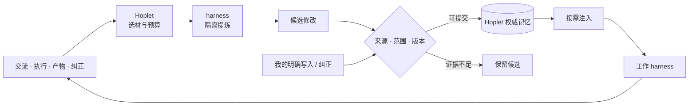
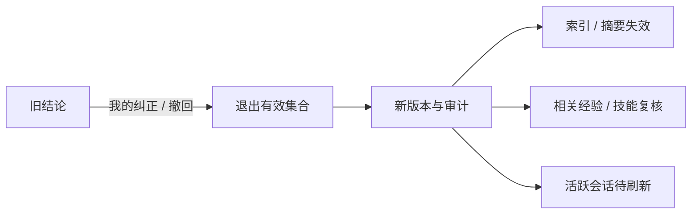
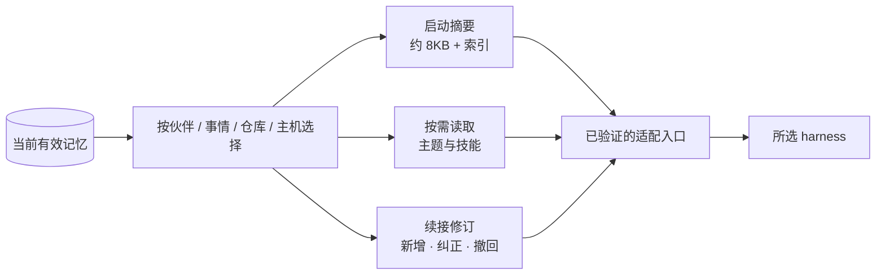

# 0016 成长记忆

状态：当前设计 · 更新：2026-11-04

## 范围与现状

交付阶段：M4b。Hoplet 持有流程与数据，harness 提供可替换的归纳能力；以下为设计目标。

| 状态 | 边界 |
|---|---|
| ○ 目标 | 成长记忆服务、提炼、注入、原生控制尚未实现 |
| ✓ 已有基础 | 可引用的会话事件、工具输出 blob 与原生适配 |

## 成长闭环



| 动作 | Hoplet | harness / 模型 |
|---|:---:|:---:|
| 触发、选材、预算、排队与恢复 | ✓ | — |
| 归纳事实、经验、技能 | — | ✓ |
| 判断语义重复、冲突，提出合并 | — | ✓ |
| 校验来源、范围、版本并提交 | ✓ | — |
| 保存、纠错、撤回、选择与注入 | ✓ | — |
| 在工作中理解和运用记忆 | — | ✓ |

工作和提炼可使用不同 harness；不依赖某一家原生 Memory 功能作为事实来源，也不自写 agent loop。

## 使用范围

| 调用方 | 读取 | 更新 |
|---|---|---|
| Personal | 对应伙伴与事情的相关记忆 | 经记忆服务校验 |
| Code agent | 仓库、任务、主机相关偏好与经验 | 只读 |
| 我本人 | 查看有效内容与来源 | 客户端 / CLI 编辑、纠正、撤回 |
| 提炼任务 | Hoplet 选定的已持久化材料 | 只返回候选，由 daemon 提交 |

获准的 Code 记录可供提炼，不因此给 Code agent 写权限，也不默认采集所有开发记录。原生学习成果经受支持的输出入口进入候选；不解析 harness 私有历史、记忆文件或凭证。

## 保存什么

| 类别 | 范围 | 条件 |
|---|---|---|
| 人格 | 各伙伴独立 | 自动提炼不擅自改变身份与职责 |
| 事实与偏好 | 共享个人档案 | 保留来源和有效时间 |
| 协作约定 | 伙伴 / 仓库 / 主机 / 场景 | 局部要求不扩大成全局规则 |
| 经验 | 已观察和验证的条件 | 一次失败不形成普遍结论 |
| 技能 | 可复用流程 | 标明步骤、依赖、适用条件和验证依据 |

“这次优先直达”留在事情记录，“以后优先直达”才是长期偏好。事情的目标、进度和临时决定不直接变成长期记忆。网页、工具输出和模型复述不能自行变成我的偏好或授权；凭证不入库，记忆不覆盖当前指令、项目规范和权限规则。

| 条目属性 | 保存内容 |
|---|---|
| 身份 | 稳定 ID、版本、类别、正文 |
| 范围 | 全局、伙伴、仓库、主机或场景；跨机用稳定资源身份，路径注明主机 |
| 证据 | 实际消息 / 事件 / 产物引用，区分用户明确说明、验证、观察与推测 |
| 生命周期 | 候选、生效、待核实、被替代、已撤回；有效时间和替代关系 |

```text
主宿主 profile/
├── PROFILE.md              短索引
├── personas/               伙伴人格
├── about-me.md · preferences.md · people.md · facts/
├── experiences/            经验主题
└── skills/                 可迁移技能
```

Markdown + frontmatter 保存可读正文与条目属性；SQLite 索引可重建，不维护第二份权威正文。主宿主统一提交，保留版本、审计和去重依据。远端旧快照不得覆盖权威版本，离线不得宣称已核对；第一版不要求向量检索或知识图谱。

## 存储与恢复（规划）

以下是持久化目标，条目到文件的映射、提交日志、SQLite 一致性与远端缓存的具体协议仍待验证，不冻结新的 SQL schema 或协议类型。

| 数据 | 归属与持久化要求 |
|---|---|
| 记忆正文 | 主宿主 `profile/` 中带 frontmatter 的 Markdown、索引与技能；稳定 ID、版本、范围、来源、状态与有效时间随条目保存 |
| 版本与审计 | 可追踪新增、替代、纠正和撤回的原因、来源、操作者 / 提炼任务与目标版本；必须能判定一次更新是否已提交 |
| 检索索引 | SQLite 中可重建的派生数据，不另行维护一份权威记忆正文；返回结果前核对版本、范围与撤回状态 |
| 提炼运行 | 保存材料范围、处理进度、目标版本、候选操作与去重依据；失败可重试，不越过未完成范围，不重跑业务操作 |
| 注入记录 | 关联会话、提供过的条目 ID / 版本、摘要依据与修订送达状态；能区分未提供、待刷新与已送达，不据此推断模型已遵守 |
| 远端缓存 | 只缓存主宿主版本并提交候选 / 用户编辑；离线不宣称版本已核对，不用旧快照覆盖权威正文 |

- 正文、版本、审计与提交状态之间需要可恢复的一致性协议；文件替换不等于 SQLite 事务已提交。未完成提交或写入失败不得 ack，也不得更新为“已保存”。索引和启动摘要均可重建，不得在恢复期间暴露已撤回的条目。
- 来源引用限于实际持久化的消息、事件和产物；源材料有缺口、已不可用或只是模型自述时保留相应标记，不伪造验证证据。提炼输出和注入文本不能成为同一结论的新独立证据。
- 我的明确纠正与撤回参与旧材料的后续提炼，防止回放重新生成旧结论。撤回标记、版本关系与派生摘要失效需要持久化；撤回不同于删除历史、备份及原生副本。
- 一次性提炼不写业务会话上下文，但不省略 Hoplet 的来源与审计。伙伴、事情和执行会话的进一步实体关系尚未定稿，暂不冻结其 schema。

## 何时提炼

| 时机 | 处理 |
|---|---|
| 明确记住、修改或忘记 | 及时提交，不等后台批次；落盘后才说已保存 |
| 事情 / 阶段结束 | 从新增证据提炼经验和技能；轮次结束不证明事情完成 |
| 重复反馈 | 形成候选，不自动扩大适用范围 |
| 归档、交接、换 harness | 整理未处理材料；未完成保持待处理 |
| 空闲维护 | 合并重复项、复核过期事实和技能 |

批量处理，不按流式增量或每轮固定调用模型；受每次提炼和每日总预算约束。提炼关闭工具、原生记忆写入副作用与业务上下文持久化，只返回候选；Hoplet 仍保存来源与审计。隔离未经验证的 harness 不承担提炼。处理范围与进度持久化，失败重试不重跑业务操作，不阻塞前台交流。

## 更新与纠错



| 情况 | 规则 |
|---|---|
| 伙伴直接写入 | `profile_write` 引用实际用户消息，不得自行声称“用户要求”；与后台候选走同一服务 |
| 自动生效 | 明确事实与纠正及时保存；经验限已验证范围；推测和范围扩大保留候选 |
| 并发更新 | 核对目标版本，过期后重新判断，不用旧摘要覆盖全文 |
| 崩溃重试 | 同一操作去重，进度不越过未完成范围；权威提交与审计可恢复后才 ack |
| 旧材料回放 | 检查之后的纠正与撤回，防止旧结论复活 |
| 自我强化 | 注入、提炼输出和模型复述不作为新独立证据；不递归提炼自身事件 |
| 撤回 | 停止检索与注入，保留防止重建的必要标记；不等于物理删除历史、版本、备份与原生副本 |

源材料缺失时标记缺口，不用模型总结补造证据。语义冲突由模型提出判断，不能仅靠字面去重或模型自报置信度判定。

## 注入与迁移



| 边界 | 契约 |
|---|---|
| 选择 | 不加载全部历史或全部个人档案；检索核对有效状态、范围和版本 |
| 记录 | 保存提供过的 ID / 版本、摘要依据和待投递 / 已送达状态；送达不证明遵守 |
| 刷新 | 下一轮核对版本，经支持的入口投递；文件改动不代表运行上下文已刷新，内部修订不伪装成用户消息 |
| 迁移 | 提供人格、有效记忆、适用技能与事情摘要；不承诺搬迁原生上下文或 session ID |
| 能力不足 | 明确标记未提供 / 待刷新，必要时新建上下文；不伪装成功 |

## 原生记忆边界

| 方式 | 处理 |
|---|---|
| 受控接入：目标 | 经已验证接口控制会话内重叠的原生记忆来源；不改变用户全局配置与凭证 |
| 兼容接入 | 原生记忆继续存在；Hoplet 提供带来源与版本的有效记忆和纠正，记录冲突；提示词不保证消除影响 |
| 技能投影 | 提供版本化副本或读取入口；原生修改回到候选流程，不直接覆盖权威版本 |
| 彻底遗忘 | 撤回不证明活跃上下文和原生副本已清除；如实呈现残留范围，必要时重建上下文 |

## 验收

先验收本机单主宿主；多机缓存与对账在安全网络接入后验证，不阻塞本机成长闭环。

| 场景 | 结果 |
|---|---|
| 明确记住后换 harness | 注入同一有效约定，能回到用户来源 |
| 用户纠正后回放旧记录 | 新版本生效，旧结论不复活；相关摘要与技能复核 |
| 一次成功流程再次使用 | 按条件找到技能，核对工具与环境依赖 |
| 非法 / 并发候选 | 拒绝不存在来源、超范围和过期目标；重试不重复提交 |
| 提炼与注入 | 提炼无工具 / 原生记忆副作用；提供版本、待刷新与已送达可核对，不以模型自报通过 |
| 写入或预算失败 | 不报告已保存，不越过未完成进度，不重跑业务副作用 |
| 撤回 | 不再检索或注入；原生副本与活跃上下文残留明确说明 |
| 多机接入后 | 离线不假称已核对，旧缓存不覆盖权威版本 |

## 待验证

| 项 | 需确认 |
|---|---|
| 提炼隔离 | 各版本能否禁工具、禁原生记忆副作用与业务持久化 |
| 注入与刷新 | 启动、按需读取、续接、修订送达和恢复的真实协议语义 |
| 原生控制 | 会话级控制是否可用；不支持时保留兼容与遗忘限制 |
| 技能 | 格式、加载、同名优先级、可写性、依赖与候选回收 |
| 提交恢复 | 文件映射、版本 / 审计日志与 SQLite 一致性、来源保留和撤回传播 |
| 提炼策略 | 执行器、批次、频率、预算、自动生效门槛和候选维护 |
| 多机缓存 | 离线候选、纠正投递、版本过期和重连对账 |
