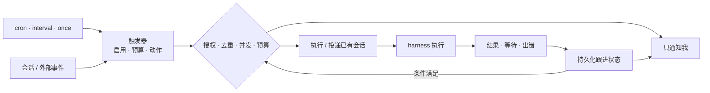
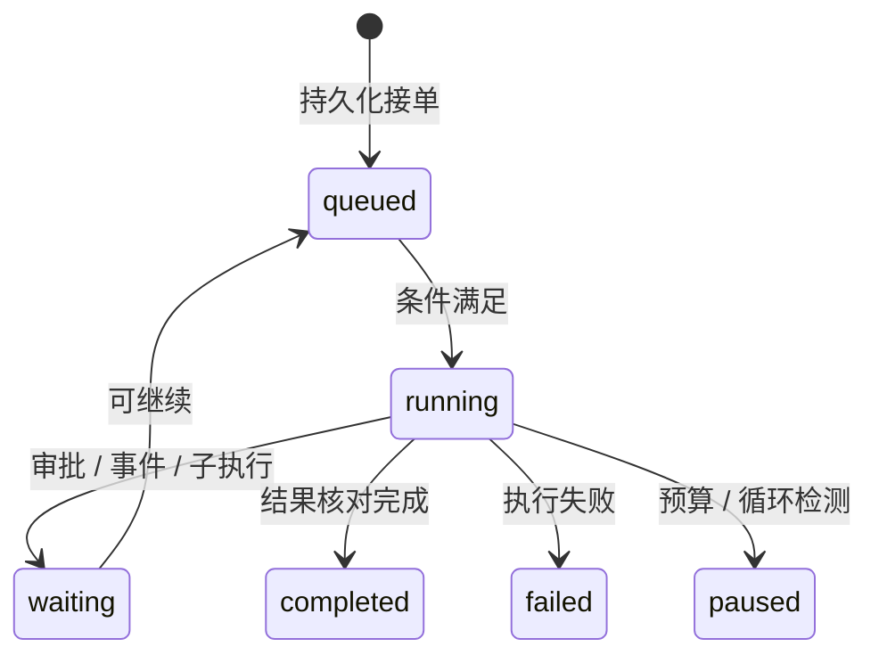

# 0017 自主运行

状态：当前设计 · 更新：2026-11-04

## 范围与现状

交付阶段：M4c。按已保存的触发规则推进事情；不包含外部通道接入或跨机调度。

| 状态 | 边界 |
|---|---|
| ○ 目标 | 触发器、预算、持久等待与自主运行尚未实现 |
| ✓ 已有基础 | 会话队列、事件与本机恢复，不等于后台任务系统 |

## 运行闭环

## 触发规则

| 项 | 规则 |
|---|---|
| 来源 | 我、定时、会话等待 / 出错 / 卡住、PR / CI 变化、外部事件 |
| 动作 | 发起自主执行、发给已有会话、只通知我 |
| 创建 / 修改 | 默认问我，不能由记忆或模型推测新增授权 |
| 并发 | 同一触发器同时只跑一个 |
| 错过 | 默认跳过并通知；可设恢复后补跑一次 |
| 成长维护 | daemon 的内部提炼工作，不为每次提炼新建用户触发器，也不获得创建定时任务的权限 |

## 等待与结果

图示表达运行语义，不冻结协议状态枚举。主会话、事情与执行上下文的具体绑定尚未定稿。

| 情况 | 行为 |
|---|---|
| 等外部条件 | 保存等待条件，释放模型执行资源；条件满足再推进 |
| 父会话空闲 | 投递结构化结果 |
| 父会话运行中 | 结果排队，空闲后投递 |
| 尚未跟进 | 保留待处理项；通知失败不删除结果 |
| 执行结束 | 分别记录执行结束、事情完成、结果已汇报，不只认一条最终回复 |
| 无人审批 | 保持等待，不超时自动批准 |

## 护栏与恢复

| 护栏 | 行为 |
|---|---|
| 预算 | 每触发器、每次自主运行的轮次 / token 上限，以及每日总预算；超出暂停并通知 |
| 循环 | 重复调用或无进展时暂停；进展判断与阈值待验证 |
| 原生委派 | 优先复用，活动、用量、审批、停止与结果回流按版本验证 |
| 崩溃 | 恢复已持久化的调度、等待与结果；不据此承诺原生子执行可恢复 |
| 未知副作用 | 无法证明是否执行时保留未知状态，不自动重放 |
| 代批 | Personal 代答 harness 审批不在 v1 范围内 |

## 验收

| 范围 | 条件 |
|---|---|
| 触发 | 同一触发器不并发重复执行，错过规则可解释 |
| 暂停 | 预算或循环命中时停止推进并通知 |
| 恢复 | 等待和结果可恢复，未知副作用不自动重放 |

## 待验证

| 项 | 需确认 |
|---|---|
| 触发 | 时区、重复事件去重、错过时段与补跑语义 |
| 并发 | 触发器与共享资源的互斥，修改规则对在途运行的影响 |
| 预算 | 子执行用量汇总、延迟上报、运行中停止能力与日切规则 |
| 恢复 | 等待 / 通知的重试和去重，原生子执行重启后的核对 |
| 跟进 | 主会话修订、取消、结果版本与通知合并策略 |
