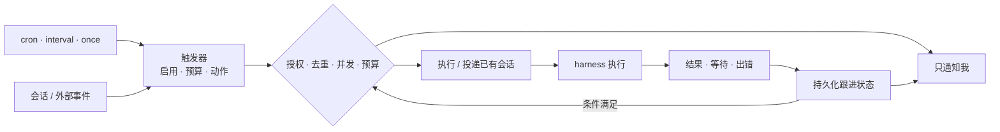
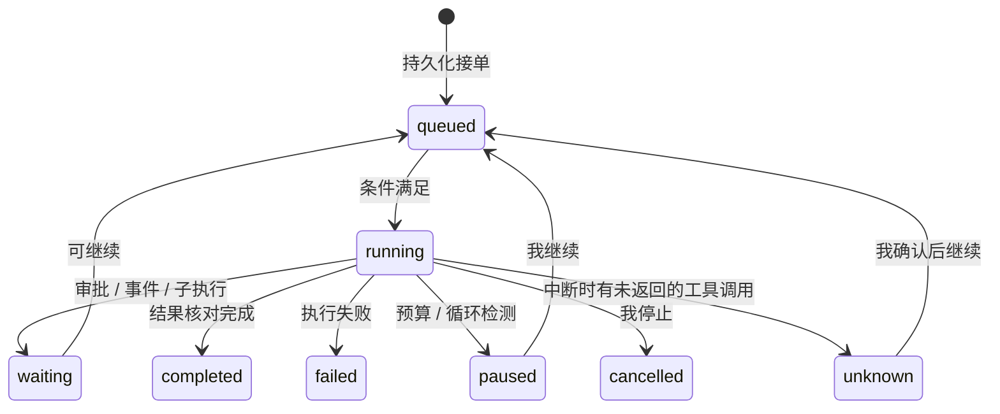

# 0017 自主运行

状态：当前设计 · 更新：2026-11-07

## 范围与现状

按已保存的触发规则推进事情；不包含外部通道接入或跨机调度。

| 状态 | 边界 |
|---|---|
| ○ 目标 | 触发器、预算、持久等待与自主运行尚未实现 |
| ✓ 已有基础 | 会话队列、事件与本机恢复，不等于后台任务系统 |

## 运行闭环

## 触发规则

| 项 | 规则 |
|---|---|
| 来源 | 我、定时、会话等待 / 出错 / 卡住、PR / CI 变化、外部事件 |
| 动作 | 发起自主执行、发给已有会话、只通知我 |
| 创建 / 修改 | 默认问我，不能由记忆或模型推测新增授权 |
| 成长维护 | daemon 的内部提炼工作，不为每次提炼新建用户触发器，也不获得创建定时任务的权限 |

## 定时

| 项 | 规则 |
|---|---|
| 种类 | `cron`：标准 5 段，不含秒；`interval`：最短 1 分钟，从上次计划时间起算，不从上次结束起算；`once`：一个绝对时间。最小粒度 1 分钟 |
| cron 解析 | 依赖 `github.com/robfig/cron/v3`，只用其标准解析与 `Next()` 计算下次时间，不用其调度器；接受标准 5 段与 `@daily` 等简写，`@every` 报“不支持”（由 `interval` 承担） |
| 时区 | 每个触发器存 IANA 时区，默认取创建时主机时区；下次触发时间按 UTC 持久化 |
| 夏令时 | 拨快跳过的那一小时里的计划，当天不触发，也不算错过；拨慢重复的时刻只触发一次，由去重键保证。两种情况都有测试 |
| 迟到 | 晚于计划时间不超过 5 分钟按正常触发；超过即为错过 |
| 错过 | 默认跳过，并合并成一条通知（“错过 N 次”）；可设“恢复后补跑”，无论错过几次只补跑一次 |
| 去重 | 每次触发有唯一键：定时为“触发器 id + 触发器时区下的钟面计划时间”，事件为来源事件 id（如 webhook delivery id）；触发记录对唯一键加约束，同一键不触发第二次 |

## 并发

| 项 | 规则 |
|---|---|
| 同一触发器 | 同时只跑一次；上一次未结束时到点，按“错过”处理，因此最多积压一次补跑 |
| 共享资源 | 投递同一已有会话的，由会话队列串行；新建会话的运行 v1 不加目录锁，默认用 Personal 工作区；同目录并行写入以后再定 |
| 修改规则 | 运行开始时快照规则，修改只影响下一次触发；停用或删除触发器不停止在途运行，停止运行是单独操作 |

## 等待与结果

运行状态枚举固定为 `queued` / `running` / `waiting` / `paused` / `completed` / `failed` / `cancelled` / `unknown`。

| 情况 | 行为 |
|---|---|
| 等外部条件 | 保存等待条件，释放模型执行资源；条件满足再推进 |
| 投递目标 | 只通知 / 指定的已有会话 / 伙伴主会话；投递持久化记录，与通知分开：目标空闲即投，运行中排队 |
| 尚未跟进 | 保留待处理项；通知失败不删除结果 |
| 执行结束 | 分别记录执行结束、事情完成、结果已汇报，不只认一条最终回复 |
| 结果 | 每次运行一个结果；重跑是新的运行与新结果，不做结果版本 |
| 中途修订 | 给该运行的会话发消息，走正常队列 |
| 取消 | 中断当前轮次，记为 `cancelled` |
| 无人审批 | 保持等待，不超时自动批准 |

本文不定义“事情”实体及其与执行的绑定。

## 预算

| 项 | 规则 |
|---|---|
| 计量 | 轮数与 token（harness 上报 `Usage` 的 input + output）；不报用量的 harness 只限轮数，界面标“用量未知” |
| 范围 | 每触发器、每次运行的上限，以及每日总预算 |
| 汇总 | 一次运行 = 自身会话 + 经 Hoplet 建出的子会话；原生子执行只计 harness 报给父会话的部分，可能少算 |
| 检查 | 每个用量事件到达时检查；超出时支持中断的 harness 立即中断，否则本轮结束后停，因此最多超出一轮 |
| 超出 | 运行转为 `paused` 并通知；我加预算或选“再跑一次”后继续 |
| 每日 | 只计 origin 为 schedule / event 的运行；按我设置的时区零点切日；超出后暂停全部自主运行，新触发按“跳过 + 通知”处理，到次日恢复 |

## 护栏与恢复

| 护栏 | 行为 |
|---|---|
| 循环 | 同一运行内，相同工具调用（工具名 + 参数哈希）连续 5 次即暂停；“无进展”不做语义判断，由轮数预算兜底 |
| 原生委派 | 优先复用，活动、用量、审批、停止与结果回流按版本验证 |
| 崩溃 | 恢复已持久化的调度、等待与结果；shim 存活则继续运行 |
| 中途丢失 | harness 进程在轮次中途退出，本轮记为中断；当时有未返回的工具调用则运行转为 `unknown`，暂停并通知，不自动重放 |
| 原生子执行 | 不单独跟踪，不承诺重启后恢复 |
| 通知 | 写入持久发件箱，id 为“运行 id + 类型 + 序号”；退避重试至少一个通道送达，最长 24 小时；客户端按 id 去重 |
| 通知合并 | 同一触发器的未读通知合并为一条并带计数，收件箱仍逐条列出 |
| 代批 | Personal 代答 harness 审批不在 v1 范围内 |

## 验收

| 范围 | 条件 |
|---|---|
| 触发 | 同一键不重复触发；同一触发器不并发；时区、夏令时、迟到与错过有测试 |
| 暂停 | 预算或循环命中时最多多跑一轮即停止推进并通知 |
| 恢复 | 等待和结果可恢复，未知副作用转为 `unknown` 不自动重放 |
| 通知 | 失败重试不丢结果，重复送达被客户端去重 |
