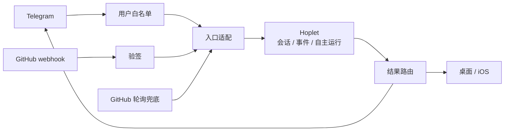
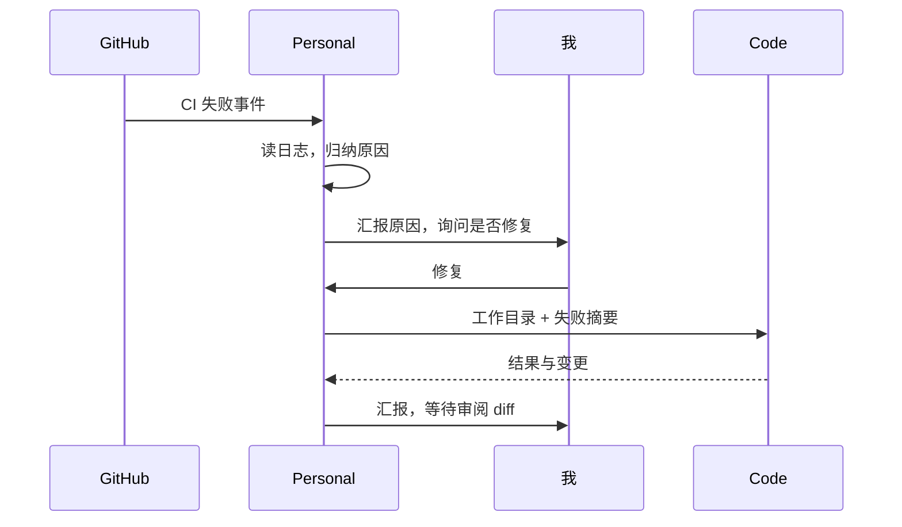
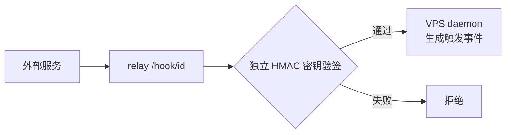

# 0018 通道与集成

状态：当前设计 · 更新：2026-11-04

## 范围与现状

把消息与外部事件接入 Hoplet，并将结果送回正确通道。

| 状态 | 边界 |
|---|---|
| ○ 目标 | Telegram、GitHub 集成、hook 验签和外部路由尚未实现 |

## 入口与出口

通道记录来源、目标与线程，不决定业务权限。接入外部账号不自动增加会话授权。

## Telegram

| 项 | 规则 |
|---|---|
| 运行 | 默认主宿主上的 bot 长轮询，无需为 Telegram 开公网入口 |
| 配对 | app 生成一次性配对码；用户 ID 加入白名单，其他消息忽略 |
| 线程 | 每个（通道，聊天）一条线程；空闲 N 小时或 `/new` 切执行上下文，携带摘要与相关记忆，伙伴身份不变 |
| 发给我 | 直接发送结果或通知 |
| 发给别人 | 必须我本人确认 |

## GitHub 琐事

| 项 | 规则 |
|---|---|
| 工具 | 复用 GitHub MCP / 已登录的 `gh`，按模式启用；使用仓库对应身份，Hoplet 不保管登录 token |
| 事件 | webhook 为主，轮询兜底；重复投递的去重语义待验证 |
| 修复 | 经我同意转交 Code，不将分析 CI 的权限扩大为修改或合并权限 |
| 其他服务 | 邮件、日历、浏览器等按需接现成 MCP，不自造通用工具平台 |

## Webhook

与中继共用公网端口；不让 hook 接口直接调用模型或跳过业务授权。每个 hook 使用独立密钥。

## 验收

| 范围 | 条件 |
|---|---|
| 配对 | 白名单外消息忽略，结果回到正确线程 |
| 事件 | 验签失败拒绝，重复事件可对账 |
| 授权 | 发给别人需本人确认，分析 CI 不扩大为修复权限 |

## 待验证

| 项 | 需确认 |
|---|---|
| 线程 | 与伙伴主会话的绑定，空闲切换和 `/new` 对后台工作的影响 |
| 路由 | 来源与回报目标的持久化、重试、去重和撤销配对 |
| Webhook | 签名输入、事件标识、重复与延迟投递语义 |
| GitHub | 多账号路由、日志权限、轮询间隔与 webhook 对账 |
