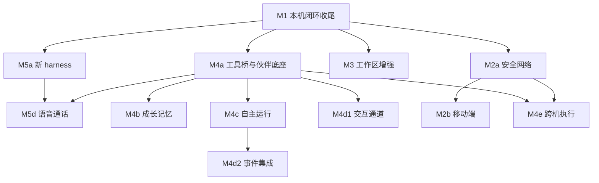

# 0019 交付路线

状态：当前设计 · 更新：2026-11-08

## 范围与现状

编号表示能力轨道，不代表全局串行。✓ 表示代码已有，◐ 表示部分实现，○ 表示未实现目标；均不代替验收结果。

| 状态 | 边界 |
|---|---|
| ◐ 代码现状 | M1 本机闭环、M2a 安全网络与 M4a 工具桥与伙伴底座代码已合入；M2a 两台主机实测待做 |
| ○ 目标 | 后续轨道按实际依赖推进，不按编号全局串行 |

## 当前基线

| 状态 | 能力 | 代码依据 |
|---|---|---|
| ✓ | 本机会话、stdio shim、事件 / 队列 / 审批、基线与累计 diff | `internal/daemon`、`internal/session`、`internal/shim`、`internal/store`、`internal/workspace` |
| ✓ | Claude Code / Hermes 适配、模型与运行设置、托管与自检 | `internal/harness` |
| ✓ | 桌面侧栏、会话、新建、输入、审批、详情、上下文圈、收件箱、命令面板与右栏（累计改动、文件树、只读查看、⌘P）；主题由设计系统 token 生成 | `desktop/internal/shell`、`desktop/internal/theme` |
| ✓ | 身份密钥与 Noise 通道、配对与直连、中继（autocert、白名单）、Linux 服务与 doctor 检查 | `internal/noise`、`internal/pair`、`internal/relay`、`internal/systemd` |
| ✓ | 会话工具桥：会话 token、`hoplet mcp`、两家适配注入，工具 `sessions_list`、`session_get`、`session_create`、`session_send`、`handoff`、`report` | `internal/tools`、`cmd/hoplet/mcp.go` |
| ✓ | 伙伴实体、伙伴目录与人格（`persona.md`，Claude Code 经 `--append-system-prompt`，Hermes 经生成的 `HERMES.md`）、`companions.*` 与 `hoplet companion` | `internal/store/companions.go`、`internal/session/companion.go`、`cmd/hoplet/companion.go` |
| ✓ | 委派子会话与回报（走父会话的消息队列，按键只入队一次）、转交 Code 与自动回报 | `internal/tools/delegate.go`、`internal/store/queue.go`、`internal/daemon/handoff.go` |
| ✓ | 产物服务：版本存放与启动清理、工具 `artifact_publish`、`artifacts.*` 与 `hoplet artifact`，配对设备可列出与读取 | `internal/artifact`、`internal/store/artifacts.go`、`internal/tools/artifact.go`、`cmd/hoplet/artifact.go` |
| ✓ | iOS 模拟器 `simctl` 层：设备占用、工具结果带图片，Code 会话工具 `simulator_list`、`simulator_boot`、`simulator_launch`、`simulator_screenshot`、`simulator_open_url` | `internal/simulator`、`internal/tools/simulator.go` |
| ✓ | 桌面的产物列表与查看（HTML 按不可信页面加载）、伙伴对话的事件行与回报卡、子会话、伙伴详情与编辑人格 | `desktop/internal/shell`、`desktop/internal/artifactpage` |
| ✓ | Swift 协议类型生成与 golden 回放 | `tools/swiftgen`、`apple/HopletKit` |
| ○ | iOS 客户端、记忆、自主、集成与跨机 | 当前没有对应服务；枚举和接口预留不等于实现 |

M1 代码已合入，`make check` 通过；两种模式的整体验收由维护者确认。M2a 代码已合入，Mac 与 VPS 两台主机的实测尚未进行。M4a 代码已合入，Claude Code 伙伴的委派、转交与发布已在桌面实测；Hermes 子会话跑通、配对机器上查看产物尚未验证。

## 实际依赖

推荐主线：**M1 → M4a → M4b**。安全网络、工作区和新 harness 可独立推进；记忆不等 iOS，工作区不等中继，Telegram 交互不等完整自主运行。自主运行可不依赖成长记忆，接入记忆时仍按范围使用。

## 阶段与验收出口

| 阶段 | 必要前置 | 交付边界 | 验收出口 |
|---|---|---|---|
| M1 本机闭环收尾 | 当前基线 | 右栏（累计改动、文件树与只读查看、⌘P）与只读文件接口、回归检查 | 两种模式完整本机操作；`make check` 通过 |
| M4a 工具桥与伙伴底座 | M1 | 会话 MCP 身份 / 工具范围、伙伴实体与人格、委派子会话与持久回报、转交 Code、产物服务与桌面查看 | 工作 harness 经工具桥调用同一服务；委派结果回到伙伴并可持续跟进 |
| M4b 成长记忆 | M4a | 权威档案、直接编辑、提炼、纠错、检索、跨 harness 注入、技能复用 | 换 harness 保留约定；旧材料不覆盖用户纠正 |
| M4c 自主运行 | M4a | 定时 / 事件、等待、预算、循环检测、恢复与通知 | 无客户端在线也可按授权推进；未知执行不自动重放 |
| M4d1 交互通道 | M4a | Telegram 配对、线程和结果路由 | 持续交流与回报正确，不要求先完成定时运行 |
| M4d2 事件集成 | M4c | GitHub 事件、webhook、轮询和对账 | 外部事件驱动授权工作；通知目标可选已有通道 |
| M2a 安全网络 | M1 | Linux 服务安装、配对（文本配对码）、Noise、直连地址与中继两条路由、CLI 连远程主机 | 两台自有主机可认证连接并追赶事件 |
| M2b 移动端 | M2a | Swift 类型 / 向量、配对二维码、局域网 Bonjour、iOS 缓存、推送、Live Activity、产物查看 | 手机跟进、断线恢复与审批 |
| M3 工作区增强 | M1 | 先只读文件 / 隔离 / PR，再按依赖交付检查点、端口、终端 | 原地数据安全、可审阅、可回滚；各子能力单独验收 |
| M3s iOS 模拟器 | M4a | 已交付 `simctl` 工具（列表、启动、安装、截图、深链）与设备占用；依次交付 Swift 辅助进程与输入工具 → 桌面实时面板 | agent 能装 App、点击并截图验证；人能在桌面观看和接手；私有接口失效时公开能力不受影响 |
| M4e 跨机执行 | M4a + M2a | `run_on`、目标授权、离线排队、状态与产物回流 | 离线明确等待，上线先核对再继续 |
| M5a 新 harness | M1 | Codex / ACP 等原生能力接入 | 每家独立过协议契约，不等待 Personal 全部完成 |
| M5d 语音通话 | M4a + M5a | Codex 语音接入、语音控制器、桌面通话；iOS 随 M2b | 口头查进度、发话、转交；失败在开始前说清，不回退 |
| M5b 可写扇出 | M4a + M3 隔离 | 会话组、隔离执行、选中合回 | 同目录并行不互相覆盖 |
| M5c 手机预览 | M2b + M3 端口 | 授权端口代理与手机预览 | 不扩大主机 / 端口授权 |

## 验收

| 门禁 | 规则 |
|---|---|
| 实现 | 以已存在的入口、类型、存储与行为为准，不以枚举 / 注释作为完成证据 |
| 检查 | 实际执行 `make check`；未通过不宣称阶段完成 |
| 协议 | MCP、注入、原生控制与子执行恢复分别验证 |
| 界面 | 仅实现已审核状态，能力未落地的入口隐藏 |
| 发布 | 不将工具桥、本机安装或基础自检推广为全部安全 / 恢复保证 |

## 待验证

原生记忆隔离、跨机持久回执、iOS 系统约束仍需在相应阶段冻结。群聊、Personal 代批和语音不隐含进入这些里程碑。
