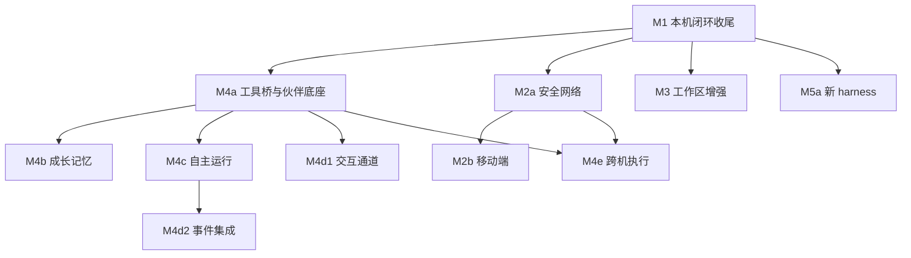

# 0019 交付路线

状态：当前设计 · 更新：2026-11-05

## 范围与现状

编号表示能力轨道，不代表全局串行。✓ 表示代码已有，◐ 表示部分实现，○ 表示未实现目标；均不代替验收结果。

| 状态 | 边界 |
|---|---|
| ◐ 代码现状 | 本机内核已有，M1 桌面与检查门禁尚未完整验收 |
| ○ 目标 | 后续轨道按实际依赖推进，不按编号全局串行 |

## 当前基线

| 状态 | 能力 | 代码依据 |
|---|---|---|
| ✓ | 本机会话、stdio shim、事件 / 队列 / 审批、基线与累计 diff | `internal/daemon`、`internal/session`、`internal/shim`、`internal/store`、`internal/workspace` |
| ✓ | Claude Code / Hermes 适配、模型与运行设置、托管与自检 | `internal/harness` |
| ◐ | 桌面侧栏、会话、新建、输入、审批、详情、上下文圈、收件箱与命令面板；主题由设计系统 token 生成 | `desktop/internal/shell`、`desktop/internal/theme`；文件 / diff 右栏尚缺 |
| ○ | 配对、中继、iOS、MCP、伙伴实体、记忆、自主、集成与跨机 | 当前没有对应完整服务；枚举和接口预留不等于实现 |

M1 尚未完成整体验收。先补桌面与只读文件接口缺口，并使 `make check` 通过；代码已有不表示检查已通过。

## 实际依赖

推荐主线：**M1 → M4a → M4b**。安全网络、工作区和新 harness 可独立推进；记忆不等 iOS，工作区不等中继，Telegram 交互不等完整自主运行。自主运行可不依赖成长记忆，接入记忆时仍按范围使用。

## 阶段与验收出口

| 阶段 | 必要前置 | 交付边界 | 验收出口 |
|---|---|---|---|
| M1 本机闭环收尾 | 当前基线 | 文件读取 / diff 右栏、回归检查 | 两种模式完整本机操作；`make check` 通过 |
| M4a 工具桥与伙伴底座 | M1 | 会话 MCP 身份 / 工具范围、伙伴身份、人格入口、产物、转交与回报关联 | 工作 harness 经工具桥调用同一服务；伙伴和结果可持续跟进 |
| M4b 成长记忆 | M4a | 权威档案、直接编辑、提炼、纠错、检索、跨 harness 注入、技能复用 | 换 harness 保留约定；旧材料不覆盖用户纠正 |
| M4c 自主运行 | M4a | 定时 / 事件、等待、预算、循环检测、恢复与通知 | 无客户端在线也可按授权推进；未知执行不自动重放 |
| M4d1 交互通道 | M4a | Telegram 配对、线程和结果路由 | 持续交流与回报正确，不要求先完成定时运行 |
| M4d2 事件集成 | M4c | GitHub 事件、webhook、轮询和对账 | 外部事件驱动授权工作；通知目标可选已有通道 |
| M2a 安全网络 | M1 | Linux 服务安装、配对、Noise、路由、中继 | 两台自有主机可认证连接并追赶事件 |
| M2b 移动端 | M2a | Swift 类型 / 向量、iOS 缓存、推送、Live Activity | 手机跟进、断线恢复与审批 |
| M3 工作区增强 | M1 | 先只读文件 / 隔离 / PR，再按依赖交付检查点、端口、终端 | 原地数据安全、可审阅、可回滚；各子能力单独验收 |
| M4e 跨机执行 | M4a + M2a | `run_on`、目标授权、离线排队、状态与产物回流 | 离线明确等待，上线先核对再继续 |
| M5a 新 harness | M1 | Codex / ACP 等原生能力接入 | 每家独立过协议契约，不等待 Personal 全部完成 |
| M5b 可写扇出 | M4a + M3 隔离 | 会话组、隔离执行、选中合回 | 同目录并行不互相覆盖 |
| M5c 手机预览 | M2b + M3 端口 | 授权端口代理与手机预览 | 不扩大主机 / 端口授权 |

## 验收

| 门禁 | 规则 |
|---|---|
| 实现 | 以已存在的入口、类型、存储与行为为准，不以枚举 / 注释作为完成证据 |
| 检查 | 实际执行 `make check`；未通过不宣称阶段完成 |
| 协议 | MCP、注入、原生控制与子执行恢复分别验证 |
| 界面 | 仅实现已审核状态，能力未落地的入口隐藏 |
| 发布 | 不将工具桥、本机安装或基础自检推广为全部安全 / 恢复保证 |

## 待验证

工具桥注入与角色映射、伙伴 / 事情实体、原生记忆隔离、跨机持久回执、iOS 系统约束仍需在相应阶段冻结。群聊、Personal 代批和语音不隐含进入这些里程碑。
