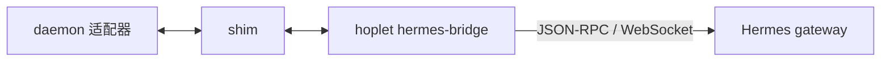

# 0020 Hermes 适配

状态：当前设计 · 更新：2026-11-07

## 范围与现状

范围：已录制版本 0.22.5 的 gateway、设置、轮次、审批和恢复契约。

| 状态 | 边界 |
|---|---|
| ✓ 代码已有 | 0.22.5 录制契约对应的 bridge、设置、审批、轮次与续接；Hoplet MCP 注入 |
| ○ 目标 | 人格、隔离提炼与原生子执行观测 |

## 接入

| 项 | 规则 |
|---|---|
| 协议 | `hermes-gateway-v1`；gateway 帧逐行写 stdout，请求逐行读 stdin |
| 环境 | 共用默认 `~/.hermes` 的登录、人格、记忆和技能；不改全局设置、不碰凭证 |
| 上下文 | gateway 持有会话；daemon 重启时 bridge / shim 继续运行 |
| 版本 | 仓库录制或本机自检通过才允许新轮次 |
| 接入选择 | 使用原生 gateway；ACP 续接需要全量回放且没有 steer，不用于此接入 |

## 会话

### 创建

- `session.create` 用 Hoplet 会话 ID 作 `request_id`（重复创建拿回同一会话），来源 `acp`，不带标题（带标题会接上同名旧会话）
- 会话在 Hermes 桌面端也可见

### 消息顺序

- 用户消息保持用户给出的顺序（含断线重发与排在设置之后的情形）

## 模式与设置

### 档位

- 需确认 = 编辑逐个确认（编辑策略 `ask`）
- 自动编辑 = 工作目录内的编辑放行（`workspace_session`）
- 全自动 = 本会话 yolo + 编辑全部放行（yolo 管不住编辑审批）。命令是否询问始终由 Hermes 自己的危险识别与全局审批模式（manual / smart / off）决定，Hoplet 不改
- 智能审批与 Plan 不声明（前者是 Hermes 的全局设置，后者只是提示词），选了按最近的更严档位回退

### 设置

- 编辑策略、思考强度（low…ultra）、模型用 `session.mutate`：一次只发一个，轮次中等轮次结束再发
- 设置未生效前发的消息排在设置之后。yolo、Fast（`service_tier`）用 `config.set`，即时生效

### 不支持

- 提问（`acp` 来源的会话没有 clarify 工具）、Plan

## 轮次与用量

- 按 admission 跟踪，组成一个有序队列，每次快照对账：Hermes 排队的下一轮、断线期间开始或结束的轮次，都保证每轮恰好一次 TurnStarted / TurnEnded、按 admission 顺序
- 排在后面的轮次的事件先缓冲，轮到它时再放出。`message.start` 开始
- `message.complete` 后取 `prompt.receipt`：带本轮用量（gateway 的计数是会话累计）与结束原因，再结束轮次。非终态的 receipt 最多再问 3 次（间隔 1 秒）
- `unknown` 或被拒时，见过 `message.complete` 就按它结束（无用量），否则记 aborted。下一轮先开始时，上一轮按 `message.complete` 结束，用量随迟到的 receipt 补报

## 审批

- 快照里已不存在、且 Hoplet 未回答的审批记为 expired（decided_by `hermes`）
- 不认识的审批被结清也记 expired
- 快照里有、本次运行不认识的待审批重新发出 ApprovalRequested
- 回答被 Hermes 拒绝时报错

## 断线与桥接

### 桥接进程

- 重连时在写 `connected` 行之前丢弃此前收到的行，写失败的行直接丢弃，不跨连接携带。连续 3 个心跳间隔收不到任何帧就断开重连（relay 正阻塞在写 stdout 时不算失联）
- 连接持续不足 30 秒就断开时不重置退避。不跟随 HTTP 重定向
- `hermes gateway ensure` 非零退出视为失败

### 断线

- 守护进程重启：桥接进程与 shim 照常运行，事件留在 spool
- 重新接上后总会发一次 `session.resume`（不带历史）
- store 里未结束的轮次以占位记录接手，在本次运行自己的快照到达时统一结清（旧守护进程请求的 receipt 先扣住；最终回复要么已发，要么随回放的 `message.complete` 到来，不补发）。gateway 重启或桥接进程重启：用 `session.resume` 重新接上，清掉在途设置并重新排队
- 在途的消息（按 `submission_id` 幂等）、审批回答、`config.set` 在重新拿到快照后重发，interrupt、steer、receipt 不重发，对旧连接请求的应答一律忽略
- 本轮已结束就用 receipt 补齐最终回复。Hermes 拒绝创建或续接会话时报错，丢弃等待中的请求（报出条数），此后的命令直接返回该错误，直到新连接重新接上。来自旧守护进程请求的错误应答直接丢弃。始终不加载全量历史（gateway 的事件补发缓冲只有 512 帧，流式输出几秒就溢出）

## 停止与插话

### 停止

- 桥接进程收到 SIGTERM 时先中断它看到的进行中轮次，写请求用不受停止影响的超时上下文

### 中断 / 插话

- 中断遇 stale_generation 不重试（那一轮已结束）
- steer 遇 stale_generation 报错

## 模型

- 当前模型取自每轮的 `session.usage`（`model`、`provider`），变化时报告 `model.changed`
- 模型列表在会话之外单独连一次 gateway 调 `model.options`，取已登录服务商的模型（当前服务商在前），缓存 10 分钟
- 换模型用 `session.mutate` 的 `model`，带服务商代号。`session.usage` 报的服务商名（如 `custom`）与 `model.options` 里的服务商代号可能不同，所以判断“当前是哪个模型”只比模型名

## 预留边界

没有实现隔离提炼入口。继承原生记忆不表示与 Hoplet 成长记忆自动同步。

## MCP 与人格

0.22.5 实测，已采用；MCP 已实现，人格尚未实现。

| 项 | 规则 |
|---|---|
| 注入 | `session.create` 的 `editor.mcp_servers`：stdio 服务为 `{name, command, args, env}`，`env` 是 `[{name, value}]`；服务由 gateway 按会话持有，凭证只在这一项的 `env` 里 |
| 工具名 | gateway 改名为 `mcp__editor_<name>_<hash>__<tool>`，模型可能先用 `tool_describe` 查出再调；调用不经审批 |
| 持久 | 配置连同 token 存在 Hermes 的会话里；不带 `editor` 续接（新连接也一样）按存下的配置重启服务 |
| 续接 | 一律不带 `editor`；带不同配置续接会被拒绝（`acp_mcp_policy_conflict`） |
| 换配置 | 会话空闲时发 `session.mutate` 的 `editor_mcp`（带 revision / generation），下次续接起生效；运行中不能换 |
| token | 随会话不变：新会话在 `session.create` 里带上；之前建的会话第一次挂载时经 `editor_mcp` 挂上（daemon 发现会话没有 token 时签发），消息等它发完再提交 |
| 人格入口 | 工作目录的 `HERMES.md`（向上找到 git 根为止取最近的一份） |
| 人格时机 | 系统提示在会话首轮构建并冻结在会话上，换模型等少数情况才重建；改 `HERMES.md` 对已有会话不保证生效 |
| 不可用 | gateway 的 `session.create` 不接受 `messages`（报 `invalid_params`）；MCP 服务 `initialize` 返回的 `instructions` 不进提示词；`personality` 作用于整个配置档，不用 |

## 任务清单

- 来源是 `todo_list` 工具 `tool.start` 的参数：`merge` 为假时整表替换，为真时按 `id` 合并；结果正文拿不到，所以不靠结果
- 适配器维护任务表，每次调用后发 `todo.list`；`content` → `Text`，没有进行中的说法，`Active` 为空；`parent` 子任务拍平
- 0.22.5 录制确认 `tool.start` 带完整参数（`{todos:[{id,content,status}], merge}`）

## 子代理

- 来源是 `delegate_task` 工具：每个委派的任务一个 `subagent`（`goal` 或 `tasks[].goal`；只有一个任务时 `ID` 是调用 ID，多个时为 `调用ID/序号`），`goal` 首行 → `Title`，没有类型，`Type` 为空；这次调用不发 `ToolCall`；完整的 `goal` 作为记录开头的任务（带 `Agent` 的用户消息）
- 0.22.5 的委派在后台进行：`tool.complete` 立即返回，结果文本是 JSON `{"status":"dispatched","mode":"background","subagent_ids":[…],…}`。这时子代理仍为 `running`、记 `Background`，按 `subagent_ids` 的顺序对应各任务；结果不是 `dispatched` 时随调用结束，记 `done`，`is_error` 时记 `failed`
- gateway 转发子代理事件 `subagent.*`，带 Hermes 自己的 `subagent_id` 和 `task_index`。调用还在进行时先到的 `subagent.spawn_requested` / `subagent.start` 按 `task_index` 对上这次调用的任务
- `subagent.tool` → 子代理记录里的工具调用（事件带 `Agent`，`tool_name` → `Name`，`text` 首行 → `Summary`）；Hermes 不报单个工具何时结束，下一个工具开始或子代理结束时记 `done`。`subagent.thinking` / `subagent.progress` 不用
- `subagent.complete` 结束子代理：`status` 为 `completed` → `done`，`failed` / `error` → `failed`，其余 → `stopped`；`summary` → `Summary`，`input_tokens + output_tokens` → `Tokens`，`tool_count` → `ToolUses`，`duration_seconds` → `DurationMS`
- 子代理多在轮次结束之后才完成，这些事件不属于任何轮次也照常处理。全部完成后 Hermes 自己开一轮（`message.start` 的 `display_kind` 为 `async_delegation_complete`，有新的 `admission_id`），按普通轮次显示

## 工具输出

当前接入不提供工具结果正文；不能从缺失输出推导执行证据。

## 验收

| 范围 | 条件 |
|---|---|
| 契约 | 按录制版本核对轮次、审批、设置和模型 |
| 重连 | 在途请求按原生语义恢复，旧连接回答不污染新状态 |

## 待验证

更多版本协议、隔离提炼与原生子执行的可见性 / 用量 / 恢复未验证。MCP 注入只在 0.22.5 实测过。
